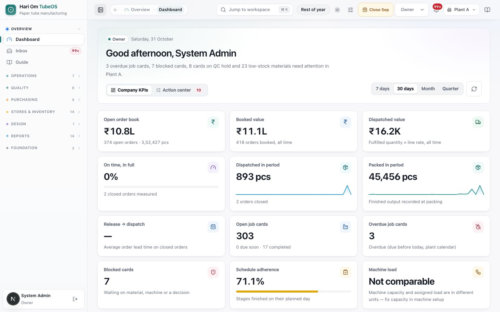
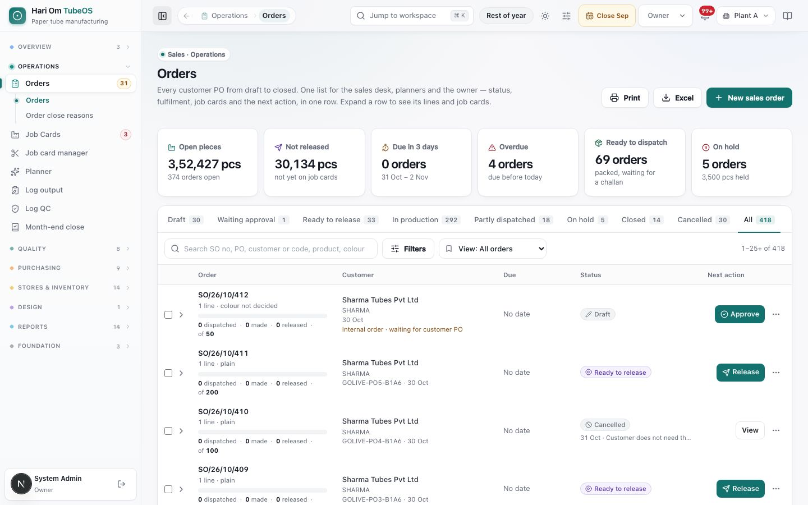
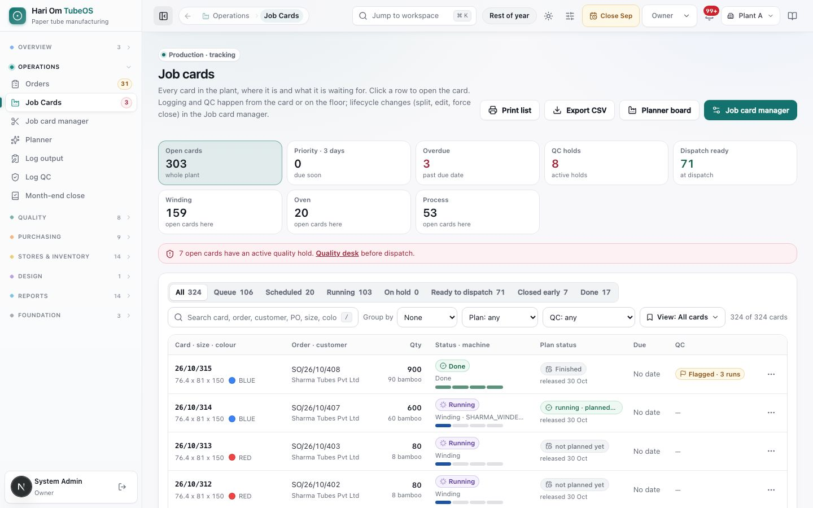
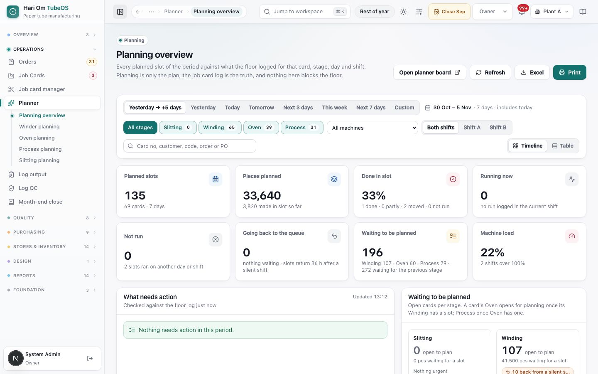

# Welcome to Hari Om TubeOS: the big picture

> **What it is:** TubeOS is the plant's one system for paper tube orders, production, quality, stores, purchasing and dispatch, from the customer PO to the delivery challan.
> **Who uses it:** Everyone: Sales, Planner, Plant Manager, Operator, QC (inward and in-process), Store, GRN, RM issue, Dispatch, Accounts, Owner and Admin.
> **Where:** Sign in at the TubeOS address. Each role lands on its own start page (see Getting started).

## At a glance
- TubeOS runs two loops that meet on the floor: **SELL → MAKE → SHIP** (customer order to dispatch) and **BUY → STORE → FEED** (raw material planning to issue on the floor).
- The **job card** is the floor's truth. Planning is only the plan: nothing in planning stops the floor from logging a run.
- Quality has two different rules. **Incoming QC** holds a lot whose reading is outside its band, and a held lot cannot be issued. **In-process QC** (winding, oven, process) only **flags** an out-of-band reading; it never holds the card.
- Numbers are made by the system: SO numbers, job card numbers, PO numbers, GRN (inward) numbers and reel labels. You never type them.
- Every page shows plain status words (for example **Ready to release**, **Running**, **Waiting for QC**). The cheat sheet below lists them.

## The flow

```flow
title: SELL → MAKE → SHIP
Customer PO [Sales] -> Sales order [Sales] -> Approve [Sales/Planner/Owner/Admin] -> Release lines [Sales/Planner] (job cards are made) -> Plan [Planner] -> Winder, Oven, Process [Operator] -> QC readings [Operator/QC] -> Dispatch challan [Dispatch]
after Approve: Hold or Cancel [Sales/Owner] -> Short close [Sales/Plant Manager]
after Winder, Oven, Process: Reading out of band [Operator] -> Flagged, card continues
```

The customer's PO becomes a **sales order**. A second person approves it (the Owner and Admin may approve their own). Releasing a line makes one **job card per line and parchment colour** in the winder queue. The planner places the cards on machines and shifts; the floor logs runs and at least two QC readings per check at each stage. When Process closes, packing and the final check close with it, and the pieces wait for a delivery challan.

```flow
title: BUY → STORE → FEED
RM inward calendar [Planner/Store] -> Owner approves arrivals [Owner] (draft PO) -> Purchase order [Store] -> PO approval [Owner/Admin] -> Goods inward / GRN [GRN/Store] (one label per reel) -> Incoming QC [Inward QC] -> Stock (usable) -> Reel and material issue [RM issue] -> Floor
after Incoming QC: Reading out of band -> Lot held -> Re-inspect, concession or return to supplier [QC/Plant Manager]
```

Raw material demand from orders and planned job cards is compared with stock day by day on the **RM inward calendar**. Arrivals the Owner approves become draft POs. Stores receive goods against the approved PO, every reel or coil gets its own label, and the lot waits for incoming QC. Only QC-cleared stock can be issued. Issue is to the floor by shift (never to a machine or a job card) and everything issued is used in full; nothing returns from the floor.

```flow
title: Where the two loops meet
Spec recipe [Owner/Admin] -> Job card [System] (recipe frozen at release) -> Floor runs [Operator] -> Month-end count [Store] -> Month-end close [Owner]
```

The approved specification sets what a tube should use. At month end the system compares the spec, what the store issued and what the count says was used.

## Screen tour


*Figure: The Owner's start page. A greeting and one sentence say what needs attention (for example "3 overdue job cards, 7 blocked cards, 8 cards on QC hold and 23 low-stock materials need attention in Plant A"). Below are money and production tiles such as Open order book ₹10.8L and Open job cards 303.*

What you see:
1. **Header bar**: page path, **Jump to workspace**, season pill (**Rest of year**), theme and appearance buttons, month chip (**Close Sep**), role, bell, plant and guide.
2. **Company KPIs / Action center**: two tabs for the Owner; the Action center lists everything waiting for an Owner decision.
3. **KPI tiles**: each tile is a link to the page behind the number. See Dashboard and inbox.


*Figure: The Orders list. Six tiles at the top (Open pieces 3,52,427 pcs, Not released, Due in 3 days, Overdue, Ready to dispatch, On hold), then status tabs from Draft to All, then one row per sales order with its status and one Next action button (Approve, Release, View).*

What you see:
1. **Tiles**: click one to narrow the list.
2. **Status tabs**: **Draft**, **Waiting approval**, **Ready to release**, **In production**, **Partly dispatched**, **On hold**, **Closed**, **Cancelled**, **All**.
3. **Order rows**: SO number, a fulfilment bar (dispatched · made · released of ordered), customer, due date, status and **Next action**.


*Figure: The Job cards list. Tiles count open cards, priority, overdue, QC holds and dispatch-ready cards, and how many open cards sit at Winding, Oven and Process. Each row shows the card number (26/10/315), size, colour, order, quantity in pcs and bamboo, state, plan status, due date and QC flags.*

What you see:
1. **State tabs**: **All**, **Queue**, **Scheduled**, **Running**, **On hold**, **Ready to dispatch**, **Closed early**, **Done**.
2. **Plan status**: words such as "not planned yet" or "running · planned 30 Oct · Shift A". Information only.
3. **QC column**: **Flagged · 3 runs** means readings outside the band were saved and flagged.


*Figure: Planning overview. The period (Yesterday → +5 days) and stage buttons (Slitting, Winding, Oven, Process) sit on top, then tiles: Planned slots, Pieces planned, Done in slot, Running now, Not run, Going back to the queue, Waiting to be planned and Machine load.*

What you see:
1. **Header text**: "Planning is only the plan; the job card log is the truth, and nothing here blocks the floor."
2. **Going back to the queue**: a slot with nothing logged returns to the queue 36 hours after its shift.
3. **Waiting to be planned**: a card's Oven opens for planning only once its Winding has a slot; Process once Oven has one.

## Status cheat sheet

**Sales order** (Orders list and Order page)

| Status on screen | Meaning |
|---|---|
| Draft | Entered, not yet approved. |
| Waiting approval | Sent for approval by the person who entered it. |
| Ready to release | Approved; lines can be released to job cards. |
| In production | Some or all lines released to job cards. |
| Partly dispatched | Some pieces already sent to the customer. |
| On hold | Customer hold: the undelivered balance is held until **Resume**. |
| Closed / Closed · short | Everything dispatched / the balance was dropped by short close. |
| Cancelled | Cancelled before anything was released or dispatched. |

**Job card** (state badge)

| Status on screen | Meaning |
|---|---|
| In queue | Released, not on the calendar yet. |
| Scheduled | Placed on a machine and shift. |
| Running | The floor is logging runs. |
| Ready to dispatch | Process closed; packed pieces wait for a challan. |
| Completed (tab **Done**) | All stages done. |
| Force-closed (tab **Closed early**) | Closed at the quantity made; the balance went back to the order. |
| Cancelled | Nothing made; the whole quantity went back to the order. |

**Plan status** words: "planned 30 Oct · Shift A", "running · planned …", "plan in 2 parts · next …", "slot … passed", "slot passed with nothing logged, back in the queue", "not planned yet", "waiting for the winding plan", "follows Process", "Finished".

**Purchase order**: **Draft**, **Waiting approval**, **Approved**, **Partly received**, **Received**, **Short-closed**, **Rejected**, **Revision needed**, **Withdrawn**, **Cancelled**.

**GRN line, incoming QC**: **Waiting for QC**, **QC passed**, **QC failed**, **Cleared** (no inspection needed, for example go-live opening stock). Stock words: **On QC hold**, **Usable**. Commercial words on the GRN: "rates match the PO", "invoice to follow", "differs from the PO · goes to Accounts", "manual GRN · goes to Accounts".

**In-process QC**: "Still needs QC" (run without its readings), "needs more readings" (fewer than 2 per check), **Flagged QC · N runs** (reading outside the band, saved and flagged).

**Specification**: **Draft**, **Review**, **Trial**, **Approved**, **Obsolete**; each season's recipe shows **Ready** or **Needs attention**.

## Numbering formats

| Document | Format | Example | Rule |
|---|---|---|---|
| Sales order | SO/YY/MM/NN | SO/26/10/412 | Restarts every month; grows past 99. Older orders kept their old numbers. |
| Job card | YY/MM/NN | 26/10/315 | Restarts every month (India time). A split or top-up card keeps the root and adds a letter: 26/10/315-A. |
| Purchase order | RP-PM/NN or OT/NN | RP-PM/68 | RP-PM for raw and packing material, OT for other items; per plant. |
| GRN (inward) | P/YY/NNN, A/YY/NNN, IN/YY/NNN | P/26/001 | P paper, A adhesive, IN everything else. Restarts on 1 April: P/26/… is financial year 2026-27, so January to March 2027 is still P/26/…; 1 April 2027 starts P/27/001. |
| Reel / coil label | AT number | one per physical reel or coil | Printed at inward; reprints never create stock. |

## How the pages connect

| Sidebar group | Pages | Feeds into |
|---|---|---|
| Overview | Dashboard, Inbox, Guide | Every other page; handoffs arrive in the Inbox. |
| Operations | Orders, Job Cards, Job card manager, Planner, Log output, Log QC, Month-end close | Orders release job cards; Planner places them; Log output and Log QC fill them. |
| Quality | QC desk, Incoming QC, In-process QC, Holds & inspections, Customer complaints, Material standards, Process stage rules, Production season | Incoming QC clears stock for issue; stage rules set floor tolerances. |
| Purchasing | Purchase orders, RM inward calendar, Expected arrivals, Create purchase order, Purchase requisitions, PO approvals, Invoice differences, Debit notes, Purchase reports | Approved POs are received in Goods inward. |
| Stores & inventory | Goods inward, GRN register & labels, Reel & coil issue, Material issue, Issue history, Stock counts & book, Opening stock, Inventory, Genealogy, Manual FG, Stock alerts, RM Costing, Dispatch | Issue feeds the floor; Dispatch ships finished job cards. |
| Design | Specifications | Specs feed sales order lines, job cards and month-end use. |
| Reports | Intelligence and role reports | Read only. |
| Foundation | Masters, System, Audit | Customers, vendors, materials, reasons, users and machines used everywhere. |

## Rules the system enforces
- An order cannot be approved by the person who entered it, unless that person is the Owner or an Admin (BLOCKS; the history records "approved by the same person").
- Every release needs a parchment colour; one job card is one colour (BLOCKS release).
- Planning never blocks the floor. A run logged with no plan is placed on its date and shift and flagged "before planning" (FLAG only).
- Each winding, oven and process run needs at least 2 readings per required check before the stage can close and before the next stage takes it (BLOCKS stage close).
- Out-of-band in-process readings are saved and flagged (FLAG only). Out-of-band incoming readings hold the lot (BLOCKS issue).
- Only QC-cleared stock can be issued; nothing returns from the floor.
- A closed month refuses stock and floor entries dated in it until the Owner re-opens it.

## Sample
Sharma Tubes Pvt Ltd sends PO GOLIVE-PO-118 for 5,000 pcs of 76.4 x 81 x 150 at ₹2.75 per pc: 3,000 BLUE and 2,000 RED.
1. Sales enters **SO/26/10/412**; a planner approves it.
2. Sales releases it: two job cards, **26/10/315** (BLUE, 3,000 pcs) and **26/10/316** (RED, 2,000 pcs), go to the winder queue.
3. The planner places 26/10/315 on a winder, Shift A, 31 Oct. Operators log Winding, Oven and Process runs with two QC readings each.
4. Meanwhile the RM inward calendar shows Kraft 300 GSM running short on 4 Nov. The Owner approves an arrival; PO **RP-PM/68** goes to Bharat Paper Mills, arrives as **P/26/014** with 12 reels, passes incoming QC and is issued to the floor.
5. When 26/10/315 closes Process, Dispatch makes the challan for 3,000 pcs; the order shows **Partly dispatched** until 26/10/316 ships too.

## Common questions
**Q: Why does my sidebar look different from my colleague's?** A: Each role sees only its pages. See the role table in Getting started.

**Q: The plan says "not planned yet" but the operator already logged a run. Is that wrong?** A: No. Planning never blocks. The run is kept and flagged as before planning.

**Q: A reading was outside the band at Oven. Is the card stopped?** A: No. In-process readings are flagged, not held. The card carries on; managers see the flag.

**Q: A reel failed incoming QC. Can the store issue it?** A: No. A held lot cannot be issued until QC re-checks it or the plant head concedes it.

**Q: Why is a GRN in January called P/26/…?** A: GRN numbers follow the financial year (April to March). January to March 2027 belongs to 2026-27.

**Q: Where do I see everything waiting for me?** A: The **Inbox** (sidebar Overview) and the bell in the header.

## Related chapters
- Getting started
- Dashboard and inbox
- Using TubeOS on a phone
- Sales orders
- Specifications
- Job cards
- Planner
- Log output and QC entry
- Quality
- Purchase orders, PO approvals and requisitions
- RM inward calendar and expected arrivals
- Goods inward, GRN register and labels
- Issue to the floor: reels, coils and materials
- Stock counts, stock book, locations and opening stock
- A day in the life
