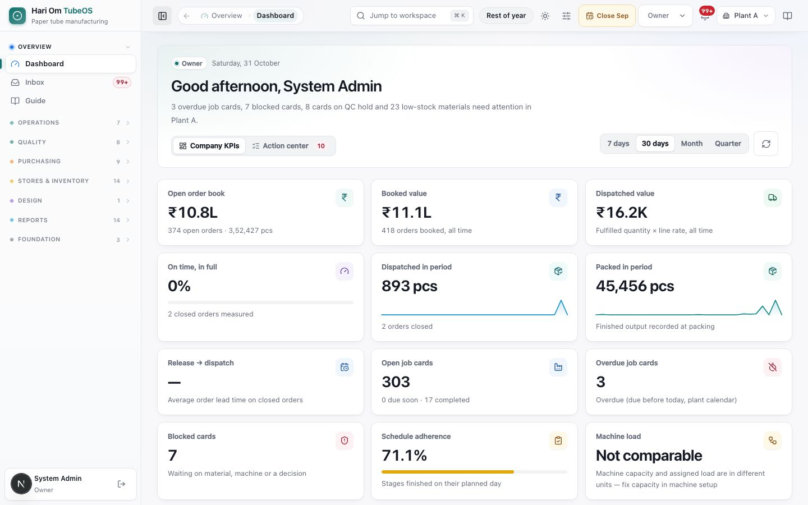
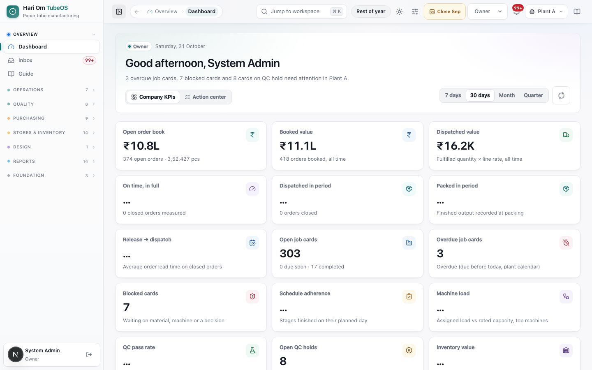
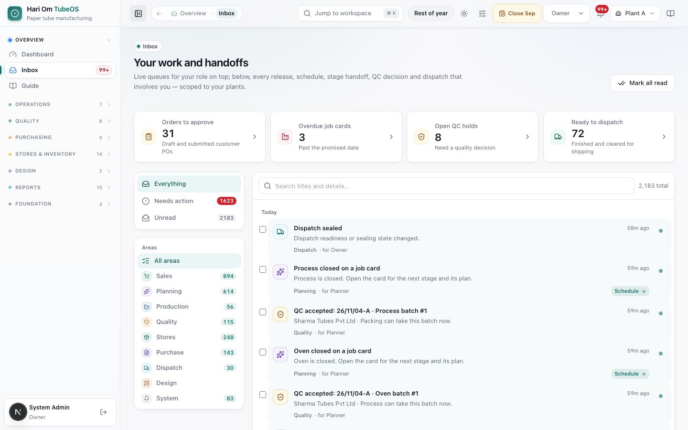
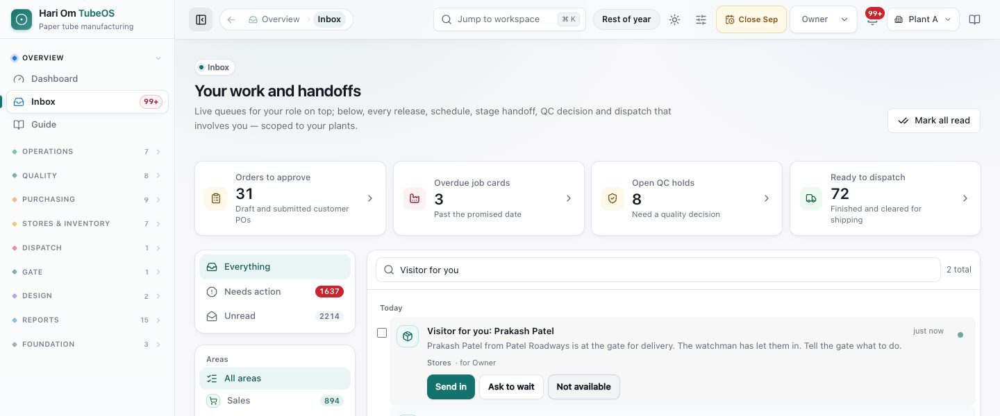

# Dashboard and inbox

> **What it is:** The Dashboard is your start-of-day view (figures, alerts and shortcuts for your role); the Inbox is your live work queue plus every handoff, hold and approval that involves you.
> **Who uses it:** Every role. The Owner, Admin and Quality Control get their own versions.
> **Where:** Sidebar > Overview > Dashboard (/dashboard) and Sidebar > Overview > Inbox (/inbox); the bell in the header

## At a glance
- **Dashboard** looks different per role. Owner: **Company KPIs** and **Action center**. Admin: **System health**. Quality Control: the QC desk itself. Every other role: a "Waiting on you" strip, figures for that role, "Latest for you" and shortcuts.
- Every tile and row is a link to the page behind the number. Fix the work there, then come back: the number moves.
- A figure that could not be loaded shows **Not reported** ("Source unavailable — not shown as zero"). "…" means it is still loading. Never read either as zero.
- The **Inbox** has your role's live counts on top and every notification below, filtered by **Everything / Needs action / Unread** and by area. **Mark all read** clears the unread count.
- **Some notifications carry action buttons** you can press right in the Inbox or the bell: **Make debit note** / **Skip…** / **Open bill** (weight short), **Send in** / **Ask to wait** / **Not available** (a visitor for you), **Make GRN** (material at the gate), **Link challan** (goods out at the gate), **Open bill** (expense bill to file). The result of the button is written on the notification.
- The **bell** is a small inbox you can open from any page.

## The flow

```flow
title: Daily start
Sign in [All] -> Read headline and tiles -> Open the top item -> Do the work on its page -> Back to Dashboard (number moved)
after Read headline and tiles: Open Inbox -> Open a notification (marks it read) -> Act -> Mark all read
```

Start with the one-sentence headline and the "Waiting on you" counts. Open the most urgent item, finish it on its own page, and come back. Use the Inbox for handoffs from other desks (a release, a schedule, a QC decision, a PO to approve).

## Screen tour


*Figure: Owner start page, Plant A, 31 October. Headline: "3 overdue job cards, 7 blocked cards, 8 cards on QC hold and 23 low-stock materials need attention in Plant A." Tabs Company KPIs and Action center (10). Period buttons 7 days, 30 days (selected), Month, Quarter and a refresh button. Tiles: Open order book ₹10.8L, Booked value ₹11.1L, Dispatched value ₹16.2K, On time in full 0%, Dispatched in period 893 pcs, Packed in period 45,456 pcs, Release → dispatch —, Open job cards 303, Overdue job cards 3, Blocked cards 7, Schedule adherence 71.1%, Machine load "Not comparable".*

What you see:
1. **Role badge and date**: for example **Owner** · Saturday, 31 October.
2. **Greeting and headline**: counts overdue job cards, blocked cards, cards on QC hold, late orders and low-stock materials in the plant shown. If nothing is late: "Nothing is late or blocked in Plant A."
3. **Company KPIs / Action center** (Owner only): KPI tiles, or the decision queues.
4. **Period** (7 days, 30 days, Month, Quarter): changes the "in period" figures and charts. Default 30 days.
5. **Refresh**: reloads every figure.
6. **KPI tiles**: see the table under Rules.
7. Further down (Owner): **Operating health** gauges (On time in full, Schedule adherence, QC pass rate, Order book delivered = dispatched ÷ booked value), charts (**Order flow**, **Production output by stage**, **Order book by status**, **Open job cards by stage**, **Where the order book stands**, **Where open work is**, **Machine load**, **Inventory mix**, **Largest open orders by customer**, **Inspection results**), the **Needs attention** list (late orders, blocked cards, QC holds, low stock), **Latest for you** (last five notifications) and shortcuts.


*Figure: The same dashboard a moment earlier. Tiles whose figures are still coming show "…" (for example On time in full, Dispatched in period, Packed in period, QC pass rate, Inventory value), while tiles already loaded show numbers (Open job cards 303, Overdue 3, Blocked 7, Open QC holds 8).*

What you see:
1. **"…"** means loading. Wait or press refresh.
2. **Not reported** (not shown here) means that source failed; the tile never shows a false zero.


*Figure: Inbox, "Your work and handoffs". Top: Mark all read. Four live tiles for the Owner: Orders to approve 31, Overdue job cards 3, Open QC holds 8, Ready to dispatch 71. Left: views Everything, Needs action (1593), Unread (2133) and Areas (Sales 888, Planning 596, Production 56, Quality 101, Stores 248, Purchase 142, Dispatch 24, Design, System 78). Right: search box, "2,133 total", and notifications grouped under Today, such as "Purchase order approved: RP-PM/68" and "1 RM arrival waiting for your approval" with an Approve button.*

What you see:
1. **Work queue tiles**: live counts for your role (not notifications). Click to open the list behind them.
2. **Views**: **Everything**, **Needs action** (critical and action items), **Unread**.
3. **Areas**: Sales, Planning, Production, Quality, Stores, Purchase, Dispatch, Design, System, with unread counts.
4. **Search**: "Search titles and details…" (try a PO number, product code or job card).
5. **Notification row**: icon of its area, title, detail, area and "for <role>", time ("11h ago"), a dot when unread, and an action button such as **Approve**, **Review**, **Inspect**, **Schedule** when your role can do it.
6. **Tick box** on each unread row, for **Mark read** on several at once.

## Step by step

### How to read the Owner dashboard and act
1. Read the headline. Each count in it matches a tile below.
2. Click a tile to open its page: **Open order book** → Orders; **Overdue job cards** → Job cards filtered to overdue; **Open QC holds** → QC desk; **Low-stock materials** → Stock alerts; **Ready to dispatch** → Dispatch desk.
3. Scroll to **Needs attention**. Each row says the area (Late order, Blocked, QC hold, Low stock), the record and a short reason. Click to open it.
4. Click **All exceptions** to open the Planning overview.

### How to work the Owner Action center
1. Click the **Action center** tab (its red number counts rows needing attention).
2. Each lane shows a count and up to four rows: **Sales orders to approve**, **Purchase orders to approve**, **RM arrivals to approve**, **Blocked & overdue job cards**, **Quality holds**, **Invoice differences**, **GRNs waiting for invoice**, **Stock alerts**, **Expired sales orders**.
3. A lane that reads "Nothing waiting" turns green.
4. Purchase lanes need one plant. In All Visible Plants they say "Select a plant to see this queue"; pick the plant in the header.
5. Click a row or the lane's link (for example **Open PO approvals**) to decide it there.

### How to use the Admin workspace
1. The Admin lands on **System health**: status banner (for example "System healthy, 6 of 6 service probes passing", with the time last measured), tiles **System Status**, **Max Probe Latency**, **Failed Probes**, **Active Accounts**.
2. Below: services table, host health, recent audit activity, background jobs, and **Admin control points** (Role matrix, Usage limits, Background jobs, Reason codes, Employees, Shifts, Plant calendar, Job card manager and others).
3. If a probe fails, tell the IT contact; do not change data to "fix" a red tile.

### How to use the dashboard as any other role
1. Click **Dashboard** in the sidebar.
2. **Waiting on you**: four tiles for your role (table below). Click one.
3. Figures: only those your role may read (for example Store sees Inventory value, Low-stock materials, Ready to dispatch, Open QC holds).
4. Floor and desk roles (Operator, Store, GRN, RM issue, QC desks, Sales, Dispatch) see **Your work**: shortcuts such as **Log output**, **Log QC**, **Job cards**, **Scan a label**. Planner and Plant Manager see **Needs attention** instead.
5. **Latest for you**: the last five handoffs. Click one to open it; it is marked read.

### How to work the Inbox
1. Open **Inbox** from the sidebar, or the bell › **Open full inbox**.
2. Pick **Needs action** to see only items that need you.
3. Click a row to open its page; the row is marked read.
4. Use the small read/unread button on a row (**Mark as read** / **Mark as unread**) to keep something for later.
5. Tick several unread rows and press **Mark read**, or press **Clear** to untick.
6. Press **Mark all read** (top right) to clear everything. It is greyed out when nothing is unread.
7. Scroll to the bottom and press **Load older** to see more (up to 200 at a time). The list refreshes itself every 30 seconds.

### How to use a notification's action buttons
1. A notification with buttons shows them under its text. Buttons that do something (for example **Make debit note**, **Send in**) are filled or outlined; links that only open a page (**Open bill**, **Make GRN**, **Open list**) are underlined words.
2. Press the button. A button that needs a reason (for example **Skip…**) first asks for the reason from its list, then **Skip**.
3. The buttons are replaced by the result, for example "Debit note DN-261108-001 drafted" (green) or the reason it did not go through (red, with "Try … again"). The result is saved on the notification, so others see what was done.
4. The server checks your role and plant. If someone already acted (for example the weight case was decided from the Weight differences page), the result says so.


*Figure: A "Visitor for you" notification in the Inbox: "Prakash Patel from Patel Roadways is at the gate for delivery. The watchman has let them in. Tell the gate what to do." with **Send in**, **Ask to wait** and **Not available**.*

### How to use the bell
1. Click the bell. The pop-up shows "N unread · N urgent" or "You're all caught up".
2. **Waiting on you · <role>** shows your first four work queue counts.
3. Tabs: **For you**, **Action · N**, **Unread**.
4. Click a notification to open it, or **Mark all read**. **Open full inbox** goes to the Inbox page.

## Rules the system enforces
- Numbers come from the same server totals the module pages use, so they always agree with the list behind them (automatic).
- A failed source shows **Not reported**, never zero; a loading tile shows "…" (automatic).
- You see only figures, rows and actions your role may use. A notification that links to a page you cannot open goes to the Inbox and is marked "for your information"; its action button is hidden (automatic).
- Opening a notification marks it read (automatic).
- Owner purchase lanes need one plant (BLOCKS the lane in All Visible Plants).
- The bell badge turns red when there is a critical item; the Inbox badge in the sidebar does the same (automatic).

### Owner KPI tiles and what each number means

| Tile | Meaning |
|---|---|
| Open order book | Rupee value of orders still open; below it, open orders and open pcs. |
| Booked value | Value of all orders booked, all time (cancelled orders not counted). |
| Dispatched value | Dispatched quantity × line rate, all time. |
| On time, in full | Share of orders closed in the period that shipped complete and on time; "No closures" when none closed. |
| Dispatched in period | Pcs dispatched in the period; orders closed. |
| Packed in period | Pcs recorded as finished output at packing in the period. |
| Release → dispatch | Average days from release to dispatch on closed orders. |
| Open job cards | Released, not finished; "due soon" and completed counts below. |
| Overdue job cards | Due before today (plant calendar). |
| Blocked cards | Waiting on material, machine or a decision. |
| Schedule adherence | Share of stages finished on their planned day. |
| Machine load | Assigned load against rated capacity; "Not comparable" when machine capacity is set in a different unit (fix in System › Machines). |
| QC pass rate | Share of inspections passed; checked and failed counts. |
| Open QC holds | Job cards stopped for a quality decision. |
| Inventory value | RM, WIP and FG value. |
| Low-stock materials | Materials below their stock policy; overstocked count below. |
| Ready to dispatch | Finished and cleared job cards. |
| Expired sales orders | Open orders past their SO expiry date; how many expire within 7 days. |
| On customer hold | Pcs held on customer hold; POs held and closed. |

### Work queue tiles by role

| Role | Tiles |
|---|---|
| Owner, Admin | Orders to approve, Overdue job cards, Open QC holds, Ready to dispatch |
| Sales | Orders to approve, Ready to release, Overdue job cards, Ready to dispatch |
| Planner | Ready to release, Due in the next 3 days, Overdue job cards, Blocked cards |
| Plant Manager | Overdue job cards, Blocked cards, Open QC holds, Ready to dispatch |
| Quality Control | Open QC holds, Blocked cards, Due in the next 3 days |
| Dispatch | Ready to dispatch, Overdue job cards |
| Store | Open job cards, Due in the next 3 days, Ready to dispatch |
| Inward QC | Open QC holds |
| GRN | Open job cards |
| RM issue, Operator, In-process QC | Due in the next 3 days, Open job cards |

A tile your role cannot count reads **Open the list** instead of a number.

## Sample
Monday 9:00, the Owner opens TubeOS:
- Headline: "2 overdue job cards, 1 card on QC hold and 4 low-stock materials need attention in Plant A."
- Action center: **Sales orders to approve 3** (SO/26/10/418 Sharma Tubes Pvt Ltd · draft · 5,000 pcs), **Purchase orders to approve 1** (RP-PM/70 Bharat Paper Mills · revision 1 · ₹4,12,500), **RM arrivals to approve 2** (Kraft 300 GSM · 4 Nov · 2,500 kg).
- She approves the SO from its order page, the PO in PO approvals and the arrivals on the RM inward calendar. Back on the dashboard the three lanes show "Nothing waiting".
- Inbox: **Needs action 12**. She opens "Purchase order awaiting approval: RP-PM/70" (already done, so it is just marked read) and presses **Mark all read**.

## Common questions
**Q: A tile says "Not reported". Is the figure zero?** A: No. That source did not answer. Press refresh in a minute; the list page shows live status meanwhile.

**Q: Why do I not see Company KPIs?** A: Only the Owner has the KPI and Action center tabs. Other roles see figures for their own work.

**Q: Why does clicking Dashboard take me to the QC desk?** A: The Quality Control role's dashboard is the QC desk.

**Q: I marked a notification read by mistake.** A: Click its read/unread button to **Mark as unread**.

**Q: The Inbox says 2,000 unread. Do I have to open each?** A: No. Work the **Needs action** view, then press **Mark all read**.

**Q: A notification has no button.** A: It is for information, or your role cannot do that action. Open it to read.

**Q: I pressed Make debit note in the Inbox. Where is the debit note?** A: It is a draft in Purchasing › Debit notes. The notification shows its number. Submit, approve and issue it as usual.

**Q: The button said it did not go through.** A: Read the red message (for example the case changed or your role may not do it). Use "Try … again" or open the page from the link.

**Q: Purchase lanes say "Select a plant to see this queue".** A: You are in All Visible Plants. Choose Plant A or Plant B in the header.

## Related chapters
- Getting started
- Using TubeOS on a phone
- Sales orders
- Job cards
- Reports
- A day in the life
