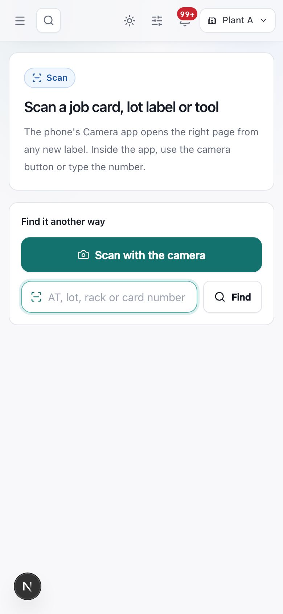
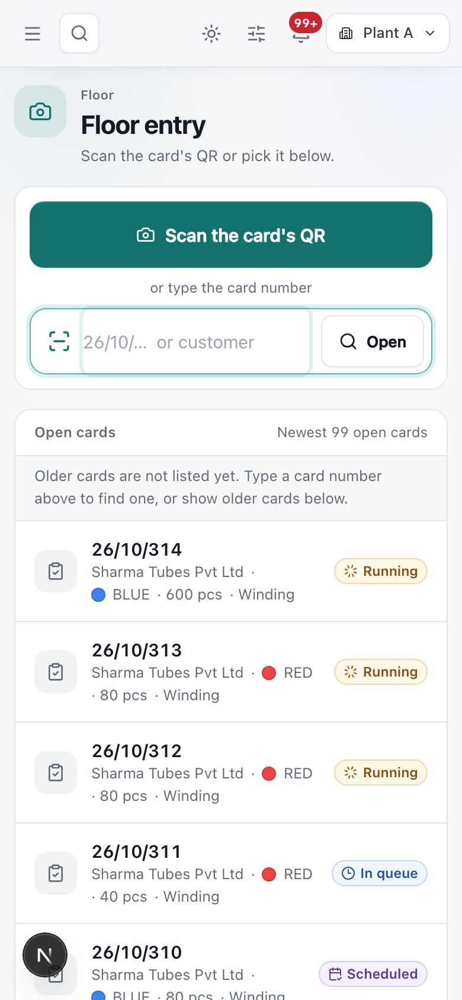
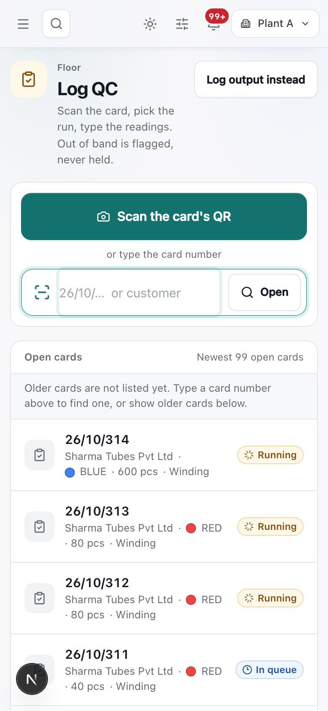
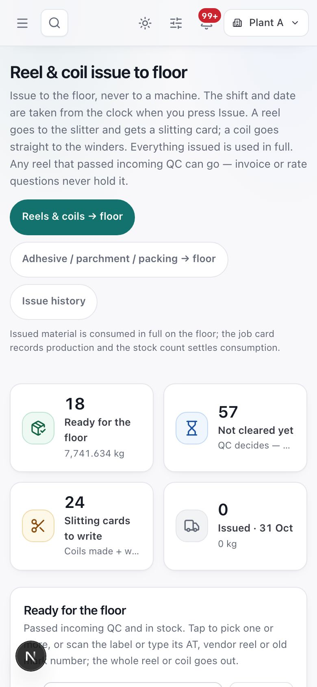
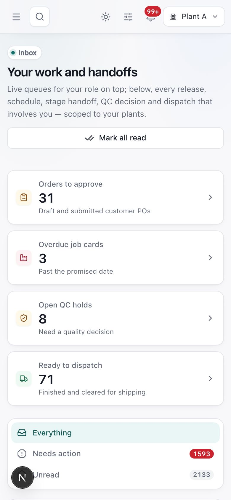

# Using TubeOS on a phone

> **What it is:** How to use TubeOS on a phone on the floor: scanning QR labels with the phone camera, the Scan page, and Log output, Log QC and Reel issue on a small screen.
> **Who uses it:** Operators, Plant Manager, QC and In-process QC, Store, RM issue, GRN, Dispatch; anyone with a phone.
> **Where:** Any page in the phone browser; Scan page (route /scan); Sidebar > Operations > Log output (/production/entry) and Log QC (/production/entry?mode=qc); Sidebar > Stores & inventory > Reel & coil issue (/inventory/reels/issue)

## At a glance
- Every new job card, reel/coil/lot label, rack label and tool label carries a QR that is a **web link**. The phone's own **Camera** app (iPhone too) opens it; no special app is needed.
- After sign-in, the QR opens **the page your role works on** for that item: a job card opens floor entry, a cleared reel opens Reel & coil issue for the store, a held lot opens Incoming QC for QC.
- If a label cannot be read, type its **AT, lot, rack or card number** on the Scan page.
- Floor forms save a **draft on the phone** as you type, for your login only, for 7 days.
- The phone shows the same pages as a PC, stacked in one column. Nothing is left out.

## The flow

```flow
title: Scan a job card and log a run
Point camera at card QR [Operator] -> Tap the link -> Sign in (if asked) -> Card opens on its stage -> Log output -> Save run -> Log QC (2 readings per check)
after Sign in (if asked): Label from other plant -> Plant switched (or "your login cannot open")
after Save run: Run waits for supervisor (if your role cannot post) -> Supervisor submits
```

```flow
title: What a scan opens
Scan label [Any role] -> Job card -> Floor entry with Log output and Log QC
after Scan label: Lot on QC hold [QC/Inward QC/Store/Plant Manager] -> Incoming QC for that lot
after Scan label: Cleared reel or coil [Store/RM issue/Plant Manager] -> Reel & coil issue, reel picked
after Scan label: Cleared adhesive, parchment or packing lot [Store/RM issue/Plant Manager] -> Material issue, lot picked
after Scan label: Rack label [Any role] -> The rack's location page
after Scan label: Anything else -> Lot card with status and next step
```

The QR link always goes through the Scan page, which checks the item, its plant and your role, then sends you on. Each page still checks your role, so a scan never opens a page your role cannot use.

## Screen tour


*Figure: The Scan page on a phone. Top bar: menu, search, sun/moon, appearance, bell (99+) and Plant A. A card reads "Scan a job card, lot label or tool — The phone's Camera app opens the right page from any new label. Inside the app, use the camera button or type the number." Below, "Find it another way": a large green **Scan with the camera** button and a box "AT, lot, rack or card number" with **Find**.*

What you see:
1. **Scan with the camera**: opens the camera inside TubeOS. Point it at the QR. The browser may ask for camera permission the first time; allow it.
2. **AT, lot, rack or card number** and **Find**: type the number printed under the QR (for example AT-26-0412, 26/10/315 or a rack code).
3. After a scan you see "Opening the job card…" or "Opening Reel & coil issue for AT-…", then the page.


*Figure: Floor entry (Log output) on a phone. Title "Floor entry — Scan the card's QR or pick it below." A large **Scan the card's QR** button, then "or type the card number" with a box "26/10/… or customer" and **Open**. Below, "Open cards — Newest 99 open cards" lists 26/10/314 Sharma Tubes Pvt Ltd · BLUE · 600 pcs · Winding (Running), 26/10/313 RED · 80 pcs (Running), 26/10/311 (In queue), 26/10/310 (Scheduled).*

What you see:
1. **Scan the card's QR**: scans the printed job card.
2. **Card number box**: type 26/10/315; dashes, dots or spaces also work (26-10-315). A customer name opens that customer's first open card.
3. **Open cards**: newest open cards with customer, colour, pcs, stage and state. Older cards: type the number. A closed card says "Job card 26/10/290 is closed (completed). No more runs can be logged on it."


*Figure: Log QC on a phone. Title "Log QC — Scan the card, pick the run, type the readings. Out of band is flagged, never held." A **Log output instead** button at the top right, then the same scan button, number box and open cards list.*

What you see:
1. **Log output instead**: switches to output logging for the card you pick.
2. The card opens with the QC form ready for the stage and run.


*Figure: Reel & coil issue to floor on a phone. Text: "Issue to the floor, never to a machine. The shift and date are taken from the clock when you press Issue. A reel goes to the slitter and gets a slitting card; a coil goes straight to the winders. Everything issued is used in full." Buttons Reels & coils → floor (selected), Adhesive / parchment / packing → floor, Issue history. Tiles: 18 Ready for the floor (7,741.634 kg), 57 Not cleared yet, 24 Slitting cards to write, 0 Issued · 31 Oct.*

What you see:
1. **Reels & coils → floor**, **Adhesive / parchment / packing → floor**, **Issue history**: the three issue screens.
2. **Ready for the floor**: passed incoming QC and in stock; tap to pick, or scan the label.
3. **Not cleared yet**: waiting for QC; cannot be issued.
4. **Slitting cards to write**: reels sent to the slitter whose card (coils made, wastage kg) is still due.


*Figure: Inbox on a phone: "Your work and handoffs", a full-width **Mark all read** button, then the work tiles stacked (Orders to approve 31, Overdue job cards 3, Open QC holds 8, Ready to dispatch 71) and the views Everything, Needs action, Unread.*

## Step by step

### How to open a job card with the phone camera
1. Open the phone's **Camera** app and point it at the QR on the printed job card.
2. Tap the link that appears.
3. If asked, sign in. TubeOS opens the same card after sign-in.
4. The card opens: number and state at the top (for example **26/10/315 · Running**), customer, size (76.4 x 81 x 150 mm), colour, and quantity ("3,000 pcs = 300 bamboo × 10").
5. Tap the stage tab you work on (**Winding**, **Oven**, **Process**). The stage box shows good quantity against target, rejected, runs waiting, what is ready from the previous stage, anything "waiting for Winding QC", and flagged runs.

### How to log output on the phone
1. On the card, tap **Log output**. If it is grey, the small text under it says why: "Card is closed", "Winding is closed", "Your role cannot log runs".
2. Fill the run (machine, operator, quantities, reason for any rejection). The form is the same as on a PC; see the job card and floor entry chapter for each field.
3. Save. If your role posts runs directly, the run counts at once. Otherwise the message says "Your run goes to the supervisor, who checks and submits it."
4. If you are interrupted, the typed numbers stay as a draft on the phone. Reopen the card and a bar offers the restored draft with a **Discard** option.

### How to log QC on the phone
1. On the card, tap **Log QC**. A badge shows how many runs wait ("2 waiting").
2. Or use the amber box **Still needs QC**: each run is listed ("Run 3 · 420 good · needs more readings") with its own **Log QC** button.
3. Type at least **2 readings for every required check**. A reading outside the band is saved and flagged; it does not stop the card.
4. Save. The run leaves the "Still needs QC" list once its readings are complete, and the next stage can take it.

### How to close a stage on the phone (Plant Manager, Owner, Admin)
1. Tap **Close Winding** (or the stage you are on) under the two big buttons.
2. If it shows a lock and "QC readings short", some runs still need readings; log them first.
3. Confirm in the close dialog. No supervisor name is asked; your login is recorded.

### How to issue a reel from the phone (Store, RM issue, Plant Manager)
1. Scan the reel's label with the Camera app. A cleared reel opens **Reel & coil issue** with the reel already picked.
2. Check the reel and press **Issue**. Shift and date come from the clock: Shift A 08:00–20:00, Shift B 20:00–08:00 (dated the day the shift started).
3. A reel goes to the slitter and appears under **Slitting cards to write**. A coil goes straight to the winders.
4. Adhesive, parchment and packing lots open **Material issue** instead.

### How to scan anything else
1. **Rack label**: opens the rack's location page for every role; the page shows the actions your role may use.
2. **Lot your role does not issue or inspect**: a lot card shows the item, plant, status in words, quantity left, received date, inward number, supplier, last QC and **Next step** (for example "Waiting for incoming QC — It cannot go to the floor yet. Ask QC to inspect it; once it passes, the store can issue it."). Links such as **Trace this reel** or **Open goods receipt P/26/014** appear when your role may use them.
3. **Tool label**: the tools register opens for the Owner and Admin only; others see "Tool T-0042" with a note to hand it to the tool room.

### How to move around on a phone
1. Tap the **menu button** (three lines) for the sidebar. The role switcher and **Logout** are at its bottom.
2. Tap the **search button** for Jump to workspace.
3. Tap **Scan another card** at the bottom of a card to go back to the picker, or **Open the full job card** for the whole card.

## Rules the system enforces
- A scan never opens a page your role cannot use; each page keeps its own role check (BLOCKS).
- Floor entry opens for Operator, Plant Manager, QC, In-process QC, Planner, Owner and Admin. Others see "This account cannot open floor entry." (BLOCKS)
- Issue desks refuse lots not cleared by incoming QC (BLOCKS).
- A label from another plant switches the app to that plant when your login has it ("Switched to Plant B for this label"); otherwise "This label belongs to Plant B, which your login cannot open." (BLOCKS)
- Nothing can be logged on a cancelled card; on a completed batch-entry card no new runs, but QC readings can still be added to its runs (BLOCKS runs).
- Signed out or idle 15 minutes: sign in and the same page opens (automatic).
- Drafts on the device belong to the signed-in person, are never shown to the next person on a shared phone, and are dropped after 7 days or after a successful save (automatic).
- Labels printed before the QR change still work inside the app's scan box; reprint them for the phone camera.
- A rack, tool or material QR scanned on the job card picker is refused: "That QR is on a material or tool label, not a job card." (BLOCKS)

## Sample
Suresh, winder operator, Shift A, 31 Oct:
1. 08:15: he scans the QR on job card **26/10/315** (Sharma Tubes Pvt Ltd, BLUE, 3,000 pcs = 300 bamboo × 10). The card opens on **Winding**.
2. He taps **Log output**: machine SHARMA_WINDER-2, 120 bamboo produced, 118 accepted. Rejected 2 is worked out by the system. He saves; the run goes to the supervisor.
3. He taps **Log QC** for Run 1 and enters two readings for each winding check. One C.S. reading is outside the band: it is saved with a flag.
4. 08:40: store keeper Anil scans reel **AT-26-0412** (Kraft 300 GSM, 412 kg). Reel & coil issue opens with the reel picked; he presses **Issue**. It is recorded as Shift A, 31 Oct, and listed under Slitting cards to write.

## Common questions
**Q: The Camera app shows the QR but nothing opens.** A: Tap the link banner that appears. If there is no link, it is an old label: type its number on the Scan page or ask the store to reprint it.

**Q: "We could not read this label".** A: The number is not in your plant or the connection dropped. Check the network and scan again, or type the number.

**Q: Log output is grey.** A: Read the small text under the button: the stage or card is closed, or your role cannot log runs.

**Q: My phone signed me out in the middle of a run.** A: Sign in again; the card reopens and your typed draft is offered back.

**Q: I scanned a reel and got a lot card, not the issue page.** A: Either your role does not issue stock, or the reel is not cleared (the card says "Waiting for incoming QC" or "Failed incoming QC").

**Q: Do I need to choose a shift when issuing?** A: No. Shift and date come from the clock when you press Issue.

**Q: Can I use a handheld scanner?** A: Yes. In-app scan boxes read new links and older labels alike.

## Related chapters
- Getting started
- Dashboard and inbox
- Log output and QC entry
- Job cards
- Issue to the floor: reels, coils and materials
- Stock counts, stock book, locations and opening stock
- Quality
- A day in the life
