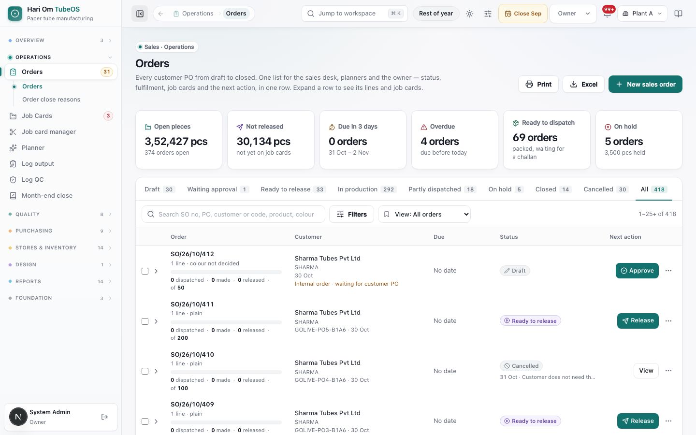
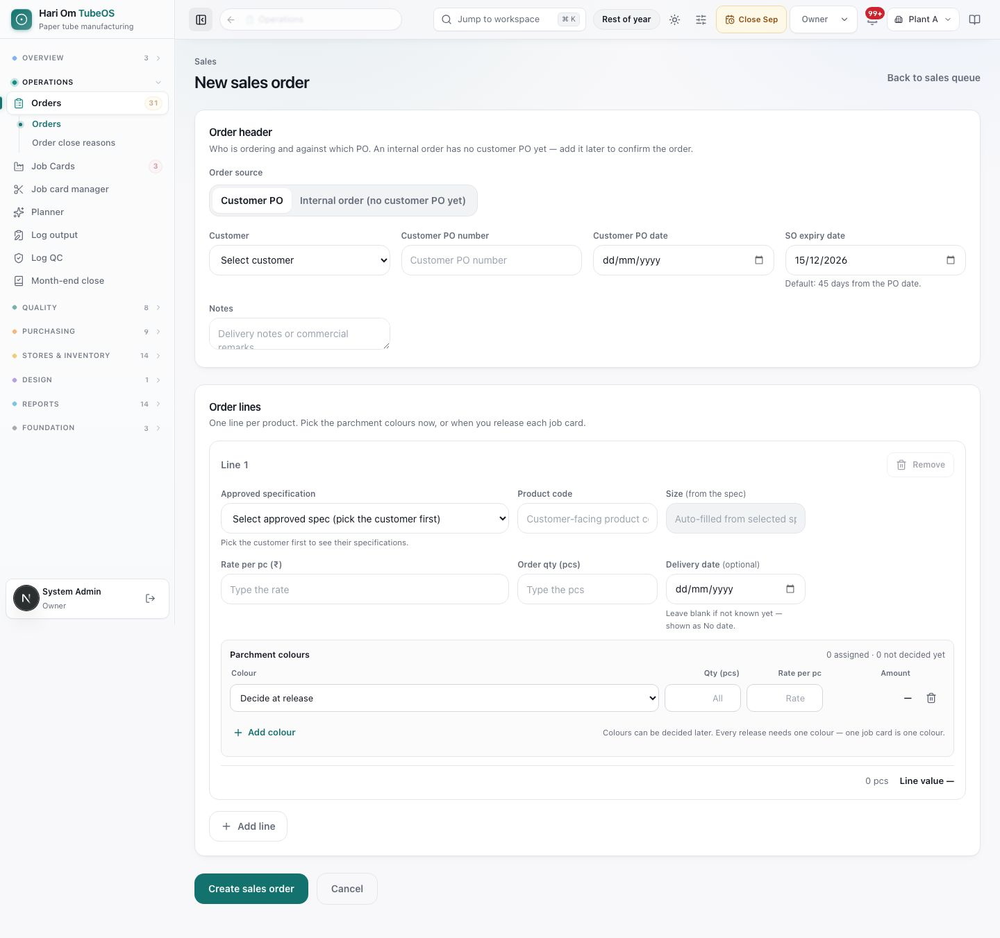
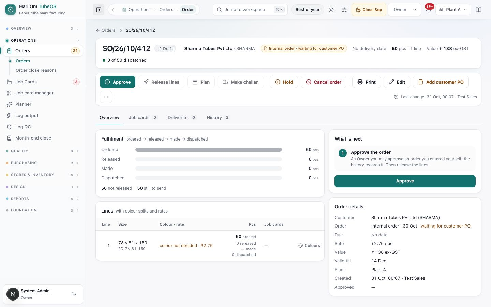
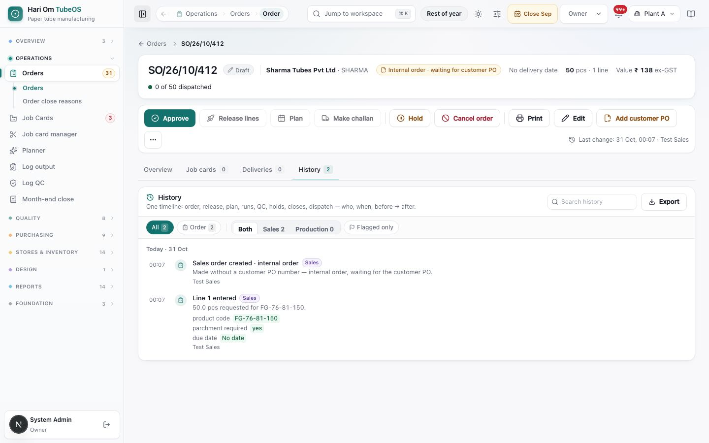
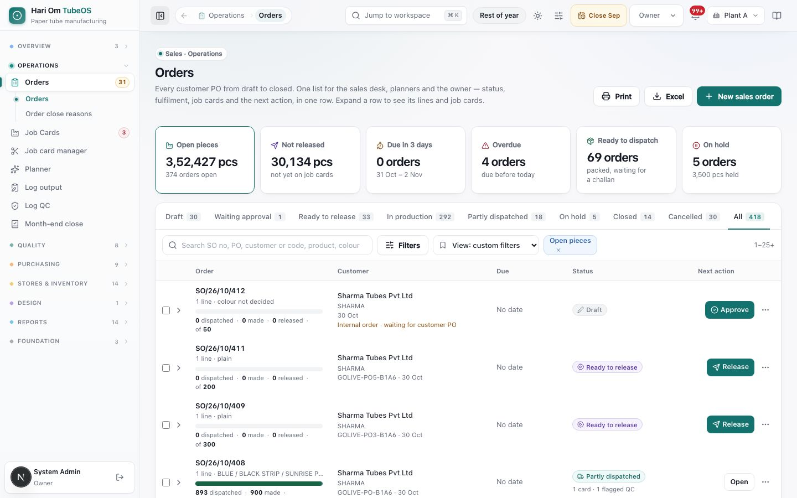
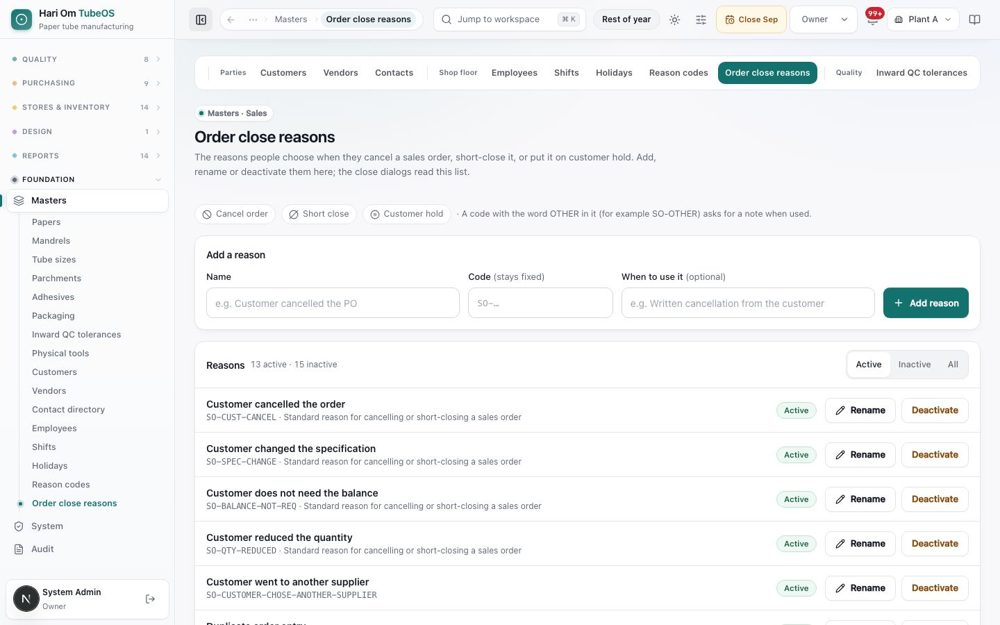
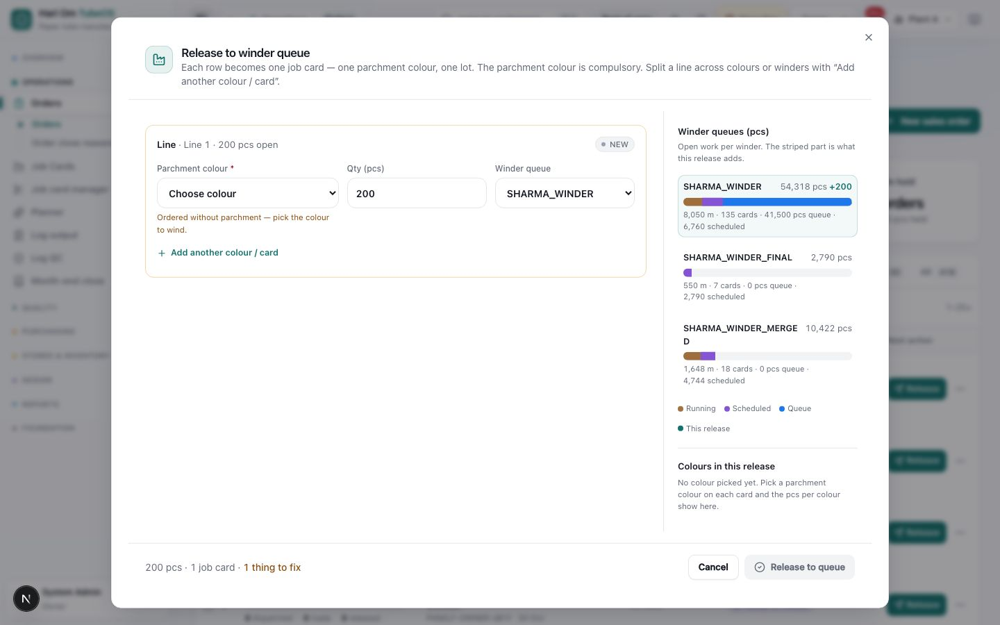
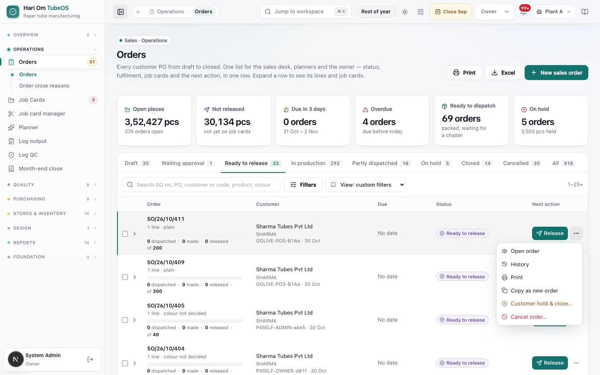

# Sales orders

> **What it is:** One Orders list and one Order page for every customer PO, from draft to closed: entry, approval, release to job cards, delivery tracking, hold, cancel and short close.
> **Who uses it:** Sales (enter, release, close), Planner (approve, release), Owner and Admin (everything), Plant Manager (view, short close), Dispatch (view, make challans).
> **Where:** Sidebar > Operations > Orders (/sales-orders); New sales order (/sales-orders/new); Order page (/sales-orders/<order>); Sidebar > Operations > Orders > Order close reasons (/masters/order-close-reasons)

## At a glance
- **One list for everyone**: status tabs, six KPI tiles, search, filters and saved views. Each row has one **Next action** button (Approve, Send for approval, Release, Plan, Dispatch, Resume, View).
- **Maker-checker**: the person who entered an order cannot approve it. Another Sales or Planner user, the Owner or an Admin approves. The Owner and an Admin may approve their own orders; the history records "approved by the same person".
- **Release** makes one job card per line and parchment colour and puts it in a winder queue. A parchment colour is compulsory at release.
- **Delivery date is optional** everywhere; a missing date shows as "No date". An **internal order** can be entered before the customer's PO arrives.
- **Cancel** (nothing released or dispatched), **Short close** (work started, drop the rest) and **Customer hold & close** (reversible) all need a reason from **Order close reasons**.

## The flow

```flow
title: Order life
New sales order [Sales] -> Approve [Planner/Sales/Owner/Admin] -> Release lines [Sales/Planner] (job cards in winder queue) -> In production -> Partly dispatched [Dispatch] -> Closed
after New sales order: Entered by me (not Owner/Admin) -> Send for approval -> Another user approves
after Approve: Customer not lifting -> Customer hold & close [Sales] -> Resume [Sales]
after Release lines: Customer wants no more -> Short close [Sales/Plant Manager] (released cards finish)
```

```flow
title: Cancel or short close
Open order -> Cancel order (nothing released or dispatched) -> Choose reason -> Cancelled (final)
after Open order: Something released or dispatched -> Short close -> Choose reason -> Balance dropped -> Closes after last dispatch
```

A draft becomes **Ready to release** once approved. Each release creates job cards; the order shows **In production**, then **Partly dispatched** as challans are made, and **Closed** when everything is dispatched. Old pages (the pending-orders page and the separate order audit page) now open the Orders list and the Order page's History tab.

## Screen tour


*Figure: Orders list, Plant A. Header buttons Print, Excel and New sales order. Tiles: Open pieces 3,52,427 pcs (374 orders open), Not released 30,134 pcs, Due in 3 days 0 orders (31 Oct – 2 Nov), Overdue 4 orders, Ready to dispatch 69 orders (packed, waiting for a challan), On hold 5 orders (3,500 pcs held). Tabs Draft 30, Waiting approval 1, Ready to release 33, In production 292, Partly dispatched 18, On hold 5, Closed 14, Cancelled 30, All 418. Rows: SO/26/10/412 Draft "Internal order · waiting for customer PO" with Approve; SO/26/10/411 Ready to release with Release; SO/26/10/410 Cancelled with View.*

What you see:
1. **Print / Excel / New sales order**: print the page, download the filtered list (one row per line) or start a new order.
2. **KPI tiles**: click to narrow the list; click again to clear. A blue chip shows the active tile.
3. **Status tabs** with counts (on a phone, one **Status** drop-down).
4. **Search**: "Search SO no, PO, customer or code, product, colour".
5. **Filters**: **Source** (Customer PO + internal / Customer PO / Internal order), **Delivery** (Any, Overdue, 3 days, 7 days), **PO / order date** from–to, **Sort** (Newest first, Earliest delivery first, PO date (latest), Oldest first), **PO validity expired**, **Clear**.
6. **View: All orders**: saved views. **+ Save current view…** saves the tab, tile, search and filters for **Only me** or **Everyone on the plant**; **Manage views…** removes them.
7. **Order row**: tick box, expand arrow, SO number, lines and colours ("1 line · colour not decided", "plain"), fulfilment bar "0 dispatched · 0 made · 0 released of 50", customer and code, PO number and date (or "Internal order · waiting for customer PO"), **Due** ("No date", "Overdue 2 d", "Due today", "Tomorrow", "in 5 days"), **Status** chip (with hold or close reason and date), **Next action** and the **⋯** menu.
8. **Expanded row**: each line (size, colour split, pcs, released) with its job cards: card number, stage dots W · O · P · D, state, plan and QC flag chips, and quick links **Log output**, **Log QC**, **Open card**. Tick lines and press **Release lines…** to release only those.


*Figure: New sales order. Order header: Order source (Customer PO / Internal order (no customer PO yet)), Customer, Customer PO number, Customer PO date, SO expiry date 15/12/2026 ("Default: 45 days from the PO date"), Notes. Order lines: Line 1 with Approved specification, Product code, Size (from the spec), Rate per pc (₹), Order qty (pcs), Delivery date (optional, "Leave blank if not known yet — shown as No date"), a Parchment colours table (Colour "Decide at release", Qty, Rate per pc, Amount, Add colour), and the line total. Buttons Add line, Create sales order, Cancel.*

What you see:
1. **Order source**: **Customer PO** needs PO number and date; **Internal order** needs an **Internal order date** and is saved as "Internal order · waiting for customer PO".
2. **SO expiry date**: blank means 45 days from the PO date; a custom date shows **Reset to 45 days**.
3. **Approved specification**: grouped as "This customer's approved specs", "Other approved specs (all customers)" and "Not approved yet — approve in Specifications first" (cannot be chosen). Pick the customer first.
4. **Size** fills from the spec. **Product code** is the customer-facing code.
5. **Rate per pc (₹)**: under it, "Last rate ₹2.75 on SO/26/10/388 · 12 Oct" with a **Use** button when an earlier order exists for this customer and product. It is only a suggestion; nothing is filled until you press **Use**.
6. **Parchment colours**: one row per colour with its own qty and rate (blank rate = line rate). "Colours can be decided later. Every release needs one colour — one job card is one colour."


*Figure: Order page SO/26/10/412, Draft, Sharma Tubes Pvt Ltd · SHARMA, "Internal order · waiting for customer PO", No delivery date, 50 pcs · 1 line, Value ₹138 ex-GST, "0 of 50 dispatched". Action bar: Approve, Release lines, Plan, Make challan, Hold, Cancel order, Print, Edit, Add customer PO and ⋯; "Last change: 31 Oct, 00:07 · Test Sales". Tabs Overview, Job cards 0, Deliveries 0, History 2. Overview shows Fulfilment bars, the Lines table (76 x 81 x 150, FG-76-81-150, colour not decided · ₹2.75), What is next ("Approve the order — As Owner you may approve an order you entered yourself…") and Order details.*

What you see:
1. **Header**: SO number, status, customer, PO (with a lock when the PO is locked), delivery, pcs and lines, value ex-GST, dispatched so far.
2. **Action bar**: buttons are greyed with a hover reason when not allowed (for example Release lines: "Approve the order first"). **Edit** shows only while Draft or Waiting approval. **⋯** has **Copy as new order**, **Full history** and **Trace materials**.
3. **Overview**: **Fulfilment** (ordered → released → made → dispatched, with "not released", "on customer hold", "dropped by short close", "still to send"), **Lines** (with a **Colours** button to edit colour splits), **What is next** (numbered steps and one main button) and **Order details** (customer, PO and PO history, due, rate, value, valid till, plant, created, approved, released, on hold, notes).
4. **Job cards**: each line with its cards, made quantity, close reasons and a **Manage** button (split, edit qty or colour, force close, cancel).
5. **Deliveries**: customer call-offs per line by date, and the **Delivery challans** list (DC, date, pcs, boxes, vehicle, card, print).


*Figure: History tab. "One timeline: order, release, plan, runs, QC, holds, closes, dispatch — who, when, before → after." Search history and Export. Filters All 2, Order 2, Both / Sales 2 / Production 0, Flagged only. Events at 00:07: "Sales order created · internal order" and "Line 1 entered — 50.0 pcs requested for FG-76-81-150; product code FG-76-81-150; parchment required yes; due date No date", by Test Sales.*


*Figure: An old "pending orders" link now opens the Orders list with the **Open pieces** tile already selected (chip "Open pieces ×", "View: custom filters").*


*Figure: Masters › Order close reasons. "The reasons people choose when they cancel a sales order, short-close it, or put it on customer hold." Chips Cancel order, Short close, Customer hold, and the note "A code with the word OTHER in it (for example SO-OTHER) asks for a note when used." Add a reason: Name, Code (stays fixed), When to use it (optional), Add reason. Reasons: 13 active · 15 inactive, e.g. Customer cancelled the order (SO-CUST-CANCEL), Customer changed the specification (SO-SPEC-CHANGE), Customer does not need the balance (SO-BALANCE-NOT-REQ), Customer reduced the quantity (SO-QTY-REDUCED), each with Rename and Deactivate.*


*Figure: The **Release to winder queue** dialog. Each row becomes one job card. The red note under **Parchment colour** says the colour is compulsory. The panel on the right shows how busy each winder queue is, and the striped part is what this release adds.*

1. **Parchment colour**: pick the colour for this card. The release cannot be saved without it.
2. **Qty (pcs)**: how many pieces this card will make. Use **Add another colour / card** to split one line across colours.
3. **Winder queue**: the winder this card joins.
4. **Winder queues (pcs)** panel: open work per winder, so you can balance the load before you release.
5. **Release to queue**: stays grey until nothing is left to fix. The footer counts the pieces, the job cards and the things still to fix.


*Figure: The three-dot menu on an order row. It lists Open order, History, Print, Copy as new order, Customer hold & close and Cancel order.*

## Step by step

### How to create a sales order (Sales, Owner, Admin)
1. Orders › **New sales order**.
2. Choose **Customer PO** or **Internal order (no customer PO yet)**.
3. Pick the **Customer**. Enter **Customer PO number** and **Customer PO date** (or the **Internal order date**). Leave **SO expiry date** at the default unless the PO says otherwise.
4. For each product: pick the **Approved specification**, check **Size**, type **Product code**, **Rate per pc** (press **Use** to take the last rate if right) and **Order qty (pcs)**. Add a **Delivery date** only if known.
5. Under **Parchment colours**, add colours and quantities now, or leave "Decide at release".
6. **Add line** for more products. Press **Create sales order**. The system gives the SO number (SO/26/10/NN) and the order is **Draft**.
7. To start from an old order: ⋯ › **Copy as new order**, then change the PO number and dates.

### How to edit an order
1. Open the order and press **Edit** (only while Draft or Waiting approval).
2. Change header or lines and save. Every change is kept in History.
3. After approval, colours can still be changed with the line's **Colours** button (a colour already released cannot be removed), and dates on the **Deliveries** tab.

### How to approve (maker-checker)
1. If you entered the order and are not Owner or Admin, press **Send for approval**; the button then reads "Waiting approval".
2. The approver (another Sales or Planner user, the Owner or an Admin) opens the order and presses **Approve**, or ticks several rows on the list and presses **Approve N**.
3. Result: "Sales order approved. Next: release its lines." Status becomes **Ready to release**.
4. If the server refuses: "This order was entered by …, so the same person cannot approve it — switching role does not change who you are."

### How to release lines to planning (Sales, Planner, Owner, Admin)
1. Press **Release** on the row or **Release lines** on the order. To release only some lines, expand the row, tick lines, then **Release lines…**.
2. The **Release to winder queue** dialog shows one row per job card. For each: **Parchment colour** (compulsory), **Qty (pcs)** and **Winder queue**.
3. To split a line across colours or winders, press **Add another colour / card**.
4. The right panel **Winder queues (pcs)** shows each winder's running, scheduled and queued pcs, metres and days of work; the striped part is what you are adding.
5. Fix anything listed ("Pick a winder queue", "Pick the parchment colour…", "Line 1 has only 2,000 pcs open"). The footer reads "5,000 pcs · 2 job cards · ready".
6. Press **Release to queue**. Result: "2 job cards created. The release winder is a hint; schedule on any available winder." Press **Open planning queue** to go to the planner.
7. If it says "Release recorded, but the job card is not in planning yet", press **Retry planning sync**. Pressing Release again never releases twice.

### How to add or change the customer PO
1. Internal order: press **Add customer PO**, enter the number and date, **Confirm customer order**. It becomes a confirmed customer order.
2. Before release the PO can be changed freely (**Change PO**).
3. After release it can be added or changed **once**: tick "I understand this is the one change allowed after release" and press **Change PO once**. Then the order shows **PO locked**. Every change is listed under **PO history**.

### How to put an order on customer hold and resume
1. Row ⋯ › **Customer hold & close…** or **Hold** on the order (several rows: tick them, **Hold… N**).
2. The dialog shows SO, PO and "Will hold N pcs". Choose a **Reason**, add a note if needed, confirm.
3. The undelivered balance becomes hold quantity and the PO closes. Delivered pieces and job cards are not changed.
4. To lift it, press **Resume**: "Customer hold lifted." The order goes back to its earlier status.

### How to cancel an order
1. Order page › **Cancel order** (or row ⋯ › **Cancel order…**). Only offered when nothing is released or dispatched.
2. The dialog shows Ordered, Dispatched, On job cards and **Cancels**, and the effects (call-offs cancelled, hold ends, cannot be undone).
3. Choose a **Reason**; codes with OTHER need a note. Press **Cancel order**. Status **Cancelled**; a red banner shows who, when and why.

### How to short close an order
1. Order page › **Short close** (row ⋯ › **Short close balance…**). Offered once something is released or dispatched and some quantity is still not released.
2. The dialog shows **Drops N pcs** and the effects: job cards already released still finish; the order closes once they are dispatched.
3. Choose a **Reason** (and note for OTHER). Press **Short close · drop N pcs**. An amber banner shows "Order short-closed · N pcs not released were dropped". Status later reads **Closed · short**.

### How to follow partial dispatch
1. **Partly dispatched** tab, or the fulfilment bar on a row ("893 dispatched · 900 made").
2. Order page › **Deliveries**: each DC with date, pcs, boxes and vehicle, and a print button.
3. When pieces are packed, Owner, Admin and Dispatch see **Make challan · N ready**; Sales sees "Waiting for dispatch · N ready".

### How to see the order's history and audit
1. Order page › **History** (row ⋯ › **History**).
2. Filter **Order** / **Both · Sales · Production** / **Flagged only**, search, and **Export**.

### How to manage order close reasons (Owner, Admin)
1. Orders › **Order close reasons**.
2. **Add a reason**: Name, Code (stays fixed, for example SO-LATE-PAYMENT), When to use it. **Add reason**.
3. **Rename** keeps the code, so closed orders are not affected. **Deactivate** hides it from new closes; **Reactivate** brings it back. Other roles can only view the list.

## Rules the system enforces
- Customer is required; Customer PO number and date are required for customer PO orders; Internal order date for internal orders (BLOCKS save).
- Colours must have a colour per qty row, qty per colour when more than one, rates 0 or more, and may not add up to more than the line qty (BLOCKS save).
- Only approved specifications can be chosen on a line (BLOCKS).
- Only Draft or Waiting approval orders can be approved; the person who entered it cannot approve unless Owner or Admin (BLOCKS).
- Release: a colour on every card, a winder queue, a qty, and together no more than the line's open pcs or the colour's open pcs (BLOCKS). The server also refuses release without a parchment colour, and refuses a spec whose seasonal recipe or QC setup is not ready.
- Release on hold is refused: "Lift the customer hold to release" (BLOCKS).
- Cancel only when nothing is released or dispatched; otherwise the dialog explains "N pcs are released to job cards. Use Short close…" (BLOCKS).
- Short close only after approval and when something is released or dispatched and some quantity is still not released (BLOCKS, with the reason in words).
- Cancel, short close and hold need a reason; OTHER codes need a note of at least 5 characters ("Write a short note for the reason 'Other'.") (BLOCKS).
- After release the customer PO may change once, then locks (BLOCKS further changes).
- Last rate is shown only as a suggestion (never filled automatically). Delivery date and expiry default are automatic helpers.
- Cancelled orders are not counted in booked value (automatic).

## Sample
Sharma Tubes Pvt Ltd sends PO 4500012345 dated 28 Oct for 76.4 x 81 x 150 tubes.

| Field | Value |
|---|---|
| Line 1 qty | 5,000 pcs at ₹2.75 (last rate ₹2.75 on SO/26/10/388, pressed **Use**) |
| Colours | BLUE 3,000 pcs; RED 2,000 pcs at ₹2.80 |
| Line value | 3,000 × 2.75 + 2,000 × 2.80 = ₹13,850 ex-GST |
| Delivery date | blank → "No date" |
| Expiry | blank → 45 days from 28 Oct = 12 Dec |

1. Priya (Sales) creates it: **SO/26/10/412**, Draft. She presses **Send for approval**.
2. Ramesh (Planner) presses **Approve**: Ready to release.
3. Priya releases: BLUE 3,000 on SHARMA_WINDER-1, RED 2,000 on SHARMA_WINDER-2. Two job cards, 26/10/315 and 26/10/316. Status: In production.
4. 26/10/315 ships 3,000 pcs: **Partly dispatched**, "3,000 of 5,000 dispatched".
5. The customer now says it does not want the RED pieces. They are already on 26/10/316, so Short close has nothing to drop and explains: "Everything left is already on job cards; the order closes by itself once they are dispatched." To stop the card, the planner force-closes 26/10/316 in the Job card manager. If the order was short-closed first, the balance that card hands back is dropped too instead of becoming releasable again.

## Common questions
**Q: Why can't I approve my own order?** A: Maker-checker. Press **Send for approval**; another user approves. Only the Owner and Admin may approve their own.

**Q: Release lines is grey.** A: Hover over it: "Approve the order first", "Lift the customer hold to release", "The order is closed" or "All lines are already released to job cards".

**Q: The release dialog says "Pick the parchment colour…" on a plain line.** A: Every job card needs a colour to wind; pick one now.

**Q: I want to cancel but only Short close is offered.** A: Something is already released or dispatched. Short close drops the rest; released cards finish.

**Q: The reason I need is not in the list.** A: Ask the Owner or Admin to add it in **Order close reasons**.

**Q: Where did the Order tracker, Pending orders and Order audit pages go?** A: They are the Orders list (tiles and tabs) and the Order page's History tab. Old links still work.

**Q: The order shows "No date". Is that a problem?** A: No. Delivery date is optional; add it on the Deliveries tab when the customer confirms.

**Q: I entered the wrong PO number after release.** A: Use **Change PO (once)**. After that it is locked; ask the Owner for a decision.

## Related chapters
- Welcome to Hari Om TubeOS: the big picture
- Specifications
- Job cards
- Job card manager
- Planner
- Dashboard and inbox
- A day in the life
