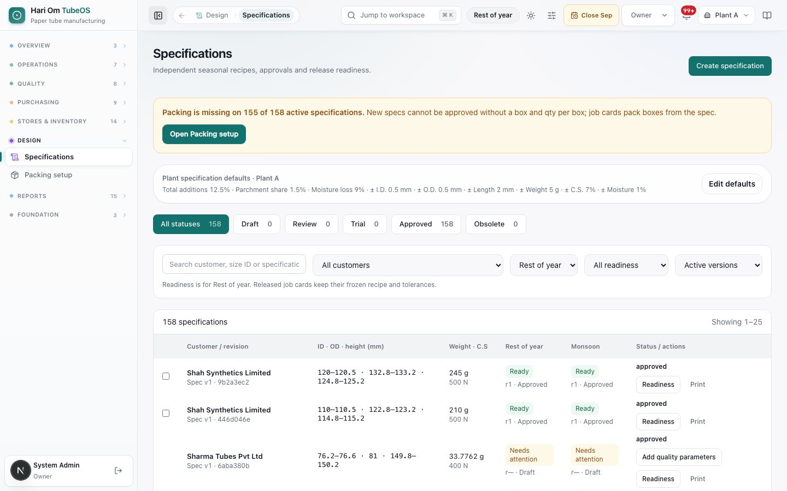
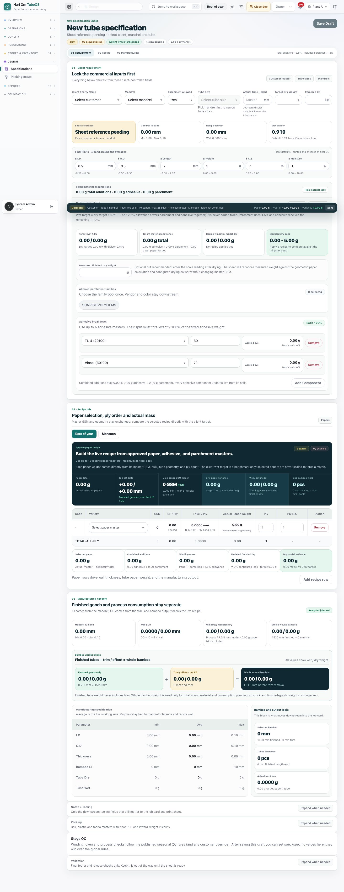
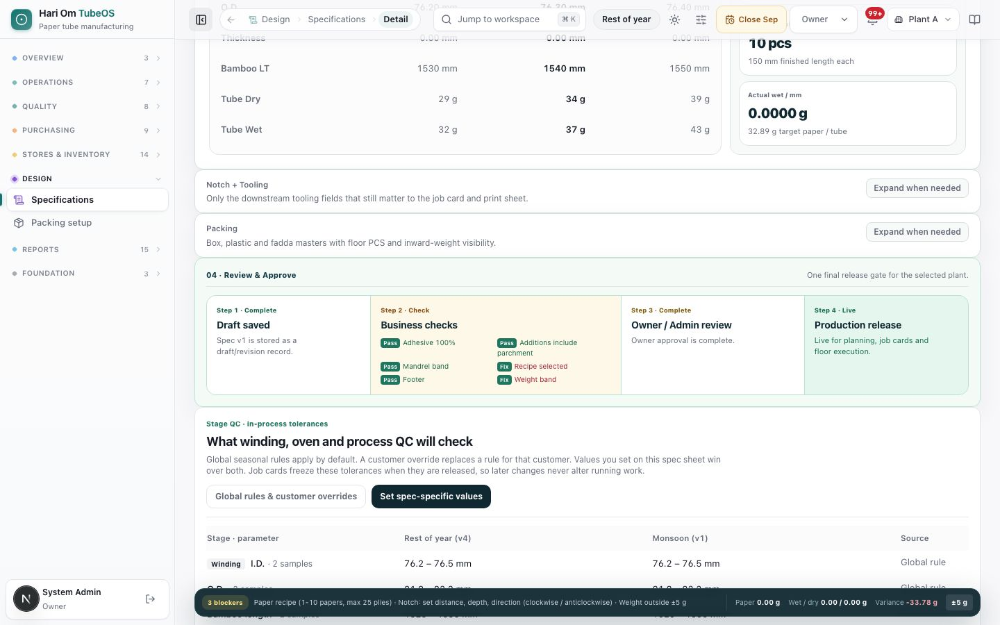
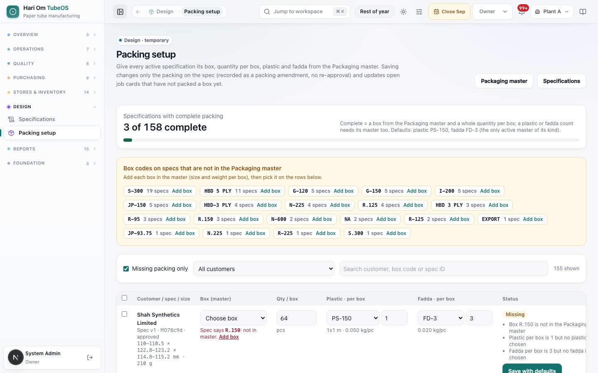
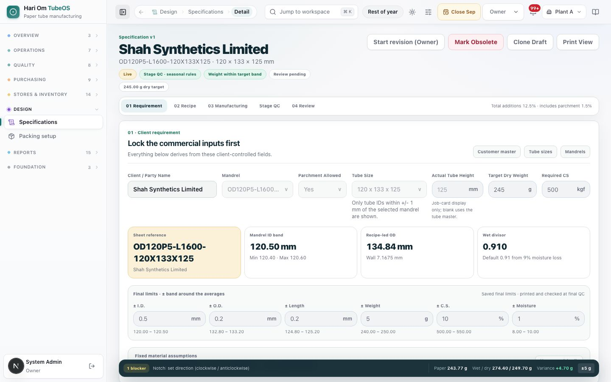
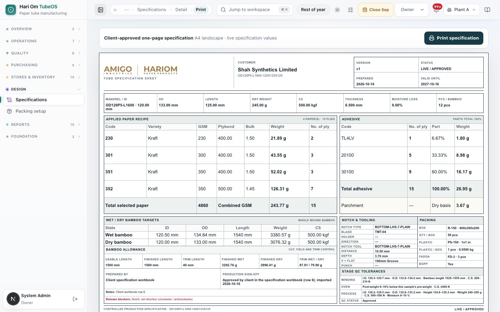
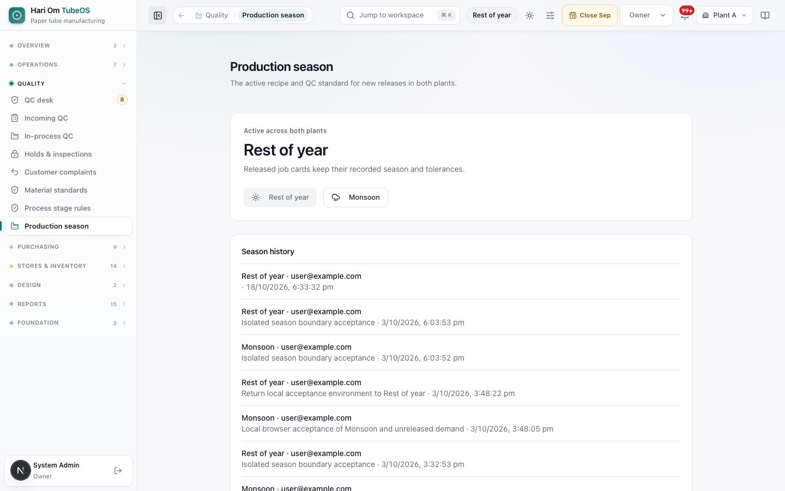

# Specifications

> **What it is:** The spec sheet workspace where the Owner and Admin build each customer's tube specification: size, mandrel, paper recipe for each season, adhesive, parchment, weights, tolerances, notch and packing, with approval and a print-ready sheet.
> **Who uses it:** Owner and Admin (create, revise, approve). Sales and planners use approved specs on orders; QC keeps the stage QC rules the spec is checked against.
> **Where:** Sidebar > Design > Specifications (/specifications); Create specification (/specifications/new); a spec (/specifications/<spec>); Print view (/specifications/<spec>/print); Sidebar > Design > Packing setup (/specifications/packing-setup, Owner and Admin); Sidebar > Quality > Production season (/settings/production-season)

## At a glance
- A spec is the product's recipe. Only **approved** specs can be picked on a sales order line, and the spec decides the size, the paper and adhesive use, the tube weight and the QC bands of every job card made from it.
- Each spec has **two recipes**: **Rest of year** and **Monsoon**. They are versioned **independently**: revising one never changes the other.
- The **Production season** (Owner only) says which recipe new releases use in both plants. A job card **freezes** the recipe and tolerances of its season at release; later edits never change a released card.
- Approval is two steps: **Submit for Owner Review**, then **Approve & Go Live** by the Owner or an Admin. A bar at the bottom lists the **blockers** still open.
- Older specs made before seasonal recipes are **legacy** specs. They still work; their QC tolerances are set on the spec itself.
- **Packing comes from the Packaging masters.** The box, plastic sheet and fadda are picked from the masters, and their size and weight come from there. The **qty per box** decides how job cards pack finished pcs into boxes. A new spec cannot be approved without a box and a qty per box. The temporary **Packing setup** page sets packing on every active spec without a re-approval.

## The flow

```flow
title: New specification
Create specification [Owner/Admin] -> Requirement (customer, mandrel, tube size, weights) -> Recipe: Rest of year and Monsoon -> Manufacturing, notch, packing -> Save Draft -> Submit for Owner Review -> Approve & Go Live [Owner/Admin] -> Usable on sales orders
after Submit for Owner Review: Return to draft [Owner/Admin] -> Fix and resubmit
```

```flow
title: Change a live spec
Approved spec -> Revise Monsoon only [Owner/Admin] (new Monsoon revision) -> Confirm -> Approve this revision -> Next releases use it
after Approved spec: Start revision (Owner) -> Draft revision v2 (v1 stays live) -> Approve -> v2 live
after Approved spec: Mark Obsolete -> Not offered on new orders
```

```flow
title: Packing on existing specs
Open Packing setup [Owner/Admin] -> Set packing per spec (box, qty, plastic, fadda) -> Save row (packing amendment, no re-approval) -> Open cards updated (no box packed yet)
after Set packing per spec: Box not in master -> Add box master [Owner/Admin] -> Set packing per spec
```

A spec is built in four sections and saved as a draft. When the bottom bar shows no blockers, it is submitted and approved, and it becomes **Live** for sales orders. A change to one season's paper recipe is a separate seasonal revision; a change to anything else is a full spec revision. The live version stays available for orders until the revision is approved.

## Screen tour


*Figure: Specifications register. Header "Independent seasonal recipes, approvals and release readiness" with Create specification. A panel "Plant specification defaults · Plant A: Total additions 12.5% · Parchment share 1.5% · Moisture loss 9% · ± I.D. 0.5 mm · ± O.D. 0.5 mm · ± Length 2 mm · ± Weight 5 g · ± C.S. 7% · ± Moisture 1%" with Edit defaults. Status buttons All statuses 158, Draft 0, Review 0, Trial 0, Approved 158, Obsolete 0. Rows such as Sharma Tubes Pvt Ltd, Spec v1, 76.2–76.6 · 81 · 149.8–150.2, 33.7762 g, 400 N, Rest of year "Needs attention r— · Draft", Monsoon "Needs attention", status approved, with Add quality parameters, Readiness and Print.*

What you see:
1. **Create specification** (Owner and Admin).
2. **Plant specification defaults** and **Edit defaults**: starting values for new specs in this plant (additions %, parchment share, moisture loss, ± bands).
3. **Status buttons** with counts: **Draft**, **Review**, **Trial**, **Approved**, **Obsolete**.
4. **Filters**: search ("Search customer, size ID or specification ID"), **All customers**, recipe season (**Rest of year** / **Monsoon**), readiness (**Ready to release** / **Needs attention**), **Active versions** / **Disabled versions**. "Readiness is for Rest of year. Released job cards keep their frozen recipe and tolerances."
5. **Row**: customer and version, ID · OD · height range in mm, weight in g and C.S., each season's readiness (**Ready** / **Needs attention**) with recipe revision and state (**Approved**, **Confirmed**, **Draft**, "Revision open"), status and buttons. Legacy specs show a QC button such as **Add quality parameters**.
6. **Readiness**: a pop-up listing each season's blockers (or "Ready for release") and the seasonal recipe manager.
7. **Tick boxes** on seasonal specs: tick several and press **Confirm reviewed Monsoon selections** (needs one plant).


*Figure: New tube specification (full page). Top: "Sheet reference pending", chips draft, QC setup missing, Weight within target band, Review pending, and Save Draft. Tabs 01 Requirement, 02 Recipe, 03 Manufacturing. Section 01 "Lock the commercial inputs first" with Client / Party Name, Mandrel, Parchment Allowed, Tube Size, Actual Tube Height, Target Dry Weight, Required CS, the cards Sheet reference, Mandrel ID band, Recipe-led OD, Wet divisor 0.910, Final limits (± bands), Fixed material assumptions, Allowed parchment families and Adhesive breakdown (TL-4 30%, Vinsol 70%). Section 02 "Paper selection, ply order and actual mass" with Rest of year / Monsoon tabs and the paper table. Section 03 "Finished goods and process consumption stay separate" with bamboo weight bridge and manufacturing table. Then Notch + Tooling, Packing, Stage QC and Validation, each "Expand when needed". A dark bar shows "5 blockers: Customer · Tube / mandrel · Paper recipe (1–10 papers, max 25 plies) · Release footer · Monsoon recipe not confirmed".*

What you see, section by section:
1. **01 Requirement**: **Client / Party Name**, **Mandrel**, **Parchment Allowed** (Yes/No), **Tube Size** (only tube IDs within ±1 mm of the mandrel are listed), **Actual Tube Height** (job card display only; blank uses the tube master), **Target Dry Weight** (g), **Required CS** (kgf). Cards: **Sheet reference** (made from customer and tube), **Mandrel ID band**, **Recipe-led OD**, **Wet divisor** (0.910 from 9% moisture loss). **Final limits** ± I.D., ± O.D., ± Length, ± Weight, ± C.S. %, ± Moisture % ("printed and checked at final QC"). **Fixed material assumptions**: total additions (adhesive + parchment), wet target = dry target ÷ 0.910; the 12.5% allowance covers parchment and adhesive together and is never added twice. **Measured finished dry weight** (optional). **Allowed parchment families**. **Adhesive breakdown**: up to 6 adhesive masters whose split must total exactly 100%.
2. **02 Recipe**: **Rest of year** and **Monsoon** tabs. "Use up to 10 distinct paper masters · maximum 25 total plies." Table: Code, Variety, GSM, BF / Ply, Thick / Ply, Actual Paper Weight, Ply, Ply No., Action; **Add recipe row**. Paper weight comes from the paper master's GSM and bulk, the tube geometry and the ply count; papers are never scaled to force a match. Totals: selected paper, combined additions, winding mass, modelled finished dry, dry model variance. On the Monsoon tab: **Copy rest of year** and **Confirm Monsoon selection**.
3. **03 Manufacturing**: Mandrel ID band, Wall / OD (OD = ID + 2 × wall), winding and modelled dry weight, whole wound bamboo; **Bamboo weight bridge** (finished tubes + trim / offcut = whole bamboo); **Manufacturing specification** min / avg / max for I.D., O.D., Thickness, Bamboo LT, Tube Dry, Tube Wet; **Bamboo and output logic** (selected bamboo length, tubes per bamboo, wet g per mm).
4. **Notch + Tooling**, **Packing** (see below), **Stage QC** (seasonal winding, oven and process checks; after saving you can set spec-specific values that win over the global rules), **Validation** (release footer: Valid until, Prepared by, Prepared date, Sign-off note).
5. **Blocker bar** (bottom): number of blockers and what they are, plus paper weight, wet / dry and variance against the ±5 g band.


*Figure: The Packing section of a spec sheet. Subtitle "Box, plastic and fadda come from the Packaging master; size and weight per piece are read from the master." Fields Box Master (Select box) with its size and weight per box from the master, Qty / Box, Plastic SKU with its weight per sheet, Plastic PCS / Box, Fadda SKU with its weight per piece, Fadda PCS / Box and Special Instructions, plus a note that new specs cannot be approved without a box and qty per box, with links Packaging master and Open Packing setup.*

What you see:
1. **Box Master** (**Select box**): only active boxes of the Packaging master. Under it, the box size in mm and its weight per box: "Dimensions and weight per box come from the Packaging master." With no box master: "No active box master is available."
2. **Qty / Box**: whole pcs per full box (for example 48). Job cards pack boxes of this size.
3. **Plastic SKU** (**Select plastic SKU**) and **Plastic PCS / Box**: "Weight per sheet comes from the master (stock is kept in kg)." If the master has no weight: "Weight per sheet not set in master".
4. **Fadda SKU** (**Select fadda SKU**) and **Fadda PCS / Box**: "Fadda is the sheet inside the box (putha); weight per piece comes from the master."
5. **Defaults**: when only one active plastic master (or one fadda master) exists, it is filled in by itself.
6. **Note**: "New specs cannot be approved without a box and qty per box; job cards pack boxes from the spec." Links **Packaging master** and **Open Packing setup**. After a packing amendment, a grey line reads "Packing amended on … by …: … Spec version N kept its approval (packing-only change)."


*Figure: Packing setup (Design · temporary, Owner and Admin only). A progress bar "Specifications with complete packing", the default plastic and fadda, a panel "Box codes on specs that are not in the Packaging master" with Add box, filters and a bulk bar, and a table with one row per active spec: Customer / spec / size, Box (master), Qty / box, Plastic · per box, Fadda · per box, Status (Complete or Missing) and a Save button.*

What you see:
1. **Header**: "Give every active specification its box, quantity per box, plastic and fadda from the Packaging master. Saving changes only the packing on the spec (recorded as a packing amendment, no re-approval) and updates open job cards that have not packed a box yet." Links **Packaging master** and **Specifications**.
2. **Progress**: "Specifications with complete packing" with a bar and count, and "Defaults: …" naming the only active plastic or fadda master. "Complete = a box from the Packaging master and a whole quantity per box; a plastic or fadda count needs its master too."
3. **Box codes not in the master** (amber, when any): box codes typed on old specs that the Packaging master does not have, each with **Add box**. "Add each box in the master (size and weight per box), then pick it on the rows below."
4. **Filters**: **All customers** and "Search customer, box code or spec ID".
5. **Apply to selected**: tick rows (or **Select all shown**), choose a **Plastic** and its per-box count and a **Fadda** and its per-box count, press **Apply to selected**. "Applied to N rows. Press Save on each row, or Save all changed rows." **Clear selection**, **Save all changed rows**.
6. **Table**: **Customer / spec / size** (with the tube weight and "Packing amended <date>" when done), **Box (master)** (**Choose box**, or **Add box** when it is missing), **Qty / box**, **Plastic · per box** (**No plastic** or a master, with size and kg per piece), **Fadda · per box** (**No fadda** or a master), **Status** (**Complete** in green or **Missing** in amber with what is missing, for example "Choose the box", "Enter qty per box (whole pcs)", "Box R-150 is not in the Packaging master") and the row button (**Save**, **Save again** or **Save with defaults**). A changed row is tinted blue.
7. **After saving**: "Saved to the spec" (or "No change on the spec"), and "3 open job cards updated, 1 already packing kept their box".


*Figure: Specification v1, Sharma Tubes Pvt Ltd, SHARMA_MANDREL-76X81X150 · 76.4 × 81 × 150 mm. Chips Live, QC setup missing, Weight within target band, Review pending, 33.78 g dry target. Buttons Start revision (Owner), Set QC tolerances, Mark Obsolete, Clone Draft, Print View. Tabs 01 Requirement, 02 Recipe, 03 Manufacturing, 04 Review. Fields are read-only. The bottom bar shows "2 blockers: Notch: set distance, depth, direction (clockwise / anticlockwise) · Stage QC tolerances", Paper 32.74 g, Wet / dry 36.96 / 33.64 g, Variance −0.14 g, ±5 g.*

What you see:
1. **Chips**: status (**Live**, draft), QC setup state, weight band, review state, dry target.
2. **Buttons** (shown when allowed): **Save Draft**, **Edit Draft** / **Start revision (Owner)**, **Open revision v2 (draft)**, **Set QC tolerances** / **Edit QC tolerances** and **Approve QC tolerances** (legacy specs), **Submit for Owner Review**, **Approve & Go Live**, **Return to draft**, **Mark Obsolete**, **Clone Draft**, **Print View**.
3. **Messages**: "This is a revision. The current live version stays available for sales orders until this one is approved." or "Live for sales orders — production release still blocked".
4. **Seasonal recipe manager** (seasonal specs): buttons **Rest of year r2** / **Monsoon r1**, **Recipe history / diff**, **Confirm current Monsoon recipe**, **Revise Monsoon only**, **Approve this revision**, and **Effective Monsoon QC tolerances** (Winding, Oven, Process checks; "minimum two samples per required parameter").


*Figure: Print view, "Client-approved one-page specification, A4 landscape, live specification values", with Print specification. The sheet shows Customer Sharma Tubes Pvt Ltd, Version v1, Status LIVE / APPROVED, Prepared 2026-10-03, Valid until 2027-10-03; a strip Mandrel / ID, OD 81.00 mm, Length 150.00 mm, Dry weight 33.78 g, CS 400.00 kgf, Thickness 2.300 mm, Moisture loss 9.00%, Pcs / bamboo 10; Applied paper recipe (SHARMA_300 Kraft 300 GSM, 32.74 g, 3 plies); Adhesive (Glue 100%, 4.22 g; Parchment 0.00 g); Wet / dry bamboo targets; Bamboo allowance; Notch & tooling; Packing (Box R-150, 45 pcs per box, plastic, fadda); Release blockers in red at the bottom.*


*Figure: Production season. "Active across both plants: Rest of year. Released job cards keep their recorded season and tolerances." Buttons Rest of year and Monsoon. Season history lists each switch with who and when.*

## Step by step

### How to create a new specification (Owner, Admin)
1. Specifications › **Create specification**. Check the plant in the header is the plant this spec is for.
2. **01 Requirement**: pick the customer, mandrel, Parchment Allowed, tube size; type Target Dry Weight and Required CS. Check the final limits (defaults come from the plant defaults; change only if the customer asks).
3. If parchment is allowed, tick the **Allowed parchment families**. In **Adhesive breakdown** add up to 6 adhesives so the split totals 100% ("Ratio 100%").
4. **02 Recipe**, **Rest of year** tab: **Add recipe row** for each paper, pick the paper master and the ply count. Watch the dry model variance; it must stay within ±5 g of the target.
5. **Monsoon** tab: build the Monsoon plies, or press **Copy rest of year** for the same papers. Press **Confirm Monsoon selection**.
6. **03 Manufacturing**: check bamboo length and tubes per bamboo. Open **Notch + Tooling** (distance, depth, direction clockwise / anticlockwise, tools from the tool master) and **Packing**: pick the **Box Master**, type **Qty / Box**, and check the plastic and fadda (filled by themselves when only one master exists) and their pcs per box.
7. Open **Validation** and fill Valid until, Prepared by, Prepared date and Sign-off note.
8. Press **Save Draft**. The spec gets its reference and is Draft.

### How to set packing on existing specs (Packing setup)
Roles: Owner and Admin (the owner's packing person uses this page).
1. Sidebar > Design > **Packing setup**.
2. If the amber panel lists box codes not in the master, click **Add box** and add the box in Masters › Packaging (code, size, weight per box). Come back.
3. For each spec row: choose the **Box (master)**, type the **Qty / box**, and check the **Plastic · per box** and **Fadda · per box** (defaults are filled where only one master exists). To give many rows the same plastic and fadda, tick them and use **Apply to selected**.
4. Press **Save** on the row (or **Save all changed rows**). The spec keeps its approval; the change is kept as a packing amendment with your name.
5. Open job cards of that spec that have not packed a box yet take the new packing at once. Cards that already packed boxes keep the packing they started with.
6. If it says "This spec changed since the list loaded. Refresh the list and try again.", refresh and save again.

### How to submit and approve
1. On the saved draft, check the blocker bar shows no blockers. A box "Before Submit for review (N)" lists what is left.
2. Press **Submit for Owner Review**. Status: Review.
3. The Owner or an Admin, with one plant selected, presses **Approve & Go Live**. If greyed out, hover for the reason ("Only the Owner or an Admin can approve a specification.", "Pick one plant in the top switcher before approving.", "Not ready: …").
4. To send it back instead, press **Return to draft**.
5. Approved specs now appear on sales order lines under "This customer's approved specs".

### How to change one season's paper recipe on a live spec
1. Open the spec (or **Readiness** on the list) and find the seasonal recipe manager.
2. Choose the season, for example **Monsoon r1**, and press **Revise Monsoon only**.
3. Change plies (**Add ply**, **Remove**, or **Copy rest-of-year plies**), type the **Reason for this seasonal change** and press **Save seasonal revision**. "This creates a new Monsoon revision. The other season and released cards retain their recorded recipe."
4. Press **Confirm current Monsoon recipe** if asked, then **Approve this revision**.
5. Press **Recipe history / diff** to see each revision and what changed ply by ply.

### How to revise other fields
1. On an approved spec press **Start revision (Owner)**. A draft revision (v2) opens; v1 stays live for orders.
2. Edit, save, submit and approve as for a new spec. On approval v2 becomes live.
3. **Clone Draft** copies the spec into a new draft (for a similar size or customer).

### How to set QC tolerances on a legacy spec
1. Legacy specs (made before seasonal recipes) show **Set QC tolerances** or **Add quality parameters**.
2. Enter the stage tolerances and save; the Owner or an Admin presses **Approve QC tolerances**.
3. Seasonal specs use the published seasonal stage rules instead (Quality › Process stage rules); spec-specific values can be set in the **Stage QC** section.

### How to print the spec sheet
1. Press **Print View** (or **Print** on the list).
2. Check the values, then **Print specification**. It prints one A4 landscape page, always on white paper. Any release blockers print in red at the bottom; do not hand out a sheet with blockers.

### How to mark a spec obsolete
1. On an approved spec press **Mark Obsolete**. It is no longer offered for new orders; existing job cards are not changed.

### How to switch the production season (Owner)
1. Quality › **Production season**. Press **Monsoon** (or **Rest of year**).
2. Read the preview: "N specifications ready · N require attention", how many released cards keep their frozen contracts, and the list of blocked specs.
3. If some are blocked, tick "I understand the listed specifications cannot release until their seasonal setup is ready."
4. Pick a **Production season switch** reason code (add a note for an OTHER code) and press **Confirm global switch**. The season pill in the header changes for everyone.

## Rules the system enforces
- Only the Owner and Admin create, edit and approve specs (BLOCKS). Approval needs one plant selected (BLOCKS).
- Paper recipe: 1 to 10 distinct paper masters and at most 25 plies (BLOCKS submit; blocker "Paper recipe (1-10 papers, max 25 plies)").
- Adhesive split must total 100% (BLOCKS; blocker "Adhesive split N%").
- Tube size must match the mandrel (±1 mm list) (BLOCKS; blocker "Tube / mandrel").
- Modelled weight within ±5 g of the target (BLOCKS; "Weight outside ±5 g").
- Notch needs distance, depth and direction; the distance must be inside the tube length; notch tools must exist in the tool master (BLOCKS).
- Release footer fields must be filled (BLOCKS; "Release footer").
- If an approved trial measured C.S. below the required C.S., the spec is blocked ("CS trial").
- A new spec needs the Monsoon recipe confirmed (BLOCKS; "Monsoon recipe not confirmed").
- **Packing blockers**: a new spec or revision cannot be approved without a box from the Packaging master ("Packing: choose the box from the Packaging master") and a whole qty per box ("Packing: enter the quantity per box (whole pieces)") (BLOCKS approval).
- **Packing masters only**: box, plastic and fadda must be active Packaging masters of the right kind ("Box R-160 is not an active box in the Packaging master. Add it there first."). A plastic or fadda count needs its master; a master needs a count of at least 1 ("Enter how many plastic pieces go in one box, or clear the plastic."); counts cannot be negative (BLOCKS).
- **Sizes and weights from the masters**: box size and weight per box, plastic and fadda weight per piece are copied from the masters, never typed (AUTOMATIC).
- **One active plastic or fadda master is the default** (AUTOMATIC).
- **Packing setup** saves only the packing fields, as an audited packing amendment, with no re-approval; it updates open job cards that have not packed a box yet (AUTOMATIC). Owner and Admin only (BLOCKS others).
- **Packing theory**: each box packed on a job card uses 1 box plus the spec's plastic and fadda per box; kg = pcs × the master's weight per piece. A packing row that cannot be costed (no stock item, no weight in the master) is kept with a warning, never dropped silently (AUTOMATIC, WARNS).
- Seasonal recipes are versioned separately; editing one never bumps the other (automatic).
- A job card keeps the season, recipe and tolerances recorded at its release (automatic). New releases on a spec whose active-season recipe or QC setup is not ready are refused (BLOCKS release).
- Only the Owner switches the production season, with a reason (BLOCKS).

### Legacy (V1) and seasonal (V2) specs and job cards
- **Legacy specs** were made before seasonal recipes. They carry one recipe and their own QC tolerances.
- **Seasonal specs** carry Rest of year and Monsoon recipes and use the seasonal stage rules.
- Since 25 Oct every new release creates a **batch-entry job card** (runs plus QC readings per stage) from either kind of spec. Older cards opened before that may still show the **old entry form**; on a phone they say "Old entry form."

## Sample
Sharma Tubes Pvt Ltd orders 76.4 x 81 x 150 tubes, dry weight 33.78 g, C.S. 400 kgf, 10 pcs per bamboo.

| Item | Rest of year | Monsoon |
|---|---|---|
| Paper | SHARMA_300 Kraft 300 GSM × 3 plies | SHARMA_300 × 2 plies + Kraft 280 GSM × 1 ply |
| Paper weight | 32.74 g | 32.10 g |
| Adhesive | Glue 100%, 4.22 g | Glue 100% |
| Revision | r1, approved | r2 (revised 15 Jun, "Higher humidity, lighter outer ply"), approved |

- In June the Owner switches the season to **Monsoon**. SO/26/06/120 released on 16 Jun gets job card 26/06/044 with the Monsoon r2 recipe frozen on it.
- On 1 Oct the Owner switches back to **Rest of year**. Card 26/06/044, still open, keeps Monsoon r2. New releases use Rest of year r1.

## Common questions
**Q: My spec does not appear on the sales order.** A: It is not approved yet, or it is obsolete. Approve it; drafts are listed under "Not approved yet — approve in Specifications first".

**Q: Approve & Go Live is grey.** A: Hover over it for the reason: not Owner/Admin, no plant selected, not submitted, or blockers left.

**Q: The list shows "Needs attention" for Monsoon.** A: Open **Readiness** to see what is missing (for example the Monsoon recipe is not confirmed).

**Q: If I change the recipe, do running job cards change?** A: No. Each card keeps the recipe and tolerances it was released with.

**Q: Why does release say the spec is not ready?** A: The active season's recipe or QC setup has blockers. Fix them on the spec, or ask the Owner about the season.

**Q: Can Planners or Sales edit a spec?** A: No. Only the Owner and Admin. Others use approved specs.

**Q: Why can't I approve my new spec? It says Packing.** A: Pick a box from the Packaging master and type a whole qty per box in the Packing section.

**Q: The box we use is not in the list.** A: Add it in Masters › Packaging (Boxes) with its size and weight per box, then pick it. On Packing setup, missing box codes are listed with **Add box**.

**Q: Does Packing setup need the spec to be approved again?** A: No. Only the packing changes, as a packing amendment with your name. The approved version stays live.

**Q: I changed the qty per box. Do running job cards change?** A: Open cards that have not packed any box yet take the new packing. A card that already packed boxes keeps its packing.

**Q: What is fadda?** A: The sheet put inside the box (putha). It is a Packaging master of kind Fadda.

**Q: What is the 12.5%?** A: The plant default allowance for adhesive and parchment together on top of the paper; parchment takes 1.5% and adhesive the rest. Change it with **Edit defaults** (plant level) or on the spec.

## Related chapters
- Sales orders
- Job cards
- Quality
- Stock counts, stock book, locations and opening stock
- Welcome to Hari Om TubeOS: the big picture
- A day in the life
