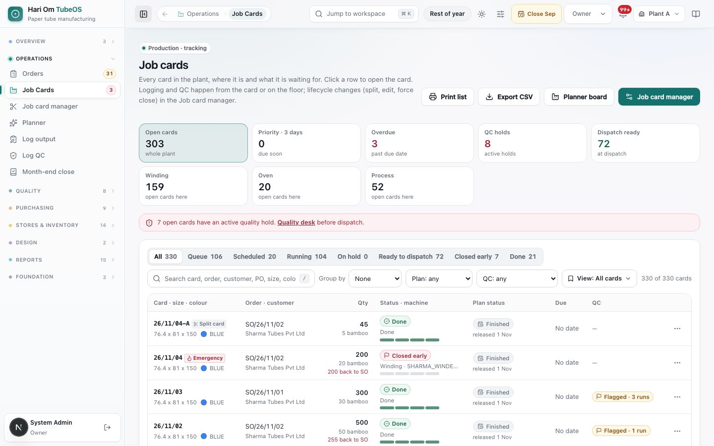
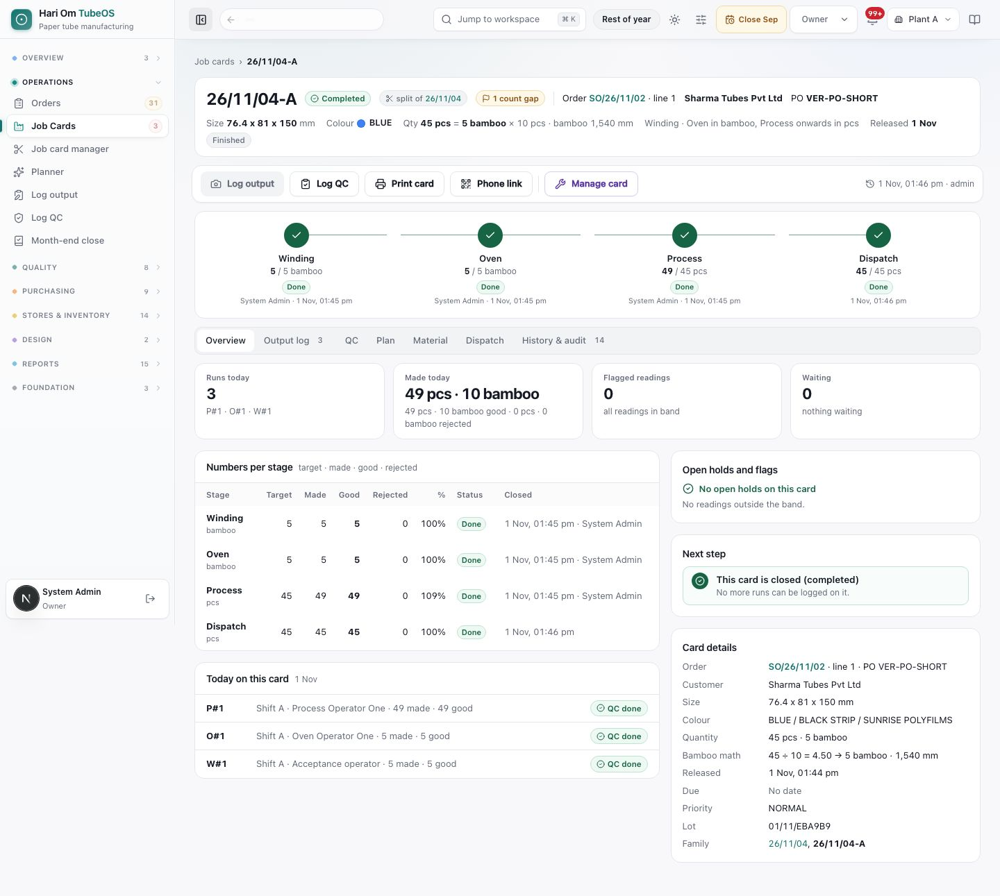
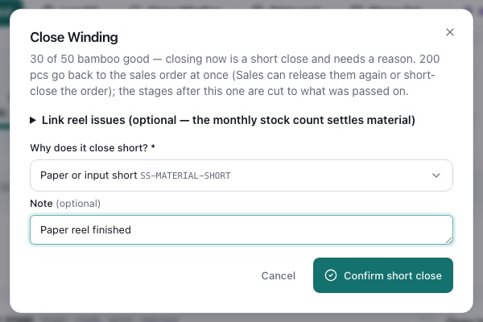
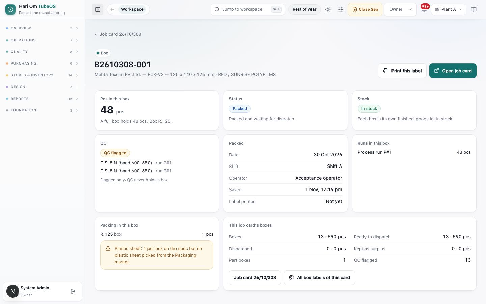
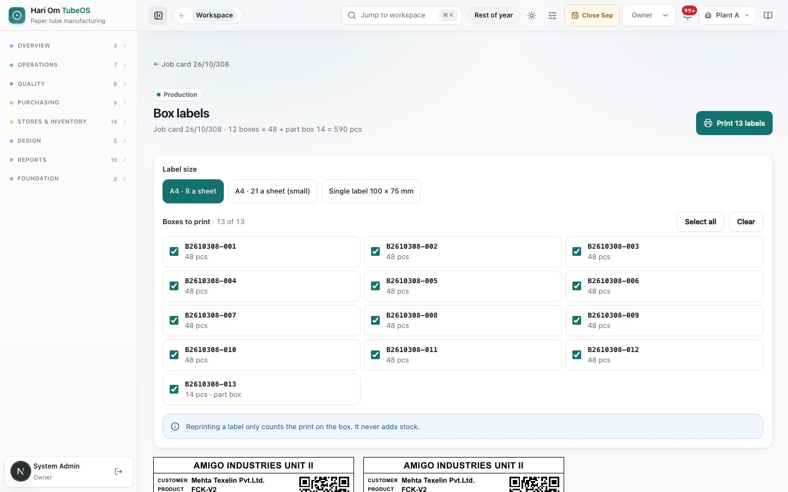
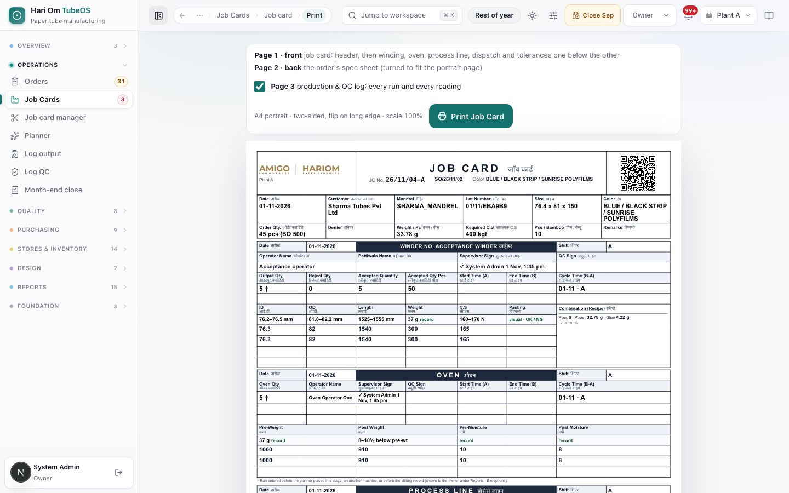

# Job cards

> **What it is:** The list of every job card in the plant and the one page per card that shows its stages, runs, QC, plan, material, boxes, dispatch and full history.
> **Who uses it:** Planner, Plant Manager, Operator, QC and In-process QC, Sales, Dispatch, Owner and Admin.
> **Where:** Sidebar > Operations > Job Cards (/production/job-cards); one card opens at /production/job-cards/<card>; a box opens at /production/boxes/<box code>; box labels print at /production/boxes/labels?card=<card>

## At a glance
- A job card is made when a sales order line is released. Its number is year/month/running number, for example **26/10/315**. A card split off it gets a letter: **26/10/315-A**.
- The **Job cards** list tracks where every card is. Click a row to open the card page. Lifecycle changes (split, edit, force close, cancel, emergency) are done in the **Job card manager**, not here.
- The card page is where the day's work happens: **Log output**, **Log QC**, **Close stage**, **Print card**, **Phone link**.
- **Any stage can close short.** The pcs the stage did not make go back to the sales order at once, the later stages carry on with what was passed on, and the card finishes normally.
- **Process good pcs are packed into boxes.** Each full box gets a box code (for example **B2610315-001**) and a QR label; the pcs left when Process closes go into a **part box**. The box is what goes into stock and what ships.
- **QC never holds a job card.** A reading outside its band is saved and **flagged** on the run, the box and the card. Only a hold that the plant head, Owner or Admin places on purpose stops the card.

## The flow
```flow
title: Life of a job card
Release order line [Sales] -> Card in queue (Queue) -> Plan the stage [Planner] (Scheduled) -> Log runs and QC [Operator] (Running) -> Close stage [Plant Manager] -> Boxes packed (Process good pcs) -> Close Process [Plant Manager] (part box packed) -> Ship all boxes [Dispatch] (Done)
after Card in queue: Log runs before planning [Operator] (flagged) -> Close stage [Plant Manager]
after Log runs and QC: Manual hold [Plant head/Owner/Admin] (On hold) -> Release hold [Plant head/Owner/Admin] -> Log runs and QC [Operator]
after Card in queue: Cancel card [Planner] (Closed early)
```
A card moves Winding, then Oven, then Process. Packing and the final QC close automatically with Process, so the floor sees only W, O, P and D (Dispatch). Boxes are packed while Process is still running, so the first boxes can ship before Process closes. The card is **Done** when Process is closed and every box has shipped or been kept as surplus.

```flow
title: Stage closed short
Close stage short [Plant Manager] (reason code) -> Balance back to the order (at once) -> Later targets cut (to pcs passed on) -> Later stages carry on [Operator] -> Card finishes normally
after Balance back to the order: Sales releases it again [Sales] (new job card)
after Balance back to the order: Sales short closes the order [Sales/Owner] (balance dropped)
after Close stage short: Reopen stage [Owner/Admin] (reason code) -> Balance back on the card -> Targets restored
```
A short close never stops the card. The pcs that were made keep moving. Only the pcs that were not made leave the card.

```flow
title: Boxes from Process
Process run logged [Operator] -> QC readings done [Operator/QC] -> Full boxes packed (box code and QR) -> Box posted to stock -> Box ready for a challan [Dispatch]
after Process run logged: Pcs left over -> Wait for the next run
after Full boxes packed: Process closed [Plant Manager] -> Part box packed (PART BOX label)
```

```flow
title: Batch entry (V2) versus old form (V1)
Card released [Sales] -> Batch entry card (V2) -> Log output, Log QC [Operator] -> Close stage [Plant Manager]
after Card released: Old-form card (V1) -> Old form tab [Supervisor] -> Move to batch entry [Planner/Supervisor] (only if no stage closed)
```
Every new release is a batch-entry card. Old-form cards are cards released before batch entry; they keep their stage form until they finish or are moved to batch entry. Boxes are packed on batch-entry cards only.

## Screen tour


*Figure: The Job cards list. Tiles across the top count open, priority, overdue, QC-hold and dispatch-ready cards and the cards at each stage; below are status tabs, search and filters, and a table with one row per card.*

What you see:
1. **Header buttons**: **Print list**, **Export CSV**, **Planner board** and **Job card manager**.
2. **Tiles** (whole plant): **Open cards**, **Priority · 3 days** (due in the next 3 plant days), **Overdue** (due before today), **QC holds** (holds placed on purpose and still open), **Dispatch ready**, then one tile per stage (**Winding**, **Oven**, **Process**, and **Slitting** when it has cards). Click a tile to filter the list; click it again to clear.
3. **Red banner**: "N open cards have an active quality hold. Quality desk before dispatch." It shows only when manual holds exist.
4. **Status tabs** with counts: **All**, **Queue** (released, not on the planner), **Scheduled** (on the board with date, shift and machine), **Running** (runs being logged), **On hold** (a hold placed on purpose), **Ready to dispatch** ("Process closed: its boxes are packed and labelled; waiting for a DC"), **Closed early** ("Cancelled, or force-closed with nothing left to make; the balance went back to the order"), **Done**. A card closed short on a stage, or force-closed, whose made pcs are still moving stays in **Running** or **Ready to dispatch** with a "closed early" chip until it is done.
5. **Search** (press **/** to jump to it): card, order, customer, PO, size or colour.
6. **Group by**: **None**, **Sales order**, **Stage**, **Status**, **Machine**. Each group line shows the card count and total pcs.
7. **Plan filter**: **Plan: any**, **Planned**, **Not planned yet**.
8. **QC filter**: **QC: any**, **Flagged readings (N)**, **On hold (N)**.
9. **View** menu: saved views (see How to save a view). On the right, "324 of 324 cards" tells how many rows match.
10. **Table columns**: **Card · size · colour**; **Order · customer**; **Qty** (pcs, with bamboo or kg under it); **Status · machine** (status badge, current stage and machine, a thin stage bar); **Plan status** (hover for detail and **Open in planner**; "released 30 Oct" under it); **Due** ("No date" when the order has none); **QC** (**Hold** in red for a manual hold, or **Flagged · N runs** in amber).
11. **Row menu (…)**: **Open**, **Log output**, **Log QC**, **Print card (A4)**, **Manage card**, **Plan / reschedule**, **Material genealogy**, **Sales order**.

Plan status words you may see: planned (date and shift), running, plan in parts, slot passed, missed (went back to the queue after 36 hours), not planned yet, waiting for the previous stage's plan, nothing to plan (packing and QC follow Process), all done. It is information only.


*Figure: The job card page for 26/10/315. The header gives the card's identity and bamboo math; an action bar holds Log output, Log QC, Print card, Phone link and Manage card; a stepper shows Winding, Oven, Process and Dispatch; the Overview tab shows today's numbers, holds and flags, the next step and card details.*

What you see:
1. **Header**: card number, lifecycle badge (**In queue**, **Scheduled**, **Running**, **Completed**, **Force-closed**, **Cancelled**), family chip ("no split", or "split of 26/10/315" with links), amber chips for **N flagged readings** and **N count gap** (Process pieces not matching bamboo × pcs per bamboo), then order and line, customer, PO and due date. Second line: size, colour, "Qty 900 pcs = 90 bamboo × 10 pcs", "Winding · Oven in bamboo, Process onwards in pcs", release date and plan status.
2. **Action bar**: **Log output**, **Log QC** (with "N waiting" when runs need readings), **Close <stage>** (shows a lock and "plant manager" or "QC short" when you cannot close), **Print card**, **Phone link** (QR and link to open this card on a phone), **Manage card**. A greyed button shows why on hover, for example "Card is closed" or "Your role cannot log runs".
3. **Stage stepper**: each stage with good/target (for example 90 / 90 bamboo), status chip and flag count, and who closed it and when. A stage closed short keeps its planned target in its history, so it reads for example "30 of 40 bamboo". Click a stage to jump to its runs.
4. **Tabs**: **Overview**, **Output log** (old-form cards show **Old form** instead), **QC**, **Plan**, **Material**, **Dispatch**, **History & audit**.
5. **Overview**: a rose box **Closed short** at the top when any stage closed short, one line per stage, for example "Winding: 30 of 40 bamboo · 100 pcs went back to the sales order · Paper or input short" (or "nothing went back to the order"). Then the tiles **Runs today**, **Made today**, **Flagged readings** ("outside the band · accepted, not held"), **Waiting**. Then **Numbers per stage** (Target, Made, Good, Rejected, %, Status, Closed), **Today on this card**, **Open holds and flags**, **Next step** and **Card details** (order, customer, size, colour, quantity, bamboo math, released, due, priority, lot).

The other tabs:
- **Output log**: every run with who, when, machine, made, good, rejected (with the rejection reason label, for example "2 · Winding loose"), QC state and plan match. Stage chips filter it. Buttons: **Export** (Excel), **Whole printed card** (plant manager types a full paper card at once), **Reopen stage…** (Owner and Admin), **Log output**. Rejection reasons come from Masters › Reason codes › **Floor rejection**: WL Winding loose, PG Pasting / glue, ID I.D. out, OD O.D. out, LN Length out, WT Weight out, CS C.S. low, DM Damage / dent, MS Moisture, NT Notch, RJ-OTHER Other (write a note). Old runs saved with OT still read as Other.
- **QC**: samples per stage, **Waiting for QC**, **Limits on this card** (frozen at release, with rule version and season) and **Flags and holds** with a link to the **QC flags register**.
- **Plan**: each planner slot with what was logged in it. "The plan is never moved by the floor." After a short close the later stages' slots are smaller (see Rules).
- **Material**: reels issued to the winder, issued versus theory, and what was posted to stock.
- **Dispatch**: the box tiles, the **Boxes** table, the dispatch slips (challans) and the packing note. Described below.
- **History & audit**: every event, filter chips **All**, **Card**, **Output**, **QC**, **Stages**, **Planning**, **Dispatch**, **Other**, a search box and an Excel export. A short close reads like "Winding closed short: 30 of 40 bamboo, 100 pcs back to the order · Paper or input short".


*Figure: The Close stage dialog for a stage that is short of target. It shows "30 of 40 bamboo good", a line saying the close is a short close, how many pcs go back to the sales order at once and that the stages after this one are cut to what was passed on, the reason picker "Why does it close short?", and the button Confirm short close.*

What you see:
1. **Good against target**: for example "30 of 40 bamboo good — closing now is a short close and needs a reason. 100 pcs go back to the sales order at once (Sales can release them again or short-close the order); the stages after this one are cut to what was passed on." When nothing is owed back it says "Nothing goes back to the order".
2. **Cannot close yet** (when something is missing): runs still with the supervisor, or QC readings (for example "I.D. — 1 of 2 readings"), with **Log QC on <stage>**.
3. **Why does it close short?**: the reason picker for the list **Stage closed short** (SS-MATERIAL-SHORT Paper or input short, SS-HIGH-REJECT High rejection at this stage, SS-MACHINE Machine breakdown, SS-CUST-QTY Customer needs less, SS-TIME No time left before delivery, SS-QUALITY Quality problem, run stopped, SS-OTHER Other). A note box sits under it; SS-OTHER needs a note of at least 5 characters.
4. **Unused input** (only when pcs from the stage before are left over): **Hold for follow-up** or **Scrap with reason**, and a second picker "Why is it held?" / "Why is it scrapped?" from the list **Leftover input at stage close** (LI-EXTRA-MADE, LI-DAMAGED, LI-WRONG-SIZE, LI-NEXT-RUN, LI-QC-DOUBT, LI-OTHER).
5. **On Process**: what will happen to boxes, for example "6 boxes are already packed (288 pcs). The 7 pcs left become a part box with its own label. Each box goes into stock on its own and ships on a challan by its box code." Also the theory paper, adhesive and parchment for the month, the **Finished-good item** (default: automatic from the product code) and **Stock location**.
6. **Confirm close** or **Confirm short close**. The message after a short close says, for example, "Winding closed short. 100 pcs went back to the sales order."

The **Dispatch** tab of a card (words only; the box picture is below):
1. **Tiles**: **Finished goods (boxes)** (pcs and box count, part boxes counted), **Ready to ship** (pcs in boxes that are in stock, "4 boxes in stock · released left 300"), **Shipped** (pcs and dispatch slips), **Kept back** (retained in stock, not inspected).
2. **Boxes** table: **Box** (box code as a link to the box page, a violet **part box** chip, an amber **QC flagged** chip), **Pcs**, **Packed** (date · shift · operator), **Stock** (**In stock**, **Posting…** or "Posting failed · retrying"), **Status** (**Packed**, **Dispatched** with the challan number, **Kept as surplus**). Button **Box labels**. If the spec has no qty per box, an amber line says "The spec has no qty per box: pcs are not boxed until it is set (Packing setup); at Process close everything goes into one part box." Packing warnings from the masters are listed in amber too.
3. **Dispatch slips from this card**: each challan (DC, when, pcs, status, vehicle · by) and **Create dispatch slip · N boxes ready**.
4. **Packing · box by box**: "Process good pcs are packed into boxes of 48 pcs as their QC readings are done; the pcs left at Process close go into a part box. Each box goes into stock on its own and uses one box plus the spec's plastic and fadda per box for the month's packing theory."


*Figure: The box page that a box label's QR opens. The header shows the box code with a Part box badge, the customer, product and size, and the buttons Print this label and Open job card. Panels show Pcs in this box, Status, Stock, QC, Packed (date, shift, operator, label printed), Runs in this box, Packing in this box and This job card's boxes.*

What you see:
1. **Header**: badge **Box** or **Part box**, the box code, and "Sharma Tubes Pvt Ltd — FG-76-81-150 — 76.4 x 81 x 150 · BLUE". Buttons **Print this label** and **Open job card**.
2. **Pcs in this box**: the pcs in big numbers, a **Part box** chip if it is one, and "A full box holds 48 pcs. Box R-150." (or "The spec has no qty per box.").
3. **Status**: **Packed** ("Packed and waiting for dispatch"), **Dispatched** ("On challan DC-… · 02 Nov 2026") or **Kept as surplus** ("Kept in stock as surplus after the order was filled").
4. **Stock**: **In stock**, **Posting…** or "Posting failed — retried automatically". "Each box is its own finished-goods lot in stock."
5. **QC**: **No QC flags**, or **QC flagged** with each reading (for example "I.D. 76.9 · run P#3") and "Flagged only: QC never holds a box."
6. **Packed**: Date, Shift, Operator, Saved (time), **Label printed** ("2 times" or "Not yet").
7. **Runs in this box**: which Process runs filled it, for example "Process run P#3 · 30 pcs" and "Process run P#4 · 18 pcs".
8. **Packing in this box**: the box, plastic and fadda codes with their counts, and any warning (for example a material with no weight in the master).
9. **This job card's boxes**: Boxes, Ready to dispatch, Dispatched, Kept as surplus, Part boxes, QC flagged, with links **Job card 26/10/315** and **All box labels of this card**.


*Figure: Box labels for job card 26/10/315. Label size buttons (A4 · 8 a sheet, A4 · 21 a sheet (small), Single label 100 × 75 mm), a tick list of the card's boxes with Select all and Clear, the note that reprinting never adds stock, and a preview of each label with the plant heading, customer, product, size, job card, order, a QR, the box code in big letters and the pcs, with PART BOX on the part box.*

What you see:
1. **Header**: "Job card 26/10/315 · 6 boxes × 48 + part box 7 = 295 pcs" and **Print N labels**.
2. **Label size**: **A4 · 8 a sheet** (2 × 4), **A4 · 21 a sheet (small)** (3 × 7, a compact layout) and **Single label 100 × 75 mm** (one per page, for a label printer).
3. **Boxes to print**: a tick box per box with its pcs, "part box" and "printed 2×" when printed before. **Select all** and **Clear**.
4. Blue note: "Reprinting a label only counts the print on the box. It never adds stock."
5. **The label**: top line the plant's label heading (for example AMIGO INDUSTRIES UNIT II; "FINISHED GOODS" when the plant has none). Then **Customer**, **Product** (product code · spec), **Size** (size · colour), **Job card**, **Order** (SO number · customer PO), and the QR with "Scan for box". Then the box code in very large letters, the pcs ("48 pcs"), a black **PART BOX** band on a part box, and the foot line "Packed 01 Nov 2026 · Shift A · Suresh".


*Figure: The printed job card. A panel lists the pages (front, back, optional page 3) with a Print Job Card button; below is the A4 portrait front with the header, QR code, and the winder, oven and process sections.*

What you see:
1. **Page list**: **Page 1 · front** (header, then winding, oven, process line, dispatch and tolerances one below the other), **Page 2 · back** (the order's spec sheet, turned to fit the portrait page), and a tick box for **Page 3** (production and QC log: every run and every reading; ticked by default once the card has runs).
2. Print hint: "A4 portrait · two-sided, flip on long edge · scale 100%" and the **Print Job Card** button.
3. **Front header**: plant logo, "JOB CARD" (with Hindi), JC No., SO number, colour, and a **QR code**. Scanning the QR with a phone opens this card's floor entry page.
4. **Header grid**: Date, Customer, Mandrel, Lot Number, Size, Colour, Order Qty, Denier, Weight / Pc, Required C.S, Pcs / Bamboo, Remarks.
5. **Stage blocks** (Winder, Oven, Process line, Dispatch, Stage QC): shift, operator, supervisor sign, output, reject and accepted qty, start and end time, cycle time, and reading rows with the allowed band printed above each column.
6. **Footnotes**: "†" marks a run entered before the planner placed the stage, on another machine, or before the slitting record; "✗" marks a reading outside its limit, "saved and flagged for QC, not held".

## Step by step

### How to find a card
1. Open **Job Cards**. Roles: everyone listed above.
2. Type part of the card number, order, customer, PO, size or colour in the search box. The list filters as you type.
3. Or click a tile (for example **Overdue**) or a status tab (for example **Running**).
4. Click the row to open the card. Ctrl-click (Cmd-click on Mac) opens it in a new tab.

### How to save and reuse a view
1. Set the tab, group, plan filter, QC filter and search you want.
2. Open the **View** menu and save the current filters with a name.
3. Next time, open **View** and pick it. Touching any filter by hand leaves the saved view. **Clear all** resets every filter.

### How to print or export the list
1. Filter the list to what you need.
2. Click **Print list**. All matching rows print, not only the first 60 shown on screen.
3. Or click **Export CSV**. The file "job-cards-<date>.csv" holds the matching rows.

### How to open a card's next step
1. Open the card. Read **Next step** on the Overview tab.
2. It tells you what is pending: runs with the supervisor to submit, runs waiting for QC, how much is left to make on the current stage, or that the stage is ready to close.
3. Click the button in that box (**Log output**, **Log QC**, **Close stage**, **Dispatch**). Logging is explained in "Log output and QC entry".

### How to close a stage in full (batch-entry card)
Roles: Plant Manager, Owner, Admin. No supervisor needs to be picked; your login is recorded as the one who closed it.
1. On the card, click **Close <stage>** in the action bar.
2. The dialog shows "N of target good". When good is at or above target, no reason is asked.
3. If it says **Cannot close yet**, it lists what is missing: runs still with the supervisor, or QC readings (for example "I.D. — 1 of 2 readings"). Click **Log QC on <stage>** to fix it.
4. If unused input is left from the stage before, choose **Hold for follow-up** or **Scrap with reason**, and pick the leftover reason code.
5. When closing **Process**, read the box line: how many boxes are packed, how many more full boxes will be packed, and the pcs that become a part box. You may pick the **Finished-good item** and **Stock location**.
6. Click **Confirm close**. Closing Process packs the last full boxes and the part box, posts each box to stock and opens the **Dispatch** tab.

### How to close a stage short (any stage)
Roles: Plant Manager, Owner, Admin. Works on Winding, Oven and Process.
1. Make sure every run is submitted and every run has its 2 readings per required check. A short close needs the same QC as a full close.
2. Click **Close <stage>**. The dialog says the close is a short close and how many pcs go back to the sales order.
3. Pick **Why does it close short?** from the list (for example SS-MATERIAL-SHORT). Add a note if useful; SS-OTHER needs one.
4. If input from the stage before is left over, choose Hold or Scrap and pick its leftover reason.
5. Click **Confirm short close**.
6. Result: the stage shows closed with "30 of 40 bamboo". The unmade pcs go to the order line at once as unreleased pcs. The later stages' targets are cut to the pcs this stage passed on, and their open planner slots shrink by themselves (the latest slots give first). The Overview's **Closed short** box, the history, the Job card manager's **Back to order** tile and the order page all show the same numbers.
7. Carry on logging the later stages as usual. Sales can now release the balance again or short close the order (see "Sales orders").

### How to reopen a closed stage
Roles: Owner and Admin.
1. Open **Output log**, pick the stage chip, click **Reopen stage…**.
2. Pick **Why is it reopened?** from the list **Entry correction / void / reopen** (for example EC-REOPEN-MORE More output to log after close) and add a note if needed.
3. If the stage had closed short, the system takes the returned pcs back from the order onto the card and restores the later stages' targets and planner slots.
4. If the order no longer has those pcs unreleased (Sales released them again on another card, or short-closed the order), the reopen is refused with the reason, for example "only 40 of the 100 pcs this close gave back are still unreleased on order SO/26/10/412; the rest was released again on another job card. Short-close or edit that card first."
5. Posted stock or tool use needs a governed reversal or an extra card. Reopening Process keeps the boxes already packed; new runs fill new boxes.

### How boxes are packed (nothing to click)
1. Each time a Process run is saved, its QC readings are saved, or Process is closed, the system packs boxes.
2. It takes the good pcs of Process runs whose readings are done (2 per required check), oldest run first, and fills boxes of the spec's **qty per box**. A run whose readings are still short waits.
3. Each full box gets the next box code (B + card number without the slashes + a 3-digit number: card 26/10/315 gives B2610315-001, B2610315-002…; a split card 26/10/315-A gives B2610315A-001). The box records the runs in it, the date, shift and operator of the run that completed it, and any QC flags of its runs.
4. Pcs that do not fill a box wait for the next run.
5. When Process closes, the pcs left become one **part box**.
6. Each box goes into stock on its own as a finished-goods lot named by its box code, with its packing material for the month's theory. If a hold placed on purpose is open on the card, the posting waits until it is released.
7. If the spec has no qty per box, nothing is boxed until the packing is set on **Packing setup**; at Process close all pcs go into one part box marked "The spec has no qty per box: all pcs went into one part box."

### How to print box labels
Roles: everyone who can open the card.
1. On the card's **Dispatch** tab click **Box labels** (or on a box page click **Print this label** or **All box labels of this card**).
2. Pick the **Label size**.
3. Tick the boxes to print (all are ticked at first). Use **Select all** or **Clear**.
4. Click **Print N labels**. The print is counted on each box; stock never changes. Reprint any time.
5. Stick each label on its box. Mark nothing by hand: the part box label already says **PART BOX**.

### How to open a box by its QR
1. Point any phone camera at the box label's QR, or open **Scan** in the app and scan it. Typing the box code (for example B2610315-001) in Scan works too.
2. The box page opens (log in if asked; the plant at the top must be the box's plant).
3. Read where the box is, its pcs, QC flags and the runs in it. Click **Open job card** to go to the card.

### How to print a card
1. Click **Print card** on the card (or **Print card (A4)** in the list row menu).
2. Untick **Page 3** if you do not want the run and QC log.
3. Click **Print Job Card**. Print A4 portrait, two-sided, flip on long edge, scale 100%.

### How to move an old-form card to batch entry
Roles: Owner, Admin, Plant Manager, Planner, Operator.
1. Open the card's **Old form** tab.
2. If no stage other than slitting has closed, a blue box offers **Move to batch entry**. Click it.
3. What was typed on the old form is kept and shown on the **Material** tab under "Typed on the old form before the move — enter it again as a batch".
4. If a stage was already closed on the old form, the card finishes on the old form. The server says "<stage> was already closed on the old form; finish this card there."

## Rules the system enforces
- **Planning never blocks.** A run on a stage with no planner slot saves and is flagged "Run before planning"; the card shows it and it appears in Reports › Plan vs actual. (FLAGS.)
- **Card times never block.** Start and end times are optional. An end time before the start time is saved and flagged "End time is before start time; check the date written on the card. Saved and flagged." (FLAGS.)
- **Good is worked out, never typed twice.** On batch-entry forms you type Made and Rejected; Good = Made − Rejected. On the old form you type produced and accepted; Reject Qty = produced − accepted. (AUTOMATIC.)
- **QC never holds or rejects a job card.** An out-of-band reading is flagged on the run, the batch, the box and the card. The run is accepted and the next stage can take it. No automatic hold is made. (FLAGS.)
- **2 readings per required check.** A run goes to the next stage, and its pcs go into a box, only once it has at least 2 readings on every required check (moisture is optional). A stage, including a short close, cannot close until it has them. (BLOCKS the close and the next stage.)
- **Runs with the supervisor block the close.** "N runs still with the supervisor must be submitted or voided first." (BLOCKS.)
- **Short close needs a reason code** from **Stage closed short**; leftover input needs a code from **Leftover input at stage close**. Free text alone is refused. Codes with OTHER need a note of at least 5 characters. (BLOCKS until chosen.)
- **Balance back to the order.** At a short close the returned pcs = this stage's target in pcs − this stage's good output in pcs (bamboo × pcs per bamboo on Winding and Oven). It goes to the order line at once; if Sales is unreachable it is sent again by itself. (AUTOMATIC.)
- **Later stages cut.** Every later stage's target becomes the smaller of its own target and what this stage passed on. Open planner slots of those stages shrink to match, latest slots first. (AUTOMATIC.)
- **Totals always reconcile.** Pcs returned to the order by all short closes + pcs in boxes = the pcs released on the card (when no stage made more than its target). (AUTOMATIC.)
- **Reopen** gives the returned pcs back to the card only if the order still has them unreleased and is not short-closed or cancelled; otherwise it is refused with the reason. (BLOCKS.)
- **Who closes**: Plant Manager, Owner or Admin. **Who reopens**: Owner or Admin, with an **Entry correction** reason code.
- **Boxes**: full boxes of the spec's qty per box from QC-cleared Process good pcs; the remainder at Process close is a part box. A Process run whose pcs are already in a box cannot be voided. (AUTOMATIC; BLOCKS the void.)
- **Box labels** count prints only and never change stock. (AUTOMATIC.)
- **Only holds placed on purpose stop a card.** A hold placed by the plant head, QC, Owner or Admin on the Quality pages stops the next stage and dispatch, and its box postings wait. Holds are released only by the plant head, Owner or Admin. (BLOCKS.)
- **Card done** when Process is closed and no box is left packed (all shipped or kept as surplus). (AUTOMATIC.)
- **Missed slot.** A scheduled card with no floor entry 36 hours after its shift ended goes back to the planner queue and shows a **Missed slot** chip (×2 if it happened twice). (AUTOMATIC.)
- **Closed cards.** A completed card takes no more runs, but late QC readings can still be added. A cancelled card takes nothing.
- **Closed month.** Runs dated in a month the Owner has closed are refused: "<Month> is closed. Ask the owner to re-open it." (BLOCKS.)
- **Limits are frozen.** The QC bands on a card are frozen at release; a new band version never changes an existing card.
- **Old-form (V1) cards**: completing a stage below plan needs a **Stage closed short** reason and an Owner, Admin or Plant Manager; rejected pieces on Winder, Oven and Process need a **Floor rejection** code. Dispatch no longer waits for a V1 final QC pass. (BLOCKS until given.)

## Sample
Sharma Tubes Pvt Ltd orders 400 pcs of 76.4 x 81 x 150, BLUE, on SO/26/10/412. Sales releases it; card **26/10/315** is made with 400 pcs = 40 bamboo × 10 pcs. The spec packs **48 pcs per box** in box R-150.

| Step | What happens | Card numbers |
|---|---|---|
| Winding closes short | 30 of 40 bamboo good, reason SS-MATERIAL-SHORT | Returned: 400 − 30 × 10 = **100 pcs** to the order at once |
| Targets cut | Oven target 40 → 30 bamboo; Process target 400 → 300 pcs | Planner slots of Oven and Process shrink |
| Oven closes | 30 of 30 bamboo good | Nothing returned |
| Process runs | 300 made, 5 rejected (code DM), 295 good | Boxes packed as readings are done |
| Boxes while running | 6 full boxes of 48 = 288 pcs (B2610315-001 to -006) | 7 pcs wait for the next run |
| Process closes short | 295 of 300 good, reason SS-HIGH-REJECT | Part box B2610315-007 with **7 pcs**; returned 300 − 295 = **5 pcs** |

The totals reconcile: 100 + 5 returned to the order + 295 pcs in 7 boxes = 400 pcs released. On the order line, 105 pcs are unreleased again. Dispatch ships boxes 001–004 (192 pcs) on 1 Nov while Process is still running, and boxes 005–007 (103 pcs) on 2 Nov. After the second challan the card is **Done**. A Process reading of I.D. 76.9 mm against 76.2–76.5 was flagged on run P#3; boxes 002 and 003, which hold pcs of P#3, show **QC flagged**, and they still shipped.

## Common questions
**Q: Why is Log output greyed out?** A: Hover over it. Common reasons: "Card is closed", "Old entry form — use the Old form tab", "No open stage takes runs", or "Your role cannot log runs".

**Q: The card is not planned. Can the operator still log a run?** A: Yes. The run saves and is flagged "run before planning". Planning is only the plan; the job card log is the truth.

**Q: What does "Flagged · 3 runs" mean in the QC column?** A: Three runs have at least one reading outside its band. They were accepted and not held. Click the flag to open the card's QC tab.

**Q: What is the difference between a flag and a hold?** A: A flag is information; nothing stops. A hold is placed on purpose on the Quality pages by QC, the plant head, Owner or Admin; it stops the next stage and dispatch until the plant head, Owner or Admin releases it. QC readings never make a hold by themselves.

**Q: Winding made less than planned. Do I have to close the whole card?** A: No. Close Winding short with a reason. The unmade pcs go back to the order, Oven and Process carry on with what Winding passed on, and the card finishes normally.

**Q: Where do the returned pcs go?** A: To the sales order line as unreleased pcs. Sales can release them again on a new card or short close the order with a reason.

**Q: I closed a stage short by mistake. Can I undo it?** A: The Owner or Admin can reopen the stage with a reason. The returned pcs come back to the card only if the order has not released them again or been short-closed.

**Q: Why are 7 pcs in a box of 48?** A: That is the part box: the pcs left when Process closed. Its label says PART BOX. It ships like any other box.

**Q: Why has no box been packed yet, although Process logged pcs?** A: The run's QC readings are not done (2 per required check), or the spec has no qty per box. Log the readings, or ask the Owner or Admin to set the packing on **Packing setup**.

**Q: I printed a box label twice. Is there extra stock now?** A: No. A print is only counted on the box. Stock comes only from packing.

**Q: Why can't I void this Process run?** A: Its pcs are already in a box. Correct it another way with the supervisor; the box and its stock stay as they are.

**Q: Why can't I close the stage?** A: The close dialog says why. Usually QC readings are short ("I.D. 1/2"), runs are still with the supervisor, or no reason was chosen for a short close. Only Plant Manager, Owner or Admin can confirm a close.

**Q: What does "Missed slot ×2" mean?** A: The card was planned twice and nothing was logged within 36 hours after each shift, so it went back to the planner queue. Plan it again, or log the run if it did happen.

**Q: What is a "count gap"?** A: On Process, the pieces counted (made + cutting loss + held) do not match bamboo × pcs per bamboo. The run is saved and flagged for the owner; nothing has to be written for it.

**Q: How do I split, edit or cancel a card?** A: Click **Manage card**. That opens the Job card manager (see the next chapter).

## Related chapters
- Job card manager
- Planner
- Log output and QC entry
- Quality
- Dispatch
- Sales orders
- Specifications (packing)
- Masters (Reason codes, Employees)
