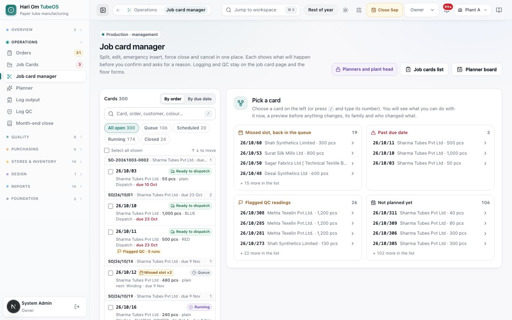
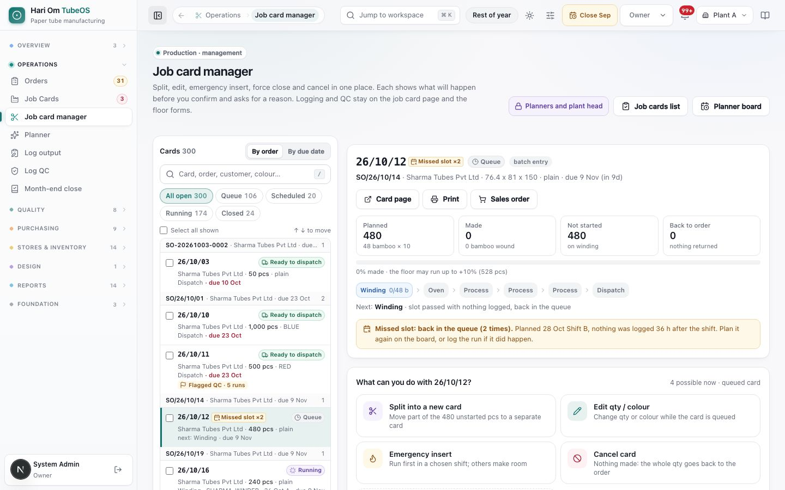

# Job card manager

> **What it is:** The one place where planners and the plant head change a job card's life: split into a new card, edit qty or colour, emergency insert, force close and cancel, each with a preview and a reason.
> **Who uses it:** Planner, Plant Manager, Owner and Admin. Other roles see a "for planners and the plant head" message and keep the Job cards list.
> **Where:** Sidebar > Operations > Job card manager (/production/job-cards/manage). A card opens directly with /production/job-cards/manage?card=<card>, which is what **Manage card** on a card or list row does.

## At a glance
- Every action shows **What will happen** before you confirm, and asks for a **reason** (at least 3 characters). The reason goes into the card history and the order history with your name.
- The manager only offers what the card allows right now. Everything else is listed under **Not possible now** with the exact reason.
- **Split into a new card** makes a separate card with its own number, lot, print, QC and dispatch. **Split plan** (on the Planner board) keeps one card and only cuts the plan into time slots.
- **Force close** is for old-form cards only. A batch-entry card that has runs or QC logged is closed short with **Close stage** on its card page instead.
- Closing a stage never asks for a supervisor. The plant manager, Owner or Admin who is logged in is recorded.

## The flow
```flow
title: One management change
Pick a card [Planner] -> Choose an action -> Fill qty or slot and reason -> Review the preview -> Confirm -> Done (card and order updated)
after Review the preview: Back [Planner] -> Choose an action
after Choose an action: Not possible now (reason shown) -> Close stage on the card page [Plant Manager]
```
Each action has three steps: the form, a confirm screen that repeats the result line by line with your reason, and a done screen with links (open the new card, place it on the planner, print).

```flow
title: Which action to use
Card in queue -> Edit qty / colour [Planner]
after Card in queue: Cancel card [Planner] (nothing made)
after Card in queue: Emergency insert [Planner] (runs first in a chosen shift)
Card running -> Split into a new card [Planner] (unstarted qty)
after Card running: Old form -> Force close [Planner] (keeps what is made)
after Card running: Batch entry -> Close stage short [Plant Manager] (on the card page)
```

## Screen tour


*Figure: The Job card manager before a card is picked. The left column lists cards grouped by order with status chips; the right side says "Pick a card" and shows four short lists of cards that need a decision.*

What you see:
1. **Header**: title, the chip **Planners and plant head**, and links **Job cards list** and **Planner board**.
2. **Cards** column header with the count, and a switch **By order** / **By due date**.
3. **Search** ("Card, order, customer, colour…"). Press **/** to jump to it and the up and down arrow keys to move through the list.
4. **Status chips**: **All open**, **Queue**, **Scheduled**, **Running** (runs logged, waiting QC, on hold or at dispatch), **Closed** (done, force-closed or cancelled).
5. **Select all shown** and a tick box on every card, for bulk actions.
6. **Card rows**, grouped under the order (for example "SO/26/10/01 · Sharma Tubes Pvt Ltd · due 23 Oct"): card number, chips such as **Emergency**, **Missed slot ×2** or **Split card**, the status badge (**Queue**, **Running**, **Ready to dispatch**…), customer, pcs, colour or "plain", current stage, due date, and **Flagged QC · N runs** when present.
7. **Pick a card** panel (right): four lists, each with the top cards and "+ N more in the list": **Missed slot, back in the queue**, **Past due date**, **Flagged QC readings**, **Not planned yet**. Click a card to open it here.

When you pick a card, the right side shows (described in words, no screenshot):
- **The card at a glance**: number, lifecycle badge, a small chip **batch entry** or **old form**, family (split from / top-up of), links **Card page** and **Sales order**, quantity, stage track, "Now at <stage>" (or "Next: <stage>" for a queued card), any hold reason, and a folding list **Planner slots (N)**.
- **Actions you can use now**, each a button with a one-line hint: **Split into a new card**, **Edit qty / colour**, **Emergency insert**, **Force close**, **Cancel card**, and a dashed link **Split plan on the Planner board** ("Run this one card over more days, shifts or machines: a planning change, it stays one card").
- **Not possible now**: the locked actions, each with its reason and, where it helps, a link such as **Close stage on the card page**.
- **Card family**: every card of this order line as a tree, with "this card" marked. A single card says "Only card on this line. A split adds the new card here, with its own number."
- **Management changes**: who, when, what, with before → after values and the reason. A **Full history** link opens the card page history. Runs and QC are not listed here.

**Bulk bar** (when cards are ticked): **Clear**, **Print** (each card on its own A4 sheet; allow pop-ups to open all at once), **Export CSV**, **Force close…**.


*Figure: Job card manager after picking card 26/10/12. The top shows the planned, made, not started and back-to-order quantities and the stage chain. Below it, **What can you do with 26/10/12?** lists Split into a new card, Edit qty / colour, Emergency insert and Cancel card.*

1. **Card list (left)**: all open cards grouped by order, with filters for Queue, Scheduled and Running.
2. **Card header**: card number, status chips (for example **Missed slot x2**, **Queue**, **batch entry**) and links to the card page, print and the sales order.
3. **Quantity tiles**: Planned, Made, Not started and Back to order.
4. **Stage chain**: Winding, Oven, Process and Dispatch, with the current stage highlighted.
5. **Action tiles**: each action shows a preview of what will happen before you confirm and asks for a reason.

## Step by step

### How to split part of a card into a new card
Roles: Planner, Plant Manager, Owner, Admin. Allowed while the card is queued, scheduled or running and has unstarted quantity on its first stage.
1. Pick the card, click **Split into a new card**.
2. The form says "Unstarted on this card: 600 pcs. Move part of it to 26/10/315-A." The new number is the next free letter.
3. Set **New card gets (pcs, 1–N)** with the slider, the box, or a quick pick (**¼**, **½**, **¾**, **All unstarted**). Quick picks are whole bamboo where the card has pcs per bamboo.
4. Write the reason, or click a quick reason: "Customer call-off earlier", "Second machine free", "Urgent part dispatch", "Colour / print change on part".
5. Read the preview: this card keeps X pcs and its plan; the new card gets Y pcs, "planner queue · unplaced", same colour; which planner slots shrink or come off the board (the latest slots give first); "Order line stays N pcs: now on 2 cards".
6. Click **Review split of Y pcs**, check the confirm lines, then **Yes, create 26/10/315-A with Y pcs**.
7. Done: links **Open 26/10/315-A**, **Place it on the planner board**, **Print new card**. Runs already logged stay on the old card.

### How to edit quantity or colour
Roles: Planner, Plant Manager, Owner, Admin. Only a **queued** card (not yet on the board) can be edited.
1. Pick the card, click **Edit qty / colour**.
2. Change **Quantity (pcs)** (a whole number of at least 1) and/or pick a new colour (**Keep current colour** leaves it). A plain card can change only the qty.
3. Write the reason (quick reasons: "Customer changed the PO", "Entry mistake at release", "Colour per customer artwork").
4. The preview shows the release lot on the order moving by the difference, and that the paper on the material plan follows the new colour. Click **Review change**, then **Yes, save the change**.
5. The sales order's release lot is changed in step. If nothing changed, the server says "Nothing changed".

### How to put a card first (emergency insert)
Roles: Planner, Plant Manager, Owner, Admin. Only a queued or scheduled card with unstarted work on its first stage.
1. Pick the card, click **Emergency insert**.
2. Choose the machine, the date (today or later) and **Shift A** or **Shift B**, or a quick slot: **Today · Shift A**, **Today · Shift B**, **Tomorrow · Shift A**.
3. The preview shows the load already in that slot. If the shift goes over capacity, the lowest-priority cards move to the next shift (and onward). Running cards never move.
4. Write the reason (for example "Customer line down", "Truck booked today"). Click **Review insert**, then **Yes, insert 26/10/315 first**.
5. The card shows an **Emergency** chip. Everyone affected is notified, and each moved card's history records the move.

### How to force close an old-form card
Roles: Planner, Plant Manager, Owner, Admin. Only cards on the **old form** that have made something but not everything.
1. Pick the card, click **Force close**.
2. The form says "Close 26/10/280 now with what is made." The preview shows "Closed at 400 pcs · 200 pcs back to the order", the planner slots that are freed, and that the card will show **Closed early**.
3. Write the reason (quick reasons: "Material short", "Customer reduced the PO", "Machine down, re-plan on a new card", "Quality: rest scrapped").
4. Click **Review force close**, then **Yes, close at 400 pcs**. What was made keeps moving through the remaining stages on the same card; the balance can be released again from the order.

### How to cancel a card
Roles: Planner, Plant Manager, Owner, Admin. Only when nothing is made. A batch-entry card can be cancelled only while no run and no QC is logged on it.
1. Pick the card, click **Cancel card**.
2. The preview says the whole qty goes back to the order and all its planner slots are freed.
3. Write the reason ("Released by mistake", "Customer cancelled the line", "Merged into another card"). Click **Review cancel**, then **Yes, cancel 26/10/311**.
4. The card shows **Cancelled**. No runs, QC or close can be saved on it any more.

### How to force close several cards at once
1. Tick the cards in the left column, click **Force close…** in the bulk bar.
2. Write one reason for all. Each card closes at what is made, or is cancelled if nothing is made; the balance goes back to its order.
3. Cards the rule does not allow are left as they are, with the reason ("Batch-entry card: left as it is. Close it short with Close stage on its card page.", "Already closed: left as it is.").
4. Click **Yes, force close N cards**. The result lists each card.

### How to close a batch-entry card short
This is done on the card page, not here. See "Job cards", How to close a stage. Roles: Plant Manager, Owner, Admin. There is no supervisor field; the login is recorded.

### How to move an old-form card to batch entry
Open the card's **Old form** tab and click **Move to batch entry** (Owner, Admin, Plant Manager, Planner, Operator). It works only while no stage except slitting has closed on the old form. A card whose old form cannot close anything because its stage QC was never approved moves by itself when its page opens. See "Job cards".

## Rules the system enforces
- **Reason required** for every action (at least 3 characters on screen; the server also requires it for force close and emergency insert). (Blocks.)
- **Edit** only while **queued**. A scheduled card: "On the board already: qty and colour are locked. Take it back to the queue on the planner, or split it." A running card: split the unstarted part instead. (Blocks.)
- **Split** needs unstarted quantity on the first stage and must leave at least 1 pc on the original card ("Split must leave some quantity on the original card"). (Blocks.)
- **Emergency** only for queued or scheduled cards; "Already running on a machine: nothing to jump ahead of." (Blocks.)
- **Force close** only for old-form cards with something made and something still to make. Nothing made: use **Cancel card**. Everything made: finish the card normally. Batch entry: "Runs or QC are already logged on this card: close it short with Close stage on the job card page, with a reason." (Blocks.)
- **Cancel** only when nothing is made; a batch-entry card only while it has no runs or QC. (Blocks.)
- **Sales order kept in step.** Edit, split, force close and cancel all change the order's release lot. A card without a sales release lot cannot be changed: "No sales release lot on this card, so the order cannot be kept in step." (Blocks.)
- **Safe retry.** Pressing confirm again after a lost connection does not cut a second split. (Automatic.)
- **Audit.** Every change is recorded with who, when, before → after and the reason, on the card and on the order. (Automatic.)

## Sample
Card 26/10/315 for Sharma Tubes Pvt Ltd: 900 pcs, BLUE, scheduled on Winder 1 for 31 Oct Shift A (600 pcs) and Shift B (300 pcs). The customer wants 300 pcs early.

| Field | Value |
|---|---|
| Action | Split into a new card |
| New card gets | 300 pcs |
| Reason | Customer call-off earlier |
| Result: 26/10/315 | 900 → 600 pcs, keeps its plan |
| Result: 26/10/315-A | 300 pcs, planner queue, unplaced |
| Slot change | 31 Oct · Shift B · Winder 1: 300 → off the board |
| Order line | stays 900 pcs, now on 2 cards |

The planner then places 26/10/315-A on Winder 2 for 1 Nov Shift A and prints it.

## Common questions
**Q: Why is Edit greyed out?** A: The card is already on the board or running. Take it back to the queue on the planner, or split the unstarted part into a new card.

**Q: When do I use Split into a new card and when Split plan?** A: Split into a new card when part of the order needs its own card (own print, QC, dispatch). Split plan when the same card should run over more shifts, days or machines.

**Q: Force close is locked on my card. Why?** A: It is a batch-entry card with runs logged. Open the card page and use **Close stage**; a short close needs a reason and sends the balance back to the order.

**Q: Can I undo a cancel?** A: No. Release the quantity again from the sales order to make a new card.

**Q: Who gets told about an emergency insert?** A: Everyone affected is notified, and each card that had to move gets the move in its history.

**Q: Does closing a stage still need a supervisor's name?** A: No. Plant Manager, Owner or Admin closes it, and that login is recorded.

**Q: The new split card is not on the board. Is that normal?** A: Yes. A split card starts in the planner queue, unplaced. Use **Place it on the planner board**.

## Related chapters
- Job cards
- Planner
- Sales orders
- Log output and QC entry
