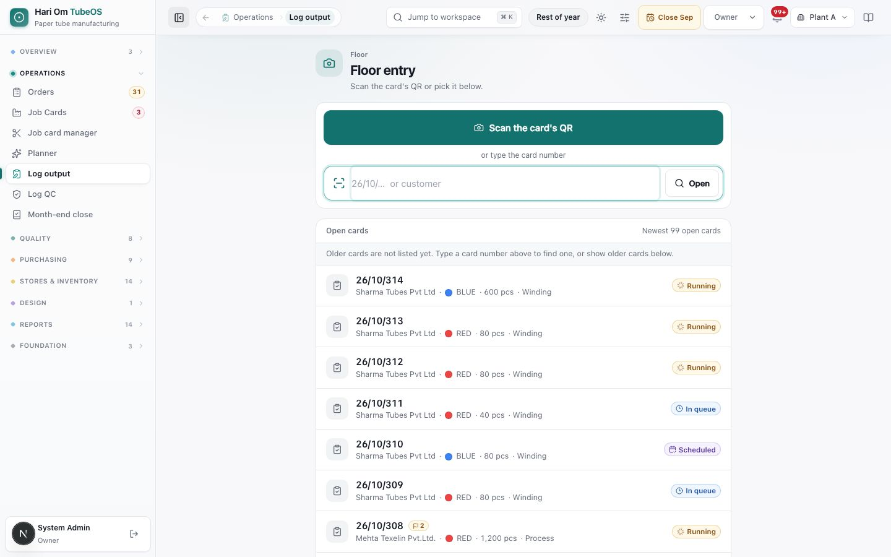
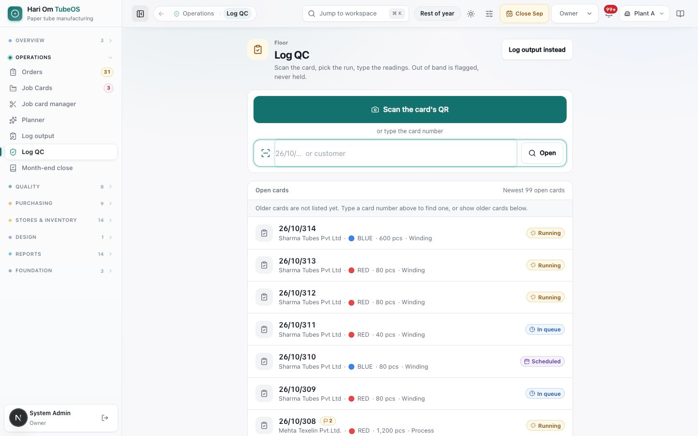
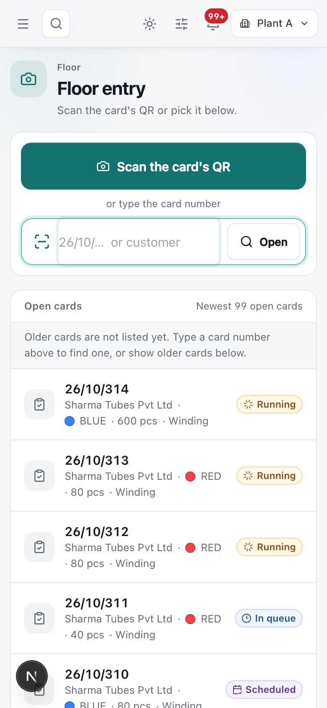
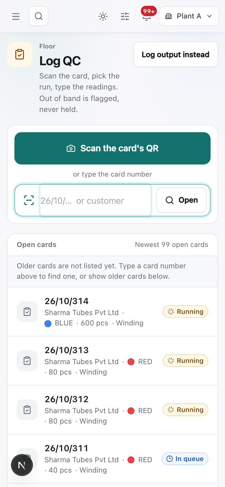
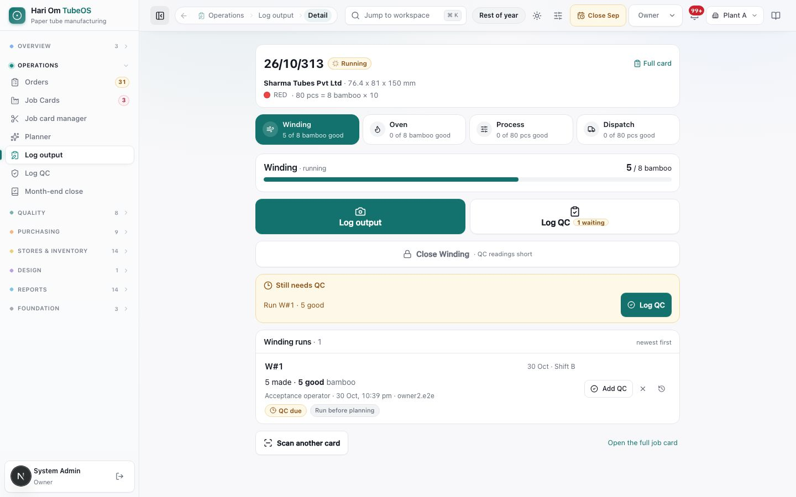
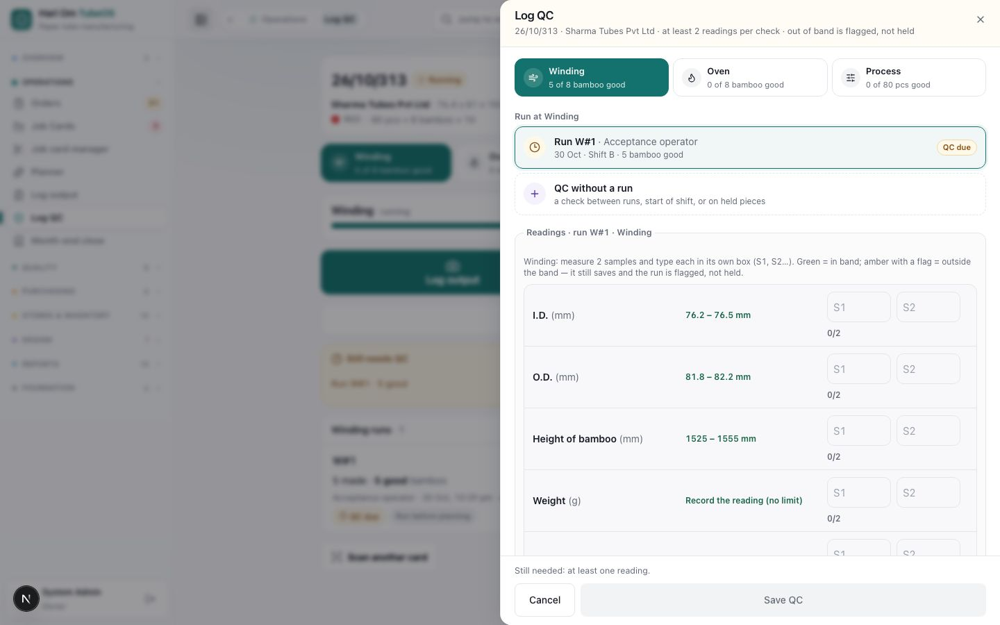

# Log output and QC entry

> **What it is:** The two short floor forms: **Log output** (how many were made and rejected on a run) and **Log QC** (the readings for a run). Same pages on a phone and a PC.
> **Who uses it:** Operator, Plant Manager, QC and In-process QC, Owner and Admin. Planners can open the pages and view runs.
> **Where:** Sidebar > Operations > Log output (/production/entry) and Log QC (/production/entry?mode=qc). Scanning a printed card's QR opens /production/entry/<card>.

## At a glance
- Find the card by **scanning its QR**, typing its number (26/10/315, or 26-10-315), or picking it from **Open cards**.
- **Log output** asks only for date, shift, machine, operator, times (optional), made and rejected. Good = Made − Rejected. There are no QC fields on it.
- **Log QC** asks for the readings: **at least 2 readings per required check** (moisture is optional). **Operators log QC too**; no separate inspector is needed.
- A reading **outside its band is saved and flagged, never held**. The run is accepted and the next stage can take it.
- An operator's run goes **to the supervisor** (plant manager, Owner or Admin), who checks and submits it. A supervisor's own run posts straight away.

## The flow
```flow
title: One run on the floor
Scan card QR [Operator] -> Pick stage -> Log output [Operator] (made, rejected) -> Send to supervisor -> Submit run [Plant Manager] -> Log QC [Operator/QC] (2 readings per check) -> Next stage can take it
after Log QC: Reading out of band -> Saved and flagged (not held)
after Log output: Log QC for this run now [Operator]
```
QC can be logged straight after the run (the saved screen offers **Log QC for run W#3 now**), later from the card, or from the QC desk. A run with its readings still due waits; the next stage takes only runs whose QC is recorded.

```flow
title: Old links
Supervisor entry link -> Floor entry (Log output)
after Supervisor entry link: EOD entry link -> Floor entry (Log output)
after Supervisor entry link: Order tracker link -> Orders list
```

## Screen tour


*Figure: Floor entry, opened from the Log output link. A large green "Scan the card's QR" button, a box to type the card number or customer with an Open button, and the list of open cards.*

What you see:
1. **Title**: "Floor entry" (from the **Log output** link) or "Log output" / "Log QC" when the page was opened for one of them. On Log QC a button **Log output instead** switches over (and **Log QC instead** the other way).
2. **Scan the card's QR**: opens the phone or laptop camera. Point it at the QR on the printed job card.
3. **Card number box** ("26/10/…  or customer") and **Open**. Numbers typed with dashes, dots or spaces read as 26/10/315. Typing a customer or order opens the first open card that matches.
4. **Open cards**: newest open cards first, 100 at a time ("Newest 99 open cards"), each with number, flag count (amber), customer, colour, pcs, current stage and status (**Running**, **In queue**, **Scheduled**). **Show older cards** loads more.
5. **Error lines** in red when the scan or number is wrong: "That is a rack label…, not a job card", "That QR is on a material or tool label, not a job card", "Job card 26/10/315 is closed (completed). No more runs can be logged on it." (with **View the card**), or "No open job card 26/10/999".


*Figure: Log QC. The same picker; the subtitle reads "Scan the card, pick the run, type the readings. Out of band is flagged, never held."*


*Figure: Floor entry on a phone. The scan button and number box fill the width; open cards are large rows for fingers.*


*Figure: Log QC on a phone. Same layout as on the PC.*

After a card is opened (described in words; no screenshot of the forms):
- **On a phone** (/production/entry/<card>): the card's number, customer and size; its stages as tabs; two big buttons **Log output** and **Log QC**; the stage's recent runs (newest first); and what still needs QC. A card of another plant switches your active plant if you are allowed. A closed card is read-only; a completed card still takes QC readings.
- **On a PC**: the job card page opens with the form in a side panel ("Log output · 26/10/315 · Sharma Tubes Pvt Ltd · no QC fields here", or "Log QC · at least 2 readings per check · out of band is flagged, not held").

**Log output form** sections:
1. **Stage tabs** (Winding, Oven, Process; closed stages show "Closed · 90 bamboo").
2. **Who and when**: **Date** (**Today**, **Yesterday**, or **Other date**), **Shift** (**Shift A** 08–20, **Shift B** 20–08), the machine (**Winder no.**, **Oven no.**, **Line no.**), **Operator** (from Masters › Employees; the last one is remembered), and **Start time** / **End time** ("Times are optional"; the cycle time is shown).
3. **How many**: on Process first **Bamboo taken from Oven** with "N ready from Oven · 1 bamboo = 10 pcs". Then **Made** and **Rejected** in the stage unit (bamboo for Winding and Oven, pcs for Process). A green box shows **Good = Made − Rejected**. A **Plan match** box shows where the run lands against the plan.
4. **Process balance** (Process only): "9 bamboo × 10 pcs = 90 pcs · all pieces accounted for", or an amber count-gap line ("4 pcs short — it still saves and the run is flagged for the owner"). **Cutting loss (pcs, if any)** with a button to count the gap as cutting loss; a cutting loss needs a reason.
5. **Why rejected?**: a **Rejection code** (WL, PG, ID, OD, LN, WT, CS, DM, MS, NT, OT) when anything is rejected; **OT (Other)** needs words.
6. **Save run** (supervisor roles: "Saving posts the run straight away") or **Send to supervisor** (operator: "Your run goes to the supervisor, who checks and submits it").

**Log QC form** sections:
1. **Stage tabs**. A stage without checks is greyed: "No QC checks on this stage"; Final QC says "Process QC is the final QC".
2. **Run**: the run waiting for QC is picked first. Runs still **with supervisor** can take QC too. **QC without a run** is for a check between runs, at the start of a shift, or on held pieces.
3. **Readings table**: one column per check with its allowed band, one row per sample (S1, S2…). Cells turn green in band and red out of band. **Add another sample** adds a row. A check named Remark or Notes is written in words ("Note — write in words") and is never judged.
4. **Instrument ID** where a check needs a calibrated instrument.
5. **Reason** (only when you change readings already saved) and **Remark** (optional — what you saw, in plain words).
6. The save line: "All readings in band." or "Saves with 2 flagged readings — not held." and the button **Save QC** (or **Save QC · flagged**).


*Figure: Floor entry after opening card 26/10/313. The four stage tabs (Winding, Oven, Process, Dispatch) show how many are good. Big buttons **Log output** and **Log QC** sit under the progress bar. A yellow **Still needs QC** box lists runs waiting for readings.*

1. **Stage tabs**: pick the stage you are working on. Each shows good pieces against the target.
2. **Progress bar**: how much of the stage is done.
3. **Log output / Log QC**: the two actions you use on the floor. A small badge shows how many QC checks are waiting.
4. **Close Winding**: stays locked with a reason (here "QC readings short") until the checks are done.
5. **Still needs QC**: runs that have output but not enough QC readings yet.
6. **Winding runs**: every run, newest first, with **Add QC**, cancel and history buttons.


*Figure: The **Log QC** panel. At least two readings per check (S1, S2). Each check shows its allowed band, for example I.D. 76.2 to 76.5 mm. Out-of-band readings are flagged, not held.*

1. **Stage tabs**: choose Winding, Oven or Process.
2. **Run list**: pick the run to check, or **QC without a run** for a check between runs, at start of shift or on held pieces.
3. **Readings**: type each measurement in its own box. Green means in band; amber with a flag means outside the band. It still saves.
4. **Save QC**: stays grey until at least one reading is typed. The footer says what is still needed.

## Step by step

### How to log a run on a phone
Roles: Operator, Plant Manager, Owner, Admin.
1. Scan the QR on the printed job card with the phone camera (or open **Log output** and tap **Scan the card's QR**). Log in if asked; you come back to the card.
2. Tap the stage tab, then **Log output**.
3. Check **Date** and **Shift**. They default to the shift running now (see the night-shift rule below).
4. Tap the machine and pick the **Operator**. Times are optional.
5. Type **Made** and **Rejected**. If you rejected anything, pick the **Rejection code**.
6. On Process, type **Bamboo taken from Oven**. If the pieces do not match bamboo × pcs per bamboo, type any **Cutting loss** and its reason, or leave the gap: it saves and is flagged.
7. Tap **Send to supervisor** (operator) or **Save run** (supervisor). The saved screen shows "Run W#3 sent to the supervisor" or "Run W#3 saved", with Made, Rejected, Good and the plan match.
8. Tap **Log QC for run W#3 now**, **Log another run**, or **Done**.

### How to log a run on a PC
1. Open the job card (Job Cards list, click the row). Or use the row menu **Log output**.
2. Click **Log output** in the action bar. The form opens in a side panel.
3. Fill it as above and save.
4. A plant manager can also type a whole paper card at once: **Output log** tab > **Whole printed card** (running totals of every stage; only what is new is posted).

### How to log QC readings
Roles: Operator, QC, In-process QC, Plant Manager, Owner, Admin.
1. Open the card and click **Log QC** (or scan with **Log QC** open). The button shows "N waiting" when runs need readings.
2. Pick the stage tab and the **Run** (the waiting run is already picked).
3. Type at least 2 readings for every required check, one per sample row. Use **Add another sample** for more.
4. If a cell turns red, check the value. If it is right, keep it: "It still saves — the run is flagged, not held, and the next stage can take it."
5. Type the **Instrument ID** if asked. Add a **Remark** if you saw something.
6. Click **Save QC**. The saved screen shows "QC saved · run W#3 · all in band" or "flagged", lists the flags under **Flagged, not held**, and says which runs still wait for QC.

### How a supervisor submits operators' runs
Roles: Plant Manager, Owner, Admin.
1. Open the card, **Output log** tab. Runs marked **With supervisor** are drafts; they do not count yet.
2. Check each one; edit it if needed (an operator can edit only their own drafts).
3. Use the tick action ("Checked — post this run"). The run now counts.
4. A stage cannot close while any run is still with the supervisor.

### How to correct a mistake
- **A draft run**: edit it (operator: own drafts only; supervisor: any).
- **A submitted run**: void it with a reason, then log it again. Output already used by the next stage cannot be voided. Every save of a run is kept under **Revision history**.
- **QC readings**: open Log QC on the same run, change the value and write the **Reason** for changing readings already recorded. Adding more readings needs no reason.

## Rules the system enforces
- **Floor entry roles**: Operator, Plant Manager, QC, In-process QC, Planner, Owner and Admin can open the floor pages. Logging runs: Operator, Plant Manager, Owner, Admin ("Your role can view runs but not log them" for others). QC and In-process QC may add QC readings only. (Blocks.)
- **Required on a run**: date, shift (Shift A or Shift B only), operator, made > 0; rejection code if rejected > 0; a reason for any cutting loss; Process bamboo taken. (Blocks.)
- **Rejected cannot be more than made.** (Blocks.)
- **Above 110% of target** needs an overproduction reason. (Blocks until written.)
- **Card times never block.** Start and end are optional; an end before the start is saved and flagged. (Flag only.)
- **Planning never blocks.** A run on a stage with no planner slot is saved and flagged "Run before planning". The floor never picks a slot; the server places the run in the slot of its date and shift. (Flag only.)
- **Count gap** on Process (pieces ≠ bamboo × pcs per bamboo) is a warning and a flag, never a block. If the spec has no pcs per bamboo, Process cannot be saved: "This card's spec has no pieces per bamboo… Ask the planner to correct the spec." (Flag; blocks only without pcs per bamboo.)
- **QC gate between stages.** The next stage can take only QC-cleared output: "Only 60 bamboo of Winding output is QC-cleared; 30 more is waiting for Winding QC. Record that batch's QC first, or a supervisor can override with a reason." Only a plant manager, Owner or Admin may override, with a reason that stays on the run. (Blocks, supervisor override.)
- **2 readings per required check** for a run to be QC done, and for a stage to close (including a short close). Moisture is optional; a missing optional reading is flagged for the owner. (Blocks the close and the next stage.)
- **Out-of-band reading** saves, flags the run and appears on the card, the order and Quality › In-process QC. No hold is made. (Flag only.)
- **Future dates refused**: "<date> is in the future. Use the date the shift started." (Blocks.)
- **Closed month**: runs dated in a closed month are refused ("<Month> is closed. Ask the owner to re-open it."). QC-only checks are not affected. (Blocks.)
- **Cancelled cards** take nothing. **Completed cards** take QC readings only. (Blocks.)
- **Drafts on the device.** Every floor form keeps what you typed on the phone or PC until it is saved; reopening shows a "Draft restored" bar with a discard option. (Automatic.)

**Canonical shift and the night-floor date.** There are two shifts: **Shift A** 08:00–20:00 and **Shift B** 20:00–08:00 (India time). Shift names written as "A", "Shift A" or "shift-a" are all read as Shift A. The date of a run is **the day the shift started**: a run at 01:30 on 31 Oct belongs to Shift B of **30 Oct**, and the form picks 30 Oct by itself. When you change the shift on the form, the date follows (at 10:00, choosing Shift B gives last night's date). Times before 08:00 on Shift B are stored on the next calendar day.

**Old pages that now redirect.** "Supervisor entry" (/production/supervisor-entry) and "EOD entry" (/production/eod-entry) open Floor entry; a link that named a card opens that card. Old printed QR codes still work. The old Order tracker (/planning/tracker) opens the Orders list with the matching filter.

## Sample
Night shift, card 26/10/315 (Sharma Tubes Pvt Ltd, 76.4 x 81 x 150, BLUE, 10 pcs per bamboo).

| Field | Value typed | Result |
|---|---|---|
| Time on the clock | 01:30, 31 Oct | Date 30 Oct, Shift B (automatic) |
| Stage / machine | Process / Line 1 | Plan match: As planned · 30 Oct · Shift B |
| Bamboo taken from Oven | 9 | 9 × 10 = 90 pcs possible |
| Made / Rejected | 86 / 2 (code OD) | Good = 84 pcs |
| Cutting loss | 4, "end trimming" | all pieces accounted for (86 + 4) |
| Saved by | Operator | "Run P#2 sent to the supervisor" |

QC on run P#2: I.D. 76.5 and 76.9 mm against band 76.2–76.5. The second reading is red; the operator saves. Result: "QC saved · run P#2 · flagged", "I.D. 76.9 mm (band 76.2–76.5) · S2". The run is accepted; the flag shows on the card and in In-process QC.

## Common questions
**Q: The scan opened "That QR is on a material or tool label". What now?** A: You scanned a reel, lot or tool label. Scan the QR on the printed job card.

**Q: It is 2 a.m. Why does the form say yesterday's date?** A: The run belongs to Shift B, which started yesterday at 20:00. That is correct.

**Q: Do I have to fill start and end time?** A: No. They are optional and never stop a save.

**Q: My reading is outside the band. Will the card stop?** A: No. It is saved and flagged. Only a hold raised by QC on the Quality pages stops a card.

**Q: Why can't the next stage take my batch?** A: Its QC is not done yet. Add at least 2 readings for every required check on that run, or ask the supervisor to override with a reason.

**Q: I saved a run but it does not count.** A: It is with the supervisor. A plant manager, Owner or Admin must submit it.

**Q: I typed the wrong quantity on a submitted run.** A: Ask the supervisor to void it with a reason, then log it again. If the next stage already used that output, it cannot be voided.

**Q: Where is the old Supervisor entry page?** A: It now opens Floor entry. Use Log output.

## Related chapters
- Job cards
- Planner
- Quality
- Job card manager
