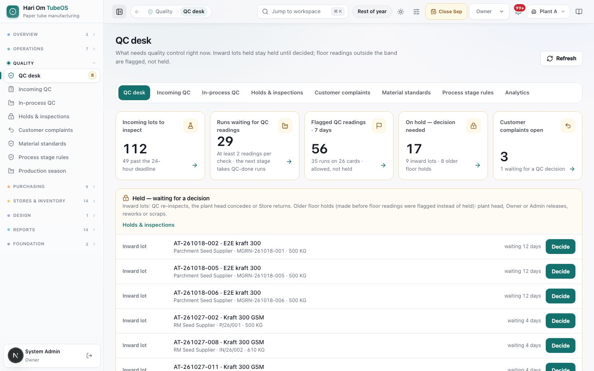
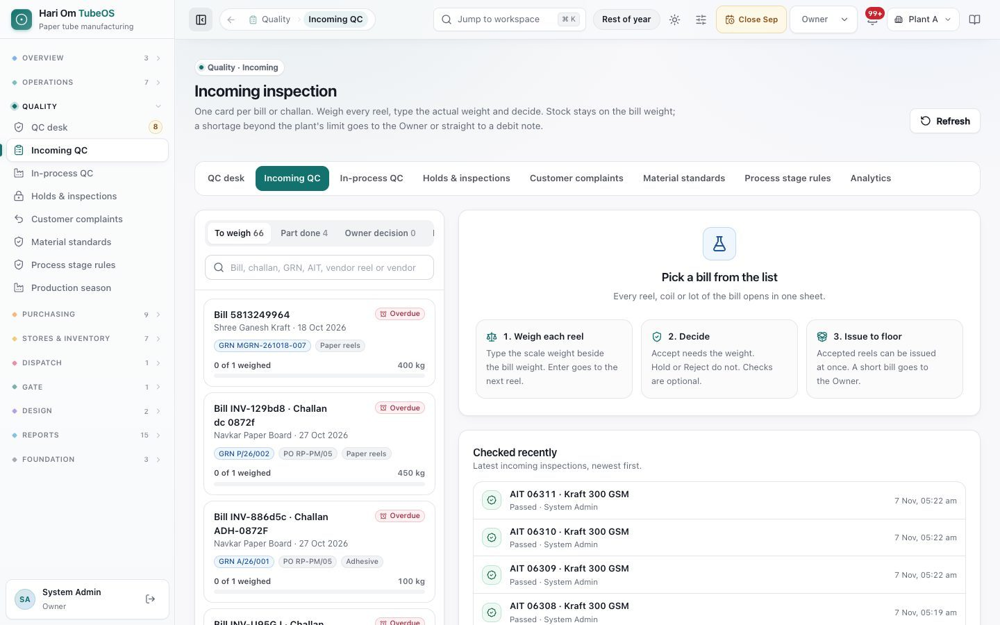
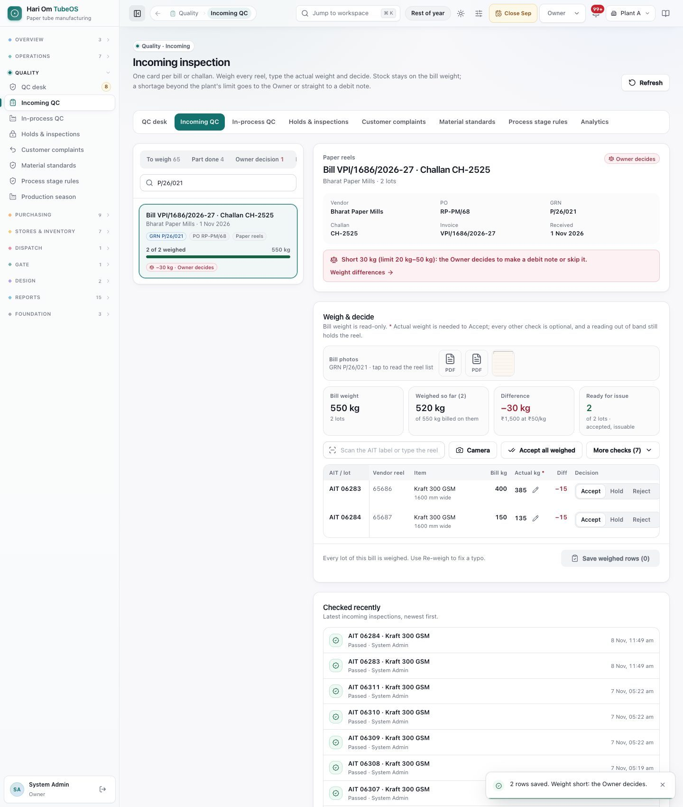
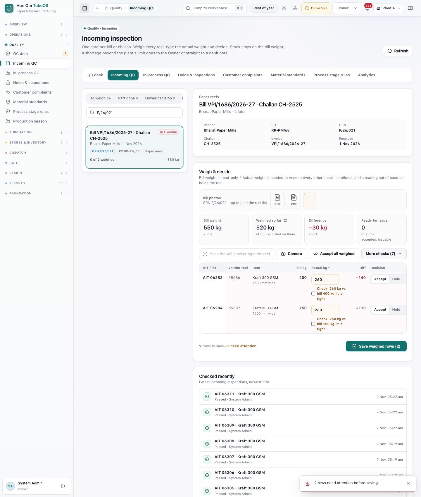
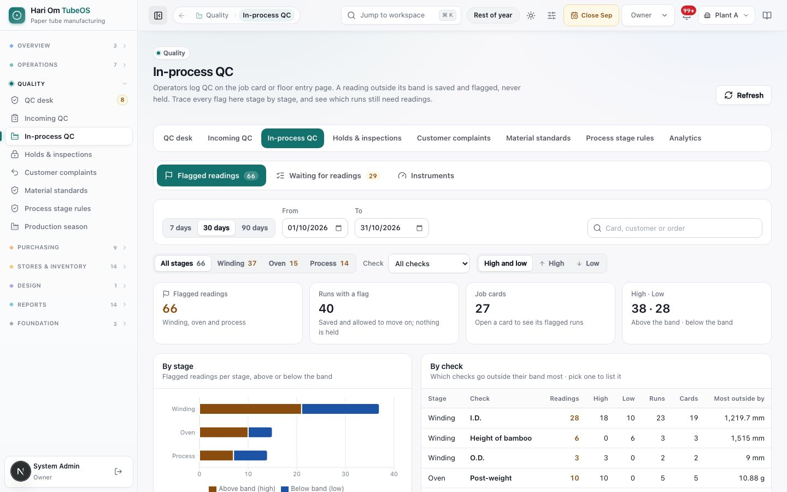
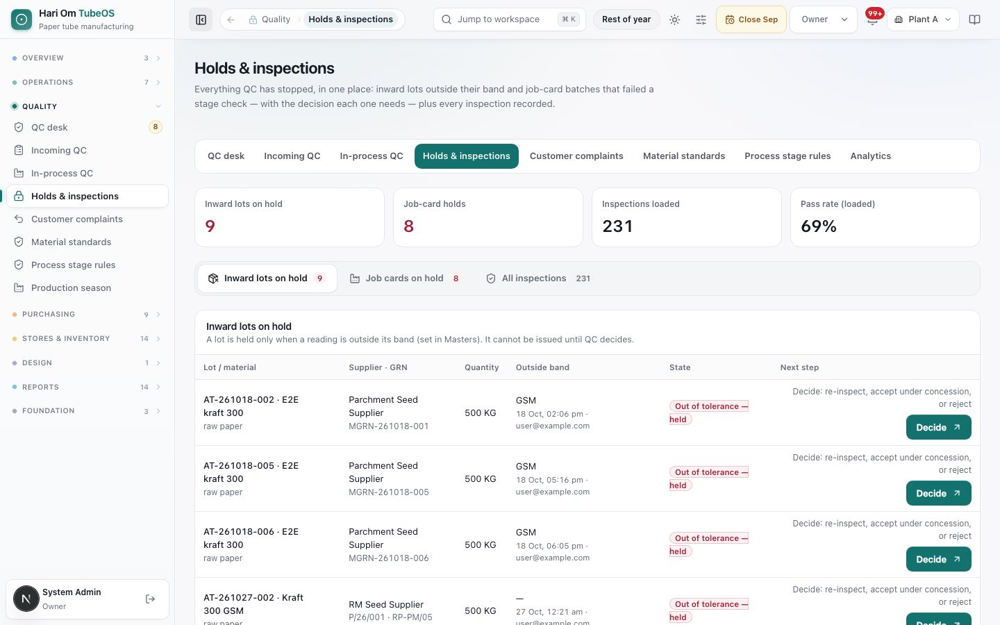
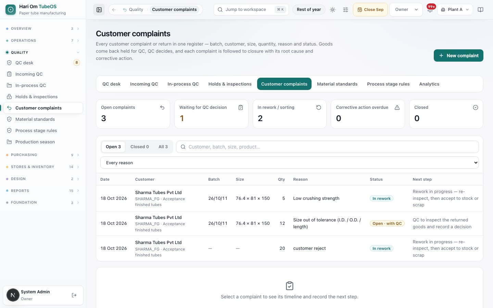
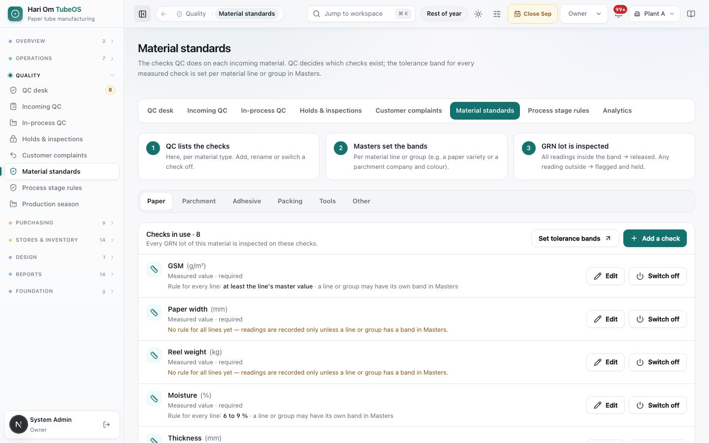
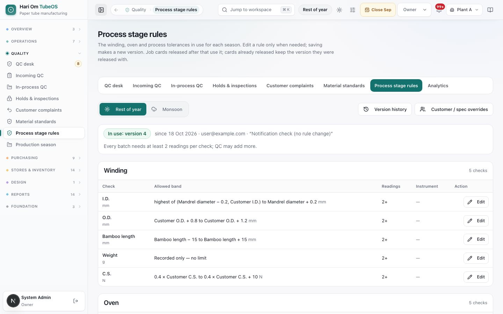

# Quality

> **What it is:** The QC pages: the QC desk (what needs QC now), incoming inspection of GRN lots, in-process QC flags, holds, customer complaints, and the standards and stage rules that set the bands.
> **Who uses it:** QC, Inward QC, In-process QC, Plant Manager (plant head), Store, Sales, Dispatch, Owner and Admin (each sees only the pages for their role).
> **Where:** Sidebar > Quality > QC desk (/quality), Incoming QC (/quality/incoming), In-process QC (/quality/stage), Holds & inspections (/quality/results), Customer complaints (/quality/returns), Material standards (/quality/material-standards), Process stage rules (/quality/stage-rules), Quality analytics (/reports/quality)

## At a glance
- **Incoming QC works by bill.** One card per bill or challan holds every reel and lot of that bill. QC weighs each reel on the scale and types the **Actual kg** beside the bill weight. **Accept needs the actual weight** on every path; Hold and Reject do not. Every other check is optional, but a reading that is entered and out of band still holds the lot.
- **Stock stays on the bill weight.** The actual weight is a record only. When every lot of a bill is weighed, the bill's weight check runs: short up to 20 kg is recorded, 20 to 50 kg goes to the Owner (Make debit note or Skip), above 50 kg a debit-note draft is made automatically (limits per plant, see Invoice differences).
- **Job card QC never holds or rejects.** On Winding, Oven, Process and final QC a reading outside its band is saved and flagged on the run, the batch, the box and the card; the run moves on and dispatch is never blocked by it. In-process QC traces every flag.
- **2 readings per required check** make a run "QC done" (moisture optional). The next stage takes only QC-done runs.
- **QC lists the checks; Masters set the inward bands; QC keeps the seasonal stage rules.** Every change is a new version; lots and cards keep the version they started with.
- **Holds** on job cards are placed only on purpose (by QC, In-process QC, the plant head, Owner or Admin) and released only by the plant head, Owner or Admin. Such a hold stops the next stage, box postings and dispatch.
- **Every reason is a code** from Masters › Reason codes: placing a hold (**QC hold placed**), releasing it (**QC hold release**), a concession, a return to the supplier (**Incoming material rejected / returned**) and a customer complaint (**Customer complaints**).

## The flow
```flow
title: Incoming bill (GRN)
GRN posted [Store/GRN] -> Bill card in To weigh (24 h) -> Weigh each reel, type Actual kg [Inward QC] -> Accept (needs the weight) -> Save weighed rows -> Released to issue desk
after Save weighed rows: Last lot weighed -> Weight check of the bill (20 / 50 kg) -> Owner decides or debit note drafted
after Weigh each reel, type Actual kg: Optional reading out of band, or Hold / Reject -> Lot held [Inward QC] -> Re-check [QC] -> Released to issue desk
after Lot held: Concession [Plant head/Owner/Admin] -> Released for limited use
after Lot held: Return to supplier [Store] (written out of stock)
```

```flow
title: In-process QC
Run logged [Operator] -> Log QC (2 readings) [Operator/QC] -> In band -> QC done (next stage takes it)
after Log QC (2 readings): Out of band -> Flagged, not held -> QC done (next stage takes it) -> Boxes show QC flagged (still ship)
after Run logged: Hold placed on purpose [QC/Plant head] (reason code) -> Release hold [Plant head/Owner/Admin] (reason code)
```

```flow
title: Customer complaint
New complaint [Sales/QC/Store] -> Goods held for QC -> QC decision [QC] -> Rework or sort -> Re-inspect [QC] -> Accept to stock or Scrap (closed)
after QC decision: Accept to stock (closed)
after QC decision: Scrap (closed)
```

## Screen tour


*Figure: The QC desk. A tab row links all Quality pages; five tiles count incoming lots, runs waiting for readings, flagged readings, holds and open complaints; below, the held items each have a Decide button.*

What you see:
1. **Tab row** (on every Quality page): **QC desk**, **Incoming QC**, **In-process QC**, **Holds & inspections**, **Customer complaints**, **Material standards**, **Process stage rules**, **Analytics**.
2. **Tiles**: **Incoming lots to inspect** (with how many are past the 24-hour deadline), **Runs waiting for QC readings** ("At least 2 readings per check · the next stage takes QC-done runs"), **Flagged QC readings · 7 days** ("allowed, not held"), **On hold — decision needed** (inward lots and older floor holds), **Customer complaints open**.
3. **Held — waiting for a decision**: inward lots (re-inspect, concession by the plant head, or return by Store) and job-card holds (holds placed on purpose, and older holds made before floor readings were flagged instead of held; released, reworked or scrapped by the plant head, Owner or Admin). Each row shows lot, material, supplier, GRN, qty, days waiting and **Decide**.
4. Further down: **Incoming lots** (oldest due first, **Inspect**), **Runs waiting for QC readings** (**Log QC**), **Latest flagged readings**, **Latest checks**, and links to standards and analytics.


*Figure: Incoming inspection: "One card per bill or challan. Weigh every reel, type the actual weight and decide. Stock stays on the bill weight; a shortage beyond the plant's limit goes to the Owner or straight to a debit note." Left: tabs To weigh 66, Part done 4, Owner decision 0 (Done today and Held further right), a search box and bill cards such as "Bill INV-129bd8 · Challan dc 0872f", Navkar Paper Board, 27 Oct 2026, GRN P/26/002, PO RP-PM/05, Paper reels, "0 of 1 weighed", 450 kg, with a red **Overdue** chip. Right: "Pick a bill from the list" with 1. Weigh each reel, 2. Decide, 3. Issue to floor; below, Checked recently.*

What you see:
1. **Tabs**: **To weigh** (nothing weighed yet), **Part done** (some lots still to weigh), **Owner decision** (weight short: the Owner decides; red count), **Done today** (every lot weighed), **Held** (on hold or rejected).
2. **Search**: bill, challan, GRN, AIT no., vendor reel no. or vendor. A lot label can be scanned into it to find its bill.
3. **Bill cards**: bill and challan numbers ("Challan … · bill to follow" when the invoice is pending), vendor, date received, chips for GRN, PO and material, "N of M weighed" with a bar, the bill weight, and chips **Overdue** (past 24 h), **Opening stock** (go-live lots, no weighing needed) or the weight result (for example "−30 kg · Owner decides").
4. **Checked recently** and **Concessions** further down.


*Figure: Bill VPI/1686/2026-27 · Challan CH-2525 open (Bharat Paper Mills, PO RP-PM/68, GRN P/26/021). A red banner: "Short 30 kg (limit 20 kg–50 kg): the Owner decides to make a debit note or skip it." with a link Weight differences. **Weigh & decide**: "Bill weight is read-only. * Actual weight is needed to Accept; every other check is optional, and a reading out of band still holds the reel." Bill photos (tap to read the reel list). Tiles: Bill weight 550 kg, Weighed so far (2) 520 kg, Difference −30 kg (₹1,500 at ₹50/kg), Ready for issue 2. Toolbar: scan box, Camera, Accept all weighed, More checks (7). Grid: AIT 06283, vendor reel 65686, Kraft 300 GSM, Bill 400, Actual 385 with a pencil (Re-weigh), Diff −15, Accept; AIT 06284, 150 / 135, −15. "Every lot of this bill is weighed. Use Re-weigh to fix a typo."*

What you see:
1. **Bill header**: vendor, PO, GRN, challan, invoice and date received. **Invoice to follow** when the invoice is pending.
2. **Weight banner** (once the last lot is weighed or rejected): the band and who acts next, for example "Short 12 kg, within the 20 kg limit: recorded only", "the Owner decides…", "Case raised for 64 kg; the debit note drafts as soon as the invoice is attached to the GRN", or "Debit note DN-… (draft) for ₹…".
3. **Bill photos**: the bill and challan photos taken at the gate and at inward. Tap one to read the vendor's reel list beside the sheet.
4. **Tiles**: **Bill weight** (lots counted; rejected lots are left out), **Weighed so far**, **Difference** (with the rupee value at the bill rate), **Ready for issue**.
5. **Toolbar**: **Scan the AIT label or type the reel / lot no.** (jumps to that row; if the reel is on another bill it says so with **Open it**), **Camera**, **Accept all weighed** (accepts every weighed row with no out-of-band reading), **More checks (N)** (shows the optional template checks such as GSM and moisture).
6. **Reel grid**: **AIT / lot**, **Vendor reel**, **Item**, **Bill kg** (read-only), **Actual kg *** (type the scale weight; Enter goes to the next reel), **Diff**, **Decision** (**Accept**, **Hold**, **Reject**) and **Status** (Waiting, Issuable, Held, Rejected, Concession, Returned to supplier). A saved weight shows a pencil: **Re-weigh**.
7. **Save weighed rows (N)**: saves every changed row. Each row saves on its own: a red row was not saved and says why.


*Figure: The typo guard. AIT 06283 has bill 400 kg and 260 typed, AIT 06284 bill 150 kg and 260 typed. Under each: "Check: 260 kg vs bill 400 kg: it is right" with a tick box. The footer says "2 rows to save · 2 need attention".*

On a phone the grid becomes one card per reel: the bill weight, a large **Weigh and type** box, the difference, the decision buttons, **More checks (optional)** and **Next reel**.

The **Resolve a held or rejected lot** box (under the sheet) offers re-check in the sheet, concession ("Why it is still fit for use", list **Concession**: CN-MINOR, CN-URGENT, CN-CUST-OK, CN-NON-CRITICAL, CN-SUPPLIER-CREDIT, CN-OTHER) or return ("Reason for the return", list **Incoming material rejected / returned**: RM-GSM, RM-MOISTURE, RM-DAMAGED, RM-WRONG-ITEM, RM-WEIGHT, RM-STRENGTH, RM-NO-DOCS, RM-OTHER). Hold, Reject and an out-of-band row need a reason from the list **Incoming QC out of band / hold / reject** (IQ-DAMAGED, IQ-GSM, IQ-MOISTURE, IQ-NO-DOCS, IQ-RECHECK-OK, IQ-SIZE, IQ-STRENGTH, IQ-WEIGHT, IQ-WRONG-ITEM, IQ-OTHER).


*Figure: In-process QC, Flagged readings tab, last 30 days. 66 flagged readings on 40 runs of 27 cards, shown by stage and by check.*

What you see:
1. **Tabs**: **Flagged readings**, **Waiting for readings** (count), **Instruments**.
2. **Filters**: **7 days / 30 days / 90 days**, **From** and **To**, search (card, customer or order), stage chips (**All stages**, **Winding**, **Oven**, **Process**), **Check**, and **High and low / High / Low**.
3. **Tiles**: **Flagged readings**, **Runs with a flag** ("Saved and allowed to move on; nothing is held"), **Job cards**, **High · Low**.
4. **By stage** chart (above band and below band) and **By check** table: Stage, Check, Readings, High, Low, Runs, Cards, **Most outside by**. Pick a check to list its readings.
5. **Waiting for readings** tab: Job card, Stage · run, Good, **Still needed (have / need)**, Waiting, and **Log QC** / **View**. Oldest first.
6. **Instruments** tab: the calibrated instrument register (gauges, balances, C.S. tester, moisture meters) with **Calibration due**, **Certificate** and **Status**. An expired instrument cannot back a check that needs one.


*Figure: Holds & inspections. Tiles for inward lots on hold, job-card holds, inspections loaded and pass rate; the Inward lots on hold table with a Decide button per lot.*

What you see:
1. **Tiles**: **Inward lots on hold**, **Job-card holds**, **Inspections loaded**, **Pass rate (loaded)**.
2. **Tabs**: **Inward lots on hold**, **Job cards on hold**, **All inspections**.
3. **Inward lots on hold** table: Lot / material, Supplier · GRN, Quantity, **Outside band** (which check, when, by whom), **State** ("Out of tolerance — held" or "Rejected"), **Next step** and **Decide** (opens Incoming QC on that lot).
4. **Job cards on hold**: each hold with its reason label and **Decide…**. The release form has **Why it can be released** (list **QC hold release**: QR-RETEST-OK Retest passed, QR-REWORKED Reworked and checked, QR-SORTED Sorted, bad pieces removed, QR-CUST-OK Customer accepted as is, QR-MGMT-OK Plant head approved use, QR-HOLD-ERROR Hold placed by mistake, QR-OTHER), **Decision** (**Release as is (use it)**, **Reworked, now OK**, **Sorted / segregated, good part released**, **Part scrapped, rest released**), **Qty affected** (optional) and **Record decision & release**. **Put a job card on hold**: choose the card and pick the reason from **QC hold placed** (QH-SUSPECT Suspected quality problem, QH-CUST-COMPLAINT, QH-MOISTURE, QH-SIZE, QH-STRENGTH, QH-LABEL, QH-RETEST, QH-OTHER), then **Hold**.


*Figure: Customer complaints. Tiles for open, waiting for QC, in rework, overdue and closed; a register table with date, customer, batch, size, qty, reason, status and next step.*

What you see:
1. **New complaint** button.
2. **Tiles**: **Open complaints**, **Waiting for QC decision**, **In rework / sorting**, **Corrective action overdue**, **Closed**.
3. **Open / Closed / All**, search ("Customer, batch, size, product…") and **Every reason** (the codes of the list **Customer complaints**).
4. **Table**: Date, Customer (with finished good), Batch (job card), Size, Qty, Reason, **Status** (**Open · with QC**, **On hold**, **Blocked**, **In rework**, **Sorting**, **Closed · scrapped**, **Closed · accepted back**), **Next step**. "Action overdue" shows in red when the corrective action date has passed.
5. Selecting a row opens its **Timeline** and **Record the next decision**.


*Figure: Material standards, Paper tab. Three steps explain how inward QC works; below, the 8 checks in use, each with its rule and Edit and Switch off buttons.*

What you see:
1. **How inward QC works**: **1 QC lists the checks**, **2 Masters set the bands** (per material line or group, for example a paper variety or a parchment company and colour), **3 GRN lot is inspected** (all inside → released; any outside → flagged and held).
2. **Material tabs**: **Paper**, **Parchment**, **Adhesive**, **Packing**, **Tools**, **Other**.
3. **Checks in use · N** with **Set tolerance bands** (opens Masters) and **Add a check**.
4. Each check: name and unit (GSM (g/m²), Paper width (mm), Reel weight (kg), Moisture (%), Thickness (mm)…), kind (**Measured value**, **Pass / fail**, **Note**), required or not, and the rule for every line (for example "at least the line's master value", "6 to 9 %", or "No rule for all lines yet — readings are recorded only unless a line or group has a band in Masters"). Buttons **Edit** and **Switch off**.
5. Below: switched-off checks (**Add check** to bring one back) and **Change history**.


*Figure: Process stage rules for Rest of year, version 4 in use since 18 Oct 2026. The Winding table shows each check, its allowed band as a formula, readings 2+, instrument and Edit.*

What you see:
1. **Season switch**: **Rest of year** / **Monsoon**. **Version history** and **Customer / spec overrides**.
2. **In use: version N** with date, who, and the change reason; "Every batch needs at least 2 readings per check; QC may add more."
3. **One table per stage** (Winding, Oven, Process): Check (I.D., O.D., Bamboo length, Weight, C.S., …), **Allowed band** (for example "Customer O.D. + 0.8 to Customer O.D. + 1.2 mm", "Bamboo length − 15 to Bamboo length + 15 mm", "Recorded only — no limit"), **Readings** (2+), **Instrument**, **Edit**.

## Step by step

### How to weigh and decide a bill
Roles: QC, Inward QC, Owner, Admin (Store and Plant Manager can open the page and see the sheet read-only).
1. Open **Incoming QC**. Pick the bill under **To weigh** (oldest due first; mind the 24 h deadline), or scan a reel label into the search.
2. Read the bill photo if you need the vendor's reel list (tap a thumbnail under **Bill photos**).
3. Put the first reel on the scale. Type the scale weight in **Actual kg** and press Enter: the cursor goes to the next reel. Or scan the reel's AIT label in the scan box to jump to its row.
4. If a weight is more than 15 % away from the bill weight, the row asks "Check: 11,750 kg vs bill 1,182 kg". Correct the typo, or tick "it is right" if the scale really says so.
5. Leave **Accept** for good reels (it is the default once the weight is typed), or click **Accept all weighed**. Choose **Hold** or **Reject** (with a reason) for a reel you do not want issued; these need no weight.
6. Optional: open **More checks** and type readings such as GSM or moisture. Leave them empty if you do not measure them.
7. Click **Save weighed rows (N)**. "2 rows saved." Accepted reels with no out-of-band reading are issuable at once.
8. When the last lot is weighed or rejected, the message and the banner say what happens next, for example "Weight short: the Owner decides." Nothing more is needed from QC.

### How to fix a weight typo (Re-weigh)
1. Click the pencil beside the saved weight (**Re-weigh**).
2. Type the **Corrected weight**, pick **Why it is corrected** (list **Weight correction**: WC-TYPO Typing mistake, WC-REWEIGHED Weighed again on the scale, WC-SCALE Scale was not zeroed, WC-WRONG-LOT Weight entered on the wrong reel or lot, WC-OTHER with a note) and click **Save correction**.
3. "AIT 06283 re-weighed: 385 kg. The weight check of the bill is updated." Stock stays on the bill weight.

### How to release a lot that was held before go-live
1. Lots received before 7 Nov 2026 that are still on QC hold need their actual weight before they can be released.
2. Open the bill under **Held**, type the actual weight of each lot, choose **Accept** and save.

### How to resolve a held lot
1. Open the lot (**Decide** on the QC desk or Holds & inspections).
2. **Re-check**: enter new readings in the sheet.
3. **Concession**: plant head, Owner or Admin (never the inspector) picks **Why it is still fit for use** from the **Concession** list (for example CN-MINOR Minor deviation, safe to use) and may add a note. The FAIL stays on record; the released qty can be issued. Critical checks cannot be conceded.
4. **Return to supplier**: Store, Plant Manager, Owner or Admin picks **Reason for the return** (for example RM-GSM GSM out of range, note "GSM 150 against 291–309") and adds the optional return challan or vehicle no. The lot is written out of stock and the inward line marked rejected; with an invoice attached, a quality claim opens for the debit note.

### How to follow up flagged floor readings
Roles: QC, In-process QC, Plant Manager, Owner, Admin.
1. Open **In-process QC** > **Flagged readings**. Pick the period and stage.
2. Use **By check** to see which check goes out most and by how much.
3. Open a card to see its flagged runs and the boxes marked **QC flagged**. Talk to the line; no action is needed in the system for the run, its boxes or their dispatch to continue.
4. If you decide the goods must stop, place a hold on purpose (next task).

### How to clear runs waiting for readings
1. **In-process QC** > **Waiting for readings** (or the QC desk tile).
2. Click **Log QC** on a run. Type at least 2 readings per required check and save. See "Log output and QC entry".

### How to put a job card on hold and release it
1. Raise: QC, In-process QC, Plant Manager, Owner or Admin. **Holds & inspections** > **Job cards on hold** > **Put a job card on hold**: choose the card, pick the reason code from **QC hold placed**, add a note if useful, **Hold**. Switch to the card's plant first if asked.
2. The card shows **On hold**; the next stage cannot take it, new boxes wait to go into stock, and no challan can be sealed ("N hold(s) placed on this card stop all movement. Release them in Quality before sealing.").
3. Release: Plant Manager (plant head), Owner or Admin only. Click **Decide…**, pick **Why it can be released** from **QC hold release**, choose the **Decision**, type **Qty affected** if part was scrapped, and click **Record decision & release**.

### How to record and close a customer complaint
1. Record: Owner, Admin, Plant Manager, QC, Store, Sales or Dispatch. Click **New complaint**. Choose the customer (or "Not in customer master…"), the batch on the goods (job card / batch number, or the box code on the label), the finished good, the quantity and the **Reason** from the list **Customer complaints** (CC-DAMAGE Crushed / damaged tubes, CC-SIZE Size out of tolerance (I.D. / O.D. / length), CC-STRENGTH Low crushing strength, CC-MOISTURE Moisture / soft tubes, CC-QTY Short or wrong quantity, CC-FINISH Finish, colour or print issue, CC-PACKING Packing issue, CC-OTHER). Add what the customer said and, under **More details**, the DC no., invoice, location, date and documents.
2. Save. "Complaint recorded; goods held for QC. QC, the plant head and Sales are notified." If the DC number is not found, it is still logged but marked unverified; the qty cannot exceed what can still come back on that dispatch.
3. Decide: Owner, Admin, Plant Manager, QC or Store. Select the complaint, **Record the next decision**: **Rework**, **Sort / segregate**, **Keep on hold**, **Block**, **Accept to stock**, or **Scrap**. Fill **What QC found and why**, **Root-cause department**, **Action owner**, **Corrective action**, **Corrective action due**, and rework or scrap cost in ₹.
4. Rework and sort keep the complaint open until re-inspection. **Accept to stock** and **Scrap** close it. Accepting held goods needs an Owner or Admin who did not record the complaint.

### How to change the checks for a material
Roles: QC, Inward QC, Owner, Admin.
1. **Material standards**, pick the material tab.
2. **Add a check**, **Edit** (name, unit, kind: Measured value, Pass / fail, Note) or **Switch off**. A note is a written observation and never holds a lot.
3. To set or change a band, click **Set tolerance bands** (Owner and Admin, in Masters › Inward QC tolerances or the band button on a master row). The most specific band wins: item, then group (for example parchment company and colour), then type.

### How to change a stage rule
Roles: QC, Owner, Admin.
1. **Process stage rules**, pick the season, click **Edit** on the check.
2. Choose **Tolerance band** (minimum and maximum built from terms such as Customer O.D., Mandrel diameter, Bamboo length, a fixed value) or **Record only**; set **Calibrated instrument** and **Readings per batch** (at least 2). "Reads as:" shows the rule in words.
3. Write the **Change reason** (required) and **Save as new version**. New releases use it; released cards keep their version.
4. For one customer or spec: **Customer / spec overrides**, pick the target and season (**Both seasons**, **Rest of year**, **Monsoon**), tick the rules, edit, **Save override draft**. A possibly wider rule needs an Owner or Admin to publish it.

## Rules the system enforces
- **Inward: Accept needs the actual weight.** No path can release a purchase lot for issue before QC types its actual weight: the bill sheet, the scan, the QC desk, closing holds, concession release and the GRN refresh after an invoice is attached. Opening-stock lots and customer returns are exempt. Hold and Reject never need a weight. ("Weigh it first: Accept needs the actual weight".) (Blocks.)
- **Inward checks are optional.** Only the actual weight is needed, and only for Accept. A reading that is entered and out of band still holds the lot; a numeric check with no band is recorded only. A held lot cannot be issued. (Blocks issue.)
- **Stock stays on the bill weight.** The actual weight never changes the stock, the ledger, the labels or month close. It only feeds the bill's weight check (see Invoice differences). (Automatic.)
- **Typo guard**: a weight more than 15 % from the bill weight must be confirmed. **Re-weigh** needs a **Weight correction** reason. (Blocks until confirmed.)
- **Each row saves on its own**; a row that fails says why and the others are kept. Saving twice does not save twice. (Automatic.)
- **Inward deadline**: 24 hours from inward; late lots show **Overdue**. (Warns.)
- **Concession** only by plant head, Owner or Admin, never the inspector; not for critical checks; the FAIL stays on record. (Blocks others.)
- **Job card QC: out of band is flagged, never held or rejected** (in-process and final QC, old-form cards too). The inspection keeps FAIL and a flag; FAIL with the minimum readings counts as QC done. No automatic hold is ever made on a job card, and dispatch no longer needs a passed final QC. (Flag only.)
- **Reason codes everywhere.** Holds, releases, concessions, returns and complaints each need an active code of the right list and plant; OTHER codes need a note of at least 5 characters; free text alone is refused. Records keep the code, its label at that time and the note. (Blocks.)
- **2 readings per required check** for QC done, the next stage and every stage close; moisture optional. (Blocks.)
- **Job-card hold** (placed on purpose) stops the next stage, box postings and dispatch ("N hold(s) placed on this card stop all movement. Release them in Quality before sealing."). Release only by Plant Manager, Owner or Admin, with a **QC hold release** code. (Blocks.)
- **Frozen versions**: inward bands and stage rules are versioned with who, when and why; lots and job cards keep the version they started with. (Automatic.)
- **Season**: the Owner alone switches the plant season (Quality > Production season); a card freezes its season's rules at release. (Owner only.)
- **Complaints**: returned goods arrive under QC hold; nothing is sellable until QC decides. (Blocks.)
- **Instruments**: a check that needs an instrument needs a valid instrument ID; an expired one cannot back it. (Blocks.)

**Roles in short.** **QC** works all pages and edits standards and stage rules. **Inward QC** inspects GRN lots and edits material checks. **In-process QC** logs floor QC, sees flags and waiting runs, and can raise job-card holds but not release them. **Plant Manager** (plant head) releases holds and grants concessions. **Store** returns lots to suppliers and records complaints. **Sales** and **Dispatch** see holds and record complaints.

## Sample
Bharat Paper Mills delivers 2 reels of Kraft 300 GSM on GRN P/26/021 (bill VPI/1686/2026-27, PO RP-PM/68, ₹50/kg). QC weighs them:

| Reel | Bill kg | Actual kg | Diff | Decision |
|---|---|---|---|---|
| AIT 06283 | 400 | 385 | −15 | Accept |
| AIT 06284 | 150 | 135 | −15 | Accept |

Both reels are issuable at once. The bill is 30 kg short (₹1,500): between 20 and 50 kg, so the Owner gets "Weight short 30 kg · Bill VPI/1686/2026-27" with **Make debit note** and **Skip…**. The stock stays 550 kg.

Another delivery, 6 reels on P/26/014, where QC also measures GSM (band at least 291) and moisture (6–9 %):

| Reel | Actual kg | GSM | Moisture | Result |
|---|---|---|---|---|
| R1 | 1,182 | 302 | 7.1 | Accepted, issuable |
| R2 | 1,204 | 298 | 6.8 | Accepted, issuable |
| R3 | 1,190 | 285 | 7.4 | Held (GSM out of band, reason IQ-GSM) |

R3 is on hold. The plant head grants a concession with CN-NON-CRITICAL, note "use on outer plies"; the FAIL stays on record. Later, card 26/10/315 has a Process I.D. reading of 76.9 mm against 76.2–76.5: flagged, not held; it appears in In-process QC under I.D., High, and the two boxes holding that run's pcs show **QC flagged**. They ship on the next challan. A week later the customer reports soft tubes in box B2610315-003; Sales records a complaint with CC-MOISTURE.

## Common questions
**Q: Why can't Store issue this reel?** A: Either QC has not weighed and accepted it yet, or it is held (Hold, Reject, or a reading out of band). QC must weigh and accept it, re-check it, the plant head concede it, or Store return it.

**Q: Do I have to enter GSM, moisture and the other checks?** A: No. Every check is optional now. Only the actual weight is needed, and only to Accept. If you do enter a reading and it is out of band, the reel is held.

**Q: I typed 11750 instead of 1175 and saved.** A: Click the pencil (**Re-weigh**), type 1175, pick WC-TYPO and save. The bill's weight check is worked out again.

**Q: The scale shows 30 kg less than the bill. Does stock go down?** A: No. Stock, labels and month close stay on the bill weight. The difference goes to the bill's weight check, and from there to the Owner or a debit note.

**Q: A reel received last week is still on hold. Why can't I release it?** A: Lots received before go-live of weighing (7 Nov 2026) must be weighed too. Type its actual weight and accept it.

**Q: A floor reading is out of band. Must I hold the card?** A: No. It is flagged, not held, and the boxes still ship. Place a hold only if you decide the material must stop.

**Q: Why did no hold appear when final QC failed?** A: Job card QC only flags. Holds on job cards are placed by people, on purpose. Incoming (GRN) lots are still held automatically when out of band.

**Q: The hold reason I need is not in the list.** A: Pick QH-OTHER and write a note, and ask a Plant Manager, Admin or the Owner to add the code in Masters › Reason codes.

**Q: Who can release a job-card hold?** A: Only the plant head (Plant Manager), Owner or Admin.

**Q: Where do I change the GSM band for one paper?** A: In Masters (the band button on the paper row, or Masters › Inward QC tolerances). QC only lists the checks.

**Q: I edited a stage rule. Why do old cards still use the old band?** A: Cards freeze their rules at release. Only cards released after your save use the new version.

**Q: What does "Recorded only — no limit" mean?** A: The reading is kept but never judged in or out of band.

**Q: A complaint's dispatch number is not found.** A: The complaint is still logged, marked unverified. Check the DC number with Dispatch.

**Q: Where are quality trends?** A: **Analytics** (Reports › Quality analytics): pass rates by stage and material, flagged readings, holds and complaints.

## Related chapters
- Log output and QC entry
- Job cards
- Goods inward, GRN register and labels
- Masters
- Dispatch
- Reports
