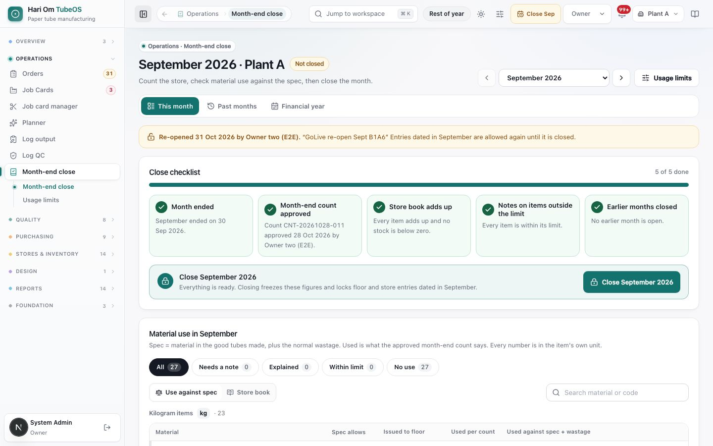
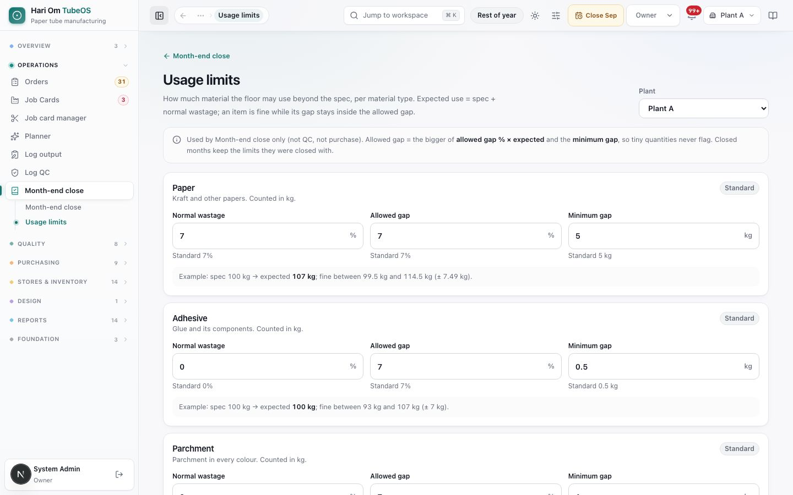
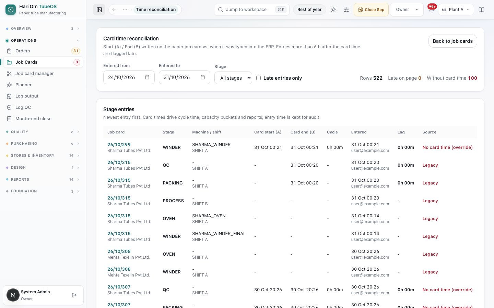

# Month-end close

> **What it is:** The monthly check of material use (what the spec allows against what the store issued and what the month-end count says was used), the Owner's close that freezes the month, the usage limits behind it, and the card time reconciliation report.
> **Who uses it:** Owner (closes and re-opens), Plant Manager (plant head: reads, writes notes), Admin (reads, edits usage limits). Planners also read the time reconciliation.
> **Where:** Sidebar > Operations > Month-end close (/production/reconciliation), with **Usage limits** (/production/reconciliation/limits). Card time reconciliation: /production/job-cards/time-reconciliation (no sidebar link; open it by its address).

## At a glance
- Month-end close is kept **per plant**. Pick one plant in the top bar.
- For each material the page shows three numbers in the item's own unit: **Spec allows** (material in the good tubes made, plus the normal wastage), **Issued to floor** (what the store gave the floor), and **Used per count** (opening + received − sent back − closing, from the approved month-end count).
- Nothing comes back from the floor: everything issued is treated as used.
- The **Close checklist** has five steps. When all are done, **only the Owner** can close the month. Closing freezes the figures and **refuses floor and store entries dated in that month** until the Owner re-opens it.
- **Usage limits** decide when an item is "outside the limit" and needs a note. They are not QC bands.

## The flow
```flow
title: Closing a month
Month ends -> Count the store [Store/any role] -> Approve the count [Owner] -> Store book adds up -> Notes on items outside the limit [Owner/Plant head] -> Close the month [Owner] (figures frozen, entries locked)
after Close the month: Re-open with a reason [Owner] -> Entries allowed again -> Close the month [Owner]
```
Earlier months must be closed first. Closing March is the **financial year close**; 1 April opens from the 31 March closing.

```flow
title: Where the spec comes from
Process closes on a card [Plant Manager] -> Theory posted for the month (paper, adhesive, parchment, packing) -> Spec allows on Month-end close -> Compared with Used per count
```

## Screen tour


*Figure: Month-end close for September 2026, Plant A, "Not closed". A banner says the month was re-opened; the close checklist shows 5 of 5 done and a "Close September 2026" button; below starts "Material use in September".*

What you see:
1. **Title** "<Month> · <Plant>" with a state chip: **Not closed**, **Running · so far** (the current month) or **Closed**. Subtitle: "Count the store, check material use against the spec, then close the month."
2. **Month picker** with previous / next arrows, and the **Usage limits** button.
3. **Tabs**: **This month**, **Past months**, **Financial year**.
4. **Re-opened banner** (when it applies): who re-opened it, when, the reason, and "Entries dated in September are allowed again until it is closed."
5. **Close checklist** with a progress bar ("5 of 5 done") and five step cards:
   - **Month ended**: "September ended on 30 Sep 2026." (A running month: "It can be closed from 1 Nov.")
   - **Month-end count approved**: the count number, who approved it and when; or what is still needed ("Counted and submitted. Waiting for the Owner to approve it.", "Counting has started. Submit it when every rack is done.") with a link to the count.
   - **Store book adds up**: "Every item adds up and no stock is below zero", or which items do not add up, with **Open the stock book**.
   - **Notes on items outside the limit**: "Every item is within its limit", or "3 items are outside the limit and need a short note" with **Go to the 3 items**. Before the count: "Waiting for the count. Notes open once the month-end count is approved."
   - **Earlier months closed**: "No earlier month is open", or "August 2026 is still open. Close it first."
6. **Close bar**: "Close September 2026 · Everything is ready. Closing freezes these figures and locks floor and store entries dated in September." with the **Close September 2026** button (Owner). Others see "Only the Owner closes the month".
7. **Material use in <month>**: the explanation line; filter chips **All**, **Needs a note**, **Explained**, **Within limit**, **No use** (a running month shows **So far** and **Waiting for count**); the view switch **Use against spec** / **Store book**; a search box. Items are grouped by unit (**Kilogram items**, **Piece items**, **Litre items**), so kilograms and pieces are never added together.
8. **Use against spec** columns: **Material**, **Spec allows**, **Issued to floor**, **Used per count**, **Used against spec + wastage** (a bar showing less, within, or more). **Store book** columns: **Opening**, **Received**, **Sent back**, **Issued**, **Count and corrections**, **Closing**, and "Does not add up" where the book is wrong.
9. Each item opens a card with its status in words (for example "Used 6.2 kg more than the spec allows. Within the limit of ± 7.5 kg."), a **note** box, and **Where the numbers come from**: the job cards that posted spec, issues to the floor, GRNs, returns to supplier, count lines and corrections.
10. **Spec items not linked to a stock item**: spec that cannot be compared with the store ("No stock item" or "Unit differs"). They stay out of the totals until the Owner links them in Masters.


*Figure: Usage limits for Plant A. One card per material type with Normal wastage, Allowed gap and Minimum gap, the standard value under each, and an example line.*

What you see:
1. **Back link** "Month-end close" and the **Plant** picker.
2. **Info line**: "Used by Month-end close only (not QC, not purchase). Allowed gap = the bigger of allowed gap % × expected and the minimum gap, so tiny quantities never flag. Closed months keep the limits they were closed with."
3. **One card per type**: **Paper** (kraft and other papers, kg), **Adhesive** (glue and its components, kg), **Parchment** (every colour, kg), **Packing** (boxes, plastic sheets and fadda, each item's own unit), **Other**. A chip says **Standard** or **Set for this plant**.
4. **Fields**: **Normal wastage** (%), **Allowed gap** (%), **Minimum gap** (in the unit), with "Standard 7%" etc. under each.
5. **Example line**: "Example: spec 100 kg → expected 107 kg; fine between 99.5 kg and 114.5 kg (± 7.49 kg)."
6. Bottom: "Last saved by … · <date>", **Undo changes** and save.


*Figure: Card time reconciliation from 24 Oct to 31 Oct. Filters at the top with totals; a table of stage entries with card times, entry time, lag and source.*

What you see:
1. **Card time reconciliation**: "Start (A) / End (B) written on the paper job card vs. when it was typed into the ERP. Entries more than 6 h after the card time are flagged late." Button **Back to job cards**.
2. **Filters**: **Entered from**, **Entered to**, **Stage** (All stages or one), **Late entries only**. Totals: **Rows**, **Late on page**, **Without card time**.
3. **Stage entries** (newest first): Job card and customer, Stage, Machine / shift, **Card start (A)**, **Card end (B)**, **Cycle**, **Entered** (time and login), **Lag**, **Source**: **Card time** (times written on the card), **No card time (override)** (the entry time was used), or **Legacy**.

## Step by step

### How to close a month
Roles: Owner closes; Plant Manager and Admin can prepare.
1. Open **Month-end close**. It opens on the oldest month not closed. Pick your plant if asked.
2. Work the checklist from left to right. The first open step is marked as "now".
3. **Count**: if the count has not started, click **Count <month> stock** (it opens Stock counts). Count, submit, and have the Owner approve it. See "Stock counts, stock book, locations and opening stock".
4. **Store book**: if items do not add up, click **Open the stock book** and fix the entries (corrections are made in Stores).
5. **Notes**: click **Go to the N items**. For each item outside its limit, write a short note (for example "Reel R-1182 wet at edges, two plies trimmed") and save. The item moves to **Explained**.
6. **Earlier months**: if an earlier month is open, open it and close it first.
7. When the bar says "Everything is ready", the Owner clicks **Close <month>**. The dialog repeats that figures, statuses, limits and notes will be frozen and entries dated in the month refused. If store entries were posted after the count was approved, it lists them ("counted 412 kg, closing now 405 kg") and asks you to accept the new closing.
8. Confirm. Message: "September 2026 is closed. Entries dated in it are now locked." For March: "Financial year 2026-27 closed. 1 April opens from this close."

### How to write or change a note on an item
Roles: Owner and Plant Manager (plant head). Notes open only after the month-end count is approved.
1. Click the item (or use **Needs a note**).
2. Type the note and save ("Note saved on Kraft 300 GSM."). Clear it to remove it.

### How to see where a number comes from
1. Click the item, then **Where the numbers come from** (or "See the issues and count lines").
2. The drawer lists the job cards whose spec was posted, issues to the floor, GRNs, opening loads, returns to supplier, count differences, corrections and count lines.

### How to re-open a closed month
Roles: Owner only.
1. Open the closed month, click **Re-open month**.
2. The dialog **Re-open September 2026?** asks for the reason (a few words at least). Any later closed month re-opens with it, and the button then reads "Re-open 2 months".
3. Confirm. "Re-opened September 2026." Floor and store entries dated in the month are allowed again until it is closed again. Every close and re-open is kept under **Past months**.

### How to check past months and the financial year
1. **Past months**: each month with its state (**Closed**, **Running**, **Re-opened**, **Not closed**, **No activity**), "Closed <date> by <person>", Items used, Outside the limit, Spec + wastage, Issued, Used per count. Click **View <month>**.
2. **Financial year**: year totals per unit (opening on 1 April, issued to floor, count and corrections, spec, spec + wastage, floor against spec + wastage) and the months of the year, with "Closing March is the financial year close".

### How to change usage limits
Roles: Owner and Admin edit; everyone else reads.
1. Open **Usage limits**, pick the plant.
2. Change **Normal wastage** (0 to 50 %), **Allowed gap** (0 to 100 %) or **Minimum gap**. Read the example line.
3. Save. "Usage limits saved. Open months use them now; closed months keep their own."

### How to check late card entries
Roles: Owner, Admin, Plant Manager, Planner.
1. Open /production/job-cards/time-reconciliation.
2. Set **Entered from** and **Entered to**, pick a stage, tick **Late entries only** if needed.
3. Read **Lag** and **Source**. A late entry or a missing card time is information only; it never blocks anything.

## Rules the system enforces
- **Only the Owner closes and re-opens** a month. Re-open needs a reason. (Blocks others.)
- **All five checklist steps** must be done before the close: month ended (closing opens on the 1st of the next month, India time), month-end count approved, store book adds up, every item outside its limit has a note, earlier months closed. (Blocks.)
- **A count cannot be made for a month once a later month is closed**: "Re-open <later month> first." (Blocks.)
- **Closed month locks entries.** Floor runs dated in it are refused: "<Month> is closed. Ask the owner to re-open it." Store movements dated in it are refused too. QC-only readings are not affected. (Blocks.)
- **Notes** only by Owner or plant head, and only after the count is approved. (Blocks.)
- **Expected use** = Spec × (1 + normal wastage % ÷ 100). **Allowed gap** = the larger of allowed gap % × expected and the minimum gap. Within the allowed gap = **Within limit**; outside = **Needs a note** (more or less than spec); with a note = **Explained**; before the count = not known. (Automatic.)
- **Standard usage limits**: Paper 7 % wastage, 7 % gap, minimum 5 kg; Adhesive 0 %, 7 %, 0.5 kg; Parchment 0 %, 7 %, 1 kg; Packing 0 %, 7 %, 10 in its unit; Other 0 %, 7 %, 5. (Automatic until a plant saves its own.)
- **Frozen figures.** A closed month keeps the figures and limits it closed with. Live store changes made later show as "Live store figures differ for …". (Automatic.)
- **Units are never mixed.** Totals are per unit; a kg total never includes pieces. (Automatic.)
- **Spec is posted when Process closes** on a card (theoretical paper, adhesive, parchment and packing for the good tubes). Cards still open add nothing yet. (Automatic.)
- **Late card entry** = typed more than 6 hours after the card time; shown in time reconciliation only. (Flag only.)

**Old links.** /production/reconciliation/actuals, /drift and /history now open Month-end close (the running month's "so far" view or the **Past months** tab).

## Sample
September 2026, Plant A. Paper limits are standard (7 % wastage, 7 % gap, minimum 5 kg).

| Material | Spec | Expected (spec + 7 %) | Used per count | Gap | Allowed | Status |
|---|---|---|---|---|---|---|
| Kraft 300 GSM | 2,000 kg | 2,140 kg | 2,195 kg | +55 kg | ± 149.8 kg | Within limit |
| Kraft 180 GSM | 400 kg | 428 kg | 470 kg | +42 kg | ± 30.0 kg | Needs a note |
| PVA adhesive | 120 kg | 120 kg | 118 kg | −2 kg | ± 8.4 kg | Within limit |

The plant head writes on Kraft 180 GSM: "Two reels wet at edges, outer plies scrapped on 18 Sep". It becomes **Explained**. With the count approved and the book adding up, the Owner clicks **Close September 2026**. A Process run dated 29 Sep typed on 2 Oct is now refused until the Owner re-opens September.

## Common questions
**Q: Why does every item show "Waiting for count"?** A: The month-end count is not approved yet. Used per count is known only after the Owner approves the count.

**Q: The close button is grey. Why?** A: Hover over it: a checklist step is open, or you are not the Owner. The first open step is marked.

**Q: The operator cannot save a run for last month.** A: That month is closed. Ask the Owner to re-open it, enter the run, then close it again.

**Q: Why is spec 0 for an item we used?** A: Spec is posted when Process closes on a card. If no card using it closed Process in the month, spec is 0. Also check "Spec items not linked to a stock item".

**Q: Are usage limits the same as QC tolerances?** A: No. Usage limits are for month-end only. QC bands are in Quality and Masters.

**Q: I changed a limit. Did August change?** A: Only if August is still open. Closed months keep their own limits.

**Q: What does "Legacy" mean in time reconciliation?** A: The stage record has no card-time source of its own. It is information only.

## Related chapters
- Stock counts, stock book, locations and opening stock
- Issue to the floor: reels, coils and materials
- Job cards
- Log output and QC entry
- Masters
