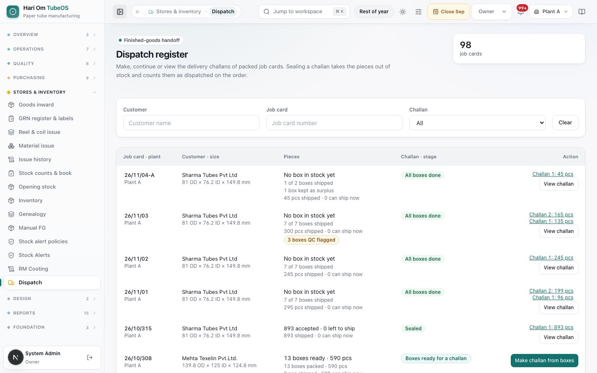
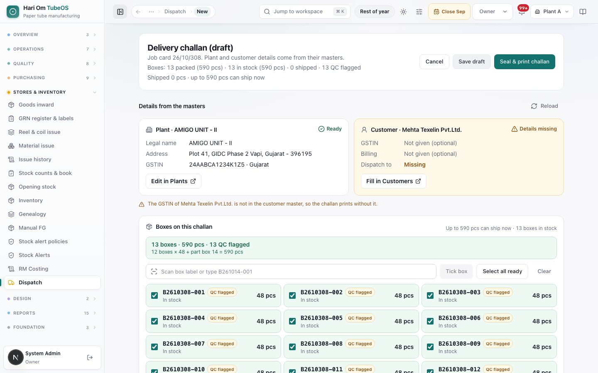
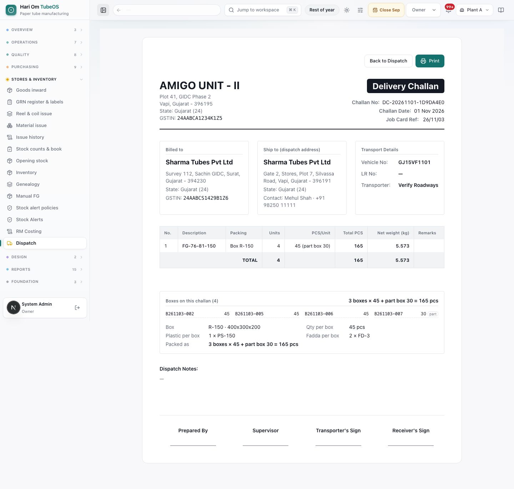
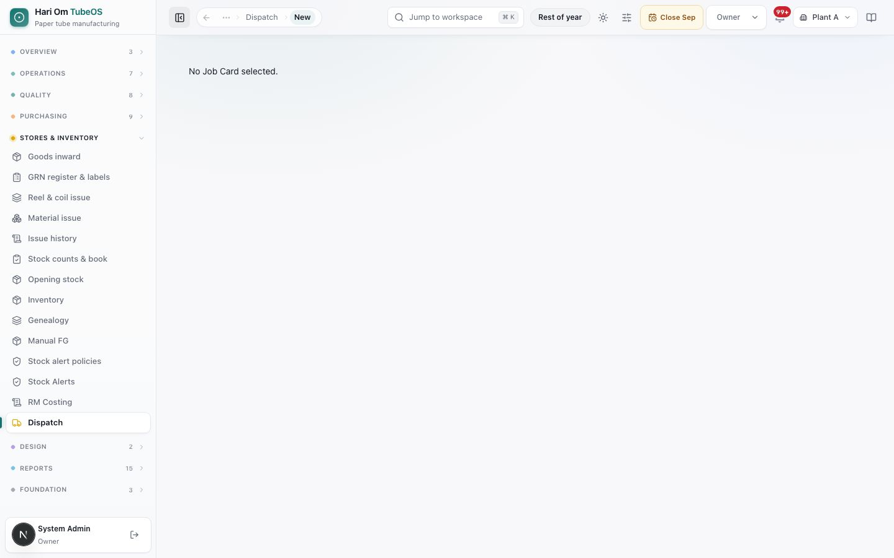
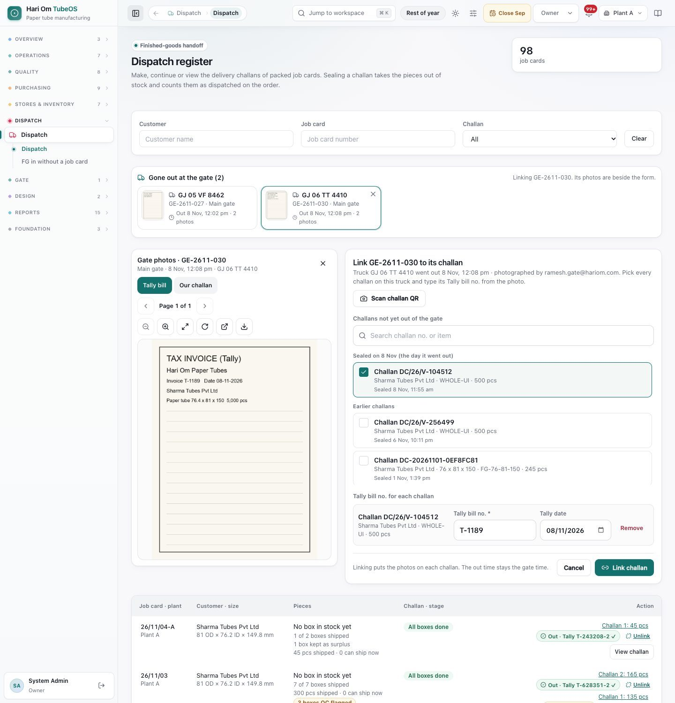
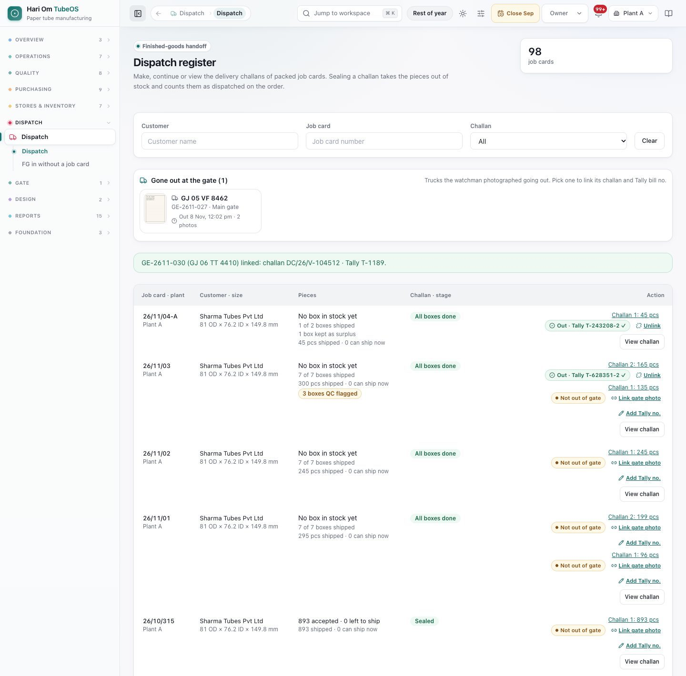

# Dispatch

> **What it is:** The dispatch register of job cards with finished goods, and the delivery challan: pick the boxes, make a draft, seal it (stock goes out and the sales order counts the delivery), and print it.
> **Who uses it:** Dispatch (makes and seals challans), Store, Plant Manager, Supervisor and Logistics (save drafts), Sales (views and prints sealed challans), Owner and Admin. Store (also Dispatch and the plant head) links the watchman's goods-out photos to the challans.
> **Where:** Sidebar > Dispatch > Dispatch (/logistics/dispatch). A new challan opens at /logistics/dispatch/new?job_card_id=<card>; a sealed challan prints at /logistics/dispatch/<card>/print.

## At a glance
- **The box is the dispatch unit.** On batch-entry cards, Process good pcs are packed into boxes of the spec's qty per box, each with a box code and a QR label. A challan is a set of whole boxes; a box is never split.
- **Ship while Process is still running.** A card appears on the register as soon as its first box is packed and posted to stock. Each challan ships some of its boxes (partial dispatch). The pcs left when Process closes go into a **part box**, which ships like any other box.
- **Build the challan by scanning or ticking boxes.** The challan lists every box code with its pcs, the box count, pcs per box and total pcs, and a packing block from the spec.
- **Sealing** takes the boxes out of stock and counts their pcs as dispatched on the sales order. Sealing is done by **Dispatch, Owner or Admin**. Others with access can save a draft.
- **Leaving the gate is recorded by photo.** When the truck leaves, the watchman only photographs the Tally bill and our challan, types the vehicle number and taps **Gone out**. **Store** (or Dispatch, or the plant head) then links that gate entry to the challan(s) on the register's **Gone out at the gate** strip (**Link challan**) and types or confirms the Tally bill number. Each challan shows **Not out of gate**, **Out · Tally T-1189 ✓** or **Photos missing**.
- **Only a hold placed on purpose blocks sealing.** QC flags never do: a box marked **QC flagged** ships like any other box.

## The flow
```flow
title: From boxes to a sealed challan
First box packed [Process] (in stock) -> Boxes ready for a challan -> Make challan from boxes [Dispatch] -> Scan or tick boxes [Dispatch] -> Seal & print challan [Dispatch/Owner/Admin] -> Boxes dispatched (stock out, order delivered)
after Boxes dispatched: More boxes packed -> Make next challan [Dispatch] (partial dispatch)
after Boxes ready for a challan: Manual hold on the card -> Release hold [Plant head/Owner/Admin] -> Make challan from boxes [Dispatch]
```

```flow
title: Finishing a card
Process closed [Plant Manager] (part box packed) -> Ship the last boxes [Dispatch] -> All boxes done (card Done)
after Process closed: Leftover boxes (do not fit) -> Retain surplus FG [Dispatch/Owner/Admin] (reason code) -> Boxes kept as surplus (card Done)
```
```flow
title: Truck out of the gate
Challan sealed [Dispatch] (Not out of gate) -> Add Tally no. (optional, early) [Dispatch/Store] -> Truck leaves: Tally bill and challan photographed, Gone out [Watchman] -> Gone out at the gate strip [Store/Dispatch] -> Pick the entry, tick the challan(s), type or confirm the Tally no. -> Link challan (Out · Tally T-1189 ✓)
after Link challan: Wrong challan or Tally no. -> Unlink with a reason [Plant head/Owner/Admin] -> Link again [Store]
```

The card completes when Process is closed and every box has shipped or has been kept as surplus. When boxes are kept as surplus, any released quantity that was not shipped goes back to the sales order.

Cards whose finished goods were posted the old way, in one lot at Process close (before boxes existed), still ship by typed quantity, as described under "Cards without boxes".

## Screen tour


*Figure: The Dispatch register with 93 job cards. Filters for customer, job card and challan; a table showing for each card its pieces accepted, shipped and left, the challan or stage state, and Make challan or View challan.*

What you see:
1. **Header**: "Finished-goods handoff", **Dispatch register**, and the number of job cards shown. "Make, continue or view the delivery challans of packed job cards. Sealing a challan takes the pieces out of stock and counts them as dispatched on the order."
2. **Filters**: **Customer**, **Job card**, **Challan** (**All**, **No challan yet**, **Draft challan**, **Sealed**), **Clear**.
3. **Job card · plant**: card number and plant.
4. **Customer · size**: customer and tube size (for example 81 OD × 76.2 ID × 149.8 mm).
5. **Pieces**: for a box card, lines such as "4 boxes ready · 192 pcs", "2 of 7 boxes shipped" (or "7 boxes packed · 295 pcs"), "1 box waiting for the stock posting" and "1 box kept as surplus", plus an amber chip "2 boxes QC flagged" ("A QC reading was out of band when these boxes were packed. Shipping is not blocked."). Under it: "192 shipped · 103 can ship now". For a card without boxes: "893 accepted · 0 left to ship" and "893 shipped · 0 can ship now".
6. **Challan · stage**: **Draft challan**, or the state in words:
   - **Packing boxes** (Process is running and boxes are being packed; " · Process still running"),
   - **Boxes ready for a challan** (boxes in stock and not yet shipped),
   - **All boxes done** (box card fully shipped or kept),
   - **Waiting for Process to close** (with the current stage),
   - **Waiting for the stock posting**,
   - **On QC hold** (a hold placed on purpose; "A hold on this card stops all movement. Release it in Quality before sealing."),
   - **Nothing accepted at final QC**,
   - **Extra pieces kept in stock**,
   - **Ready for a challan** and **Challan sealed** (cards without boxes).
7. **Action**: **Make challan from boxes** (box card), **Make challan** (card without boxes) or **Edit draft challan**; links **Challan 1: 192 pcs**, **Challan 2: …** to each sealed challan; **View challan**; and **Retain surplus FG** when the leftover boxes no longer fit (see below).


*Figure: The new challan page for job card 26/10/315. Above the shipment details is the panel Boxes on this challan: "Up to 300 pcs can ship now · 4 boxes in stock", a green total line "4 boxes · 192 pcs" with "4 boxes × 48 = 192 pcs", a scan box "Scan box label or type B261014-001" with Tick box, Select all ready and Clear, and a grid of the card's boxes, each with its code, Part and QC flagged chips, its state and its pcs.*

What you see (box card):
1. **Title**: **Delivery challan (draft)** or **Sealed delivery challan**; "Job card 26/10/315. Plant and customer details come from their masters." Buttons **Save draft** and **Seal & print challan**.
2. **Role note**: "You can save this as a draft. Dispatch, Owner or Admin seal it." Sales sees "View only…".
3. **Cannot be sealed yet** box (red) when something is missing, each line with where to fix it: plant legal name, plant address, plant GSTIN (fix in **Plants**), customer ship-to address (fix in **Customers**), vehicle number, transporter name, at least one box, net weight.
4. **Details from the masters**: a **Plant** card (Legal name, Address, GSTIN) and a **Customer** card (GSTIN and Billing optional, **Dispatch to**), each marked **Ready** or **Details missing**, with **Edit in Plants / Fill in Plants** and **Edit in Customers / Fill in Customers** (Owner and Admin), and **Reload**.
5. **Boxes on this challan**:
   - The top line: "Up to 300 pcs can ship now · 4 boxes in stock" (the released quantity still to ship on this card).
   - The total line: "0 boxes · 0 pcs" with "Tick boxes below, scan a box label, or press Select all ready." Once boxes are ticked: "4 boxes · 192 pcs · 1 QC flagged" and "4 boxes × 48 = 192 pcs" (with "+ part box 7" when a part box is ticked). It turns red when the boxes hold more than can ship: "That is more than the 300 pcs that can ship now; untick a box."
   - **Scan or type a box code** with **Tick box**, **Select all ready** and **Clear**. A line under it answers each scan, for example "Box B2610315-005 ticked: 48 pcs.", "Box B2610315-002 is already shipped on challan DC-…", "Box B2610315-009 is not on this job card.", "That is not a box code. Scan the box label or type a code like B261014-001."
   - **The box grid**: one tile per box with a tick box, the box code, a violet **Part** chip, an amber **QC flagged** chip, the state (**In stock**, "Waiting for stock posting", "Stock posting failed", "Shipped on DC-…", **Kept as surplus**) and the pcs. Only boxes **In stock** can be ticked.
6. **Net weight (kg)**: worked out from the ticked pcs × the spec's tube weight, and worked out again when the boxes change; it stays editable ("You typed 6.500 kg; it is worked out again when the boxes change.").
7. **Challan document** below, as it will print (next picture).


*Figure: A sealed delivery challan for a box card. The goods table shows Packing "Box R-150", Boxes 4, Pieces / box 48, Total pieces 192 and the net weight. Below is the block Boxes on this challan (4) with the line "4 boxes × 48 = 192 pcs", a grid of each box code with its pcs, and the packing block Box, Qty per box, Plastic per box, Fadda per box and Packed as.*

What you see on the challan:
1. **Header**: plant name, address and GSTIN; customer; **Challan No** ("Given on sealing"), **Challan Date**, **Job Card Ref**.
2. **Transport Details**: **Vehicle No** (for example GJ15AB1234), **LR No**, **Transporter**.
3. **Goods table**: **Packing** (the spec's box, for example "Box R-150"), **Boxes** (the box count), **Pieces / box** (the spec's qty per box), **Total pieces** (the pcs in the ticked boxes) and **Net weight (kg)**. The total line reads for example "Total: 192 pcs · 4 boxes · 6.486 kg".
4. **Boxes on this challan (N)**: the "Packed as" line (for example "6 boxes × 48 + part box 7 = 295 pcs") and every box code with its pcs; a part box carries a small **part** mark.
5. **Packing block**: **Box**, **Qty per box** ("48 pcs"), **Plastic per box** (for example "1 × PL-SHEET-24"), **Fadda per box** (for example "2 × FADDA-A4"), or "Not in the spec" where the spec has none; and **Packed as**.
6. **Dispatch Notes** and the signature boxes **Prepared By**, **Supervisor**, **Transporter's Sign**, **Receiver's Sign**.


*Figure: The new challan page opened without a card. It says only "No Job Card selected." Open it from Make challan on the register, or from the card's Dispatch tab, so the card is filled in.*

**Cards without boxes** (finished goods posted in one lot at Process close, before boxes existed) show a **Shipment** section instead of the box picker: **Shipment quantity (pcs)** ("Up to 893 pcs"), **Pieces per bundle** ("9 bundles; the last one may hold fewer"), **Net weight (kg)** ("893 pcs × 33.78 g (spec) = 30.166 kg", with **Use 30.166 kg** to put the worked-out value back), and a packing table (Description, Units, PCS/Unit, Total PCS, Net weight (kg), Remarks).


*Figure: The Dispatch register with **Gone out at the gate (2)**: cards GJ 05 VF 8462 (GE-2611-027) and GJ 06 TT 4410 (GE-2611-030, picked; "Linking GE-2611-030. Its photos are beside the form."). Left: **Gate photos · GE-2611-030** with tabs **Tally bill** and **Our challan** and the viewer. Right: **Link GE-2611-030 to its challan**: "Truck GJ 06 TT 4410 went out 8 Nov, 12:08 pm · photographed by … Pick every challan on this truck and type its Tally bill no. from the photo." **Scan challan QR**, the list **Challans not yet out of the gate** with a search box, "Sealed on 8 Nov (the day it went out)" (Challan DC/26/V-104512 ticked) and **Earlier challans**; **Tally bill no. for each challan** with Tally bill no. T-1189 and Tally date 08/11/2026 and **Remove**; "Linking puts the photos on each challan. The out time stays the gate time." **Cancel** and **Link challan**.*

What you see:
1. **Gone out at the gate (N)**: trucks the watchman photographed going out that are not yet linked. Each card: photo, vehicle number (or "No vehicle no."), GE- number, gate, out time and number of photos. Click one to pick it (x to unpick).
2. **Gate photos**: the Tally bill and our challan photos docked beside the form, with zoom, rotate and pages.
3. **Challans not yet out of the gate**: tick every challan that went on this truck. Search the challan number or item, or **Scan challan QR** (the QR printed on our challan). Challans sealed on the day the truck went out come first, then **Earlier challans** (last 30 days).
4. **Tally bill no. for each challan** (required) and **Tally date**: filled in when the dispatch desk already typed it ("From the dispatch desk"); for a second challan the first number is copied ("Same as the first; type over if different").
5. **Link challan** (or **Link 2 challans**). The message says, for example, "GE-2611-030 (GJ 06 TT 4410) linked: challan DC/26/V-104512 · Tally T-1189."


*Figure: The register after linking. Rows show per challan: **Out · Tally T-243208-2 ✓** with **Unlink** (plant head, Owner, Admin), or **Not out of gate** with **Link gate photo** and **Add Tally no.**; above, **Gone out at the gate (1)** still has GJ 05 VF 8462.*

What you see on each challan row:
1. **Not out of gate** (amber) until a goods-out entry is linked.
2. **Out · Tally T-1189 ✓** once linked with its Tally bill number. **Photos missing** when it is linked but a photo has not reached the vault yet.
3. **Link gate photo**: the same link from the challan's side: pick the truck the watchman photographed with this challan, then type the Tally bill no.
4. **Add Tally no.** (Store, Dispatch, Plant Manager, Owner, Admin): type the Tally bill number before the truck leaves; Store then only confirms it when linking.
5. **Unlink** (plant head, Owner, Admin): undoes a wrong link with a reason from the list **Goods-out photo unlinked** (GU-WRONG-CHALLAN Linked to the wrong challan, GU-WRONG-TRUCK Photos are of another truck, GU-TALLY-WRONG Wrong Tally bill, GU-OTHER with a note). The entry goes back to **Gone out at the gate**. A wrong Tally number on a linked challan is corrected by unlinking and linking again.

## Step by step

### How to link a truck that went out to its challan(s)
Roles: Store, Dispatch, Plant Manager, Owner, Admin.
1. Store and Dispatch get "Goods out at the gate · GE-…". Open **Dispatch** and look at **Gone out at the gate (N)** above the register.
2. Click the entry. Its photos (Tally bill and our challan) open beside the form.
3. Tick the challan(s) that went on that truck: read the challan number on the photo, search it, or tap **Scan challan QR** and scan the printed challan.
4. Type the **Tally bill no.** of each challan from the Tally bill photo (and the **Tally date** if different), or confirm the number the dispatch desk already typed.
5. Click **Link challan** (**Link 2 challans** for two). The challans show **Out · Tally T-1189 ✓**, the entry becomes **Linked to challan**, and the photos are on each challan (Doc Vault, Outward). The out time stays the time the watchman tapped Gone out.
6. From a challan row you can do the same with **Link gate photo**.

### How to undo a wrong link
Roles: Plant Manager, Owner, Admin.
1. On the challan row, click **Unlink**, pick the reason (for example GU-WRONG-CHALLAN) and confirm.
2. The challan is **Not out of gate** again and the entry goes back to **Gone out at the gate**. Link it to the right challan, or with the right Tally number.

### How to type the Tally bill number before the truck leaves
Roles: Store, Dispatch, Plant Manager, Owner, Admin.
1. On the challan row, click **Add Tally no.**, type the number (for example T-1189) and **Save**.
2. When the truck's photos are linked, the number is filled in ("From the dispatch desk"); Store only confirms it.

### How to make and seal a challan from boxes
Roles: drafts by Dispatch, Store, Plant Manager, Supervisor, Logistics, Owner, Admin; sealing by Dispatch, Owner, Admin.
1. Open **Dispatch**. Find the card (filter by customer or card number). It says **Boxes ready for a challan** (or **Packing boxes** with boxes ready while Process runs).
2. Click **Make challan from boxes**. (From the job card's **Dispatch** tab, **Create dispatch slip · N boxes ready** opens the same page.)
3. Check the **Plant** and **Customer** cards. If one says **Details missing**, an Owner or Admin fills it in the master, then press **Reload**.
4. Pick the boxes going on this truck:
   - scan each box label's QR with a phone or barcode reader into **Scan or type a box code** (or type the code) and press **Tick box**, or
   - tick the boxes in the grid, or
   - press **Select all ready** to tick every box in stock that fits in what can ship now (in box order; a line says how many did not fit).
5. Check the total line: box count and pcs. Untick a box if it says more than can ship now.
6. Check **Net weight (kg)**. Type **Vehicle No**, **Transporter** and, if you have it, **LR No**. Add **Dispatch Notes** if needed.
7. Click **Save draft** to keep it for later, or **Seal & print challan**.
8. The dialog **Seal this challan?** repeats Quantity, Customer, Dispatch to, Vehicle and Job card, and says "Sealing locks the challan and records stock going out and the sales order delivery for this shipment." Click **Confirm and seal** (or **Keep editing**).
9. "Sealed and locked. Opening the challan to print…". The challan gets its number, each box goes out of stock, the boxes show **Dispatched** with the challan number, and the sales order counts the pcs as delivered.

### How to ship part of a card while Process is running (partial dispatch)
1. As soon as a box is packed and in stock, the card is on the register.
2. Make a challan with the boxes ready now (for example 4 boxes, 192 pcs). Seal it.
3. The register shows "4 of 6 boxes shipped" and **Challan 1: 192 pcs**.
4. When the next truck goes, click **Make challan from boxes** again. Boxes already shipped are greyed and cannot be ticked. It becomes **Challan 2**.

### How to keep leftover boxes in stock (Retain surplus FG)
Roles: Dispatch, Owner, Admin.
1. The button **Retain surplus FG** shows on a box card when Process is closed, boxes are still packed, no hold is open, and no box left fits in the released quantity still to ship.
2. Click it. The settlement says: "No box left on this card fits in the released quantity still to ship (a box is never split). These boxes stay in stock as surplus with their labels; any released quantity not shipped goes back to the sales order, so Sales can release it again or short-close it. This closes the job card and records your reason."
3. Pick the reason from **Surplus kept**: SR-NEXT-ORDER Kept for the next order, SR-CUST-LATER Customer will take it later, SR-SAMPLE Kept as a sample, SR-OTHER Other (write a note).
4. Click **Confirm retention and close** (or **Keep card open**).
5. The leftover boxes show **Kept as surplus**, the card closes, and the register shows "N boxes kept as surplus". Any draft challan is discarded (kept in the audit).

### How to print or reprint a challan
1. On the register, click **Challan 1: … pcs** or **View challan**.
2. Use the print button on the challan page. Sales can print sealed challans too.

### How to finish an interrupted shipment
If the connection dropped while sealing, the challan shows "This shipment was interrupted." Click **Retry shipment** (or **Resume shipment**). It finishes the stock and sales posting once, box by box; never make a second challan for the same boxes.

### How to ship a card without boxes
1. Click **Make challan**. Type **Shipment quantity (pcs)** (up to the number shown), **Pieces per bundle**, and check **Net weight (kg)**.
2. Type the transport details and seal as above. Partial dispatch works by typing part of the quantity; "left to ship" goes down each time.
3. When the allowed quantity is shipped but accepted pieces remain, **Retain surplus FG** keeps them in the existing finished-goods lot, with a **Surplus kept** reason; the card closes.

## Rules the system enforces
- **Boxes on the challan must be ready.** Each box must belong to this card, be packed (not shipped, kept or void) and be in stock. Otherwise: "These boxes cannot go on the challan: B2610315-002 is already dispatched", "… belongs to another job card", "… is not in stock yet (posting pending)". (BLOCKS.)
- **At least one box**: "Tick or scan the boxes going on this challan." (BLOCKS.)
- **Not more than the released quantity left**: "These 5 boxes hold 240 pcs, but only 200 pcs of this card's released quantity are left to ship. Leave the extra box(es) off; keep them with Retain surplus once the rest is shipped." (BLOCKS.)
- **Only holds placed on purpose block**: "1 hold(s) placed on this card stop all movement. Release them in Quality before sealing." QC flags never block, and a passed final QC is no longer needed, also on old-form cards. (BLOCKS only for manual holds.)
- **Required to seal**: plant legal name, address and GSTIN; customer dispatch address; vehicle number; transporter name; at least one box (or a shipment quantity on a card without boxes); net weight above 0. The server checks the same list. (BLOCKS.)
- **Who seals**: "Only an Owner, Admin or Dispatch user can seal a challan." (BLOCKS.)
- **Sealed is final**: "This challan is sealed and cannot be changed." (BLOCKS.)
- **One shipment at a time per order line**: if another card of the same line has an unfinished shipment, finish that first with **Retry shipment**. (BLOCKS.)
- **Stock out per box**: each box leaves stock from its own lot; the challan's pcs are the sum of its boxes. (AUTOMATIC.)
- **Net weight** is worked out as pcs × tube weight per piece from the spec, and stays editable. (AUTOMATIC.)
- **Challan number** is given when sealed (for example DC-20261031-3F9A1C2B). The challan and the stock movement carry the same India business date. (AUTOMATIC.)
- **Safe retry**: a retry of the same seal never posts a box twice. (AUTOMATIC.)
- **Retain surplus on a box card** is refused while Process is open ("Close Process before keeping surplus boxes"), while a hold is open ("Release the hold on this card before keeping surplus boxes"), while a shipment is unfinished, or while a box still fits ("Box B2610315-007 (7 pcs) still fits in the 50 pcs of released quantity left: ship it first"). It needs a **Surplus kept** code. (BLOCKS.)
- **Card done** when Process is closed and no box is left packed. (AUTOMATIC.)
- **Out of the gate**: a challan is **Not out of gate** until Store links the watchman's goods-out entry to it with its Tally bill number. The truck is never held for the photos; **Photos missing** shows until both photos are in the vault. (NEVER BLOCKS.)
- **Not out by close time**: after the plant's gate close time, Dispatch and Store get one notice a day listing challans sealed today that are not out of the gate, and Store and the plant head get one notice of goods-out photos still not linked. (AUTOMATIC.)
- **Linking**: each challan needs its Tally bill number; one challan goes out of the gate once; only the plant head, Owner or Admin can unlink, with a **Goods-out photo unlinked** reason. (BLOCKS.)

## Sample
Card 26/10/315 for Sharma Tubes Pvt Ltd: 400 pcs released, Winding closed short (100 pcs back to the order), Process target 300 pcs, 48 pcs per box, tube weight 33.78 g.

| Day | Boxes | Pcs | Net weight | Vehicle | State after seal |
|---|---|---|---|---|---|
| 1 Nov (Process running) | B2610315-001 to -004 | 192 | 6.486 kg | GJ15AB1234 | 4 of 4 boxes shipped · Packing boxes |
| 2 Nov (Process closed) | B2610315-005, -006 and part box -007 | 48 + 48 + 7 = 103 | 3.479 kg | GJ15CD5678 | All boxes done |

Process closed with 295 good pcs, so 5 more pcs went back to the order. Total shipped 295 pcs in 7 boxes. The order line SO/26/10/412 shows 295 pcs delivered and 105 pcs unreleased (100 + 5), which Sales releases again or short closes. Challan 2 prints "Boxes on this challan (3)", the three codes with "part" on -007, and "Packed as 2 boxes × 48 + part box 7 = 103 pcs".

## Common questions
**Q: The watchman says the truck left, but the challan still says Not out of gate.** A: The goods-out entry is waiting under **Gone out at the gate**. Store picks it, ticks the challan, confirms the Tally bill number and clicks **Link challan**.

**Q: I linked the wrong challan or typed the wrong Tally number.** A: Ask the plant head, Owner or Admin to **Unlink** it with a reason, then link it again correctly.

**Q: Does the watchman type the Tally bill number?** A: No. He only photographs the Tally bill and our challan and types the vehicle number. Store (or Dispatch) types or confirms the Tally number when linking.

**Q: The chip says Photos missing.** A: The gate phone has not finished uploading. Ask the watchman to keep the phone on the network. If the photo was lost on the phone, tell the plant head.

**Q: Why is there no Make challan button on my card?** A: Read the state: "Packing boxes" with no box in stock yet, "Waiting for the stock posting" or "On QC hold". The button appears only when boxes can ship and your role can prepare challans.

**Q: Can I ship before Process is closed?** A: Yes. Every box that is packed and in stock can ship. The last pcs follow in the part box after Process closes.

**Q: Can I take some pcs out of a box?** A: No. A box always ships whole. If a box no longer fits in what can ship, keep it with **Retain surplus FG** once the rest is shipped.

**Q: A box is QC flagged. Can I still ship it?** A: Yes. Flags do not block. Only a hold placed on purpose on the card blocks sealing.

**Q: The scan says the box is not on this job card.** A: The label belongs to another card. Make that card's challan separately; one challan is one job card.

**Q: The seal says the plant GSTIN is missing.** A: Ask an Owner or Admin to fill it in **Plants** (System). Then press **Reload** on the challan.

**Q: Can Sales seal a challan?** A: No. Sales can view and print sealed challans. Dispatch, Owner or Admin seal.

**Q: I sealed the wrong boxes.** A: A sealed challan cannot be changed. Speak to the Owner or Admin about a correction; do not make a second challan for the same boxes.

**Q: Why can only 300 pcs ship when the order released 400?** A: Winding closed short and gave 100 pcs back to the order. The card may ship only what is still released on it; Sales handles the 100 pcs on the order.

**Q: The net weight is empty.** A: The spec has no tube weight. Type the net weight in kg.

## Related chapters
- Gate desk and visitors
- Job cards (boxes, box labels, box page)
- Quality
- Sales orders
- Specifications (packing)
- Masters
- Inventory, material items, manual FG, stock alerts and RM costing
