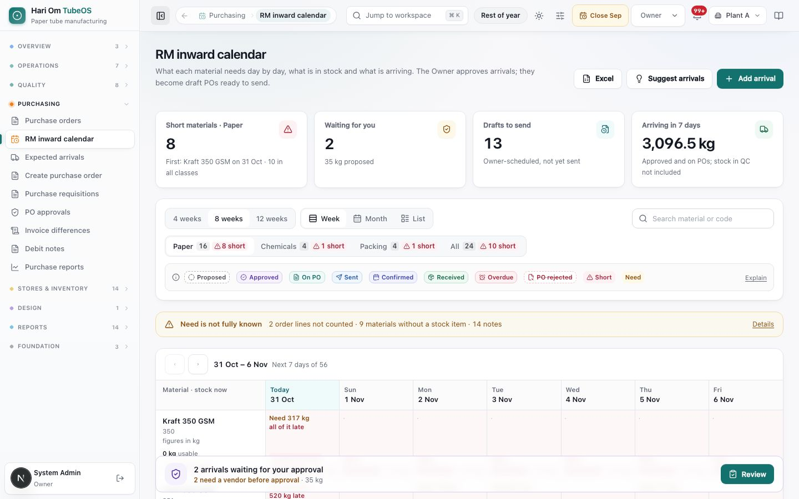
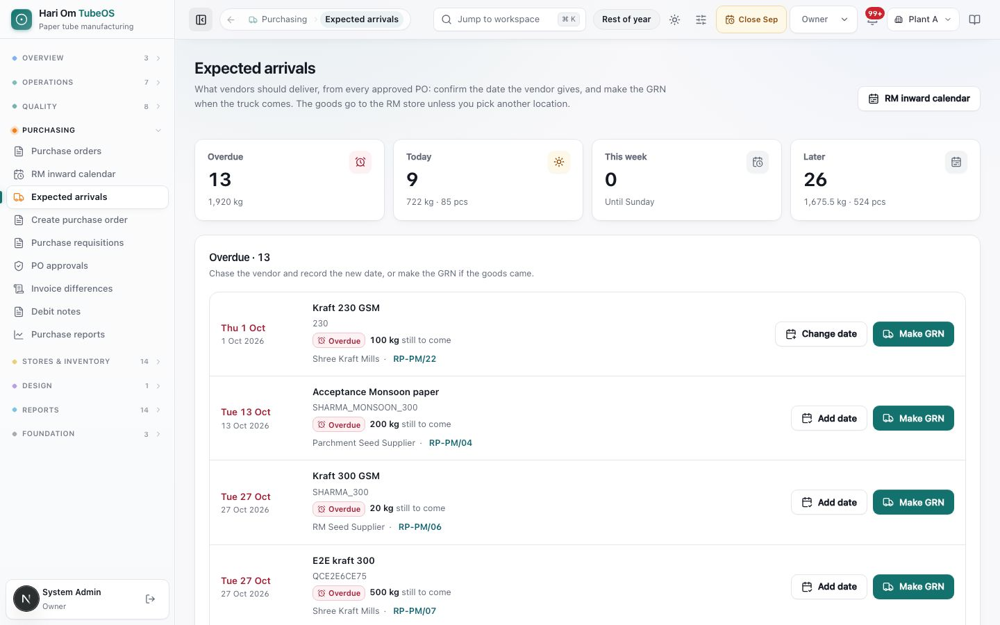

# RM inward calendar and expected arrivals

> **What it is:** the RM inward calendar shows, for every raw and packing material, what the plant needs day by day, what is in stock and what is arriving. The desk proposes arrivals, and the Owner approves them into draft POs. Expected arrivals is the daily list of what vendors should deliver, with **Make GRN** on each row.
> **Who uses it:** Planner, Store and Plant Manager propose arrivals. Only the Owner approves them. The purchase desk (Store, Planner, Plant Manager, Owner) records the dates vendors promise. GRN reads both pages and makes the GRN.
> **Where:** Sidebar > Purchasing > RM inward calendar (/purchase/scheduler) and Sidebar > Purchasing > Expected arrivals (/purchase/supplier-deliveries)

## At a glance
- **Need, stock and arrivals in one grid.** Each day's balance = the previous day's balance + counted arrivals − need, starting from usable stock now. A day below zero (or below the minimum stock) shows **Short**.
- **A proposal is not cover.** A **Proposed** arrival is not counted until the Owner approves it. After approval it counts as arriving, and it goes onto a draft PO, one PO per vendor per week, tagged **Scheduled by Owner**.
- **Stock waiting for incoming QC is not an arrival.** It is already in the store, so it counts as stock from tomorrow, never twice.
- **Expected arrivals lists only approved POs** with an open quantity, in four groups: **Overdue**, **Today**, **This week** (until Sunday) and **Later**.
- **Vendor dates are recorded, not guessed.** **Confirm** records the date the vendor gives. **Change date** needs a reason. A date can only be today or later.

## The flow
```flow
title: From shortage to goods in the store
See short day [Planner/Store] -> Add or suggest arrival [Planner/Store/Plant Manager] (Proposed) -> Approve [Owner] -> Draft PO, Scheduled by Owner -> Check & send [Purchase desk] -> Vendor confirms date -> Make GRN [GRN/Store]
after Approve: Desk changes qty, date, vendor or rate -> Owner approves PO again -> Check & send
after Vendor confirms date: Overdue (date passed) -> Change date with reason [Purchase desk] -> Make GRN
```

The calendar is where buying is decided; the purchase orders page is where the drafts are sent (see the Purchase orders chapter); Expected arrivals is where the store watches the trucks.

## Screen tour


*Figure: The RM inward calendar on 31 Oct. Buttons: Excel, Suggest arrivals, Add arrival. Tiles: Short materials · Paper 8 (first: Kraft 350 GSM on 31 Oct, 10 in all classes), Waiting for you 2 (35 kg proposed), Drafts to send 13, Arriving in 7 days 3,096.5 kg. Below: window and view switches, class tabs with short counts, the colour legend, an amber "Need is not fully known" bar, and the week grid starting Today 31 Oct. A floating bar says "2 arrivals waiting for your approval" with a Review button.*

What you see:
1. **Header buttons**: **Excel** (download the view or import a schedule workbook), **Suggest arrivals** and **Add arrival**. Roles that cannot propose (GRN, Admin) see **Excel** and **Expected arrivals** instead.
2. **Tiles**: **Short materials** (for the chosen class, with the first short material and date; click to open it), **Waiting for you** (Owner) or **Waiting for the Owner** (others; click to review), **Drafts to send** (opens the scheduled drafts queue) and **Arriving in 7 days** (approved and on POs; stock in QC not included).
3. **Window**: **4 weeks**, **8 weeks** (default) or **12 weeks**. **View**: **Week**, **Month** or **List** (phones open in List). **Search material or code**.
4. **Material class tabs**: **Paper**, **Chemicals**, **Packing**, **All**, each with a count and a "short" badge.
5. **Legend** (click **Explain** for the meanings): **Proposed** (dashed; not counted), **Approved** (counted as arriving), **On PO** (on a PO not yet sent), **Sent**, **Confirmed** (vendor confirmed the date), **Received** (GRN done), **Overdue** (date passed; counted on today), **PO rejected** (struck through; not counted), **Short** and **Need**.
6. **Need is not fully known** bar: order lines that could not be counted, materials with no stock item to plan against (with a link to link them in Items) and other notes. Click **Details**.
7. **Week grid**: one row per material with stock now ("0 kg usable"), one column per day. Each cell shows the need ("Need 317 kg, all of it late"), arrival chips and the balance. Late need (due before today) sits on today. Use the arrows to move week by week. Click a cell to open the material's day sheet. You can drag an arrival chip to another day.
8. **Owner bar** (Owner only, floating at the bottom): "2 arrivals waiting for your approval · 2 need a vendor before approval" with **Review**.

The **material sheet** (opened from a cell or list row) shows the day: **Need that day**, **Arriving (counted)**, **Balance at day end**, **If proposals approved**, **Usable stock now**, **Waiting for QC** (and from which day it counts) and the window totals. It lists where the need comes from (Planned on the floor, Released card not planned yet, Order line due not released, Customer call-off) and each arrival with its PO and state. The **Add an arrival** form inside it has **Material**, **Arrives on**, **Quantity** (with the short amount as a hint), **Vendor** (hint: last vendor) and **Note**.


*Figure: Expected arrivals. Tiles: Overdue 13 (1,920 kg), Today 9 (722 kg · 85 pcs), This week 0 (Until Sunday), Later 26 (1,675.5 kg · 524 pcs). The Overdue · 13 list shows rows such as "Thu 1 Oct · Kraft 230 GSM · Overdue · 100 kg still to come · Shree Kraft Mills · RP-PM/22" with Change date and Make GRN, and other rows with Add date and Make GRN.*

What you see:
1. **RM inward calendar** button (top right).
2. **Bucket tiles**: **Overdue**, **Today**, **This week**, **Later**: number of rows and the open quantity per unit. Click a tile to jump to its list.
3. **Bucket lists**: each row shows the day ("Thu 1 Oct", in red when overdue) and full date ("· no date on PO" when the PO has no dated row), the material name and code, a state chip, "100 kg still to come" (with what was already received), the vendor and the PO number (a link for the desk).
4. **Row buttons**: **Confirm** (or **Add date** when the PO line has no dated row yet), **Change date** and **Make GRN**. A confirmed row shows only Change date and Make GRN.
5. **Confirm / Change date form** (opens under the row): **Date the vendor gives** or **New date**, **Note** (optional) or **Why it moved** (required), **Save** and **Close**.
6. **Add a delivery date to a PO** (folded panel at the bottom, desk roles): for hand-made POs and split deliveries. Fields **Purchase order**, **Material** (shows the open quantity), **Quantity**, **Arrives on**, **Vendor confirmation** (Not confirmed yet / Vendor confirmed) and **Save delivery date**.

## Step by step

### How to read whether a material is short
1. Open **RM inward calendar**, pick the class tab (for example **Paper**) and the window.
2. Look at the **Short materials** tile, or the red **Short** cells in the grid. In **List** view the **Runs short** column gives the first short day.
3. Click the material to open its sheet. Compare **Balance at day end** with **If proposals approved** to see whether the proposals already waiting would fix it.

### How to propose an arrival
Roles: Planner, Store, Plant Manager, Owner.
1. Click **Add arrival** (or **Add an arrival** inside a material sheet).
2. Pick the **Material**, the **Arrives on** date (today or later) and the **Quantity**. The hint shows how much is short.
3. Pick the **Vendor**. The hint shows the last vendor. An arrival can be proposed without a vendor, but it cannot be approved until it has one.
4. Add a **Note** if useful (truck, grade, reason) and click **Propose arrival**. The chip shows **Proposed** and the Owner gets a notice.
5. The Owner sees an extra button, **Add and approve**, which proposes and approves in one step.

### How to use Suggest arrivals
1. Click **Suggest arrivals**. The system works out "Arrivals that close the shortages": each shortage gets an arrival the day before, enough for the following week, rounded up to the minimum order and order multiple, from the last vendor.
2. Each suggestion shows the material, quantity, date, vendor ("no vendor yet" in amber) and, where relevant, "order by …" or "late to order (lead time)" in red.
3. Untick any you do not want and click **Add N as proposals**. Nothing is saved until you click this button.

### How to import a schedule from Excel
1. Click **Excel** › **Import a schedule workbook** and choose the .xlsx file. The first dated block is read: one column per material (its code) and one row per date.
2. Match any column the system did not recognise (**Match a material…** or **Leave this column out**) and pick the unit the sheet uses (a kg column is never added to pieces). Past dates are left out.
3. Confirm. Every quantity becomes a proposed arrival for the Owner. **Download this view** gives the current grid as Excel.

### How to approve arrivals (Owner)
1. Click **Review** on the Owner bar, the **Waiting for you** tile, or **Review on the calendar** on PO approvals.
2. In the review sheet, pick a vendor for any arrival that has none ("Pick a vendor to approve it").
3. Click **Approve all**, or approve one week from the week grid. The message says, for example, "2 arrivals approved. 1 PO draft ready to send: RP-PM/55 (Bharat Paper Mills)", with a link **Open drafts to send**. Arrivals that could not be approved are listed with the reason ("needs a vendor", "was cancelled", "not an active vendor of this plant").
4. Arrivals of the same vendor in the same week go on one draft PO. The rate is the vendor's last Owner-approved PO rate for that material, else the RM costing base rate, else "Rate needed".

### How to move or cancel an arrival
1. Drag the chip to another day, or open it in the material sheet and change **Arrives on** or **Quantity**.
2. A proposal changes freely. An approved arrival can be changed only by the Owner. An approved arrival keeps its vendor; to change vendor, cancel it and propose a new one.
3. If the PO was already sent, the system asks "PO already sent — change the PO?". **Change the PO** makes a new PO revision with the new date (quantities and rates stay approved); send it to the vendor again. **Keep the date** leaves it.
4. After the PO is approved, the quantity is fixed on the calendar; change it on the PO itself (Edit / vendor change), which goes to the Owner again.

### How to confirm or change a vendor's date
Roles: Store, Planner, Plant Manager, Owner.
1. Open **Expected arrivals** and find the row.
2. Click **Confirm**, set **Date the vendor gives** (today or later), add a note such as "Confirmed on call", and click **Save**. The chip becomes **Confirmed**.
3. If the date moves, click **Change date**, set **New date**, write **Why it moved** (for example "Mill shut, truck late") and click **Save**.

### How to make a GRN from an arrival
Roles: GRN, Store, Plant Manager, Owner, Admin.
1. When the truck arrives, click **Make GRN** on the row (Expected arrivals, the PO's delivery dates, or the calendar sheet).
2. Goods inward opens with the vendor, the PO and the material line already filled. Continue as in the Goods inward chapter. The received quantity fills the oldest open date first.

## Rules the system enforces
- **BLOCKS:** only the Owner approves arrivals (an Admin alone cannot). Proposing is for Planner, Store, Plant Manager and Owner.
- **BLOCKS:** an arrival needs a quantity above 0 and a date of today or later ("Arrival 1: pick today or a later day"). Arrivals without a vendor are skipped at approval ("… needs a vendor").
- **BLOCKS:** "Only the Owner can change an approved arrival." "An approved arrival keeps its vendor. Cancel it and propose a new one for the other vendor."
- **BLOCKS:** once the PO is past draft, the quantity cannot change on the calendar ("… is past draft. Change the quantity on the PO itself (Edit / vendor change), which goes to the Owner again.").
- **BLOCKS:** a vendor date in the past is refused ("… has passed. Pick today or a later day."). **Change date** needs a reason of at least 3 characters.
- **BLOCKS:** vendor confirmation is for approved POs: "Send the approved PO to the vendor first; the vendor confirms an approved PO." Delivery rows cannot add up to more than the PO line's open quantity.
- **ASKS:** moving an arrival on a sent PO asks "PO already sent — change the PO?" before making a new revision.
- **AUTOMATIC:** balance per day; late need placed on today; overdue arrivals counted on today; QC-pending stock counted from tomorrow; received goods counted as stock only once; packing material (boxes, plastic, fadda) for a card counts as needed until its Packing step closes.
- **AUTOMATIC:** approval places arrivals on one draft PO per vendor per week and fills the rate as described above. A rejected PO's arrivals stop counting as cover until it is revised and approved.

## Sample
On 31 Oct the Planner opens **Paper** on the calendar. **Kraft 350 GSM** shows 0 kg usable, need 317 kg on today (all of it late) and **Short from 31 Oct**. She clicks **Suggest arrivals**; the suggestion is 450 kg on 3 Nov from Bharat Paper Mills (rounded up to the 50 kg order multiple). She adds it as a proposal. The **Waiting for you** tile on the Owner's screen goes to 1.

The Owner clicks **Review** and **Approve all**: "1 arrival approved. 1 PO draft ready to send: RP-PM/55 (Bharat Paper Mills)." The rate comes from the last approved PO, ₹47.25 / kg. Store opens **Scheduled drafts to send**, clicks **Check & send** › **WhatsApp**. Bharat Paper Mills says 4 Nov; Store records it with **Confirm**. On 4 Nov the row is under **Today** in Expected arrivals; GRN clicks **Make GRN**.

| Day | Need | Counted arrivals | Balance at day end |
|---|---|---|---|
| Sat 31 Oct | 317 kg | 0 | −317 kg (Short) |
| Wed 4 Nov | 120 kg | 450 kg | 13 kg |

## Common questions
**Q: I proposed 500 kg but the balance did not change. Why?** A: A proposal is not counted until the Owner approves it. Look at **If proposals approved** in the material sheet to see the effect.

**Q: Reels are in the store but the calendar still says short. Why?** A: Reels waiting for incoming QC count from tomorrow, not today. If QC rejects them they never count. Ask QC to inspect them.

**Q: Why can't I approve arrivals?** A: Only the Owner approves arrivals. Admin and the desk can pick a vendor for an arrival so it is ready for him.

**Q: The Owner approved arrivals but nothing came to the vendor.** A: Approval makes a draft PO. The desk must still open **Scheduled drafts to send** and click **Check & send**.

**Q: What does "Need is not fully known" mean?** A: Some order lines could not be turned into material need, or a material has no stock item linked. Click **Details**; link missing materials in Inventory › Items.

**Q: An arrival shows "Overdue". Is it still counted?** A: Yes, an overdue arrival that is not received is counted on today. Chase the vendor and use **Change date**, or make the GRN if the goods came.

**Q: A row in Expected arrivals shows "Add date" instead of "Confirm".** A: That PO line has no dated delivery row yet. **Add date** creates one with the date the vendor gives.

**Q: Why is my approved PO not in Expected arrivals?** A: Only approved and partly received POs with an open quantity are listed. A draft or a PO waiting approval is not expected yet.

## Related chapters
- Purchase orders, PO approvals and requisitions
- Goods inward, GRN register and labels
- Inventory, material items, manual FG, stock alerts and RM costing
- Planner (where the need comes from)
- Incoming QC
