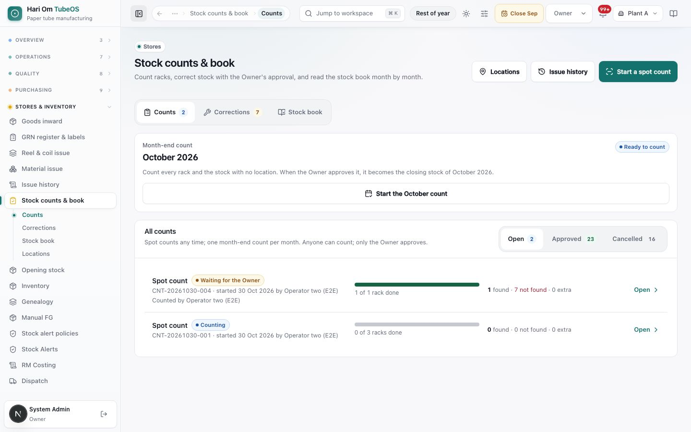
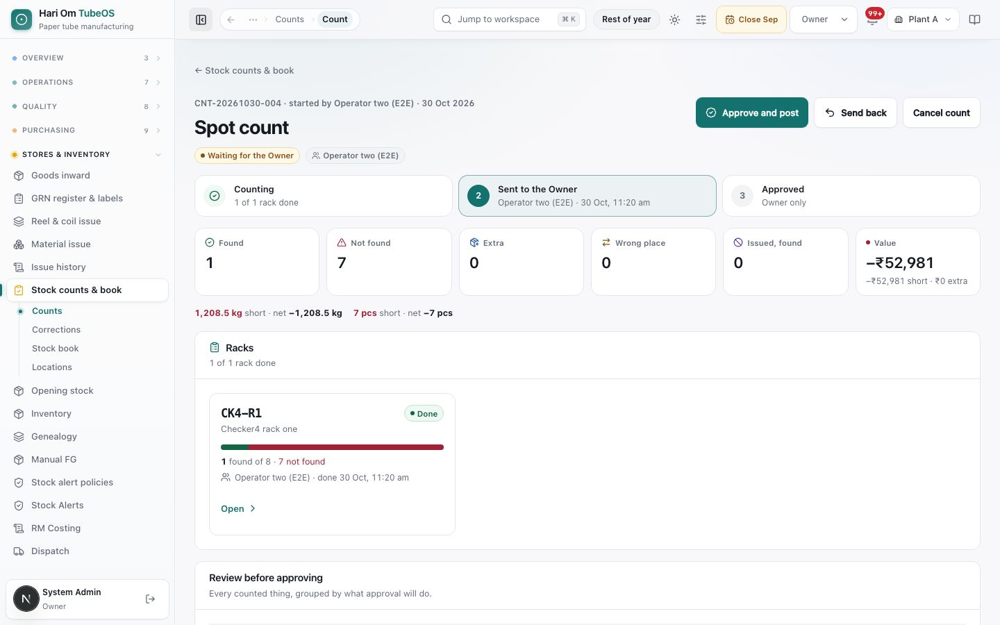
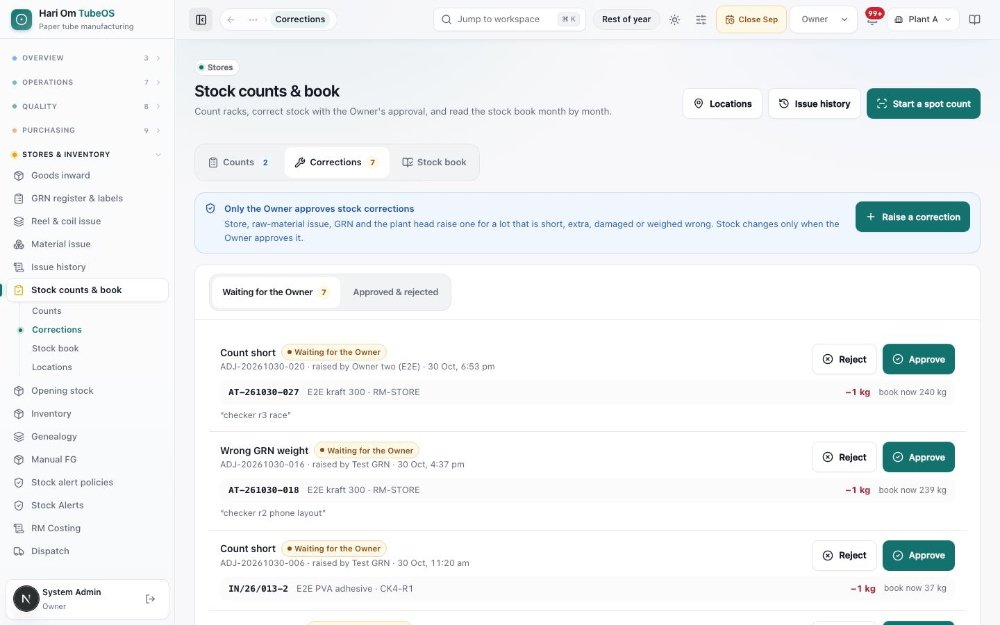
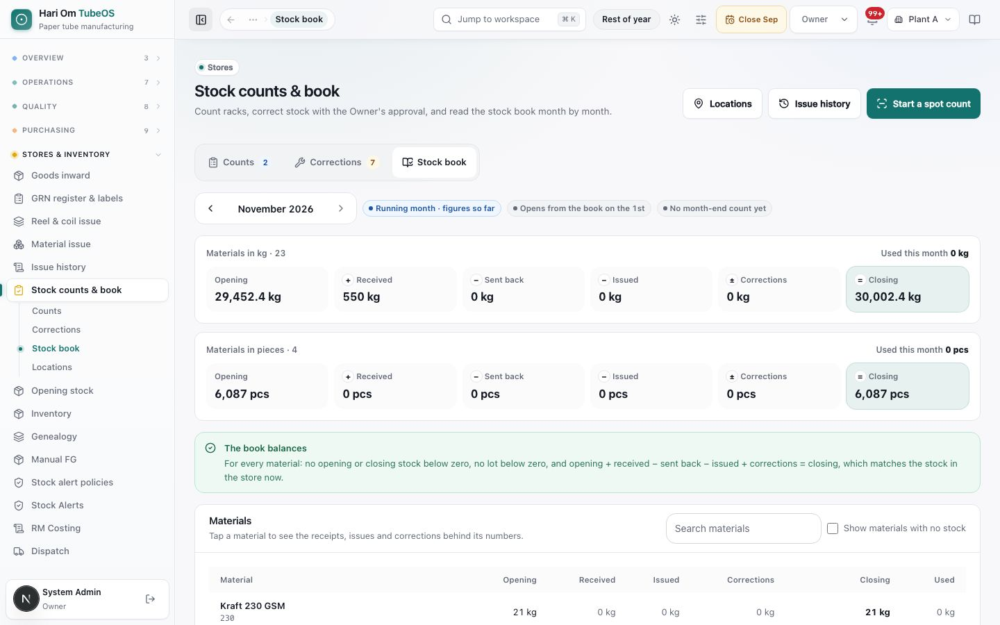
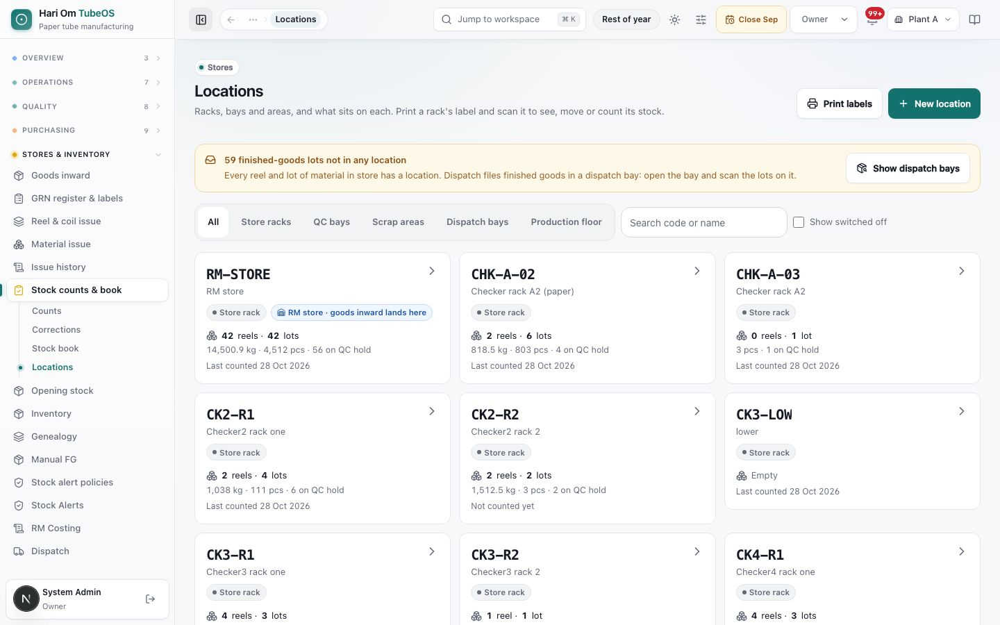
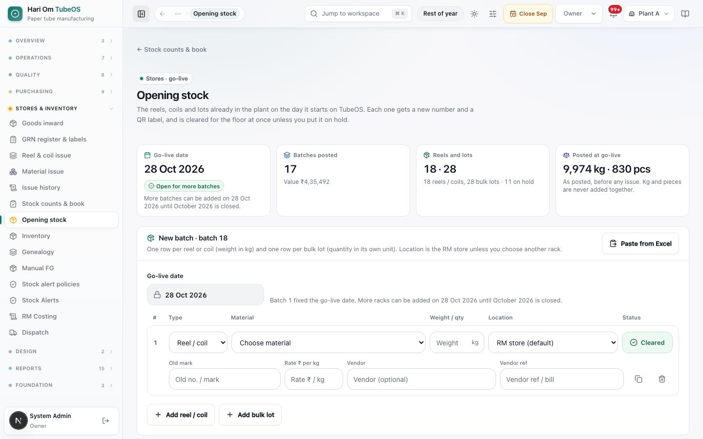

# Stock counts, stock book, locations and opening stock

> **What it is:** the one place where the store counts its racks, corrects stock with the Owner's approval, reads the month's stock book, manages racks with QR labels, and (once, at go-live) enters the stock already in the plant.
> **Who uses it:** every role can count; Store, RM issue, GRN and the Plant Manager raise corrections; only the Owner approves counts and corrections; Owner and Admin enter opening stock.
> **Where:** Sidebar > Stores & inventory > Stock counts & book (/inventory/stock-control, tabs **Counts**, **Corrections**, **Stock book**, plus **Locations** at /inventory/locations). Opening stock: Sidebar > Stores & inventory > Opening stock (/inventory/opening-stock).

## At a glance
- **Anyone counts, only the Owner approves.** A count or a correction changes stock only when the Owner approves it. Admin cannot approve.
- **Two kinds of count.** A **Spot count** (a few racks, a few materials or the whole store) can run any day. A **Month-end count** covers every rack and the stock with no location, once per month; when approved it becomes the month's stock certificate.
- **Nothing comes back from the floor.** A reel or lot issued to the floor is used on its issue day. A count never "un-issues" it, and a correction cannot put it back.
- **Stock found without a known label goes on QC hold.** Incoming QC stays the only gate before anything can be issued.
- **The stock book is per material and per month:** Opening + Received − Sent back − Issued ± Corrections = Closing, always in the material's own unit (kg is never added to pcs).

## The flow
```flow
title: Count to stock
Start count [Any role] -> Count each rack [Any role] (scan reels and lots) -> Rack done (unscanned lots marked not found) -> Send to the Owner [Any role] -> Approve and post [Owner] (stock changes)
after Send to the Owner: Send back [Owner] (racks to recount, with note) -> Count each rack [Any role]
after Count each rack: Cancel count [Owner or starter] (stock does not change)
```

```flow
title: Stock correction outside a count
Raise a correction [Store/RM issue/GRN/Plant Manager] -> Waiting for the Owner -> Approve [Owner] (posted today) -> Stock book shows it
after Waiting for the Owner: Reject with note [Owner] -> Stock does not change
```

```flow
title: Go-live opening stock
Enter rows [Owner/Admin] (reels by kg, lots by qty) -> Check rows -> Post batch (fixes go-live date) -> Print QR labels -> Next rack, same date
after Post batch: Month closed -> Opening stock closed (use a stock count)
```

A count is worked rack by rack and only touches stock at the Owner's approval. Small fixes between counts go through a correction. Opening stock is a one-time go-live step; after the go-live month is closed, a count is the only way to fix stock.

## Screen tour


*Figure: The Stock counts & book page on the Counts tab. At the top is the month-end count card for October 2026 with a **Start the October count** button. Below it is **All counts**, with Open, Approved and Cancelled filters and two open spot counts.*

What you see:
1. **Header buttons**: **Locations** (rack list), **Issue history** (every issue to the floor, which feeds the book's Issued column) and **Start a spot count**.
2. **Tabs**: **Counts** (the badge shows how many counts are open), **Corrections** (the badge shows how many wait for the Owner) and **Stock book**.
3. **Month-end count card**: the month the store should count now. The chip says **Ready to count**, **Not open yet**, **Counting**, **Waiting for the Owner**, **Approved · month certificate** or **Month closed**. If the count cannot start yet, the card says why (for example, it opens in the last 3 days of the month). When the earlier month's count is approved but that month is not closed yet, a second card for it is shown too.
4. **All counts** list: each row shows the kind (**Spot count** or **Month-end count**), its status, the count number (like CNT-20261030-004), who started it and when, who counted, a rack progress bar ("1 of 1 rack done") and the result ("1 found · 7 not found · 0 extra", plus "issued, found" when there are any). **Open** opens the count.


*Figure: A spot count page while it waits for the Owner. The Owner sees **Approve and post**, **Send back** and **Cancel count**. A three-step bar shows Counting, Sent to the Owner and Approved. Tiles show Found 1, Not found 7, Extra 0, Wrong place 0, Issued found 0 and a Value of −₹52,981. One rack card shows 1 found of 8 and 7 not found.*

What you see:
1. **Title line**: count number, who started it, date, kind and status chip, and the people who counted.
2. **Action buttons**: one main action at a time. While counting it is **Count <rack>** / **Continue counting <rack>**. When every rack is done, **Send to the Owner** appears. For the Owner, a submitted count shows **Approve and post** and **Send back**. **Cancel count** is shown to the Owner, or to the person who started the count while it is still being counted.
3. **Steps**: Counting (racks done), Sent to the Owner (who and when), Approved (Owner only). A month-end count's last step reads "Approved · certificate".
4. **Result tiles**: **Found**, **Not found**, **Extra** (includes stock without a label), **Wrong place**, **Issued, found** and **Value** (net ₹, with the ₹ short and ₹ extra underneath). Under the tiles, totals are shown per unit, for example "1,208.5 kg short · 7 pcs short".
5. **Racks**: one card per rack, plus a card for stock with no location. Each shows its status (**To count**, **Counting**, **Done**, **Count again**), a bar of found, not found and still to find, who counted and when it was marked done. If the Owner sent the rack back, the Owner's note is shown on it.
6. **Review before approving**: every line grouped by what approval will do. The groups are **Not found** (written off), **Extra stock**, **In the wrong place** (moved where found), **Quantity different**, **Had no location** (filed where found), **Issued, but found in store**, **Used during the count**, **Arrived during the count**, **Moved away during the count**, **Moved after it was counted**, **Issued after it was counted**, and the collapsed **Found as the book says**. Each line shows the label, material, rack, Book qty, counted qty, who counted and the change in qty and ₹.

**The rack page** (opened from a rack card, /inventory/counts/<id>/rack/<rack>) is where the counting happens, usually on a phone. It shows **Found on this rack** with a progress bar and three lists: **Still to find**, **Not found** and **Counted here**. You scan each reel, coil or lot label. A reel counts at its label weight; tap the weight to re-weigh it. A lot asks "How much is here?". An unknown label or loose material opens **Stock without a label**, where you choose the material and quantity. **Rack done** asks you to confirm when lots are still unfound ("Mark 3 not found"), and **Look again** lets you go back. A rack marked done can be re-opened with **Look again** while the count is still being counted.


*Figure: The Corrections tab. A blue note says only the Owner approves stock corrections, with a **Raise a correction** button. Below it, the **Waiting for the Owner** list shows corrections such as "Count short" and "Wrong GRN weight". Each has its voucher number, the lot, rack, change (−1 kg), the current book quantity and **Reject** / **Approve** buttons.*

What you see:
1. **Notice and Raise a correction**: the button is shown only to roles that may raise (Store, RM issue, GRN, Plant Manager, Owner, Admin).
2. **List switch**: **Waiting for the Owner** (with count) and **Approved & rejected**.
3. **Correction card**: reason (Count short, Count extra, Damaged in store, Wrong GRN weight, Label lost / found, Other), status chip, voucher number (ADJ-YYYYMMDD-NNN), who raised it and when. Each line shows the lot or reel code, material and rack, the signed change and "book now". Cards made by a count show a **From a count** chip.
4. **Changed-since warning**: an amber line appears if the lot changed after the correction was raised. For example: "Since this was raised, this reel was issued to the floor ... reject this one". Or: "Approving now changes it by −0.5 kg".


*Figure: The Stock book tab for October 2026, the running month. One card covers materials in kg: Opening 0 kg, Opening loads 9,974 kg, Received 31,684 kg, Sent back 0, Issued 15,065.8 kg, Corrections −90.8 kg, Closing 26,501.4 kg. A second card covers materials in pieces. A green note says "The book balances".*

What you see:
1. **Month picker** with previous and next arrows (you cannot go past the current month), and chips: **Running month · figures so far**, **Not closed yet** or **Month closed**; **Opens from last month's close** or **Opens from the book on the 1st**; and the month-end count state (click it to open the count).
2. **One card per unit** (kg, pcs and so on): Opening, Opening loads (only when there was go-live stock), Received (GRNs), Sent back, Issued, Corrections and Closing, plus **Used this month**.
3. **Balance check**: green **The book balances**, or red "N materials do not balance", naming each problem material (for example "opens below zero"). Month-end waits until it is fixed.
4. **Materials** table: search, a **Show materials with no stock** tick box, and one row per material with the same columns plus **Used**. A material that changed after the month-end count is marked "Changed after the month-end count". Clicking a row opens a side panel with every receipt, issue and correction behind the numbers (date, kind, lot, document, shift, reason, place).
5. **Go-live opening stock** strip (Owner and Admin only) with **Enter opening stock** or **See opening stock**.


*Figure: The Locations page with **Print labels** and **New location** buttons. An amber note says 45 finished-goods lots are not in any location. Filter chips are shown for All, Store racks, QC bays, Scrap areas, Dispatch bays and Production floor. Rack cards include RM-STORE (marked "RM store · goods inward lands here", 37 reels and 42 lots, 10,999.9 kg, 4,512 pcs, 51 on QC hold, last counted 28 Oct 2026).*

What you see:
1. **Print labels** (select racks, then **Print N labels** or **Print all labels**) and **New location**: for Store, Plant Manager, Owner and Admin.
2. **Unplaced stock note**: "Not in any location yet: N reels and N lots", with **Put away by scan** (choose the rack you are at, then scan lots) and, for the Owner only, **Put all in RM store**. Finished-goods lots without a place are filed by Dispatch in a dispatch bay. When everything is placed the note turns green.
3. **Filters and search**, and **Show switched off**.
4. **Location cards**: code (big), name, kind chip (**Store rack**, **QC bay**, **Scrap area**, **Dispatch bay**, **Production floor**), the RM store chip, reels and lots on it, totals per unit, how many are on QC hold, and **Last counted** date.

Opening a card shows the location page. It has **What is here** (**Reels & coils** and **Lots**), and the buttons **Move stock here**, **Count this rack** (starts or joins a spot count of that rack), **Raise correction** and **Print label**. Under **More actions** are **Edit name or code** and **Make this the RM store (goods inward lands here)**.


*Figure: The Opening stock page. The tiles show the go-live date (28 Oct 2026, "Open for more batches"), batches posted (17, value ₹4,35,492), reels and lots (18 reels or coils, 28 bulk lots, 11 on hold) and what was posted at go-live (9,974 kg and 830 pcs). Below is the **New batch** form with a locked go-live date and one row: Type, Material, Weight / qty, Location (RM store default), Status (Cleared), Old mark, Rate, Vendor and Vendor ref.*

What you see:
1. **Tiles**: **Go-live date** (with "Open for more batches" until the month is closed), **Batches posted** and their value, **Reels and lots**, and **Posted at go-live** (kg and pcs are never added together).
2. **New batch** form: **Paste from Excel**, a **Go-live date** field (locked after batch 1), and one row per reel or coil (**Reel / coil**, weight in kg) or per bulk lot (**Bulk lot**, quantity in its own unit). Each row has Location (default RM store), Status (**Cleared** or on hold, with **Why on hold** needed), **Old mark**, **Rate ₹ per kg/piece**, **Vendor** and **Vendor ref**. There are buttons to duplicate or remove a row.
3. **Add reel / coil**, **Add bulk lot**, **Clear all rows**, then **Review before posting** (totals per material) and **Post opening stock?**.
4. **Posted batches**: every batch so far, newest first, with label reprint.

## Step by step

### How to start a spot count
Any signed-in role. One plant must be selected at the top (Owner and Admin pick the plant).
1. Open **Stock counts & book** and click **Start a spot count**. The **Start a spot count** sheet opens.
2. Under **What to count**, choose **Some racks** (tick the racks), **Some materials** (search and pick; the racks that hold them are added for you) or **Whole store** (every store rack plus stock with no location).
3. Confirm. The count opens with one card per rack. The system refuses a rack that is already in another open count, with a message like "CK2-R1 is already in spot count CNT-20261030-001, which is still being counted", and gives you a link to open that count.

Tip: on a rack's own page, **Count this rack** starts a spot count of that rack, or joins one already running there.

### How to start the month-end count
1. On the **Counts** tab, look at the **Month-end count** card. When it says **Ready to count**, click **Start the <month> count**.
2. The count covers every store rack and the stock with no location. If someone else already started it, you join the same count. There is never a second count for the same month.
3. If the card says **Not open yet**, read the reason. The running month opens only in its last 3 days. A month that has ended can be counted until it is closed. A month that is already closed, or that has a later closed month, cannot be counted.

### How to count a rack
1. On the count page, tap a rack card (or **Count <rack>**). The rack page opens.
2. Scan each reel, coil or lot label on that rack. A reel is counted at its label weight. To re-weigh it, tap the weight and enter the scale reading (it cannot be more than its inward weight). A lot asks "How much is here?"; type the quantity you see and tap **Save count**.
3. For a label the system does not know, or material with no label, use **Stock without a label**: pick the material, enter the quantity and add a note if useful. It becomes a new lot on QC hold when the Owner approves.
4. To take a scan back, tap the undo arrow next to the line.
5. Tap **Rack done**. If lots the book expects are still not scanned, the sheet lists them and offers **Mark N not found**, or **Look again**. Lots that arrived on the rack after you started it are left out and are never marked not found. Reels issued from the rack while you counted are recorded as "Used during the count", not missing.
6. Repeat for every rack. Several people can count different racks at the same time.

### How to send the count to the Owner
1. When every rack is **Done**, **Send to the Owner** appears at the top of the count page.
2. Click it, add an optional note and click **Send**. Counting is now locked. If a rack is not done, the system refuses with "2 racks are not done yet: CK2-R1, CK3-R2."

### How to approve a count (Owner)
1. Open the count from the **Open** list. Read **Review before approving** group by group.
2. For each **Issued, but found in store** line, choose **Leave as used (no change)** or **Add as new stock on QC hold**. Approval is refused until every such line is decided.
3. Click **Approve and post**. The sheet lists what will happen: not-found lots are written off by their own label, lots with a different quantity are set to the counted qty, extra known lots add back, stock without a label becomes new lots on QC hold, and wrong-place lots move to where they were found. It also shows the net ₹ value and the posting date.
4. Click **Approve and post** again to confirm. A green note shows the voucher number (VAR-YYYYMMDD-NNN), the number of lines posted and the date. A month-end count becomes the stock certificate for that month.
5. If new lots were made, click **Print N new labels** and stick the labels on before the lots are moved.

### How to send racks back for a recount (Owner)
1. On a submitted count, click **Send back**.
2. Pick **Why it is counted again** from the list **Correction rejected / count sent back** (AR-RECOUNT Recount needed, AR-NO-PROOF No proof or photo, AR-WRONG-ITEM Wrong item or lot, AR-WRONG-QTY Quantity looks wrong, AR-OTHER), write in the note what should be counted again, and tick the racks. If you tick none, all racks go back.
3. Click **Send back**. The racks show **Count again** with your note. Scans already made stay. Lines made by Rack done are cleared so they are rebuilt when the rack is finished again.

### How to cancel a count
1. Click **Cancel count**, add an optional reason and confirm. Stock does not change and the count stays in the **Cancelled** list.
2. The Owner can cancel any open count. The person who started it can cancel only while it is still being counted. An approved count cannot be cancelled.

### How to raise a stock correction
Store, RM issue, GRN, Plant Manager, Owner or Admin.
1. On the **Corrections** tab click **Raise a correction** (or **Raise correction** on a location page).
2. Under **What to correct**, choose **A lot or reel** or **Found without a label**.
3. For a lot or reel: scan or type the code (for example AIT 06243, an older AT-261027-026, or IN/26/005-5). The sheet shows **Book now**. Enter **Quantity really there**, or tick **Not here / damaged (nothing usable left)**.
4. For stock found without a label: choose the **Material**, the quantity and, if you like, the location. If you leave the location empty, the RM store is used. It will be added as a new lot on QC hold.
5. Choose a **Reason** from the list **Stock correction**: COUNT_SHORT Count short, COUNT_EXTRA Count extra, DAMAGED_IN_STORE Damaged in store, WRONG_GRN_WEIGHT Wrong GRN weight, LABEL_LOST_FOUND Label lost / found, STOCK-OTHER Other. **Other** needs a written note of at least 5 characters.
6. Save. The correction waits for the Owner with a number like ADJ-20261030-020. Stock does not change yet.

### How to approve or reject a correction (Owner)
1. Open **Corrections** > **Waiting for the Owner**.
2. Read the amber note if the lot changed since it was raised. When nothing is left to post, **Reject** becomes the main button.
3. Click **Approve** to post it, dated today. Or click **Reject**, pick a reason from **Correction rejected / count sent back** (for example AR-NO-PROOF) with a note, and confirm; the person who raised it sees the reason and your note.

### How to read the stock book
1. Open the **Stock book** tab and choose the month with the arrows.
2. Read the unit cards for totals, then the **Materials** table. Click a material to see every movement behind its figures.
3. If the red "do not balance" note appears, tell the Owner. The month cannot be closed until the book balances.

### How to add, edit or switch off a location
Store, Plant Manager, Owner or Admin.
1. On **Locations** click **New location**. Fill **Code (on the label)**, **Name**, **What it is** (Store rack, QC bay, Scrap area or Dispatch bay), **Store / area**, and optionally **Zone** and **Bin**. Save.
2. To edit, open the location and use **More actions** > **Edit name or code**.
3. To switch a location off, first move out everything on it. You cannot switch off the RM store; make another rack the RM store first.

### How to print rack labels and lot labels
1. On **Locations** click **Print labels**, tick racks (or none for all) and click **Print N labels**. The **Rack labels** sheet prints on A4: a big code, the name and a QR. Stick one at eye level on each rack. Laminate them so they last. Scanning a rack QR with a phone camera opens that rack's page.
2. **Lot labels** for new lots made by a count are printed from the count page (**Print its label** or **Print N new labels**), or from **Lot labels**. Pick the **Label paper**: **A4 sheet · 8 per page** (cut them apart) or **One label per page**. Reels and coils print the plant's own reel label (heading, MILL NAME, invoice no., date, PLYBOND, VARIETY, GSM, ROLL NO., the AIT serial in big letters, WEIGHT and the QR; see "Goods inward, GRN register and labels"). Bulk lots print a lot label with the code and QR. Reel and coil labels do not print the QC state: "Lots on QC hold stay on hold until incoming QC clears them. Reel and coil labels do not print the QC state: scan the QR to see it."

### How to move stock to a rack
Store, GRN, RM issue, Plant Manager, Owner or Admin. Dispatch moves finished goods only.
1. Scan the rack label, or open the rack from **Locations**, and tap **Move stock here**.
2. Scan each reel or lot you put on it. Each line shows the result. Tap undo to put a move back (refused if the lot has moved again since).
3. QC status never changes when a lot is moved.

### How to enter go-live opening stock (Owner or Admin)
1. Open **Opening stock**. For the first batch, choose the **Go-live date** (not after today).
2. Add rows with **Add reel / coil** (weight in kg) and **Add bulk lot** (quantity in its unit), or use **Paste from Excel**. The columns, in order, are: item code or name, type (reel / coil / bulk), weight or qty, location, old mark, vendor, rate. A header row is skipped.
3. For each row, pick the material and location (the RM store by default), and keep **Cleared** or put it on hold with a **Why on hold** code from the list **QC hold placed** (for example QH-MOISTURE). Optionally fill the old mark, rate, vendor and vendor ref.
4. Review the totals per material. Fix any red row errors and read the warnings. Then post. The first posted batch fixes the plant's go-live date.
5. Print the labels for the new reels and lots and stick them on. Reels and coils get the next numbers of the plant's AIT series and print in the plant's own reel label layout. "Reels and coils print the plant's own label with a QR, numbered in the plant's AIT series. Print the A4 sheet (8 per page) and cut, or one label per page."
6. Enter the next rack the same way on later days. All batches use the same go-live date, until that month is closed.

## Rules the system enforces
- **Only the Owner approves** counts, corrections, send-backs, issued-but-found decisions and **Put all in RM store** (BLOCKS everyone else with "Only the Owner can do this."). An Admin, or an Owner switched to another desk, cannot approve.
- **Anyone may count and submit.** Every line keeps who counted it and when.
- **One month-end count per plant per month**. Two people starting it at once join the same count (automatic).
- **Month-end count window** (BLOCKS): the running month opens in its last 3 days. Months before the stock book starts, closed months, and months with a later closed month are refused. Approval is also refused if a later month was closed after the count started (LATER_MONTH_CLOSED).
- **No rack in two open counts** (BLOCKS, RACK_IN_OPEN_COUNT), so nothing is posted twice.
- **Submit needs every rack done** (BLOCKS). After submitting, counting is locked ("Counting is locked: this count is waiting for the Owner.").
- **A reel cannot weigh more than its inward weight** (BLOCKS) in a count or a correction.
- **Finished goods and tools are not counted** (BLOCKS, NOT_COUNTED). Materials outside a materials-only spot count are refused (NOT_IN_SCOPE).
- **Rack done** turns every expected lot not scanned into **Not found**. Lots that arrived after the rack was started, lots issued during the count and lots moved away during the count are never "not found" (automatic).
- **Issued, but found** (automatic flag, BLOCKS approval until decided): the issue is never reversed. The Owner leaves it as used, or adds it as a new lot on QC hold with a new label.
- **Approval posts one voucher** (VAR-YYYYMMDD-NNN) with exact reel and lot lines. A gain on a known lot keeps its QC state. Unknown or loose stock becomes a new lot on QC hold. A spot count posts today. A month-end count posts on the month's last day, or today if the month is still running. Lots received after the month end are changed on the approval day, on a second voucher.
- **A back-dated month-end posting may not push a material or lot below zero** in that month (BLOCKS; "Send the count back to recount that rack").
- **Value** uses each line's rate. Lines with no rate yet (usually a GRN whose invoice is pending) are left out of the ₹ total, but their stock change still posts in full (WARNS).
- **Corrections**: a **Stock correction** code is required, and **Other** needs a note of at least 5 characters; rejecting a correction or sending a count back needs a **Correction rejected / count sent back** code. Free text alone is refused (BLOCKS). Only one waiting correction per lot (BLOCKS, CORRECTION_WAITING). A lot returned to the supplier, or a reel already issued to the floor, cannot be corrected ("Nothing comes back from the floor; if it is in the store, record it in a stock count."). If the book already equals the quantity typed, there is nothing to correct (BLOCKS).
- **At approval, a correction is re-based on the stock now.** If another count or correction already changed the lot, only the remaining difference posts (automatic). If the lot was issued after the correction was raised, approval is refused (ISSUED_SINCE_RAISED). Rejecting needs a reason code.
- **Closed months take no stock movement.** Counts, corrections and opening stock dated in a closed month are refused; ask the Owner to re-open the month.
- **Locations**: the production floor is never a move target, and stock reaches it only through the issue desks. A dispatch bay holds finished goods only. A switched-off location cannot receive stock. A location that still holds stock cannot be switched off. Each plant has exactly one RM store (receiving default), and it must be an active store rack or QC bay. Location codes are unique per plant.
- **Opening stock**: Owner or Admin only. The first batch fixes the go-live date, and later batches must use the same date (GO_LIVE_DATE_FIXED). The date cannot be in the future. Once the go-live month is closed, opening stock is closed ("Opening stock is closed. Use a stock count to correct stock."). Only raw materials can be entered, not finished goods or tools. A material kept as reels must be entered as a reel, and a material kept as lots as a bulk lot. Whole units (pcs, boxes, bags) need whole numbers. The floor, dispatch bays and scrap bays are refused as locations. On-hold rows need a **QC hold placed** code, and a rate cannot be below zero. The system WARNS (does not block) about a reel over 3,000 kg, a lot over 50,000, a repeated old mark, or a missing rate (counted at ₹0). Each batch posts all or nothing, once.
- **Opening stock is cleared at once** (no incoming QC) unless put on hold; held lots are cleared by incoming QC like any held lot. New reels and coils get the plant's AIT serial (AIT + 5 digits, the series of the financial year of the go-live date); lots get RM-<item>-yymmdd-nnn, dated the go-live date. Reels entered before 1 Nov 2026 keep their AT-yymmdd-nnn numbers. In the stock book they show as **Opening loads**.

## Sample
**Month-end count of October 2026, Plant A.** On 29 Oct the store opens the October card (it opened on 29 Oct, the last 3 days) and clicks **Start the October count**. It becomes CNT-20261029-001 with 12 racks plus "Not in any location".

| Rack | Result after Rack done |
|---|---|
| RM-STORE | 36 reels found; reel AT-261020-014 (412 kg) not found |
| CHK-A-02 | lot IN/26/031-2 of PVA adhesive: book 60 kg, counted 55 kg |
| CK3-R1 | reel AT-261011-006 found, but the system says it was issued on 14 Oct |
| CK2-R1 | one bag of BLUE parchment with no label, 25 kg |

The count is sent to the Owner on 31 Oct. The Owner chooses **Leave as used** for AT-261011-006 and clicks **Approve and post**. Voucher VAR-20261031-001 posts three lines dated 31 Oct 2026: −412 kg on AT-261020-014, −5 kg on IN/26/031-2, and +25 kg as a new lot on QC hold for the parchment, whose label is then printed. The count becomes **Approved · month certificate** for October 2026. The stock book's **Corrections** column for October now includes −392 kg. The Owner then closes October on **Month-end close**.

## Common questions
**Q: I counted a rack correctly, so why does it show lots "not found"?** A: Rack done marks every lot the book expects on that rack and nobody scanned as not found. Use **Look again** before confirming. If the lot is on another rack, scan it there; it will show as **In the wrong place** and move on approval, not be written off.

**Q: A reel was issued to the floor but it is still lying in the store. Can I return it?** A: No. Nothing comes back from the floor. Scan it in a count; it shows as **Issued, but found in store**, and the Owner either leaves it as used or adds it as new stock on QC hold with a new label.

**Q: Why can't I start the month-end count?** A: Read the note on the card. The running month opens only in its last 3 days. A closed month, or a month before a closed month, cannot be counted. A spot count can run any time.

**Q: What is the difference between a whole-store spot count and the month-end count?** A: Both change stock when approved, but only the month-end count becomes the month's stock certificate, which Month-end close uses.

**Q: The Owner approved a count with a mistake. How do we undo it?** A: Approval cannot be undone. Fix it with a new spot count of that rack, or a correction for that lot.

**Q: Why did my correction post a different quantity from what I raised?** A: At approval the system re-bases it on the stock at that moment. If a count or another correction already changed that lot, only the remaining difference is posted, and the note on the line says so.

**Q: Why does the stock book say "Opens from the book on the 1st" and not from last month's close?** A: The previous month is not closed yet. After it is closed, the chip says "Opens from last month's close".

**Q: Why is the Value on a count shown in amber, with "with no rate"?** A: Some lines have no rate yet, usually because the GRN invoice is pending. Those lines are left out of the ₹ total, but their stock change still posts in full.

**Q: Can I scan an old AT label in a count?** A: Yes. Old AT numbers and new AIT serials are both found by scan or by typing ("ait 6243" finds AIT 06243).

**Q: Why doesn't the reel label say "QC hold"?** A: The reel label matches the plant's own label and does not print the QC state. Scan its QR to see whether it is cleared.

**Q: We forgot one rack at go-live. Can we still add it?** A: Yes, as a new batch on the same go-live date, until the go-live month is closed. After that, add the stock through a stock count.

**Q: Where does goods inward put stock if I do not choose a rack?** A: In the location marked **RM store · goods inward lands here**. The Owner or Admin can make another active store rack the RM store from its **More actions** menu.

## Related chapters
- Goods inward and GRN register (labels, locations at inward)
- Reel & coil issue, Material issue and Issue history
- Month-end close and Usage limits
- Incoming QC (clearing lots on QC hold)
- Inventory and alerts
- QR scan
