# Reports

> **What it is:** the read-only report pages that show how the plant, the orders, the stock and quality are doing, with links back to the records behind every figure.
> **Who uses it:** Owner and Admin (all reports); Plant Manager, Planner, Sales, Store, Dispatch, QC and Inward QC (the reports of their area).
> **Where:** Sidebar > Reports (Intelligence at /analytics; the others under /reports/..., for example /reports/owner, /reports/plan-vs-actual).

## At a glance
- **Reports never change data.** They read orders, job cards, floor logs, stock and QC records. To fix a number, fix the record it comes from.
- **Every report works on the plant chosen at the top bar.** Owner and Admin can pick a plant or all plants.
- **Each report has its own period control.** Some have buttons (7 days, 30 days, Month, Quarter, or 4 weeks, 13 weeks, 6 months), some have From / To dates, and some are fixed (for example Operations command is always the last 7 days).
- **Exports:** Owner daily pack (PDF and printable page), Planning performance and Plan vs actual (Excel), Slitting report (CSV), Throughput and Dispatch & SLA (Print).
- **When a source cannot be read, a tile shows "Not reported" or "—", never a false zero.**

## The flow
```flow
title: From the floor to a report
Record work [Sales/Operator/QC/Store] (orders, runs, checks, issues) -> Records saved -> Report reads them (for the chosen plant and period) -> Click a figure -> Source record opens
```

```flow
title: Plan against the floor log
Planner places slot [Planner] -> Floor logs run [Operator] -> Run matched to slot (same day, shift, machine) -> As planned or Different -> Planning performance and Plan vs actual
after Planner places slot: No entry for 36 h -> Planned, not run (card back to queue)
after Floor logs run: No slot yet -> Run before planning
```

Reports only read what the desks record. Planning reports compare the planner's slots with the job card log; the log is the truth, and the plan never blocks the floor.

## Screen tour

### Intelligence (/analytics)
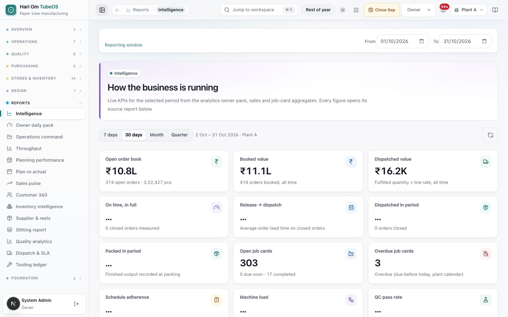
*Figure: The Intelligence page, titled "How the business is running". At the top is a Reporting window (From 01/10/2026, To 31/10/2026). Below it are period buttons (7 days, 30 days, Month, Quarter) with "2 Oct – 31 Oct 2026 · Plant A". KPI tiles follow: Open order book ₹10.8L (374 open orders · 3,52,427 pcs), Booked value ₹11.1L, Dispatched value ₹16.2K, On time in full, Release → dispatch, Dispatched in period, Packed in period, Open job cards 303, Overdue job cards 3, Schedule adherence, Machine load and QC pass rate.*

**Question it answers:** how is the business doing right now? **Who:** Owner, Admin, Planner, Plant Manager, Store, Dispatch, Sales, QC. Tiles that come from the analytics pack (OTIF, dispatched and packed in period, adherence, machine load, QC pass rate, inventory value) need Owner, Admin, Planner or Plant Manager; other roles see "Not reported" there.

What you see:
1. **Period buttons**: 7 days, 30 days, Month (month to date) and Quarter (quarter to date), plus a **Refresh** button. The tiles follow these buttons.
2. **Open order book**: ₹ value, count and pcs of orders not yet closed. **Booked value**: ₹ of all orders ever booked. **Dispatched value**: dispatched quantity × line rate, all time.
3. **On time, in full (OTIF)**: closed orders whose last dispatch was on or before the due date, divided by closed orders. **Release → dispatch**: average days from order creation to last dispatch, over closed orders.
4. **Dispatched in period** (pcs and orders closed) and **Packed in period** (pcs recorded at packing).
5. **Open job cards** (with due soon and completed), **Overdue job cards** (due before today, by the plant calendar) and **Blocked cards**.
6. **Schedule adherence**: the share of stages whose actual finish day equals the planned day. **Machine load**: assigned load ÷ rated capacity, averaged over the busiest machines. If capacity and load are in different units, the tile says "Not comparable" and points to machine setup.
7. **QC pass rate**: passed ÷ (passed + failed) checks in the period. Record-only readings are not counted.
8. Below the tiles: charts (order flow, stage output, order status, cards by stage, commercial split, machines, quality, inventory, top customers) and the **report catalog**. The catalog lists every report as a card and can be filtered by audience (All audiences, Owner / exec, Operations, Commercial, Inventory, Quality, Dispatch). It also links to Period Close Workbook (Month-end close), Cross-plant Comparator and the RM inward calendar.

### Owner daily pack (/reports/owner)
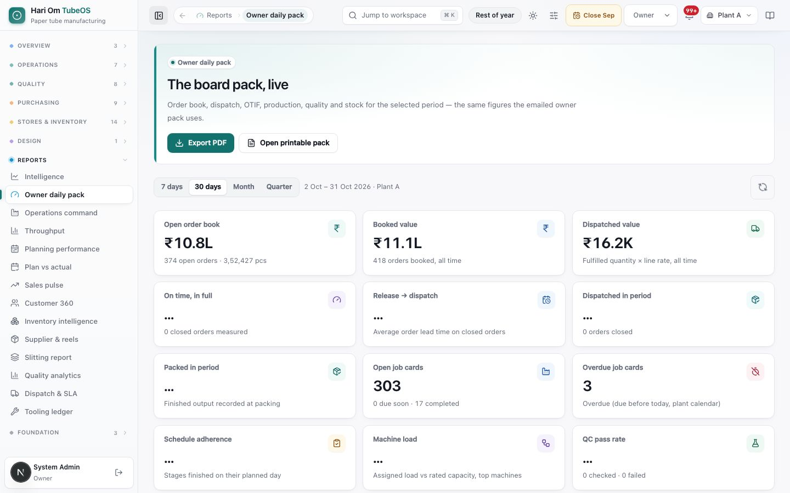
*Figure: "The board pack, live", with **Export PDF** and **Open printable pack** buttons, the same period buttons and the same KPI tiles as Intelligence.*

**Question:** the one-page board pack: order book, dispatch, OTIF, production, quality and stock. **Who:** Owner and Admin only. The figures are the same ones the emailed owner pack uses. **Export PDF** downloads the pack; **Open printable pack** opens a page you can print.

### Operations command (/reports/operations)
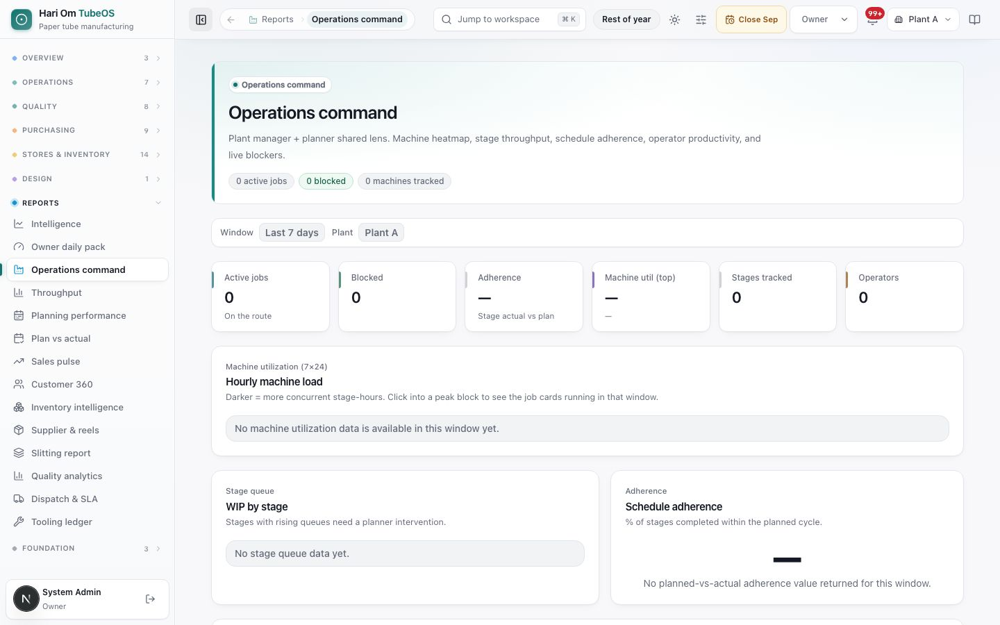
*Figure: Operations command for the last 7 days, Plant A. Tiles: Active jobs, Blocked, Adherence, Machine util (top), Stages tracked, Operators. Below are the Hourly machine load heatmap, WIP by stage and Schedule adherence panels, each empty in this window.*

**Question:** where is the floor stuck this week? **Who:** Plant Manager, Planner, Owner, Admin. **Filter:** fixed to the last 7 days and the chosen plant.

What you see: **Active jobs** (on the route), **Blocked**, **Adherence** (stage actual vs plan), **Machine util (top)**, **Stages tracked** and **Operators**. Panels: **Hourly machine load** (7 days × 24 hours; darker means more stage-hours running at once), **WIP by stage** (stages with more than 12 cards are marked), **Schedule adherence**, **Operator productivity** (Operator, Stage, Cards, Completed, Output, On-time), **Live blockers** (Job card, Customer, Stage, Reason), **How late is stage-output entry?** (lag = time entered minus actual end, with median, p90 and rows later than 6 hours), and **Where the planned qty went** (short-close events and machine downtime minutes).

### Throughput (/reports/production)
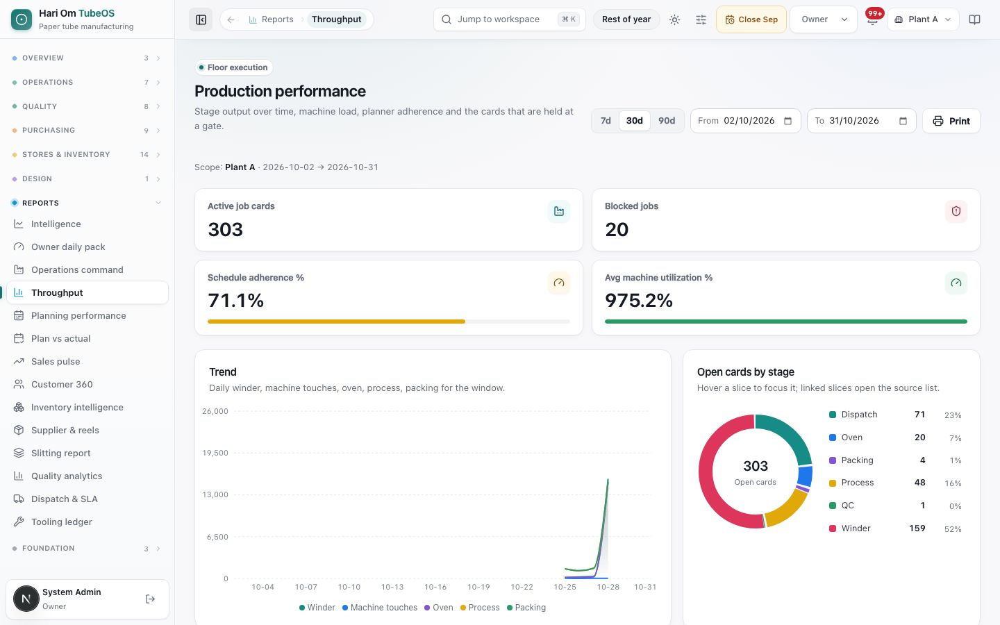
*Figure: The "Production performance" page with 7d / 30d / 90d buttons, From and To dates and a Print button. Tiles: Active job cards 303, Blocked jobs 20, Schedule adherence 71.1%, Avg machine utilization. A Trend chart shows daily Winder, Machine touches, Oven, Process and Packing output. An "Open cards by stage" donut shows Winder 159, Dispatch 71, Process 48, Oven 20, Packing 4 and QC 1.*

**Question:** how much did each stage and machine produce? **Who:** Plant Manager, Planner, Owner, Admin. **Filters:** 7d, 30d, 90d or From / To. **Print** prints the page.

What you see: **Active job cards** (not completed or cancelled), **Blocked jobs**, **Schedule adherence %** (as on Intelligence) and **Avg machine utilization %** (assigned load ÷ capacity, top 12 machines; it reads above 100% when capacity is set in a smaller unit than the load). Then a daily **Trend** of output qty per stage and **Open cards by stage** (click a slice to open those job cards). **Detail rows** has three tabs: **Held at a gate**, **Machine load** and **Stage pipeline**, with a search box and an arrow to open each record.

### Planning performance (/reports/planning)
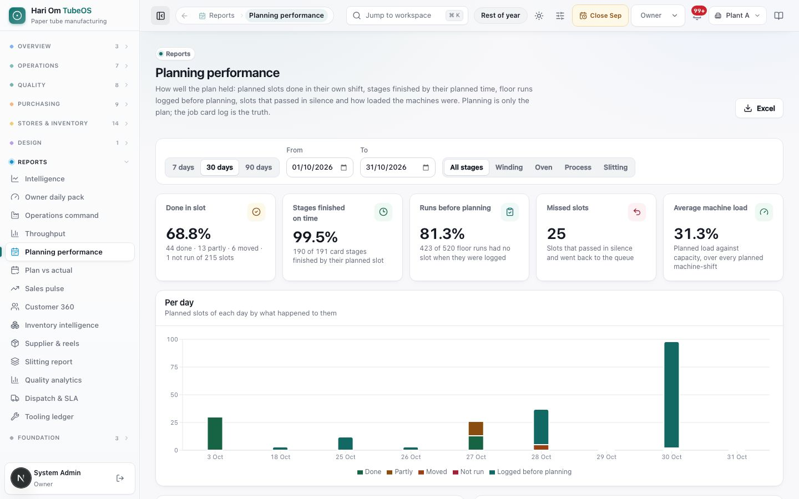
*Figure: Planning performance for 30 days, all stages. Tiles: Done in slot 68.8% (44 done · 13 partly · 6 moved · 1 not run of 215 slots), Stages finished on time 99.5% (190 of 191), Runs before planning 81.3% (423 of 520 floor runs), Missed slots 25 and Average machine load 31.3%. A "Per day" bar chart colours each day's slots as Done, Partly, Moved, Not run or Logged before planning.*

**Question:** how well did the plan hold? **Who:** Plant Manager, Planner, Owner, Admin. **Filters:** 7, 30 or 90 days, From / To, and stage (All stages, Winding, Oven, Process, Slitting). **Excel** downloads every table.

What you see:
1. **Done in slot**: done slots ÷ (done + partly + moved + not run). A slot is **Done** when at least 95% of its planned qty was logged in that slot. **Partly** means something was logged but less. **Moved** means it ran on another day or shift. **Not run** means nothing was logged. Upcoming and running slots are not counted.
2. **Stages finished on time**: card stages whose close (or last run) came by the end of their last planned slot.
3. **Runs before planning**: floor runs logged while the stage had no slot (the planner placed it afterwards from the log).
4. **Missed slots**: slots that passed with no floor entry for 36 hours and went back to the queue.
5. **Average machine load**: planned load ÷ machine capacity per shift, averaged over every planned machine-shift.
6. Tables: **By stage**, **By shift** (Shift A 08:00–20:00, Shift B 20:00–08:00), **By machine** (with Avg load), **Card stages finished late**, **Missed slots** and **Runs before planning** (first 100 shown; Excel has all).

### Plan vs actual (/reports/plan-vs-actual)
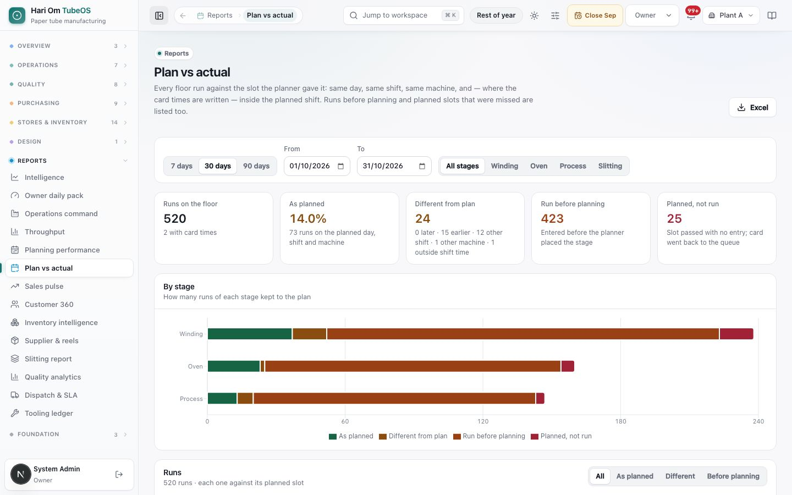
*Figure: Plan vs actual for 30 days. Tiles: Runs on the floor 520 (2 with card times), As planned 14.0% (73 runs), Different from plan 24 (0 later · 15 earlier · 12 other shift · 1 other machine · 1 outside shift time), Run before planning 423 and Planned, not run 25. A "By stage" bar shows Winding, Oven and Process split by result. A **Runs** table has All / As planned / Different / Before planning filters.*

**Question:** did each floor run happen on the planned day, shift and machine? **Who:** Plant Manager, Planner, Owner, Admin. **Filters and export:** as Planning performance.

Each run is compared with the slot in force when it was entered. It is **As planned** when the day, shift and machine match and, if card times were written, the times sit inside the planned shift. It is **Different from plan** when it ran later, earlier, in another shift, on another machine or outside the shift time. It is **Run before planning** when the stage had no slot when the run was entered; the reason is shown, for example "Its planner slot was more than 36 h old when the run was entered." **Planned, not run** lists slots that passed with no entry. Further tables: **By machine** and **Job cards furthest from plan**.

### Sales pulse (/reports/sales)
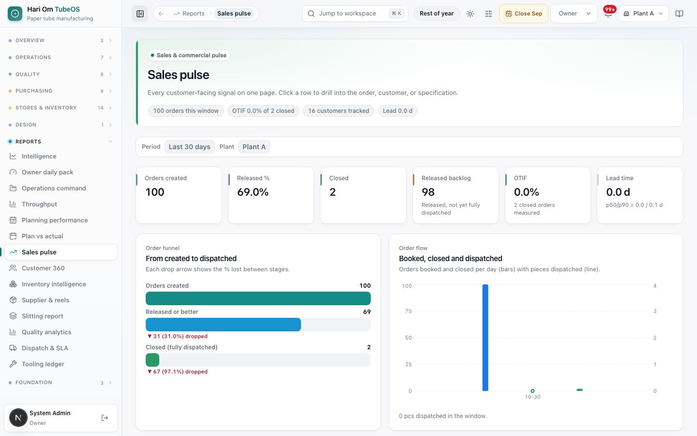
*Figure: Sales pulse for the last 30 days. Tiles: Orders created 100, Released % 69.0%, Closed 2, Released backlog 98, OTIF 0.0% (2 closed orders measured), Lead time 0.0 d. Below are an order funnel (100 created, 69 released or better, 2 closed) and a "Booked, closed and dispatched" chart.*

**Question:** how is order flow and delivery? **Who:** Sales, Plant Manager, Owner, Admin. **Filter:** fixed to the last 30 days.

What you see: **Orders created**, **Released %** (released or better ÷ created), **Closed** (fully dispatched), **Released backlog** (released but not fully dispatched), **OTIF** and **Lead time** (with p50/p90). Panels: **From created to dispatched** funnel (the drop between steps in % shown in red), **Booked, closed and dispatched** per day, **Where the lead-time days are going**, **Top customers — risk-sorted** and **Top SKUs by quantity**.

### Customer 360 (/reports/customer-360)
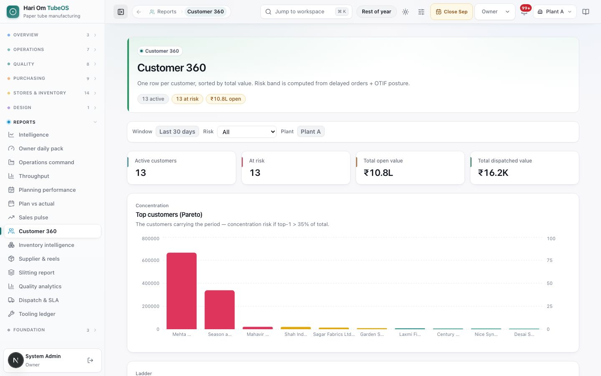
*Figure: Customer 360 for the last 30 days with a Risk filter. Tiles: Active customers 13, At risk 13, Total open value ₹10.8L, Total dispatched value ₹16.2K. A "Top customers (Pareto)" bar chart shows each customer's value.*

**Question:** which customers carry the business, and which are at risk? **Who:** Sales, Plant Manager, Owner, Admin. **Filters:** the last 30 days (fixed) and **Risk** (All, Watch + Critical, Critical only).

Customers are sorted by open value + dispatched value. A customer is **Critical** with 3 or more delayed open orders, or with 1 or more delayed orders and OTIF below 75%. A customer is **Watch** with 1 or more delayed orders, or OTIF below 90%. A delayed order is an open order past its promise date. A customer with no closed orders yet has OTIF 0, so it shows as Watch. The Pareto chart warns of concentration risk if the top customer is more than 35% of the total. The **Customer rows** table shows Open, Closed, Delayed, Open ₹, Dispatched ₹, OTIF, Risk and an Orders link.

### Inventory intelligence (/reports/inventory)
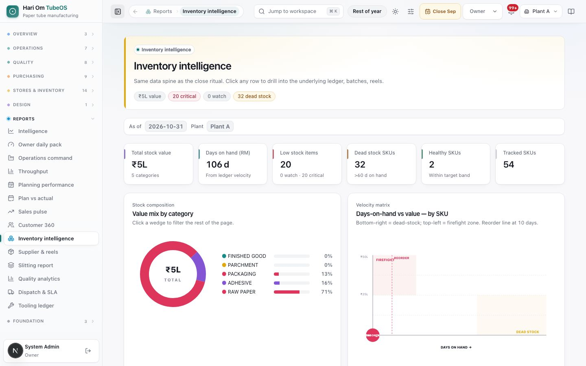
*Figure: Inventory intelligence as of 2026-10-31. Tiles: Total stock value ₹5L (5 categories), Days on hand (RM) 106 d, Low stock items 20 (0 watch · 20 critical), Dead stock SKUs 32 (>60 d on hand), Healthy SKUs 2, Tracked SKUs 54. A "Value mix by category" donut (raw paper 71%, adhesive 16%, packaging 13%) and a "Days-on-hand vs value" matrix are shown.*

**Question:** what is the stock worth, and what is short or dead? **Who:** Store, Planner, Plant Manager, Owner, Admin. **Filter:** as of today, for the chosen plant.

Days on hand = available qty ÷ (issued in the last 30 days ÷ 30). An item with stock but no issues counts as 180 days. **Critical** is 5 days or less, **watch** is 12 days or less, **dead** is 60 days or more, and **healthy** is anything in between. **Low stock items** = watch + critical. Panels: **Value mix by category** (click a wedge to filter), **Days-on-hand vs value** (reorder line at 10 days), a stock-as-on list with old label (Amigo) numbers, source documents, locations and QC status, **Highest-velocity items (30d)** and **Items below reorder** (with Available, Burn/day and a Demand and cover link).

### Supplier & reels (/reports/loss)
No useful screenshot (the charts were empty on 31 Oct). The page has two bar charts for the current month. **Material Loss % by Reel Supplier** takes each winder shift's loss from its reconciliation and shares it across the reels issued to that winder in that shift, by issued weight. **Loss % by GSM/BF Specification** shows the same loss grouped by paper GSM and BF. The top 10 are shown, and bars above 5% are coloured. **Who:** Store, Plant Manager, Owner, Admin.

### Slitting report (/reports/slitting)
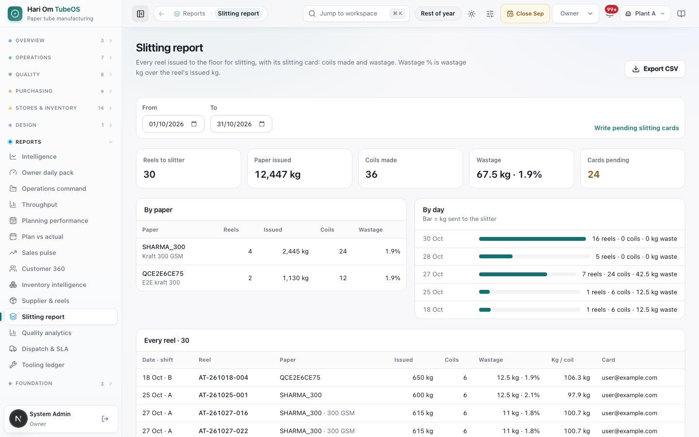
*Figure: Slitting report for 01/10/2026 to 31/10/2026. Tiles: Reels to slitter 30, Paper issued 12,447 kg, Coils made 36, Wastage 67.5 kg · 1.9%, Cards pending 24. Tables "By paper", "By day" and "Every reel" (Date · shift, Reel, Paper, Issued, Coils, Wastage, Kg / coil, Card) are shown.*

**Question:** what did each reel sent to the slitter turn into? **Who:** Store, Plant Manager, Planner, Owner, Admin. **Filters:** From / To (default: this month). **Export CSV** downloads every reel. **Write pending slitting cards** opens Reel & coil issue.

**Wastage %** = wastage kg ÷ the issued kg of the reels whose slitting card is written. Reels with a pending card are left out of the % but counted in **Paper issued** and **Cards pending**. In **By paper**, a wastage above 3% is shown in red.

### Quality analytics (/reports/quality)
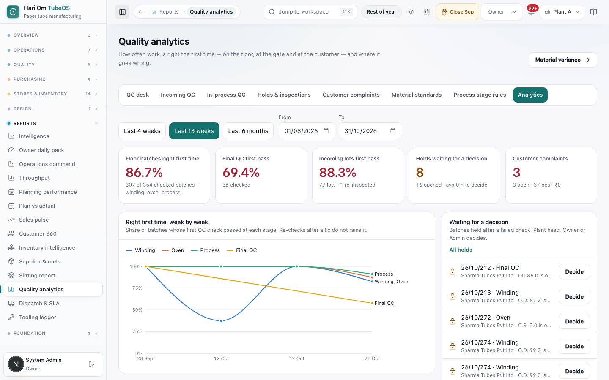
*Figure: Quality analytics for the last 13 weeks. Tiles: Floor batches right first time 86.7% (307 of 354 checked batches), Final QC first pass 69.4% (36 checked), Incoming lots first pass 88.3% (77 lots · 1 re-inspected), Holds waiting for a decision 8 and Customer complaints 3. A weekly line chart shows Winding, Oven, Process and Final QC, and a "Waiting for a decision" list shows job cards like 26/10/212 with a **Decide** button.*

**Question:** how often is work right the first time, and where does it fail? **Who:** QC, Inward QC, Plant Manager, Planner, Owner, Admin. **Filters:** Last 4 weeks, Last 13 weeks, Last 6 months, or From / To. **Material variance** opens the variance report.

Only the **first** check of each batch or lot counts toward "right first time"; a re-check after a fix never raises the rate. Readings that are only recorded (no band set) never count as a failure. Panels: **By stage**, **Checks that fail first time** (counted once per job card), **Incoming lots passing first time**, **Suppliers** (worst reject rate first; rejected means blocked, scrapped or returned), **Materials**, **Incoming checks that fail**, **Customer complaints by reason** and **by customer**, and **Holds by week**.

### Dispatch & SLA (/reports/dispatch)
No useful screenshot (the page was still loading on 31 Oct). The page is titled "Dispatch readiness" and has the same 7d / 30d / 90d, From / To and **Print** controls as Throughput. **Who:** Dispatch, Sales, Owner, Admin. Tiles: **Dispatch qty** (pcs dispatched in the window), **Ready job count** (finished and cleared cards at the gate), **Closed orders** and **Sealed dispatches**. A daily trend, a **Gate readiness** donut (Sealed vs Awaiting seal) and a **Ready at the gate** detail table follow.

### Tooling ledger (/reports/tooling)
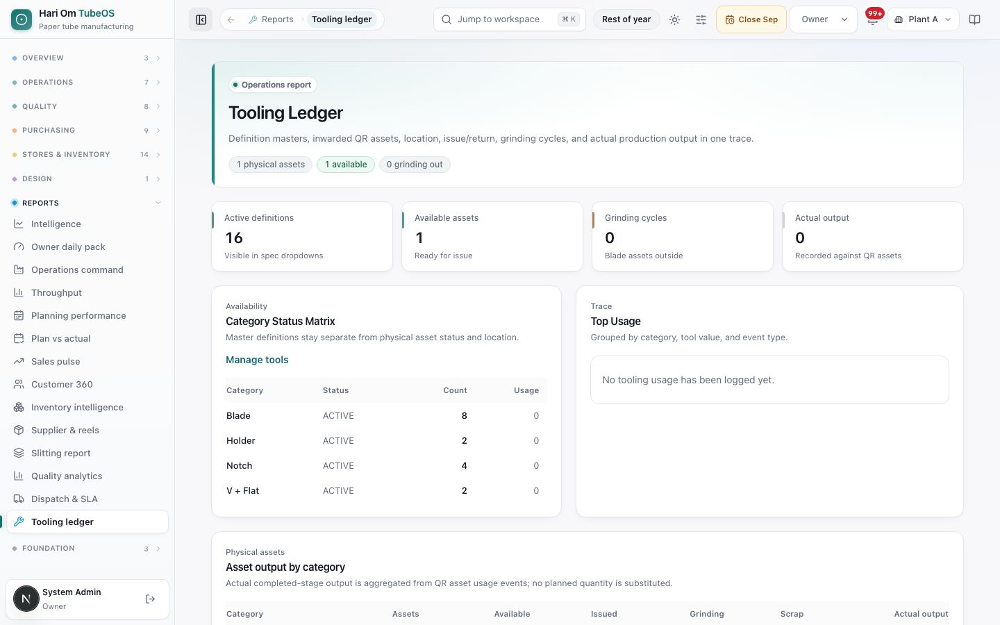
*Figure: The Tooling Ledger. Tiles: Active definitions 16 (visible in spec dropdowns), Available assets 1 (ready for issue), Grinding cycles 0 (blade assets outside), Actual output 0 (recorded against QR assets). A Category Status Matrix (Blade 8, Holder 2, Notch 4, V + Flat 2, all ACTIVE) and a Top Usage panel are shown.*

**Question:** which tools exist, where they are, and how much each produced. **Who:** Plant Manager, Owner, Admin. **Manage tools** opens the Physical tools master. Panels: **Category Status Matrix**, **Top Usage**, **Asset output by category** (Assets, Available, Issued, Grinding, Scrap, Actual output), **Lifetime output by physical tool**, **Output by blade grinding version** (each grinding return starts a new version) and **Recent Tool Trace**. Output is the real completed-stage output from QR asset usage; planned qty is never used in its place.

## Step by step

### How to open a report and set its period
1. Pick the plant at the top bar (Owner and Admin can choose all plants).
2. Open **Reports** in the sidebar and click the report. Only the reports of your role are listed.
3. Use that report's period control: the buttons, or the **From** and **To** dates. Fixed-window reports (Operations command, Sales pulse, Customer 360) say their window in the filter bar.
4. Click a tile, slice, row or arrow to open the source list or record.

### How to export or print
1. **Owner daily pack**: click **Export PDF** to download, or **Open printable pack** and print from the browser.
2. **Planning performance** or **Plan vs actual**: set the period and stage, then click **Excel**. The file holds every row, including those not shown on screen.
3. **Slitting report**: set From / To and click **Export CSV**.
4. **Throughput** or **Dispatch & SLA**: click **Print**; the period buttons are hidden on paper.

### How to check how well the plan held (Planner, Plant Manager)
1. Open **Planning performance**, choose **30 days** and **All stages**.
2. Read **Done in slot** and **Missed slots**. Open **Missed slots** to see which cards went back to the queue.
3. Open **Plan vs actual**, filter **Runs** to **Different** or **Before planning**, and read the reason on each run.

### How to find customers at risk (Sales)
1. Open **Customer 360** and set **Risk** to **Watch + Critical**.
2. Click a customer row to see their orders, dispatches and OTIF history.

### How to chase pending slitting cards (Store, RM issue)
1. Open **Slitting report** for this month. Read **Cards pending**.
2. Click **Write pending slitting cards** and write each card on Reel & coil issue.

### How to decide a QC hold from quality analytics
1. Open **Quality analytics**. In **Waiting for a decision**, click **Decide** on the job card. The Plant head, Owner or Admin decides.
2. Click **All holds** to see the full list on Holds & inspections.

## Rules the system enforces
- **Reports are read-only** and follow the selected plant (automatic). A page opened without the right role shows "This page is not open to your role" (BLOCKS).
- **OTIF** = closed orders whose last dispatch date ≤ due date ÷ closed orders (automatic). An order with no due date cannot be on time.
- **Lead time / Release → dispatch** = days from order creation to its last dispatch, averaged over closed orders (automatic).
- **Schedule adherence** = stages whose actual end day equals the planned day ÷ stages with both (automatic).
- **Machine utilization** = assigned load ÷ machine capacity. If the units do not match, Intelligence shows "Not comparable" (WARNS); fix the capacity in System > Machines.
- **Done in slot** counts a slot as done at 95% of its planned qty; upcoming, running and not-needed slots are left out (automatic).
- **Missed slot**: no floor entry for 36 hours after the slot; the card goes back to the planner's queue (automatic, never blocks the floor).
- **As planned** needs the same day, shift and machine, and card times inside the shift when they are written (automatic).
- **Customer risk** bands are Critical and Watch as described above (automatic).
- **Days on hand** uses the last 30 days of issues to the floor and dispatches (automatic).
- **Slitting wastage %** counts only reels with a written card (automatic).
- **Right first time** counts only the first check of a batch or lot; record-only readings never fail (automatic).
- **A failed data source shows "Not reported" or "—"**, never zero (automatic).

## Sample
**Monday review at Plant A, period 1–31 Oct 2026.**

| Report | Figure | What it means |
|---|---|---|
| Planning performance | Done in slot 68.8% (44 of 64 finished slots) | About two in three planned slots ran fully in their own shift |
| Planning performance | Missed slots 25 | 25 slots had no entry for 36 h; those cards are back in the queue |
| Plan vs actual | Run before planning 423 of 520 | Most runs were logged before the planner placed the stage |
| Slitting report | 6 carded reels, 3,575 kg issued, 67.5 kg wastage | Wastage % = 67.5 ÷ 3,575 = 1.9% |
| Customer 360 | Sharma Tubes Pvt Ltd: 1 delayed order, OTIF 80% | Watch (not Critical, because OTIF is not below 75%) |
| Inventory intelligence | Kraft 180 GSM: 2,400 kg available, 9,000 kg issued in 30 days | 9,000 ÷ 30 = 300 kg/day; 2,400 ÷ 300 = 8 days → watch |

## Common questions
**Q: Why does a tile say "Not reported"?** A: Either your role cannot read that source (pack figures need Owner, Admin, Planner or Plant Manager), or the source did not answer. Refresh after a minute; it never shows a false zero.

**Q: Why is machine utilization above 100%?** A: The load assigned to the machines is larger than the capacity set for them, often because capacity is entered in a different or smaller unit. Check the machine's capacity in System > Machines.

**Q: OTIF shows 0% but we delivered on time.** A: OTIF counts only closed (fully dispatched) orders with a due date. Few closed orders, or orders without a due date, give 0%.

**Q: Why are so many runs "Run before planning"?** A: The floor logged the run before the planner gave the stage a slot. The floor is never blocked by this; it only shows the planner where the plan lagged.

**Q: Why is every customer "at risk" in Customer 360?** A: A customer with no closed order in the window has OTIF 0, which is below 90%, so it shows as Watch until orders close on time.

**Q: The slitting wastage % looks low compared with the paper issued.** A: The % uses only reels whose slitting card is written. Write the pending cards to complete it.

**Q: Can I change the window on Operations command or Sales pulse?** A: No. Operations command is always the last 7 days and Sales pulse and Customer 360 the last 30 days. Use Throughput or Planning performance for other periods.

**Q: Can I get the owner pack by email?** A: The system can send the owner pack every day (06:30 by default) through Background jobs. Ask the Admin whether it is switched on for your plant.

## Related chapters
- Dashboard and Inbox
- Planner (winder, oven, process and slitting planning)
- Log output and Log QC
- Holds & inspections and Customer complaints
- Reel & coil issue (slitting cards)
- Month-end close
- System and audit (Machines, Background jobs)
