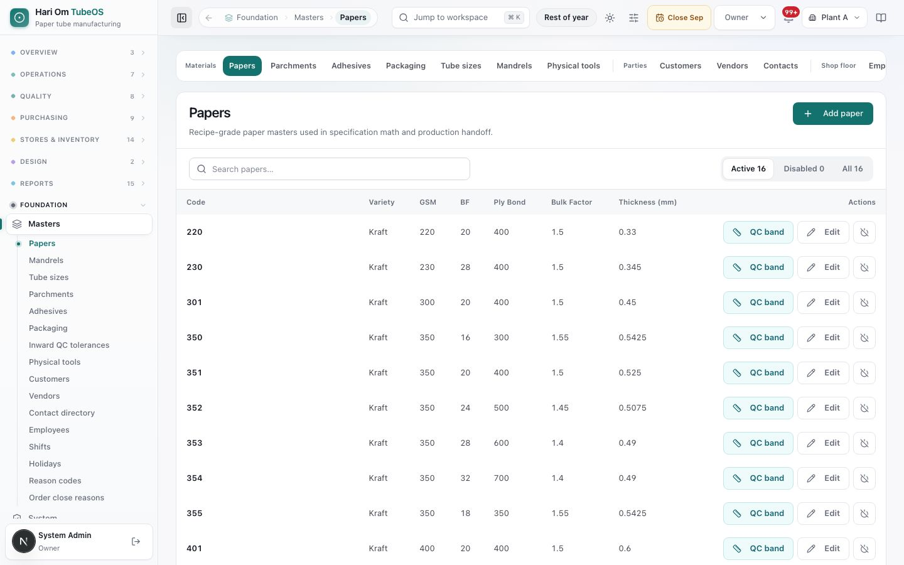
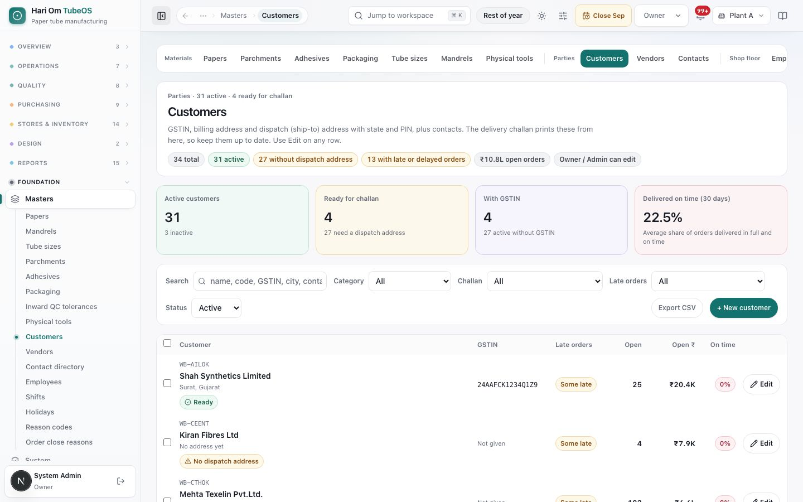
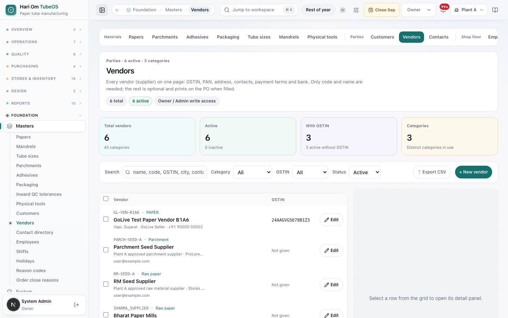
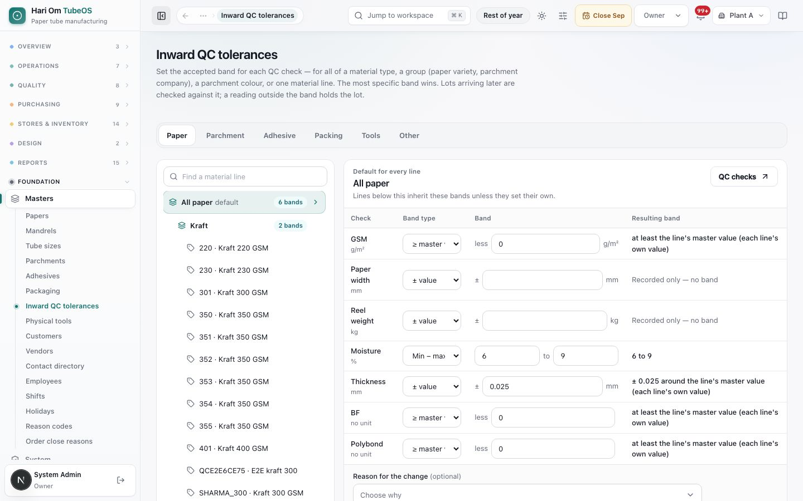
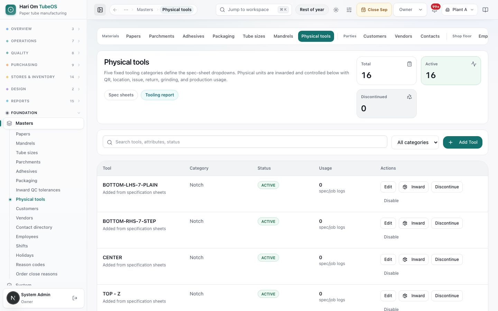
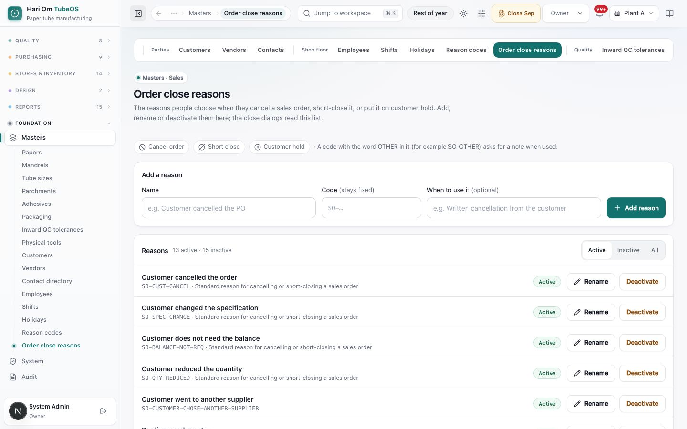
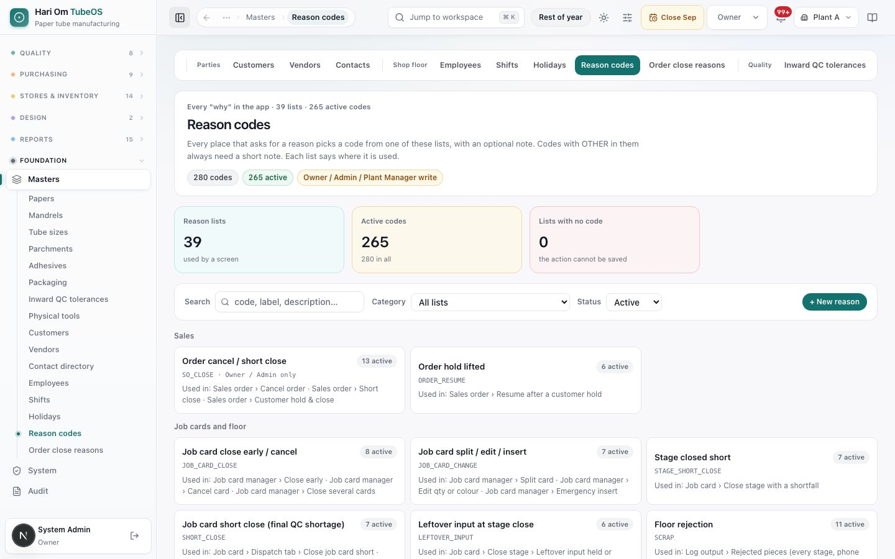

# Masters

> **What it is:** the base lists every other screen picks from: papers, mandrels, tube sizes, parchments, adhesives, packaging, inward QC bands, tools, customers, vendors, contacts, employees, shifts, holidays and reason lists.
> **Who uses it:** Owner and Admin (all masters). The Plant Manager can also work on Reason codes. Sales, Plant Manager and Planner can read Order close reasons.
> **Where:** Sidebar > Foundation > Masters (/masters/papers, with sub-links for each master). A tab strip at the top groups them as **Materials**, **Parties**, **Shop floor** and **Quality**.

## At a glance
- **Masters feed the dropdowns.** Specs pick papers, mandrels, tube sizes, adhesives, parchments, packaging and tools. Orders pick customers. POs and GRNs pick vendors. Floor screens pick shifts, employees and reasons.
- **Every reason in the app is a code from Reason codes.** There is one list per kind of action (for example Stage closed short, Floor rejection, QC hold placed, PO cancel / short close). No screen takes a reason as free text only.
- **Employee departments matter.** Floor logs list only the active employees of the stage's department (WINDER, OVEN, PROCESS).
- **Packaging weights matter.** Box, plastic and fadda weights per piece feed the month's packing theory; a missing weight shows a warning.
- **Nothing is ever erased.** **Disable**, **Deactivate** and even **Delete** only hide a record from new dropdowns. Old orders, specs, job cards and ledgers keep pointing to it, and you can reactivate it later.
- **Saved specs keep the values they were saved with.** A spec recipe stores each paper's GSM, BF and bulk at save time, so editing a paper master changes new work only, never an approved recipe version.
- **Every material master becomes a stock item automatically** (same code). Inward QC bands are set per material type, group, colour or line, and are versioned.
- **Customer and vendor details print on documents.** The delivery challan reads the customer's GSTIN and dispatch (ship-to) address; the PO prints the vendor's details. Keep them up to date.

## The flow
```flow
title: How a master change reaches daily work
Edit master [Owner/Admin] -> New dropdown value -> New spec or order picks it [Design/Sales] -> Released job card keeps its copy
after Edit master: Old specs and orders unchanged
```

```flow
title: Inward QC band change
Choose scope [Owner/Admin] (type, group, colour or line) -> Set bands and reason -> Save bands (new version) -> New GRN lots checked against it [Inward QC]
after Save bands: Lots already received keep their old band
```

Masters are the start of every chain. A change applies from the next use onward; anything already saved keeps its own copy, so history stays true.

## Screen tour


*Figure: The Papers master. The tab strip at the top shows Materials (Papers, Parchments, Adhesives, Packaging, Tube sizes, Mandrels, Physical tools), Parties (Customers, Vendors, Contacts) and Shop floor. The table lists papers such as 220 (Kraft, GSM 220, BF 20, Ply Bond 400, Bulk Factor 1.5, Thickness 0.33 mm), each with **QC band**, **Edit** and a disable button. Top right is **Add paper**, with a search box and Active 16 / Disabled 0 / All 16 filters.*

What you see (the same layout is used by Papers, Mandrels, Tube sizes, Parchments, Adhesives and Packaging):
1. **Add <record>** button, **Search** box and **Active / Disabled / All** filter with counts.
2. **Table** with the master's columns. Disabled rows are greyed and marked **Disabled**.
3. **Row actions**: **QC band** (opens the inward QC band for that line; papers, adhesives and parchments), **Edit**, the disable icon, and **Reactivate** on a disabled row.

The masters and their key fields:

| Master | Key fields | Used by |
|---|---|---|
| Papers | Paper Code, Variety, GSM, BF, Bulk Factor, Ply Bond; Derived Thickness = GSM × bulk ÷ 1000 | Spec recipe math, reel labels, inward QC nominals |
| Mandrels | OD (mm), Length (mm) | Spec ID band and winder setup |
| Tube sizes | Inner Dia, Outer Dia, Length (mm), Description (for example 76.4 x 81 x 150) | Spec and customer ask |
| Parchments | Company, then Sub Parchment / Color (for example SUNRISE POLYFILMS · BLUE / BLACK STRIP) | Spec allows by company; orders, release and stock use the colour |
| Adhesives | Variety, Internal Code, Solid %, Viscosity, pH | Spec glue, material issue, inward QC |
| Packaging | Three kinds: Boxes (code, size label such as 400x300x200, dimensions, **Weight per box (kg)**), Plastic Sheets (**Weight per sheet (kg)**), Fadda, the sheet inside the box (**Weight per piece (kg)**) | Spec packing (picked by code), job card boxes, packing theory, challan packing block |

**Parchments** has two panels. **Companies** (parchment families allowed on spec sheets, with **Add company**, a QC band per company, and rename) and **Parchments** (the colour rows, with **Add parchment**). A note under the table reads: "Records are never deleted. Disabling hides a record from new dropdowns; old orders, specs, job cards and ledgers keep their references."


*Figure: The Customers master: "31 active · 4 ready for challan". Tiles: Active customers 31, Ready for challan 4 (27 need a dispatch address), With GSTIN 4, Delivered on time (30 days) 25.0%. Filters for Search, Category, Challan, Late orders and Status, with **Export CSV** and **+ New customer**. Rows show code, name, city, a **Ready** or **No dispatch address** chip, GSTIN, Late orders, Open, Open ₹, On time and **Edit**.*

What you see:
1. **Summary chips and tiles**: total, active, without dispatch address, with late or delayed orders, open order ₹, and "Owner / Admin can edit".
2. **Filters**: Search (name, code, GSTIN, city, contact), Category, **Challan** (Ready for challan, No dispatch address, GSTIN given, No GSTIN), **Late orders**, Status. **Export CSV**.
3. **Rows**: a **Ready** chip means the customer has what the challan needs. Clicking a row opens the detail panel (Overview, Contacts, Performance) with Billing address, Dispatch (ship-to) address, Tax, Payment and Main contact.
4. **Customer form** (New or Edit): Customer name, Code, Category, GSTIN, PAN, the billing address (Address, City, State, PIN code), the dispatch address (or tick **Same as the billing address**) with a Dispatch contact (stores / gate) and phone, Payment terms, Credit limit (₹), and the main contact (Contact person, Phone, Email). The form shows "Challan prints: ..." so you can see what will print.


*Figure: The Vendors master: Total vendors 6, Active 6, With GSTIN 3, Categories 3. Filters for Search, Category, GSTIN and Status, with **Export CSV** and **+ New vendor**. Rows show code, category (Paper, Parchment, Raw paper), name, city, GSTIN and **Edit**. A side panel says "Select a row from the grid to open its detail panel."*

The vendor form has: Code, Vendor name, **Mill / short name** (for example AKSHAT; "Prints as MILL NAME on reel and coil labels"; when blank, reel labels print the vendor name), Legal name, Trade name (as on the GST certificate), Categories, GSTIN, PAN, MSME / Udyam number, the address (Address line 1 and 2, City, State, PIN code, Country), Payment terms (days), Credit days, Credit limit (₹), the bank (Bank name, Account number, IFSC), the main contact (Contact person, Phone, Alternate phone, Email) and Notes. Only code and name are required; whatever else you fill prints on the PO.

**Contact directory** (/masters/contact-directory) is a read-only list of every customer and vendor contact with Type, Master, Contact Name, Number and Email, plus a search box and Customers / Vendors counts. Edit contacts on the customer or vendor record.


*Figure: The Inward QC tolerances page on the Paper tab. On the left is a tree: All paper (default, 6 bands), the Kraft group (2 bands) and each paper line (220 · Kraft 220 GSM and so on). On the right is the band editor for "All paper": each check (GSM, Paper width, Reel weight, Moisture, Thickness, BF, Polybond) with a Band type, a Band and the Resulting band. Examples: Moisture "Min – max 6 to 9", Thickness "± 0.025 around the line's master value", GSM "at least the line's master value". At the bottom are **Reason for the change** and **Save bands**.*

What you see:
1. **Material tabs**: Paper, Parchment, Adhesive, Packing, Tools, Other.
2. **Tree**: the default for the whole type, then groups (paper variety or parchment company), colours, and single lines, each with the number of bands set. **Find a material line** searches.
3. **Band editor**: for each check choose a **Band type**: **± value**, **± %**, **≥ master value**, **≤ master value**, **Min – max** or **No band here**. The **Resulting band** column shows what the lot will be checked against. A check with no band says "Recorded only — no band". On a single line you can type its **Nominal** and use **Copy nominals from master**.
4. **QC checks** opens Material standards (where the checks themselves are set).


*Figure: The Physical tools master: Total 16, Active 16, Discontinued 0, with **Spec sheets** and **Tooling report** links. A search box, an **All categories** filter and **Add Tool**. Rows such as BOTTOM-LHS-7-PLAIN (Notch, ACTIVE, 0 spec/job logs) have **Edit**, **Inward**, **Discontinue** and **Disable**.*

Tools come in five fixed categories: **Notch**, **Blade**, **Holder**, **V + Flat** and **Punch**. Each category has its own required fields (for example a Notch needs type, thickness, design and degree; a Blade needs type, thickness and length). The dropdown values (Notch types, designs, degrees and directions; Blade types; Punch single or double) are editable under the **Editable dropdown registry**. **Inward** registers a physical unit with a receipt date, Receipt / GRN no, quantity and a **Location Master position**, and gives it a permanent QR label (**Print QR label**). Each unit then has a **QR asset ledger** of Issue, Return, Grinding out, Grinding return, Maintain, Move and scrap events.


*Figure: Order close reasons. Chips show where they are used: Cancel order, Short close, Customer hold, and the note "A code with the word OTHER in it (for example SO-OTHER) asks for a note when used." The **Add a reason** form has Name, Code (stays fixed) and When to use it. The list shows "13 active · 15 inactive", with reasons like "Customer cancelled the order (SO-CUST-CANCEL)", each with **Rename** and **Deactivate**.*


*Figure: Masters › Reason codes. Header "Every 'why' in the app · N lists · N active codes" with the chip "Owner / Admin / Plant Manager write" and **+ New reason**. Tiles Reason lists, Active codes and Lists with no code. Below, list cards grouped under Sales, Job cards and floor, Quality, Stores and stock, Purchase, Dispatch and Not linked yet, each with its code count; picking a card shows where the list is used and its codes (Code, Label, Description, Severity, Status, Edit, Deactivate).*

**Reason codes** (/masters/reason-codes): "Every place that asks for a reason picks a code from one of these lists, with an optional note. Codes with OTHER in them always need a short note. Each list says where it is used." What you see:
1. **Tiles**: **Reason lists**, **Active codes** ("N in all"), **Lists with no code** (amber when a list in use has no active code).
2. **List cards** grouped by area, with **All lists** to show every code. A list with no active code has an amber border. Picking one shows **Used in** (the screens that read it) and its codes. A list under **Not linked yet** says "No screen uses this list. Kept so older records stay readable."
3. **Codes table**: **Code** (fixed), **Label** (what people see), **Description**, **Severity** (OK, WATCH, CRITICAL), **Status** (Active / Inactive), **Edit**, **Deactivate** / **Reactivate** ("will be hidden from new entries. Existing rows referencing this code stay intact.").
4. **+ New reason**: **List** (required), **Code**, **Label**, **Severity**, **Description**. The Order cancel / short close list is changed on its own page: "Order close reasons are changed on their own page." with **Open Order close reasons**.

Every plant starts with standard codes in each list, and each list has an OTHER code (for example SO-OTHER, QH-OTHER, RJ-OTHER) that needs a note of at least 5 characters. The lists and where they are used:

| Area | List (category) | Used when | Example codes |
|---|---|---|---|
| Sales | Order cancel / short close (SO_CLOSE) | Cancel order, Short close, Customer hold & close | SO-CUST-CANCEL, SO-QTY-REDUCED, SO-BALANCE-NOT-REQ |
| Sales | Order hold lifted (ORDER_RESUME) | Resume after a customer hold | RS-CUST-CONFIRMED, RS-PAYMENT, RS-HOLD-ERROR |
| Job cards and floor | Job card close early / cancel (JOB_CARD_CLOSE) | Force close, cancel, close several cards | JC-CUST-CANCEL, JC-RELEASED-TWICE, JC-MATERIAL-SHORT |
| Job cards and floor | Job card split / edit / insert (JOB_CARD_CHANGE) | Split card, edit qty or colour, emergency insert | CH-CUST-REQUEST, CH-URGENT, CH-MACHINE-LOAD |
| Job cards and floor | Stage closed short (STAGE_SHORT_CLOSE) | Close stage with a shortfall; old-form stage below plan | SS-MATERIAL-SHORT, SS-HIGH-REJECT, SS-MACHINE |
| Job cards and floor | Job card short close, final QC shortage (SHORT_CLOSE) | Dispatch tab › Close job card short; Operations control short close | SH-REJECT, SH-COUNT, SH-CUST-ACCEPT |
| Job cards and floor | Leftover input at stage close (LEFTOVER_INPUT) | Unused input held or scrapped at a stage close | LI-EXTRA-MADE, LI-DAMAGED, LI-NEXT-RUN |
| Job cards and floor | Floor rejection (SCRAP) | Rejected pieces and cutting loss on every stage | WL, PG, ID, OD, LN, WT, CS, DM, MS, NT, RJ-OTHER |
| Job cards and floor | Entry correction / void / reopen (ENTRY_CORRECTION) | Void a run, change saved readings, reopen a stage | EC-WRONG-QTY, EC-DUPLICATE, EC-REOPEN-MORE |
| Job cards and floor | Override (OVERRIDE) | Above 110% of target, carryover, run outside the plan, taking batches before QC | OV-CUST-EXTRA, OV-SETUP-LOSS, OV-PLAN-CHANGE |
| Job cards and floor | Machine downtime (DOWNTIME) | Operations control › log or edit downtime | DT-POWER, DT-BREAKDOWN, DT-CHANGEOVER |
| Quality | Customer complaints (CUSTOMER_COMPLAINT) | Record a complaint | CC-DAMAGE, CC-SIZE, CC-STRENGTH |
| Quality | QC hold placed (QC_HOLD) | Place a hold; opening stock put on hold | QH-SUSPECT, QH-CUST-COMPLAINT, QH-RETEST |
| Quality | QC hold release (QC_RELEASE) | Release a hold | QR-RETEST-OK, QR-REWORKED, QR-MGMT-OK |
| Quality | Incoming material rejected / returned (RM_ISSUE) | Return a rejected lot to the supplier | RM-GSM, RM-MOISTURE, RM-WEIGHT |
| Quality | Concession (CONCESSION) | Use a failed lot under concession | CN-MINOR, CN-URGENT, CN-SUPPLIER-CREDIT |
| Stores and stock | Stock correction (STOCK_CORRECTION) | Raise a stock correction | COUNT_SHORT, COUNT_EXTRA, WRONG_GRN_WEIGHT |
| Stores and stock | Correction rejected / count sent back (APPROVAL_REJECT) | Reject a correction; send a count back for recount | AR-RECOUNT, AR-NO-PROOF, AR-WRONG-QTY |
| Stores and stock | Manual FG inward (MANUAL_FG) | FG inward › Manual inward | FG-REWORK, FG-ADJUSTMENT, FG-OPENING |
| Stores and stock | Receipt without PO (MANUAL_RECEIPT) | Receive without a PO | MR-URGENT, MR-SAMPLE, MR-CASH |
| Stores and stock | Books unlock (BOOKS_UNLOCK) | Unlock a closed month's store books | BU-LATE-GRN, BU-CORRECTION, BU-AUDIT |
| Stores and stock | Month-end variance (MONTH_END_VARIANCE) | Explain an item's variance outside tolerance | MV-WASTAGE, MV-COUNT, MV-MOISTURE |
| Purchase | Purchase approval rejected (PURCHASE_REJECT) | Reject a PO, requisition or purchase plan | PJ-RATE-HIGH, PJ-NOT-NEEDED, PJ-STOCK-OK |
| Purchase | PO cancel / short close (PO_CLOSE) | Cancel or short close a PO | PC-SUPPLIER-CANNOT, PC-NOT-NEEDED, PC-DELAY |
| Purchase | PO revision (PO_REVISION) | Edit a PO (new revision) | PV-RATE, PV-QTY, PV-DATE |
| Purchase | Receiving more than the PO (OVER_RECEIPT) | GRN above the PO quantity | OR-ROLL-WEIGHT, OR-MIN-LOT, OR-TOLERANCE |
| Purchase | Invoice difference (INVOICE_DIFF) | Accept variance, reject invoice, release stock | ID-RATE, ID-FREIGHT, ID-TAX |
| Purchase | Debit note (DEBIT_NOTE) | Raise or void a debit note | DN-SHORT, DN-REJECT, DN-VOID-ERROR |
| Purchase | Supplier schedule change (SUPPLIER_SCHEDULE) | Change a supplier delivery; cancel an RM calendar delivery | SCH-SUPPLIER-DELAY, SCH-PLAN-CHANGE |
| Dispatch | Surplus kept (SURPLUS_RETAIN) | Retain surplus FG | SR-NEXT-ORDER, SR-CUST-LATER, SR-SAMPLE |
| Not linked yet | QC reject, Customer return, Other (general) | No screen; kept so older records stay readable | (old codes only) |

Each record that uses a reason keeps the code, the label at that moment and the note, so renaming a label later never changes old records; reports and histories show the label. Records made before 1 Nov 2026 keep their old typed text.

**Employees**: Code (EMP-001), Name, Role (Operator, Supervisor, Packer, QC Inspector, Storeman, Dispatcher, Manager), Dept (WINDER, OVEN, PROCESS, PACKING, QC, DISPATCH, STORE, GENERAL), Default shift, Skills (for example WINDER, OVEN), Phone and Email. **The department decides where a person can be picked as operator**: Log output and Log QC on Winding list only active WINDER employees, Oven only OVEN, Process only PROCESS (operators first). The server refuses anyone else. The operator chosen on every floor log feeds Reports › **Employee performance**. Employees are not login users; logins are made under System > Users.

**Shifts**: Code, Name, Start time, End time, Break (min), Hours / day and Night premium (%). Shifts are marked DAY or NIGHT. They feed machine availability, planner day boundaries and night-premium reports.

**Holidays** (Plant calendar): Date, Type (PUBLIC HOLIDAY, PLANT HOLIDAY, MAINTENANCE DAY, STRIKE, POWER CUT, OTHER), Description (for example Diwali) and Impact shifts (blank = the whole day). They are used by OTIF and adherence (a due date on a holiday moves to the next working day).

## Step by step

### How to add a paper (or mandrel, tube size, adhesive, parchment colour, packaging item)
Owner or Admin.
1. Open **Masters** and the right tab. Click **Add paper** (or the matching button).
2. Fill the fields. For a paper: **Paper Code** (for example KRAFT-230-18BF), **Variety**, **GSM** and **BF** (required), then **Bulk Factor** and **Ply Bond**. **Derived Thickness (mm)** fills itself.
3. Click **Save**. The paper appears in spec dropdowns, and a stock item with the same code is made for purchase, inward and issue.
4. Click **QC band** on the row to set its inward QC band, if it differs from the group default.

### How to edit or disable a master record
1. Click **Edit**, change the fields and **Save**. New specs and orders use the new values; saved recipe versions keep the values they were saved with.
2. To stop using a record, click the disable icon (or **Deactivate**). It disappears from new dropdowns only.
3. To bring it back, switch the filter to **Disabled** and click **Reactivate**.

### How to add a parchment company and its colours
1. Under **Companies**, click **Add company** and type the **Company Name** (for example SUNRISE POLYFILMS). Save.
2. Click **Add parchment**, pick the **Company** and type the **Sub Parchment / Color** (BLUE, RED, Printed and so on). Save.
3. Specs allow parchment by company. Sales orders and the release step pick the colour, and a parchment colour is compulsory at release.

### How to add or edit a customer
Owner or Admin.
1. Open **Customers** and click **+ New customer** (or **Edit** on a row).
2. Fill **Customer name** and **Code** (the only required fields). Add **GSTIN**; the PAN and billing state fill in from it.
3. Fill the billing address. For the dispatch address, tick **Same as the billing address** or type the ship-to address with its own state, PIN and dispatch contact.
4. Fill payment terms, credit limit and the main contact. Save. The row shows **Ready** when the challan has what it needs.

### How to add or edit a vendor
Owner or Admin.
1. Open **Vendors**, click **+ New vendor** (or **Edit**).
2. Fill **Code** and **Vendor name**, then GSTIN, PAN, MSME / Udyam, address, payment terms, bank and contact as needed. Save.
3. The vendor now appears in PO, inward and parchment-company dropdowns.

### How to set inward QC bands
Owner or Admin.
1. Open **Inward QC tolerances** and pick the material tab.
2. Click the level in the tree: the type default, a group, a colour or one line.
3. For each check, choose the **Band type** and enter the band. Read the **Resulting band** column.
4. Optionally write the **Reason for the change** (kept in history). Click **Save bands**. The message says how many lines now inspect against the new band; lots already received keep the band they arrived with.

### How to add and manage a physical tool
Owner or Admin (the Plant Manager can also change tool masters).
1. Open **Physical tools**, click **Add Tool**, choose the category and fill its required fields. Save. It appears in spec sheet dropdowns.
2. To register a real unit, click **Inward**, fill the receipt date, Receipt / GRN no, quantity and location, and click **Post inward**. Print its QR label.
3. Use **Discontinue** to stop new selections, or **Disable** to hide it.

### How to add, rename or deactivate an order close reason
Owner or Admin. Sales, Plant Manager and Planner see the list read-only.
1. Open **Order close reasons**. In **Add a reason**, type the **Name**. The **Code** fills in as SO-<NAME> (you can change it now; it stays fixed afterwards). Add **When to use it** if helpful.
2. Click **Add reason**.
3. To change the wording, click **Rename**. To stop offering it, click **Deactivate** and confirm.

### How to add a reason code
Owner, Admin or Plant Manager.
1. Open **Reason codes**. Click the list card (for example **Stage closed short**) to see its codes and where it is used.
2. Click **+ New reason**. Pick the **List**, type the **Code** (for example SS-NO-ADHESIVE; it stays fixed), the **Label** people will see ("Adhesive not available"), the **Severity** and an optional **Description**. Click **Create**.
3. The code appears at once in every picker of that list in this plant.
4. To change the words, click **Edit** and change the label; records already saved keep the label they were saved with. To stop offering it, click **Deactivate**; old records keep it.
5. A code with OTHER in it (as a whole word, for example SS-OTHER) always asks for a note of at least 5 characters when used.

### How to add an employee so they can log runs
Owner or Admin.
1. Open **Employees**, click **+ New employee**.
2. Fill **Code**, **Name**, **Role** (Operator) and **Dept**: WINDER for winding, OVEN for the oven, PROCESS for the process line. Save.
3. The person now appears in the **Operator** list of Log output and Log QC for that stage only. To move someone to another stage, change the **Dept**. To stop listing them, **Deactivate** them.

### How to add a shift or holiday
1. Open the master and click **+ New shift** or **+ New holiday**.
2. Fill the fields shown above and save. Use **Deactivate** / **Reactivate** for shifts. Holidays can be edited or deleted.

### How to add a packaging item with its weight
Owner or Admin.
1. Open **Packaging**, pick **Boxes**, **Plastic Sheets** or **Fadda**, click add.
2. Type the code (the same code the spec and stock use, for example R-150), the **Size label** (for example 400x300x200), dimensions and the weight: **Weight per box (kg)**, **Weight per sheet (kg)** or **Weight per piece (kg)**. Save.
3. The item can now be picked on spec sheets and on Packing setup. When it is the only active plastic (or fadda) master, specs take it by default.

## Rules the system enforces
- **Who can change masters**: Owner and Admin (all). Reason codes also allow the Plant Manager. Order close reasons are Owner or Admin only ("Only the Owner or an Admin can change order close reasons."). Others are shown "This page is not open to your role" (BLOCKS).
- **No hard delete**: disabling, deactivating and deleting all just set the record inactive (automatic). History keeps its references.
- **Codes are unique per plant** (BLOCKS): for example "Paper code already exists in this plant", "Customer code or name already exists in this plant", "Supplier code or name already exists in this plant", "Employee code already exists in this plant", "Shift code already exists in this plant", "Reason code already exists in this plant". Holidays are unique per date and type.
- **Required fields**: paper code, variety, GSM and BF; customer code and name; vendor code and name; employee code and name; shift code and name; reason code and label (BLOCKS).
- **Derived paper thickness** = GSM × bulk factor ÷ 1000 (automatic).
- **GSTIN** must be 15 characters: a 2-digit state code, a 10-character PAN and 3 characters, for example 24ABCDE1234F1Z5 (BLOCKS). **PAN** must be 5 letters, 4 digits and 1 letter. **IFSC** must be 4 letters, a zero and 6 letters or digits.
- **GSTIN fills the PAN and billing state** when they are empty (automatic). A PAN that does not match the GSTIN is refused, and so is a billing state outside the GSTIN's state ("The billing address must be in the GSTIN's state"). When the GSTIN changes, a PAN and state that came from the old GSTIN follow the new one.
- **Vendor payment terms and credit days** must be 0 to 365 days, and the credit limit cannot be negative (BLOCKS).
- **Spec recipes snapshot paper values** (GSM, BF, bulk) when saved (automatic). Master edits never rewrite them.
- **Every material master record gets a stock item** with the same code. A code already used by another material type is reported, not overwritten (automatic).
- **Inward QC bands**: the most specific band wins (line, then colour, then group, then type default). Each save is a new version. New GRN lots are checked against the band in force; earlier lots keep theirs. A reading outside the band holds an incoming lot.
- **Tools**: the category is fixed after creation ("Tool category is fixed after creation"). Each category has required fields (BLOCKS). Tool names are unique within a category, and dropdown values are unique.
- **Order close reasons**: the code never changes once made ("An order close reason keeps its code, because closed orders still point to it."). A code containing OTHER makes the close dialog ask for a note (automatic). They are stored as reason codes of category SO_CLOSE.
- **Reason codes**: the list must be one of the lists above and the severity OK, WATCH or CRITICAL (BLOCKS). Every service checks a chosen code itself: it must be active, of the right list and of the record's plant, and an OTHER code needs a note of at least 5 characters ("Write a short note (at least 5 characters) for the reason 'Other'."). A code from another list is refused ("SS-MACHINE belongs to the list 'Stage closed short', not 'Machine downtime'."); an unknown code says to pick one from the list or ask a Plant Manager, Admin or the Owner to add it (BLOCKS). If master data cannot be reached, the save waits and says to try again.
- **Operators by department**: a floor log refuses an employee whose department is not the stage (BLOCKS).
- **Packaging weights** feed packing theory; a material with no weight is listed as a warning, not dropped (WARNS).
- **Vendor mill / short name** prints as MILL NAME on reel and coil labels; blank prints the vendor name (AUTOMATIC).

## Sample
**New customer for the challan.** The Admin adds Sharma Tubes Pvt Ltd: Code WB-SHARMA, GSTIN 24AAKCS4821M1Z3. The system fills PAN AAKCS4821M and the billing state Gujarat (24). Billing address: Plot 14, GIDC Phase II, Vapi 396195. The Dispatch (ship-to) address is their Daman warehouse with stores contact Mr Patel, 98250 12345. The row now shows **Ready**. When Dispatch makes a challan for SO/26/10/412, it prints the GSTIN and the Daman ship-to address.

**Paper edit.** The Admin changes paper 350 (Kraft) bulk factor from 1.55 to 1.50, so the derived thickness goes from 0.5425 to 0.525 mm. Recipe version 3 of spec 76.4 x 81 x 150 for Sharma Tubes, approved last week, keeps 1.55 in its layers. The next recipe version saved will use 1.50.

**Reason code.** Paper often runs out because adhesive is late. The Plant Manager adds SS-NO-ADHESIVE "Adhesive not available" to the list **Stage closed short**. The next day, when Winding on 26/10/318 closes at 52 of 60 bamboo, the plant manager picks it; the card history, the order history and the returned balance all show "Adhesive not available".

**Order close reason.** The Owner adds "Customer moved the plant" and the code becomes SO-CUSTOMER-MOVED-THE-PLANT. Later the Owner renames it "Customer shifted the plant"; the code stays the same, so orders already closed with it still show it.

## Common questions
**Q: I deleted a customer by mistake. Is it gone?** A: No. Delete only deactivates it. Set Status to Inactive, find it and click **Activate**.

**Q: Why can't I change an order close reason's code?** A: Closed orders keep that code. Rename it instead, or deactivate it and add a new one.

**Q: I changed a paper's GSM. Why does an old spec still show the old value?** A: Saved recipe versions keep the values they were saved with. Save a new recipe version to use the new value.

**Q: The customer row says "No dispatch address". Does it matter?** A: Yes for dispatch. The challan prints the ship-to address from here. Edit the customer and fill it, or tick **Same as the billing address**.

**Q: I typed a GSTIN and the PAN changed by itself.** A: A GSTIN contains the PAN (characters 3 to 12) and the state code (first 2 digits), so the system fills them to match.

**Q: A new paper does not appear in Material items.** A: It is created automatically when the master is saved. Refresh Material items. If its code is already used by another type of material, the system reports a conflict instead; use a different code.

**Q: Where do I change who can log in?** A: Not here. Employees are shop-floor people for reports. Logins are under System > Users.

**Q: Why can't the Plant Manager edit papers?** A: Masters are Owner and Admin only, except Reason codes, which the Plant Manager may also change.

**Q: A reason picker says "No reasons are set up for this list".** A: That list has no active code in this plant. Add one in Reason codes (the picker links there).

**Q: An operator is missing from the Log output list.** A: Check their **Dept** and that they are active in Employees. Winding shows WINDER people only, Oven OVEN, Process PROCESS.

**Q: What is the mill name on a reel label?** A: The vendor's **Mill / short name** (for example AKSHAT). Fill it on the vendor; until then the label prints the vendor name.

## Related chapters
- Specifications (recipes, tools, parchment allowed)
- Sales orders (close reasons, customer PO, parchment at release)
- Purchase orders and goods inward (vendors)
- Incoming QC and Material standards
- Dispatch and delivery challan
- Inventory and alerts (Material items)
- System and audit (Users, Plants, Machines)
