# System, audit, production season and the guide

> **What it is:** the setup and control pages: who can log in and with which roles and plants, the plants and machines, the background jobs, the audit trail of every change, the global production season, and the in-app guide.
> **Who uses it:** Owner and Admin (System and Audit); the Owner only for switching the production season; every user for the Guide.
> **Where:** Sidebar > Foundation > System (/system/users, with **Users**, **Roles & access**, **Plants**, **Machines**, **Background jobs**), Sidebar > Foundation > Audit (/system/audit), Sidebar > Quality > Production season (/settings/production-season), Sidebar > Overview > Guide (/help).

## At a glance
- **One login per person, with one or more roles.** Access adds up across roles. Their highest role decides the page they land on, and they can switch role from the top bar.
- **Plant access is part of the login.** A user works only in their allowed plants. Only Owner and Admin can have **Allow all plants**.
- **Owner and Admin always see every screen.** Give these roles only to managers. The system always keeps at least one active Owner or Admin.
- **The audit trail records who did what, when, to which record, and what changed field by field.** It can be filtered and exported to CSV.
- **Each plant card also holds two Owner settings from 7 Nov 2026:** the **Weight check of a bill** limits (default 20 kg and 50 kg) and the **Gate** settings (gate close time, default 19:00, and how long visitor photos are kept, default 365 days). Gates and their QR posters are in **System › Gates**.
- **Watchman** is a gate-only role: a Watchman login opens only the gate desk.
- **The production season (Rest of year or Monsoon) is global.** Only the Owner switches it, after a readiness check. Released job cards keep the season and tolerances they were released with.

## The flow
```flow
title: Giving someone access
Add New User [Owner/Admin] -> Name, login, password -> Tick roles -> Primary and allowed plants -> Create user -> Person signs in (lands on their role's page)
after Create user: Change roles or plants [Owner/Admin] -> Person is signed out -> Signs in with new access
```

```flow
title: Switching the production season
Pick season [Owner] -> Readiness preview (ready and blocked specs) -> Acknowledge blocked specs -> Reason -> Confirm global switch -> New releases use the new season
after Confirm global switch: Released cards keep their old season
```

Access changes take effect at the next sign-in, because the system signs the person out. The season switch only changes what new releases use; nothing already released changes.

## Screen tour

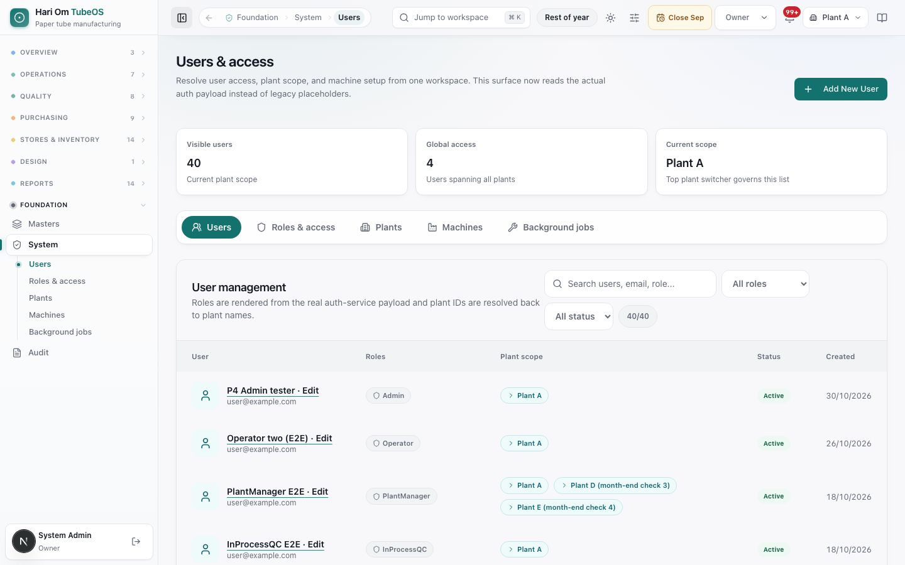
*Figure: The Users & access page. Tiles: Visible users 40 (current plant scope), Global access 4 (users spanning all plants), Current scope Plant A. Tabs: Users, Roles & access, Plants, Machines, Background jobs. The User management table has search, an All roles filter, an All status filter and a 40/40 count. Each row shows a name with "· Edit" and the email, role chips (Admin, Operator, PlantManager, InProcessQC), plant scope chips (Plant A, Plant D), Status (Active) and Created date.*

What you see:
1. **Add New User** button.
2. **Tiles**: **Visible users** (users of the plant chosen at the top), **Global access** (users with all plants) and **Current scope**. The top plant switcher decides which users are listed.
3. **Filters**: search (name, email, role), **All roles**, **All status** (Active, Inactive).
4. **Table**: User (click "Name · Edit" to open the editor), **Roles**, **Plant scope** ("All plants", the plant names, or "Global"), **Status** and **Created**.

The **user editor** (Add New User or Edit) has: **Full name**, **Email / login username**, **Password** (on edit: "Reset password (leave empty to keep current password)"), **Assigned roles** grouped as Management, Commercial, Production, Quality and Stores (Owner and Admin carry an **All access** badge; **See what each role can do** explains each), **Allow all plants** (Owner or Admin only), **Primary plant**, **Allowed plants**, and on edit **Account active** ("Inactive accounts retain their history and cannot sign in"). Then **Create user** or **Save changes**. The note at the top says "Access changes sign the affected user out."

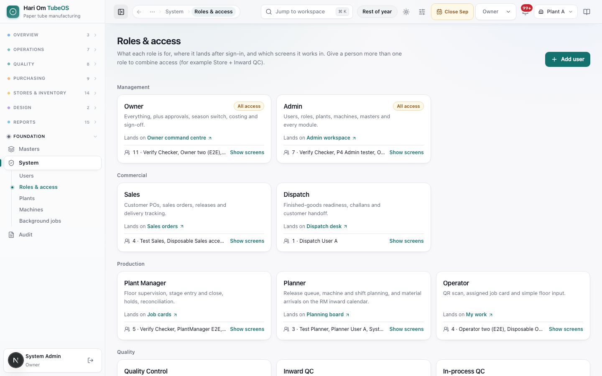
*Figure: The Roles & access page with an **Add user** button. Role cards are grouped as Management (Owner, Admin, both "All access"), Commercial (Sales, Dispatch), Production (Plant Manager, Planner, Operator) and Quality (Quality Control, Inward QC, In-process QC). Each card shows what the role is for, "Lands on" a page, the number and names of people with it, and **Show screens**.*

The roles and where they land:

| Role | What it is for | Lands on |
|---|---|---|
| Owner | Everything, plus approvals, season switch, costing and sign-off | Owner command centre |
| Admin | Users, roles, plants, machines, masters and every module | Admin workspace |
| Sales | Customer POs, sales orders, releases and delivery tracking | Sales orders |
| Dispatch | Finished-goods readiness, challans and customer handoff | Dispatch desk |
| Plant Manager | Floor supervision, stage entry and close, holds, reconciliation | Job cards |
| Planner | Release queue, machine and shift planning, RM inward calendar | Planning board |
| Operator | QR scan, assigned job card and simple floor input | My work |

The Quality group (Quality Control, Inward QC, In-process QC) and the Stores group (Store, GRN, RM issue, Watchman (gate)) follow the same layout further down. **Watchman (gate)** is for the gate desk only (visitors in and out, photos of bills coming in and of goods going out) and lands on the **Gate desk**. Below the cards, the **Screen access matrix** shows which screens each role opens (**Show all roles** expands it), and **Giving someone extra access** explains that roles add up.

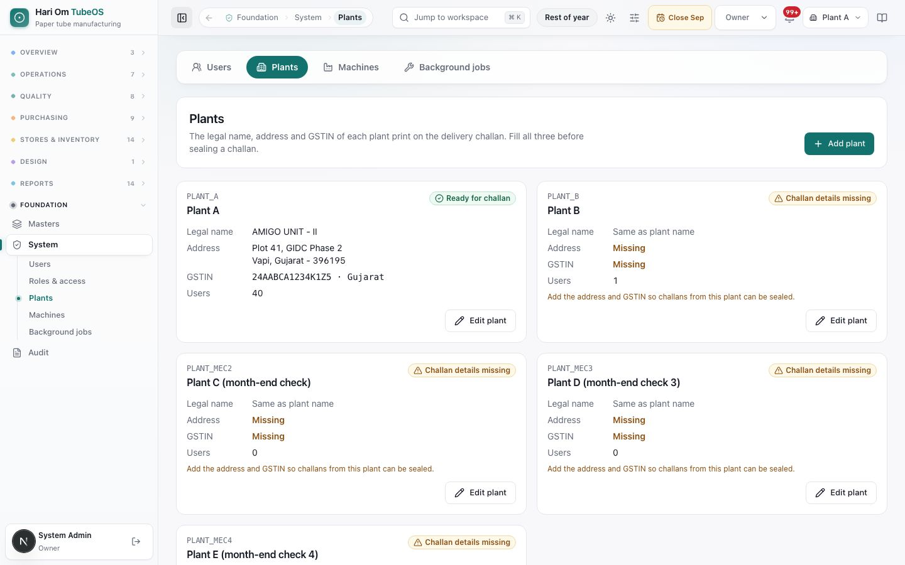
*Figure: The Plants page with an **Add plant** button. Each plant card shows its code and name, Legal name, Address, GSTIN with state, the number of users, and a chip: "Ready for challan" (Plant A: AMIGO UNIT - II, Plot 41, GIDC Phase 2, Vapi, Gujarat - 396195, GSTIN 24AABCA1234K1Z5 · Gujarat, 40 users) or "Challan details missing" with "Add the address and GSTIN so challans from this plant can be sealed." Each card has **Edit plant**.*

The plant form has **Plant code** and **Plant name** (both required), **Legal name (prints on the challan)**, **Address**, **GSTIN** and **Label heading (prints on reel and coil labels)**: "The first line of every reel and coil label, e.g. AMIGO INDUSTRIES UNIT II. Blank prints <the legal name in capitals>." The same heading is the top line of finished-goods box labels. Inside the edit dialog, **Disable this plant…** switches a plant off after a "Yes, disable" confirmation. The page note reads: "The legal name, address and GSTIN of each plant print on the delivery challan. Fill all three before sealing a challan. The label heading and the AIT reel numbers are for reel and coil labels."

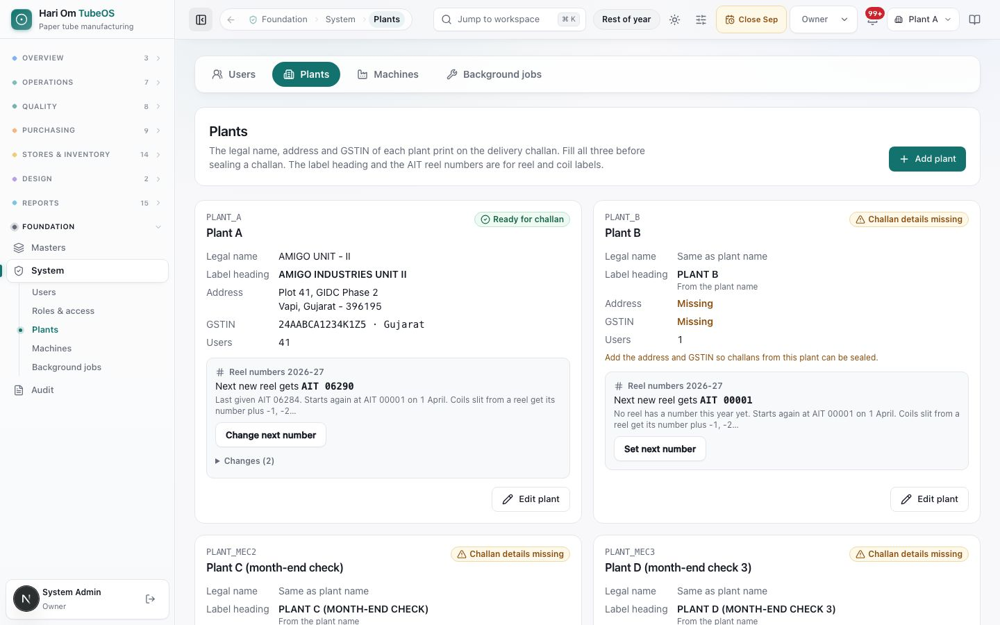
*Figure: A plant card on the Plants page with its legal name, address, GSTIN, the Label heading line (AMIGO INDUSTRIES UNIT II), and a grey box "Reel numbers 2026-27": "Next new reel gets AIT 06280", "Last given AIT 06279. Starts again at AIT 00001 on 1 April. Coils slit from a reel get its number plus -1, -2…", with a Change next number button for the Owner or Admin.*

What you see on each plant card:
1. **Label heading**: what prints as the first line of reel, coil and box labels.
2. **Reel numbers <year>** (for example 2026-27): "Next new reel gets AIT 06280"; "Last given AIT 06279." (or "No reel has a number this year yet."); "Starts again at AIT 00001 on 1 April. Coils slit from a reel get its number plus -1, -2…".
3. **Set next number** / **Change next number** (Owner and Admin only): a small form with **Next number** and a reason (for example "Carry on from the plant's printed series"), **Save next number** and **Cancel**. Before the first reel of the year: "Set this once, before the first reel of this year is received in the system." After reels have numbers: "Reels already have numbers up to AIT 06279: the next number can only go up." Earlier changes are listed with who, when and why.

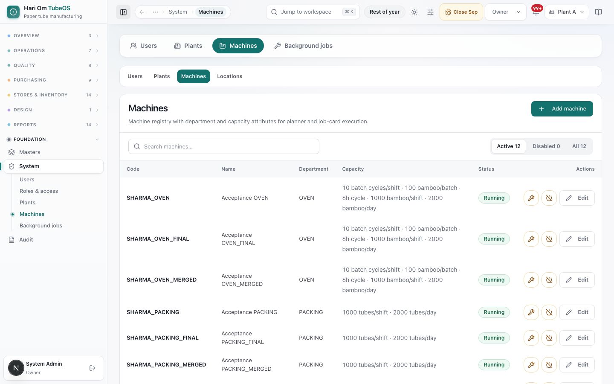
*Figure: The Machines page with **Add machine**, a search box and Active 12 / Disabled 0 / All 12 filters. Rows show Code, Name, Department and Capacity, for example "10 batch cycles/shift · 100 bamboo/batch · 6h cycle · 1000 bamboo/shift · 2000 bamboo/day" for an oven, or "1000 tubes/shift · 2000 tubes/day" for packing. Each row has Status (Running) and actions: a wrench (Send to maintenance), Disable machine and **Edit**.*

The machine form has **Machine Code** (W-01), **Machine Name** (Winder 1), **Process** (Slitting, Winder, Oven, Process, Packing), **Machine State** (Running / available, Maintenance, Down keep visible, Disabled hide from production) and the capacity. Capacity is entered **per shift**, and the daily figure is worked out for two shifts:
- Slitting: reels converted per shift.
- Winder: metres made per shift. The winder also has an **ID Range**, **OD Range** and **Length Range (mm)** (the capability window) that the planner checks before allowing a job on it.
- Oven: batch cycles per shift, **Bamboos per batch** and **Cycle hours per batch**. Shift capacity = cycles × bamboos per batch.
- Process: tubes completed per shift.
- Packing: packed tubes per shift.

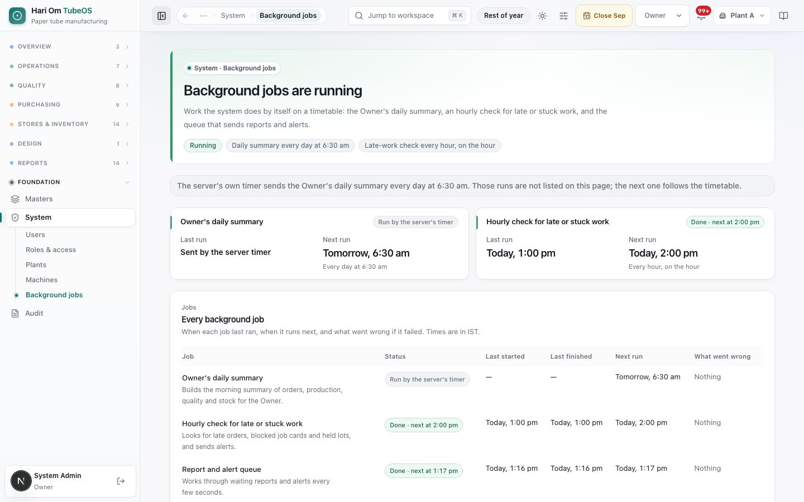
*Figure: The Background jobs page titled "Background jobs are running", with chips "Daily summary every day at 6:30 am" and "Late-work check every hour, on the hour". Two cards show the Owner's daily summary (run by the server's timer, next run tomorrow 6:30 am) and the Hourly check for late or stuck work (last run today 11:00 am, next 12:00 pm). An "Every background job" table lists Job, Status, Last started, Last finished, Next run and What went wrong.*

The three jobs:
1. **Owner's daily summary**: builds the morning summary of orders, production, quality and stock for the Owner, every day at 6:30 am. When the server's own timer sends it, the page shows "Run by the server's timer" and does not list those runs.
2. **Hourly check for late or stuck work**: looks for late orders, blocked job cards and held lots, and sends alerts, every hour on the hour.
3. **Report and alert queue**: works through waiting reports and alerts every few seconds.

Times are in IST. If the page says the job status could not be read, refresh in a minute; if it stays that way, the reports service needs a check by the developer.

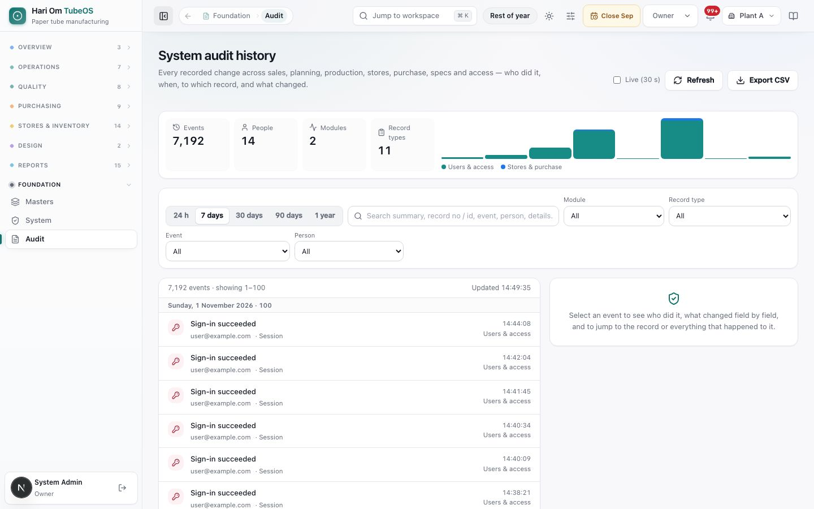
*Figure: The System audit history page with a **Live (30 s)** tick box, **Refresh** and **Export CSV**. Tiles: Events 7,002, People 13, Modules 2, Record types 10, with an activity-by-day bar chart. Filters: 24 h, 7 days, 30 days, 90 days, 1 year, a search box, and Module, Record type, Event and Person dropdowns. The list shows "7,002 events · showing 1–100", grouped by day, each row with an event (for example "Sign-in succeeded"), the person, record type, time and module. A side panel says "Select an event to see who did it, what changed field by field, and to jump to the record or everything that happened to it."*

What you see:
1. **Live (30 s)** refreshes every 30 seconds; **Refresh** reloads now; **Export CSV** downloads the filtered events.
2. **Tiles and Activity by day** for the chosen period.
3. **Filters**: Period, search (summary, record no / id, event, person, details), **Module** (Users & access, Stores & purchase, Sales, Production, Specs, Masters, Workspace), **Record type**, **Event**, **Person**. **Clear all** resets them.
4. **Event list** with **Newer** / **Older** paging.
5. **Event detail**: who and when, plant, source, the **What changed** table (Field, Before, After), **Open record**, **Full history of this record**, **all by them** (everything that person did) and **Copy JSON**.

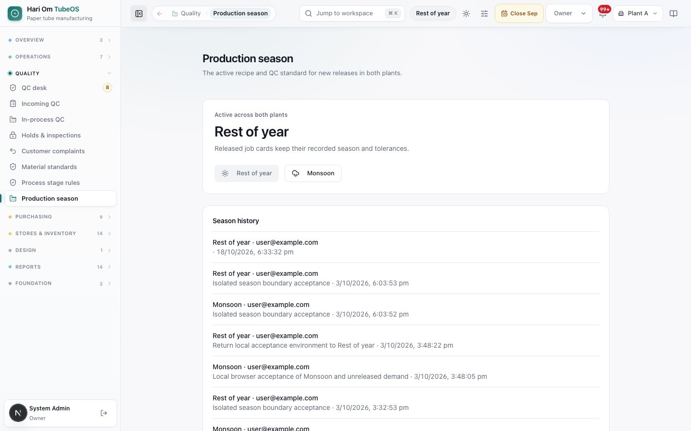
*Figure: The Production season page. "Active across both plants: Rest of year", with the note "Released job cards keep their recorded season and tolerances." Two buttons: Rest of year and Monsoon. Below is the Season history, each line showing the season, who switched it, the note and the time.*

The active season also shows as a chip in the top bar (for example "Rest of year") on every page; clicking it opens this page. Everyone can see the active season. Only the Owner sees the history and can switch.

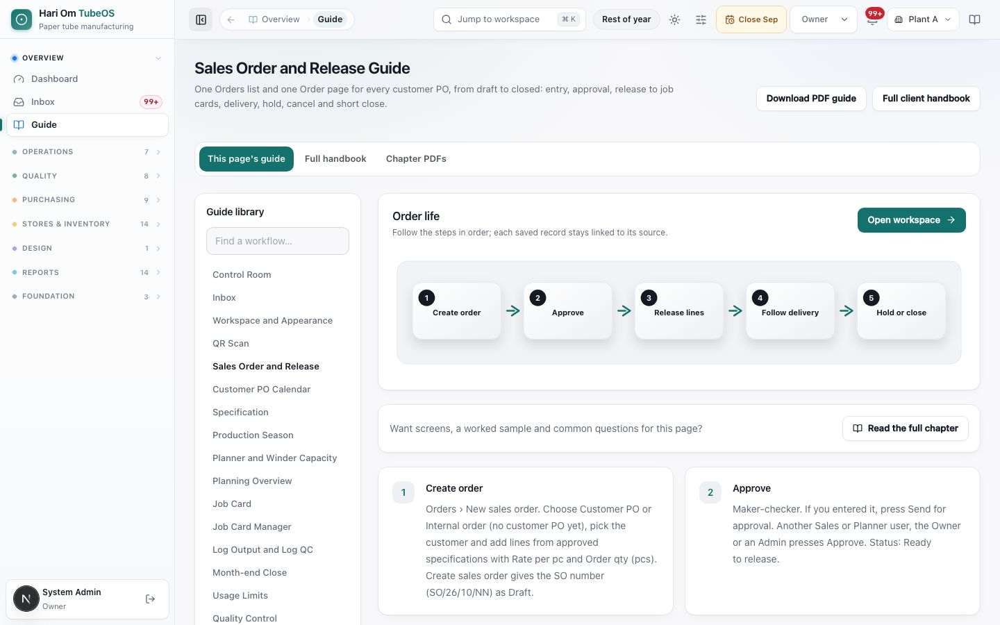
*Figure: The Guide page showing the Sales Order and Release guide, with three tabs above it: This page's guide, Full handbook and Chapter PDFs. Top right: **Download PDF guide** and **Full client handbook**. On the left, a **Guide library** with a "Find a workflow…" search and the list of guides (Control Room, Inbox, Workspace and Appearance, QR Scan, Sales Order and Release, and more). On the right, the **Order life** flow (Create order → Approve → Release lines → Follow delivery → Hold or close) with an **Open workspace** button, a **Read the full chapter** button, the steps explained, and **Field rules** and **Control checks** panels.*

Each guide shows its flow, the **Field rules**, **Control checks**, **Actions and outputs** and **Continue the workflow** links to the next guides. A **Read the full chapter** button opens the matching handbook chapter. The book icon in the top bar opens the guide for the page you are on. Three tabs sit above the guide: **This page's guide**, **Full handbook** (the whole handbook inside TubeOS, searchable, with **Open full screen**) and **Chapter PDFs** (one PDF per chapter, the whole handbook, and quick references such as the glossary). **Download PDF guide** downloads the whole handbook as a PDF; **Full client handbook** opens it as a web page. The handbook web page also opens from the sign-in screen, so people who cannot sign in yet can read it.

## Step by step

### How to create a user
Owner or Admin.
1. Open **System** > **Users** and click **Add New User**.
2. Fill **Full name**, **Email / login username** and a **Password** of at least 12 characters, with a lowercase letter, an uppercase letter, a number and a symbol.
3. Tick one or more **Assigned roles**. Use **See what each role can do** if unsure. For a desk person who does two jobs, tick both (for example Store + Inward QC).
4. Choose the **Primary plant** and tick the **Allowed plants**. Tick **Allow all plants** only for an Owner or Admin.
5. Click **Create user**. Give the person their login and password; they land on their role's page.

### How to change a user's roles, plants or password
1. On **Users**, click the person's "Name · Edit".
2. Change the roles (saving replaces their roles with your selection) and plants, or type a new password in **Reset password**.
3. Click **Save changes**. The person is signed out and signs in again with the new access.

### How to deactivate a user
1. Open the user and untick **Account active**. Save.
2. The person can no longer sign in, and their sessions end. Their history stays. You cannot deactivate yourself, and you cannot deactivate the last active Owner or Admin.

### How to add or edit a plant
1. Open **System** > **Plants** and click **Add plant** (or **Edit plant**).
2. Fill **Plant code** and **Plant name**, then **Legal name**, **Address** and **GSTIN**. The card turns **Ready for challan** when all three are filled.
3. Type the **Label heading** exactly as the plant's labels print it (for example AMIGO INDUSTRIES UNIT II), or leave it blank to print the legal name in capitals.
4. Save. To stop using a plant, open **Edit plant** > **Disable this plant…** > **Yes, disable**.

### How to set the next AIT reel number (Owner or Admin)
Do this once per plant, before the first reel of the year is received in the system, so the system carries on from the plant's own printed series.
1. Open **System** > **Plants**. On the plant card, find **Reel numbers 2026-27**.
2. Click **Set next number** (or **Change next number**).
3. Type the **Next number**, for example 6280 when the last label printed by hand was AIT 06279. Pick a **Reel serial number set** reason code (an OTHER code needs a note of at least 5 characters).
4. Click **Save next number**. The card now says "Next new reel gets AIT 06280". The next reel received (GRN, receipt without PO or opening stock) gets it.
5. Later, the number can only be raised above the highest given, never lowered, so no number is used twice in a year. On 1 April the series starts again at AIT 00001 by itself.

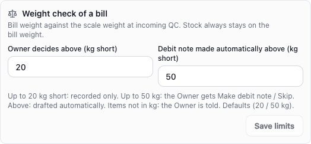
*Figure: The **Weight check of a bill** box on a plant card: "Bill weight against the scale weight at incoming QC. Stock always stays on the bill weight." Two fields: **Owner decides above (kg short)** 20 and **Debit note made automatically above (kg short)** 50, with the note that between them the Owner gets Make debit note / Skip, above it a draft is made automatically, and for items not in kg the Owner is told.*

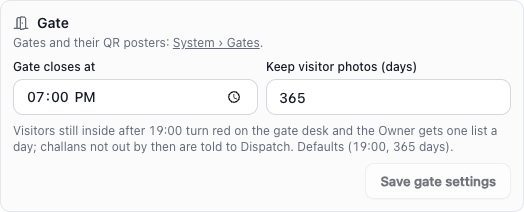
*Figure: The **Gate** box on a plant card: a link to System › Gates, **Gate closes at** 19:00 and **Keep visitor photos (days)** 365, with the note "Visitors still inside after 19:00 turn red on the gate desk and the Owner gets one list a day; challans not out by then are told to Dispatch." and **Save gate settings** (Owner only).*

### How to change the weight limits of a plant (Owner)
1. Open **System** > **Plants**, find the plant card and its **Weight check of a bill** box.
2. Type **Owner decides above (kg short)** (default 20) and **Debit note made automatically above (kg short)** (default 50). The second must be at least the first; neither can be below zero.
3. Save. New bills use the new limits; a bill already weighed keeps the limits it was checked with (shown on its weight case).

### How to set the gate close time and visitor photo days (Owner)
1. On the plant card, in the **Gate** box, set **Gate closes at** (for example 19:00) and **Keep visitor photos (days)** (30 to 3,650).
2. Click **Save gate settings**. Other roles see the values but "Only the Owner changes these."
3. Gates themselves (code, name, In / Out / Both, QR poster, New QR) are set up in **System › Gates**; see the Gate desk chapter.

### How to create a Watchman login
1. **System** > **Users** > **Add New User**: name, login, password, role **Watchman (gate)** only, and the plant of that gate.
2. The person signs in on the gate phone and lands on the **Gate desk**. Any other page sends them back to it.
3. Give the watchman no other role: a login with Watchman plus another role is not gate-only any more.

### How to add or edit a machine
1. Open **System** > **Machines** and click **Add machine** (or **Edit**).
2. Fill **Machine Code**, **Machine Name** and **Process**, and choose the **Machine State**.
3. Enter the capacity per shift. For an oven, also enter bamboos per batch and cycle hours. For a winder, enter the ID, OD and length ranges it can make.
4. Save. The planner uses the capacity to show the machine load. Use the wrench to send a machine to maintenance, and the disable button to hide it from production; a disabled machine can be restored.

### How to check background jobs
1. Open **System** > **Background jobs**.
2. Read the **Status** and **What went wrong** of each job. "Nothing" means the last run worked.
3. If the hourly check failed, the next run retries on the hour.

### How to find who changed a record
Owner or Admin.
1. Open **Audit**. Choose the period (for example **30 days**).
2. Type the record number in search (for example SO/26/10/412 or 26/10/315), or pick the **Module** and **Record type**.
3. Click an event to see **What changed** field by field. Click **Full history of this record** for every change to it, or **all by them** for everything that person did.
4. Click **Export CSV** to keep a copy.

### How to switch the production season (Owner)
1. Open **Production season** (or click the season chip in the top bar).
2. Click the other season (**Monsoon** or **Rest of year**). The preview opens: "Switch to Monsoon", the number of specifications ready and the number that require attention, how many released cards keep their frozen contracts, and the list of blocked specs with their reasons (for example "Approved season recipe missing" or "QC rules not published").
3. If any specs are blocked, tick "I understand the listed specifications cannot release until their seasonal setup is ready."
4. Type the **Reason for switching season** and click **Confirm global switch**. The switch is recorded in **Season history**.
5. Click **Cancel** to close the preview without switching.

### How to use the guide
1. Click **Guide** in the sidebar to open the **Full handbook** tab, or click the book icon in the top bar to open **This page's guide**.
2. In the handbook, pick a chapter on the left or type a word in the search box. In a page guide, pick a workflow from the **Guide library** or search with **Find a workflow…**.
3. Click **Read the full chapter** for screens, a sample and common questions, **Open workspace** to go to that page, or the **Chapter PDFs** tab to download a copy.

## Rules the system enforces
- **System and Audit pages are for Owner and Admin** (BLOCKS others with "This page is not open to your role").
- **Login usernames are unique**, including inactive accounts ("Username is already registered, including inactive accounts") (BLOCKS).
- **Password**: at least 12 characters, at most 72 bytes, with a lowercase letter, an uppercase letter, a number and a symbol (BLOCKS).
- **All-plant access needs an Owner or Admin role** ("All-plant access requires an Owner or Admin role") (BLOCKS). Removing Owner/Admin from a user removes all-plant access (automatic).
- **You cannot disable your own account**, and **at least one active Owner or Admin must remain** ("Keep at least one active Owner or Admin") (BLOCKS).
- **Changing roles, plants, activation or password signs the user out** (automatic). Each change is kept in the user's history with a before and after.
- **Deactivating a user keeps their history** and ends their sessions; they cannot sign in (automatic).
- **Sign-in is limited after 5 failed attempts within 15 minutes** (BLOCKS for a while).
- **Plants**: the code must be unique ("Plant code already exists") and the name is required. The GSTIN must be 15 characters with a valid state code (BLOCKS). "ALL" is a reporting scope, not a plant. The page asks for legal name, address and GSTIN before sealing a challan (WARNS on the card). A blank label heading prints the legal name, else the plant name, in capitals (AUTOMATIC).
- **AIT reel serial**: "AIT" + a space + 5 digits, one series per plant and financial year, restarting at 00001 on 1 April (AUTOMATIC). Only the Owner or Admin sets the next number; it must be 1 to 99999 and needs a reason ("Say why the reel number is being set (at least 3 characters)"). Once a reel of the year has a number, the next number can only be raised ("AIT 06279 is already on a reel this year. The next number can only be raised above 06279, never lowered.") (BLOCKS). Every change is kept with who, when and why (AUTOMATIC). Coils carry the parent serial plus -1, -2; old AT numbers stay valid.
- **Machines**: capacity is per shift and the daily figure is calculated for two shifts (automatic). Where capacity and load units differ, reports say "Not comparable" (WARNS).
- **Production season**: only an Owner with all-plant access can preview, switch or read the history (BLOCKS). A reason is required ("Season switch note is required"). If the specs changed after you opened the preview, the switch is refused ("Season preview changed; review it again"). If specs are blocked, the switch needs the acknowledgement (BLOCKS). After the switch, new releases using a blocked spec are refused until its seasonal recipe and QC setup are ready. Released cards keep their season (automatic).
- **Audit** records sign-ins, changes and approvals across modules; it is read-only.
- **Weight limits**: only the Owner changes them; the auto limit cannot be below the Owner limit ("The auto debit-note limit cannot be below the Owner-decides limit") (BLOCKS).
- **Gate settings**: only the Owner changes the close time and photo days; photos are kept 30 to 3,650 days (BLOCKS). Gates and QR posters: Owner and Admin (BLOCKS others).
- **Watchman-only login**: opens only /gate; the server refuses every other page for it (BLOCKS).

## Sample
**New store keeper.** The Admin adds Ramesh Patel: login ramesh.store@hariom.com, a 14-character password with upper and lower case letters, a number and a symbol, roles **Store** and **Inward QC**, primary plant Plant A, allowed plants Plant A. Ramesh signs in and lands on his Store work page. He can raise stock corrections and inspect incoming lots, but he cannot see System or approve counts.

**Who changed the access?** Next week Ramesh suddenly cannot open Incoming QC. On **Audit** the Owner sets **7 days**, picks Module **Users & access** and searches "ramesh". The user-updated event shows under **What changed** that the Inward QC role was removed, by whom and when. The Owner opens the user, ticks Inward QC again and saves; Ramesh signs in again with the role back.

**Monsoon switch.** On 1 Jun the Owner clicks Monsoon. The preview shows 41 specifications ready, 3 requiring attention ("Approved season recipe missing") and 18 released cards keeping their contracts. The Owner ticks the acknowledgement, types "Monsoon from 1 June as per QC" and confirms. New releases now use the Monsoon recipes and QC bands; the 3 blocked specs cannot be released until QC and Design finish their monsoon setup.

## Common questions
**Q: I changed a person's role but they still see the old screens.** A: Saving signs them out. Ask them to sign in again.

**Q: Where do I change the 20 kg and 50 kg weight limits?** A: System › Plants, on the plant card, **Weight check of a bill**. Owner only.

**Q: The watchman can see other pages.** A: Check his login has only the **Watchman (gate)** role. With any other role added, he is no longer gate-only.

**Q: Can a user have two roles?** A: Yes. Tick both. Access adds up, and they can switch role from the top bar.

**Q: Why can't I tick "Allow all plants" for a Plant Manager?** A: All-plant access is only for Owner and Admin. Tick each plant they need under **Allowed plants** instead.

**Q: A person left the company. Do I delete them?** A: Untick **Account active**. They cannot sign in, and their history stays in the audit trail.

**Q: Why does the Users list show fewer people than I expect?** A: It shows users of the plant chosen in the top plant switcher. Switch to all plants to see everyone.

**Q: Why did the season switch refuse with "Season preview changed"?** A: Someone changed a spec or QC rule after you opened the preview. Click the season again to get a fresh preview.

**Q: Does switching the season change job cards already on the floor?** A: No. Released job cards keep the season and tolerances they were released with. Only new releases use the new season.

**Q: The daily summary did not arrive.** A: Check **Background jobs**. If it says "Run by the server's timer", the server sends it at 6:30 am. If an error shows under **What went wrong**, tell the Admin.

**Q: Where is the latest guide?** A: The Guide page in the app (Full handbook tab) and the same handbook on the sign-in screen link. The book icon on any page opens the guide for that page.

**Q: Our hand-printed labels reached AIT 06279. How do we carry on?** A: The Owner or Admin opens System > Plants, clicks **Set next number** on the plant card, types 6280 with a reason and saves. The next reel received gets AIT 06280.

**Q: Can we start the AIT series again mid-year?** A: No. After reels of the year have numbers, the next number can only go up. The series restarts at AIT 00001 by itself on 1 April.

## Related chapters
- Dashboard and Inbox
- Masters
- Planner (machine load and capacity)
- Dispatch and delivery challan (plant and customer details)
- Specifications and seasonal recipes
- Process stage rules and Material standards
- Reports
